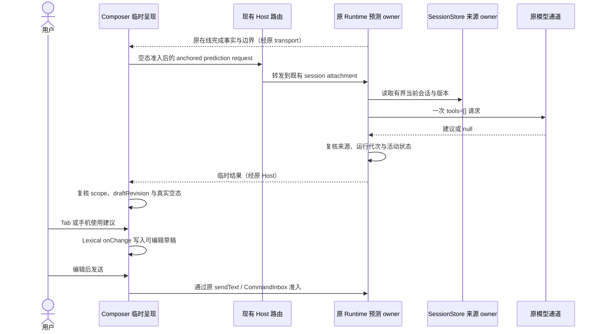

# Agent 主动记忆、历史召回与输入框预测：复盘与完善方案

日期：2026-10-18。基线：L-GO，d37e5854，应用版本 3.19.4。

状态：已按阶段实施，并完成 Windows 实际 Electron 链路验证。第 1—15 节保留调查与设计依据，第 16—17 节记录首次实现，第 18 节记录隔离资料目录的开发版桌面验证，第 19 节记录用户实际生产安装版与真实模型复验；实际结果以第 19 节为准。范围是 zcode-full 的 Agent 上下文与输入闭环，包括 Composer、准入、Runtime、SessionStore、工作区记忆、后台学习、历史召回及桌面/手机恢复；不代表全仓所有业务模块都已审计。

## 1. 复盘后的核心决定

1. 主动记忆沿用现有成功轮后提取、独立核验、受控提交；用户无需每次说“记住”，也不增加逐条审批弹窗。提升重点是证据质量、旧记忆选择、更新完整性和持续运行能力。
2. 先改善相关内容的选择与交付，再按质量证据决定历史索引升级。现有延迟基准通过不代表长历史覆盖已通过，也不直接构成上 FTS/embedding 的理由。
3. 输入框预测独立于记忆和历史召回，首先只读当前聊天；由用户接受成草稿，再由用户发送。未接受建议不能进入长期记忆、历史检索或 canonical transcript。
4. 三者复用原有状态所有者、模型通道、权限、trace 和 transport，不创建新的 Agent、Host、任务队列或统一“知识数据库”。
5. Metis 的信号识别、经验更新保护可以借鉴；其全轮成败归因、自动退役、全局画像和可执行适配层不作为本轮迁移目标。

## 2. 证据等级与已执行验证

| 等级             | 本轮证据                                                      | 能证明什么                                                  |
| ---------------- | ------------------------------------------------------------- | ----------------------------------------------------------- |
| 当前源码         | 本文各节列出的当前文件、接口与调用链                          | 已实现行为、责任边界和确定的覆盖限制                        |
| 已执行回归       | 两批定向测试，37 + 25，共 62 项通过                           | 当前测试涉及的规则在本机通过                                |
| 合成探针         | 5620 字符记忆，命中事实位于后部；注入前 4000 字符不含命中事实 | 当前 formatter 存在选中文档却未交付命中段落的情况           |
| 官方文档         | OpenAI Composer Predictions 页面，2026-10-18 阅读             | 第 5 节列出的产品规则                                       |
| 本地应用静态线索 | 只读检查已安装 Codex 客户端产物                               | 存在接受草稿的提示与接受/提交区分；不能证明服务内部推理机制 |
| 待验证           | 本文新增排序、索引、学习信号和预测方案                        | 不声称已提升真实效果或节省费用                              |

工作区基线检查通过。根目录 typecheck 与 lint 均通过。实际 Node 为 24.14.1，而 mise.toml 要求 24.21.0；本机没有可调用的 mise。上述结果不是规定工具链下的跨平台交付证明。

## 3. 当前闭环与唯一所有者

    用户输入 / 接受后编辑的草稿
      → Lexical onChange → 当前 workspace/session 草稿
      → 用户发送 → 现有 sendText / CommandInbox admission
      → AgentRuntime 固定输入、执行配置与真实用户 query
      → 工作区记忆召回 + 可选历史召回 → 本轮临时 overlay
      → provider / tools / 受控写入 / 完成或错误事件
      → SessionStore 与 ProductProjection → 原 conversation transport
      → 合格成功轮后的 extraction scheduler
      → 冻结证据 → 生成候选 → 独立核验 → ProjectMemory CAS 提交

| 数据           | 当前权威所有者                                                       | 派生内容 / 不应取得的职责                        | 当前证据                                                                                |
| -------------- | -------------------------------------------------------------------- | ------------------------------------------------ | --------------------------------------------------------------------------------------- |
| 输入草稿       | Renderer 的 V4 Composer，按 workspace identity 和 session scope 保存 | 不等于已接受输入；预测不能直接写草稿             | packages/ui/src/v4/composer/composerDraftStore.ts；ConversationComposer.tsx             |
| 已接受输入     | CLI CommandInbox / runtime admission                                 | Renderer optimistic overlay 不成为第二队列       | apps/lcode-cli/packages/bootstrap/src/lcode-protocol-v4/command-inbox.ts                |
| 会话与有效分支 | SessionStorePort                                                     | 检索索引、摘要、投影不能取代原始事实             | core/src/session-context/active-session-messages.ts；adapters 的 transcript-snapshot.ts |
| 当前记忆正文   | 原工作区 Markdown，通过 ProjectMemory port 受控写入                  | journal、前像、ranking ledger 不成为第二正文库   | contracts/src/interfaces/project-memory.port.ts；adapters/src/fs/project-memory.ts      |
| 记忆召回索引   | 当前 Runtime 的 ProjectMemoryRecallIndex                             | 只是派生索引，每次核对当前内容；不可沿用失效事实 | core/src/memory/recall/project-memory-recall.ts                                         |
| 召回注入       | 当前 TurnRequestState                                                | 不持久化进历史、compact 或下一轮                 | core/src/runtime/methods/turn-loop-state.ts；turn-session-history-recall.ts             |
| 自动提取       | 原 extraction scheduler，单 Runtime 串行                             | 不负责用户任务准入，不扩展为平台调度器           | core/src/memory/extraction.ts；runtime/helpers/project-memory-extraction.ts             |
| 完成与核验     | 原运行事件、Goal 核验事件和各任务 owner                              | 普通 completed 不等于验收通过                    | runtime/methods/turn-complete.ts；memory-effect-observation.ts                          |
| 应用设置       | SettingService / AppSettings，Host 投影到运行配置                    | 不由 UI 草稿或模型响应修改事实                   | shared/src/validationAppSettings.ts；原 runtime-preferences 契约                        |

表中省略前缀的 CLI 路径均在 apps/lcode-cli/packages/ 下；应用路径在 packages/ 下。

## 4. 系统复盘发现

| 编号 | 当前事实与影响                                                                                     | 结论等级                                                              | 改进位置                                                                                            |
| ---- | -------------------------------------------------------------------------------------------------- | --------------------------------------------------------------------- | --------------------------------------------------------------------------------------------------- |
| R01  | 前台按正文 BM25 排名，后台复盘按文件名匹配选最多两条旧记忆；候选选择不一致，可能漏掉应修订条目     | 选择规则已确认；实际重复率待测                                        | review-memory-evidence.ts:88；recall/ranking.ts                                                     |
| R02  | 记忆按整篇排名，注入却从开头截断；后部命中可不在给模型的片段中                                     | 合成探针已复现                                                        | project-memory-recall.ts:248                                                                        |
| R03  | 后台会话证据通过共享的可见文字投影生成；工具 parts 不进入这个文字投影                              | 已确认；独立模型核验不等于独立执行证据核验                            | review-session-evidence.ts；session-history-search.ts                                               |
| R04  | 当前准入有真实文字阈值、直接成功写入去重、复盘污染隔离，但缺少明确的学习信号分类                   | 已确认；不能据此称没有主动记忆                                        | extraction.ts                                                                                       |
| R05  | cursor 在 Runtime 内存，pending 保留最新快照；自动 review 只复盘最后真实用户轮                     | 已确认；不承诺每个中间轮都被学习                                      | extraction.ts:145；review-profile.ts；review-session-evidence.ts                                    |
| R06  | 没有模型请求前的持久“该证据已处理”判定；review draft fingerprint 不等于跨重启的学习消费水位        | 已确认；不能推论每次启动都会重学全历史                                | automatic-review.ts；project-memory.ts:280                                                          |
| R07  | journal/review 各有 100 条上限，前像 20 MiB；容量检查在模型请求前，满额保留旧记录并停止新维护      | 已确认；持续学习生命周期需要单独设计                                  | project-memory.port.ts；project-memory-store.ts:318                                                 |
| R08  | 自动历史召回只查最近 8 个候选，生产存储读有界前缀，按本次文字词法排序                              | 已确认；旧会话、长会话后部、模糊续问有覆盖限制                        | session-history-auto-recall.ts；session-history-search-service.ts                                   |
| R09  | 现有离线质量 fixture 只有 6 个预构造候选；延迟 benchmark 为固定的小规模语料                        | 已确认；不能当作大历史/长会话质量证明                                 | session-history-recall-evaluation.test.ts；docs/benchmarks/session-history-recall-2026-09-27.md     |
| R10  | 现有主动任务推荐来自模式推荐池或 Client Scenes，展示于新任务草稿页                                 | 已确认；不是完成后的上下文灰字预测                                    | featureSuggestedPrompts.ts；ConversationDraftSuggestedPromptsContainer.tsx；SessionPane.tsx:5527    |
| R11  | Composer 已有草稿 revision、延迟回填防覆盖、mention Tab/Escape 优先级、IME 防误发与手机规则        | 已确认；新增预测应复用这些边界                                        | composerDraftRevision.ts；LexicalChatInput.tsx；MentionPlugin.tsx                                   |
| R12  | TurnComplete 只代表该轮收口，仍需看 queue、Goal、pending interaction、workflow/subagent 等原有事实 | 已确认；不能仅凭最后一条 assistant 或 UI canStop=false 生成“下一任务” | product-projection-turns.ts；shared/src/lcode-protocol-v4/snapshot.ts                               |
| R13  | memory-design-references.md 仍描述旧输出预算 1536/768，当前实现已是 4096/2048                      | 已确认文档漂移，本轮同步修正                                          | review-profile.ts；workspace-memory-extraction-reliability.md                                       |
| R14  | 当前系统 Memory 提示仍提到删除错误记忆，自动复盘/工具治理却没有同等删除能力                        | 已确认提示与能力契约不一致；实施前统一规则和回归                      | core/src/context/sections/memory.ts；extraction.ts；workspace-memory-intelligence-implementation.md |

远端自动提取当前仍显式跳过。子代理 persistent memory 有独立 user/project/local 根，不应与主工作区记忆自动合并。效果观察和排序实验默认关闭；其保守归因不是需要删除的缺陷。

## 5. Codex 灰字建议的已知机制与未知部分

官方已确认：回答结束后利用当前聊天预测下一条输入；Tab 接受为可编辑草稿，接受不发送；预测自身不检索记忆或连接应用。来源：[Composer Predictions](https://learn.chatgpt.com/docs/features/composer-predictions)。

服务内部模型、提示词、采样、调度与缓存策略未由该页面披露；本轮本地客户端静态检查也未建立完整服务调用链。因此下文是适合 zcode-full 的设计，不声称复刻 Codex 内部实现。

输入框预测、跨会话自动召回、长期主动记忆分别提供下一步输入便利、历史发现、长期事实积累。它们可以通过更好的当前回答间接受益，但不能互相代开开关或互相制造“用户事实”。

## 6. 对上一版方案的具体修正

- “统一候选”指共享相关性规则与候选引用，不是后台复制前台整个上下文，也不是再扫一遍无预算的全库。
- 先做命中段落交付和旧记忆选择，历史索引是否升级由新增覆盖测试决定，不预设向量方案。
- 学习信号先用来确定重点和优先级，不用关键词门槛静默取消现有主动提取；普通真实输入中的新持久事实仍可被学习。
- 持久消费记录只描述已处理证据，不承载任务队列、不保存第二份记忆；失败、容量不足和取消不能伪装成消费成功。
- “成功修复经验”需要结构化执行依据。第二个同模型新上下文可以复核语义，但不能凭 assistant 说“测试通过”生成执行证明。
- 增加容量生命周期设计，不承诺现在已经有长期无限运行、自动归档或跨 Host 后台整理。
- 灰字建议采用独立无工具请求，不要求主回答追加固定的 next_action 字段，不从最后一句提议机械截取，不生成后直接执行。

## 7. 主动记忆的目标行为

### 7.1 记什么、何时记

开启工作区记忆并允许自动提取后，沿用成功轮后后台维护。强信号包括明确用户纠正、非临时的显式偏好、已采用且有依据的决策理由、具有证据的错误恢复。弱信号用于提高候选质量，不能独立决定真伪。

- 已在代码、Git、AGENTS 或 spec 中明确记录的内容只保留必要来源引用与非显然的决策原因，不重复维护代码镜像。
- 保存适用范围、原因、例外和验证方式；“本次请这样做”不能推断成所有项目的永久偏好。
- 用户没有说“记住”也可保存有来源支持的持久事实；没有有价值变化时允许空结果。
- 失败尝试、未采用提案、临时任务进度、秘密、推测的人格画像不自动固化。
- 主工作区学习不自动抓取子代理私有记忆、不将不同 worktree 或远程同路径的内容合并。
- 新的强信号仍经过独立核验与统一提交；不增加用户逐条确认，也不绕过现有明确反馈工具的单次用户应答要求。

### 7.2 候选选择和更新

先从当前 Runtime 现有已核验索引取得有界候选引用，再为本轮完成证据排序；可复用 tokenizer/BM25 规则及 description，不让文件名成为唯一依据。候选引用只是 hint；审核前仍完整读取目标并冻结原始 hash。

自动档暂保留最多两条旧记忆、合计 4000 字符；没有完整 before 的文件不能被改写。新筛选不能通过“先读完所有文件再切两条”偷增后台 IO 预算；无可复用快照时的读取上限须写进对应 spec，并用端口调用计数验证。

对相同事实优先更新原条目。逐字无变化直接跳过；近似重复、矛盾、例外变化交独立审核比较完整 before。保护有效限定条件、否定词、关键参数和来源；合法的新证据可以修订旧命令，不能把“任何参数不能删”变成僵化规则。首批不增加自动删除/跨文件原子合并。

### 7.3 可核验的执行证据

在既有 SessionStore/执行事件的公开契约内新增有界 evidence projection，至少区分用户明确陈述、助手陈述、工具状态与 Goal 核验。

- 工具依据只含工具名、call/message/turn 引用、结构化结果、退出码或验收结果、关联输入指纹；不复制完整 stdout、环境或凭据。
- 工具失败本身不证明修复原因；失败与后续成功必须有可靠关联，否则保留“待验证”或不入库。
- 生成者和审核者使用同一冻结来源，审核者通过可信端口重读并检查分支、边界、scope 和 revision。
- evidence projection 缺能力时仍可学习明确用户事实；不得为缺失工具依据捏造成功经验。
- 不在核心直接读 Repo/数据库，不以 UI 日志或 renderer 行文本冒充执行事实。

### 7.4 持久消费记录与 pending

拟议的消费记录由 ProjectMemory adapter 在原控制目录和原 root 锁下维护。标识至少包含 workspace key、sessionId、有效分支/来源版本、throughMessageId、处理结果、处理器版本。

推进规则：应用成功、独立审核拒绝或确定无候选，可以标记该冻结证据已处理；取消、来源变化、部分冲突、存储故障、容量不足不能按成功整体跳过。部分成功必须记录逐项事实，不能吞掉未处理证据。跨存储不宣称原子事务，崩溃恢复以已提交 journal 与源版本对账。

水位必须在模型请求前检查；不采用全局最新时间、文件 mtime 或仅 sessionId 判断。软件升级、存储位置切换、删除记忆均不能自动触发付费全历史重学。控制目录迁移与现有“不复制 governance 状态”规则需要在实施 spec 中明确处理。

pending 继续由原 scheduler 管理。首批明确 latest-wins 的覆盖语义并增加回归；若要保证每个重要纠正都能处理，用有界证据边界集合或来源补处理能力扩展原 owner，不新建后台任务平台。历史补处理必须有明确预算和单独产品范围。

## 8. 工作区记忆召回的目标行为

1. 保留 BM25 正相关门槛、现有四种类型、到期处理、内容版本核验和原有保护排序规则。
2. 从选中文档提取包含命中事实的段落，连同标题、必要限定条件及来源引用。不能只围绕一个命中词截断从而遗漏“不适用”等相邻约束。
3. 结果区分整篇命中、实际片段交付和片段截断；可观察性只记数量/字符量/耗时，不记正文或命中词。
4. 保留单项 4000、总 attachment 12000 字符上限；首批不同时调阈值和换排序算法，避免无法归因。
5. 片段只用于本轮背景上下文。细节需要当前文件深读；不把片段当作获得写权限或长期指令。

## 9. 自动历史召回的目标行为

### 9.1 先增加覆盖基准

分别测候选发现、排序、片段交付和最终来源核对。新增 10/100/1000 会话语料、相关会话在最近 8 条以外、长会话尾部结论、大工具输出、中文/标识符/改写表达、无关同词、同路径不同 identity、归档删除、fork/rewind/compact 与旧索引失效场景。

指标至少包括来源 recall@3 / MRR、无关查询误召回、有效证据片段覆盖、跨 scope/废弃分支泄漏、首请求前耗时、读取行数/字节数及注入字符量。旧 fixture 的 precision 门槛继续保留，但不替代新覆盖指标。新增质量阈值必须由标注语料建立基线后冻结，不能先写一个收益百分比。

### 9.2 模糊续问与发现

“继续上次那个”只允许用当前会话已确认主题、显式会话/文件引用等可信当前线索补 query，保持小而有界；不能自动拼入最近若干其他项目、全部本地草稿或不相关用户历史。没有足够线索时允许无结果或由主 Agent澄清。

若评测证明候选或前缀读取是主瓶颈，再引入工作区内可重建的轮次/片段发现索引。索引由存储 adapter 维护，核心负责相关性和策略；绑定 session、有效分支、消息边界及 sourceVersion。命中后重读当前来源，删除/归档/rewind 必须使旧引用失效。

索引 v1 优先使用可追溯的可见原文片段和已有已核验摘要，不为每轮额外调用 LLM 生成全历史摘要；FTS 是可选词法实现，embedding 是独立的成本与模型决策。若涉及数据库变更，先完成维护者对 migration、回填、写入原子性及回滚的确认，本文不授权落 migration。

### 9.3 注入与设置

保持自动历史召回默认关闭、与 memory 独立、每个真实用户轮最多一次、失败 best effort。先维持 top3/3200 字符与原存储硬预算，不用无限扩大最近会话数量掩盖发现缺口。ReadSessionContext 仍负责后续细读，不能把预览当完整事实。

两类 recall 首批仍分别守原预算；后续如引入统一 token 分配，只新增纯选择策略，保持各自开关独立和所有者不变。不得把字符上限冒充实际 token、SQLite page IO 或堆内存上限。

## 10. 输入框预测：适合 zcode-full 的完整契约草案

### 10.1 设置、触发与静默

拟议新增 composerPredictionsEnabled，由原 AppSettings/SettingService 拥有，首版默认 false；与 proactiveSuggestionsEnabled、memoryEnabled、sessionRecallEnabled 独立。现有新任务推荐仍维持原语义。

仅当前可见的真实交互会话、合格在线成功轮完成后、编辑器为空且无附件/引用草稿时可请求。依据权威完成边界和活动状态，不能凭最后一条 assistant 文本推测完成。

队列非空、审批/提问待处理、Goal 继续或核验中、workflow/subagent 等仍会产出结果、正在重试或前景运行时静默。首版对未明确可区分的后台工作保守跳过，后续才能按原 owner 的明确事实放宽预览服务等资源型工作。异常结束不生成泛化的新任务；故障恢复建议属于原错误恢复能力。

新任务空白页、冷恢复、旧 completed 的 recovery frame、automation、OffPeak、子代理、侧聊、headless 不自动触发。手机是否展示由同一设置与目标能力控制，不另起 Agent。

### 10.2 请求路径与所有者

    在线完成事实 → 当前可见 Composer 的空态准入
      → UI hook → 原 ILCodeAgentService → 现有 Host 路由
      → 原 workspace/generateText 的严格 composerPrediction 分支 → 精确已存在 Runtime
      → 冻结当前会话证据 → 一次无工具辅助模型请求
      → scope / 来源 / 新输入 / 活动状态复核
      → 临时预测 → UI 灰字 → 用户接受 → Lexical 原草稿写入路径
      → 用户发送 → 原 CommandInbox

Runtime 是生成任务、冻结证据、取消和短期去重缓存的 owner。Host/Main 只承担原有鉴权、路由和请求生命周期；UI 通过 hooks 访问服务，不直接调用模型、Repo 或 window.lcode。

拟议的请求与接受时序：

生成期间的新输入会沿同一路由取消请求；失效结果不得进入呈现步骤。桌面沿原 continuous 链路消费在线完成，手机沿原 replayable 链路恢复；recovery 完成事实本身不启动新预测。

实施复盘后改为复用原 workspace/generateText 辅助请求的取消、鉴权、用量与 Host 路由，增加严格的 composerPrediction 分支，不另建 v4 生成接口。该分支必须精确命中 resident session，不能沿通用分支使用同工作区首个 Runtime 或创建冷 Runtime。预测会产生可计费模型调用，Runtime 完成边界许可在请求前去重；旧 CLI 拒绝新形状，UI 不重试。

请求锚点包含 workspace identity/path、sessionId、完成 turn/boundary、sourceVersion、运行 generation，以及客户端 requestId。源版本由 owner 产生并复核，不能接受客户端自报正文为历史事实。renderer 另保存 draftRevision、当前 scope 和连接 epoch 作为呈现条件。

### 10.3 证据、输出和成本

- v1 只用当前会话最新完成的可见用户/助手文字及可信状态摘要；通过既有有界窗口读取，不发送整个模型隐藏上下文。
- 不主动调用历史搜索、记忆扫描、连接应用、工具或 hooks；也不把本轮 recall overlay 偷偷持久化成新的会话摘要。已有当前回答可以间接携带相关背景。
- 一次请求只输出一个自然语言建议或 null，表达用户可能要说的话；无自然下一步时 null 合法。不能重复刚完成事项，也不把 Agent 应在原任务完成的工作转嫁给用户再点击。
- 初始拟议上限：窗口不超过现有 96 message rows / 384 part rows / 98304 persisted JSON 字节，最终输入至多 8000 字符且 3000 估算 tokens，输出总预算至多 512 tokens，建议正文至多 200 UTF-16 字符。还需扣除 system/schema 开销并受模型 context/公开输出能力约束；超限跳过，不能扩大预算或自动重试。
- 模型请求沿用原 provider 鉴权、公开 auxiliary options、trace、usage 与并发治理；不照搬指定模型名。推理耗尽输出、非法结构、length、空正文、失败或取消都不显示建议。
- 每完成边界最多一次模型尝试；同 Runtime 多窗口请求不能重复付费。重复请求读短期结果或返回 busy/skipped，不建立新等待队列。单请求取消不允许用定时器假装物理模型请求已结束。
- 新用户输入优先取消/淘汰预测；资源不可用则跳过，不能抢占前景准入。模型可能产生实际费用，不能把某产品的订阅策略解释成 zcode-full 免费额度。

### 10.4 状态机与陈旧结果处理

    idle → generating → available | empty | failed
                      → invalidated（新输入 / 换 scope / 分支改变 / 新一轮 / 关闭）
    available → accepted（只写草稿） | dismissed | invalidated
    accepted → 用户编辑 → 原 sendText，或保留 / 放弃草稿

本期不做输入一半后的逐字补全，只覆盖回答结束后的空输入框建议。

模型结果返回和用户接受的两个时点都必须核对：当前 workspace/session、完成边界/源版本、draftRevision、编辑器真实空态、无组合输入、连接与设置、没有更晚用户输入和待处理工作。任何一项变化均丢弃；编辑后又删空也不能让旧结果重新覆盖。

缓存只在原 Runtime 有界存在，包含 null/已尝试结果，进程或 session 关闭即丢弃。切分支、换模型/策略、删除会话、重建 Runtime 即失效；失效不等于自动再次付费。新轮次才形成新生成机会。重连不因回放同一完成事件重跑。

### 10.5 编辑器、键盘与手机

- 灰字是显示层，不能作为 Lexical text node、真实 placeholder 值或已持久化草稿正文；未接受时 Enter 不能发送它。
- 按 Tab 接受后通过现有 Lexical 写入与 onChange 链更新草稿、revision 和持久化，不直接改两份 store；接受与发送是不同事件。
- @/#/$/slash 面板优先处理已有 Tab/Escape。IME 组合输入、Shift+Tab、非输入框焦点和非合格选择态不拦截；没有预测时保留正常焦点导航。
- Escape 仅在没有更高优先级面板时关闭当前建议，同一完成边界不反复出现；接受可正常撤销。
- 手机提供明确“使用建议”触点，只填草稿，不能把点按同时解释为发送；不抢焦点弹键盘。兼容长文本、主题和国际化，遵守 DESIGN.md 的文本与颜色 token。
- 桌面 continuous 和手机 replayable 都读同一 owner；手机重连后的编辑草稿不被桌面预测覆盖。

### 10.6 防止自我强化

未接受建议不进入 MessageHistory、SessionStore 用户消息、MEMORY.md、topic、历史检索语料、prompt history 或草稿。预测模型请求不产生正常用户轮，不触发自动提取、标题、Stop hooks 或新的预测。

接受表示用户选择一条可编辑输入，不证明该建议中的外部事实成立，也不是给已有记忆正反馈。发送后按正常真实用户输入处理；若需要记录来源，增加独立 submission attribution，不能复用 inputSource/model-only/synthetic 标志，否则会被当前真实用户 recall 准入排除。

只记录 generated/displayed/accepted/dismissed/submitted/edited 的有界计数与稳定原因，不记录建议正文、用户改写全文或检索 query。接受率不能作为唯一质量目标；还要测重复任务、无依据建议、误发送、草稿损坏与额外成本。

## 11. 容量、撤销与长期运行

首批保留当前容量满后零模型请求的 fail-closed 规则，同时提供可查询的具体停止原因。持久消费去重可以减少无意义调用，但不能解决审计记录终有上限的问题。

后续单独定义已结算 review 的保留/摘要、导出、受控清理与撤销期限，始终保留活动正文、未决恢复记录和必要前像。清理审计元数据不等于归档记忆内容；两者分别设计。本文不授权静默删除旧记录、不简单扩大 100 条上限，也不承诺无限撤销。

## 12. 分阶段实施和回滚

| 阶段            | 交付与最小改动面                                                             | 必须先更新的规格                                                                           | 验证与回滚                                                                        |
| --------------- | ---------------------------------------------------------------------------- | ------------------------------------------------------------------------------------------ | --------------------------------------------------------------------------------- |
| P0 基线与可见性 | 新增质量语料、覆盖指标，修正文档漂移和 Memory 删除提示契约；明确容量健康状态 | memory-recall-topk-injection；workspace-memory-effect-observation；相关提示契约            | 旧测试保留；新评测不作为已实现能力；不改默认开关                                  |
| P1 记忆交付     | 命中段落提取；复盘共享候选相关性并完整冻结 before                            | memory-recall-topk-injection；workspace-memory-intelligence-implementation                 | 后部命中、限定条件、旧文件、预算、CAS、取消；保留前缀基线以便对照，发布可独立回退 |
| P2 主动学习质量 | 有界执行证据、学习信号、更新保护、持久消费与恢复                             | workspace-memory-extraction-reliability；project-memory port 与 adapter 契约；新增消费规格 | 不少记明确事实，不重复付费；中间纠正、跨重启、冲突、满额；失败仍可用旧读取路径    |
| P3 当前会话预测 | 独立设置、Runtime 无工具请求、严格锚点、灰字/接受交互                        | 新增 composer-predictions spec；workspace/generateText schema；设置与模型调用契约          | 单元/协议/桌面与手机 E2E；关闭停止新请求并撤销在途呈现，不改变记忆/历史设置       |
| P4 历史覆盖     | 依据新评测决定模糊 query 补充、窗口或派生发现索引                            | session-history-auto-recall；session-history-search；如需则单独 migration spec             | 旧/长/撤回历史基准；索引不可用恢复有界原查询；不开默认自动召回                    |
| P5 持续治理     | 审计容量生命周期、配对质量评测与按版本效果分析                               | workspace-memory-governance；effect-observation                                            | 不继承旧版本处罚，不按整轮失败自动退役；正文与撤销边界可解释                      |

用户最终指定先完成记忆与历史，再做输入预测；本次按 P0/P1/P2 → P4 历史发现 → P3 预测实施。历史发现复用当前 SQLite 表和有界窗口，不增加 migration 或向量库。P3 的实际协议见 composer-predictions spec，使用原辅助模型通道。每阶段实施前运行架构检查与目标受控 context，先更新规格和验收，再实现；UI 变更需真实交互 E2E。

## 13. 新增验收场景

以下保留设计阶段的验收矩阵。实际已执行覆盖与未验证边界以第 16—18 节为准；真实模型质量及长期容量场景不因矩阵存在而视为通过。

| ID    | 设置 / 动作                                            | 核心断言                                                                    |
| ----- | ------------------------------------------------------ | --------------------------------------------------------------------------- |
| AM-01 | 用户未说“记住”，对旧结论作明确持久纠正                 | 独立核验后修订对应条目，不重复新建；旧版本可追溯                            |
| AM-02 | 只有失败尝试或助手声称测试成功                         | 没有结构化依据时不学习为已验证修复                                          |
| AM-03 | 旧记忆文件名不含用户词，description/正文相关           | 复盘候选可选中旧条目，完整 before 仍在原预算内                              |
| AM-04 | 命中事实位于正文 4000 字符以后，旁边有否定/例外        | 注入含命中和必要限定，总预算仍满足                                          |
| AM-05 | 同证据重复调度、多窗口、关闭后冷恢复                   | 已完成证据不重复发模型请求；失败不冒充处理成功                              |
| AM-06 | 连续三个轮次、第二轮为关键纠正、第一轮整理仍在运行     | 对 latest-wins / 有界补处理的规定作明确断言，不默称三轮全学到               |
| AM-07 | journal/review 满额、恢复异常、CAS 冲突                | 保留正文与旧记录，零无意义新调用，部分结果不吞未处理项                      |
| HR-01 | 相关会话在近期 8 条以外或结论在长会话尾部              | 新基准准确记录候选/片段覆盖，不能只测已预选候选的排序                       |
| HR-02 | “继续上次那个”，当前会话有明确主题或显式引用           | 只补当前可信线索；无证据不猜另一个项目                                      |
| HR-03 | 同路径不同 identity、fork/rewind/归档删除与旧索引      | 零跨 scope/废弃分支命中；未知覆盖明确 partial                               |
| CP-01 | 在线真实成功轮结束，空编辑器和空附件                   | 至多一个预测；未接受时草稿和 transcript 均不变                              |
| CP-02 | 点击 Tab 后编辑，再发送                                | 接受不发送；原草稿写链和 CommandInbox 分别只发生一次                        |
| CP-03 | 生成期间输入、撤销、删空、切会话/工作区/模型           | 旧建议不出现或覆盖，源版本和 draftRevision 双重检查                         |
| CP-04 | 中文 IME、mention/slash、Shift+Tab、辅助技术和无预测   | 保留输入法/面板/焦点原行为，无隐式发送                                      |
| CP-05 | queued 输入、待审批、Goal 核验、workflow/subagent 未完 | 依据原 owner 状态静默，不催生新任务                                         |
| CP-06 | desktop 重放、手机 recovery、两个客户端请求同一边界    | 不重发付费请求、不串草稿、不新建 Host/Agent                                 |
| CP-07 | 输出为空/null/length/非法 JSON、预算不足、旧 Host      | 静默且结构化失败；主轮不受影响，不重试或回退工具执行                        |
| CP-08 | 预测开关关闭；记忆/历史分别关闭或开启                  | 各自独立；未接受建议与模型内部消息不成为学习材料                            |
| CP-09 | 关闭/新用户输入发生在模型物理请求未结束时              | 实际 AbortSignal 传播，资源以原 provider 确认释放，不靠 UI timeout 宣告完成 |
| CP-10 | 主 Agent 尚欠原请求内测试，或没有自然下一步            | 不把本应自行完成的工作转成要求用户再次发出的建议                            |

## 14. 实施前的调查验证记录

本节是调查阶段记录，最终交付与工具链版本以第 16—18 节为准。

从仓库根运行，两批实际测试为：

    node --import tsx --test
      apps/lcode-cli/packages/core/src/memory/extraction.test.ts
      apps/lcode-cli/packages/core/src/memory/recall/recall-presentation.test.ts
      apps/lcode-cli/packages/core/src/memory/review-incremental.test.ts
      apps/lcode-cli/packages/core/src/session-context/session-history-recall-evaluation.test.ts
      apps/lcode-cli/packages/core/src/runtime/methods/turn-session-history-recall.test.ts

结果 37/37 通过。第二批：

    node --import tsx --test
      packages/ui/src/v4/composer/composerSubmissionConfig.test.ts
      packages/ui/src/v4/composer/composerAutoFocus.test.ts
      packages/ui/src/v4/composer/contextCapsuleRefs.test.ts
      apps/lcode-cli/packages/core/src/runtime/methods/memory-effect-observation.test.ts
      apps/lcode-cli/packages/core/src/memory/recall/ranking-effects.test.ts
      apps/lcode-cli/packages/core/src/memory/automatic-review.test.ts
      apps/lcode-cli/packages/core/src/session-context/session-history-search-snapshot.test.ts

结果 25/25 通过。上面为可读性分行的参数清单，实际调用为各自单条命令。没有新增实现或新测试文件。

根目录检查：node scripts/mise-run.mjs pnpm typecheck 与 node scripts/mise-run.mjs pnpm lint，均 exit 0。该 runner 使用本次实际 Node，不代表已补齐缺失的 mise 或切换到要求版本。

未执行新预测 E2E、真实 provider 付费质量评测、长期容量运行、千会话新基准、macOS/Linux 或真实手机交互。此处不以现有 fake model 单测和合成探针证明新方案已交付。

## 15. 依据与维护边界

- 当前有效实现契约：[工作区记忆](../../specs/workspace-memory-intelligence-implementation.md)、[提取可靠性](../../specs/workspace-memory-extraction-reliability.md)、[效果观察](../../specs/workspace-memory-effect-observation.md)、[自动历史召回](../../specs/session-history-auto-recall.md)。旧 governance/retrospective 中已被覆盖的逐条审批规划不作为当前事实。
- 相关图节点保留 project-memory-recall、project-memory-files、session-history-auto-recall 与 composer-trigger-routing；实施后已增加 composer-predictions、memory-learning-consumption 及已核对的真实源码入口。
- 本文不扩展远端自动记忆支持、不迁移子代理私有记忆、不修改任务协议 owner/lease、不改变 desktop-continuous 与 web-remote-replayable 的既有恢复语义。
- 本文所有拟议接口、开关、预算和新增场景都需在实施阶段落实到对应 spec/contract；文档存在不等于能力已实现。

## 16. 首次实施结果（2026-10-18）

按用户指定顺序完成主动记忆、历史发现，再完成灰字建议；具体行为由 [增量实施规格](../../specs/agent-memory-learning-v2.md) 和 [输入预测规格](../../specs/composer-predictions.md) 定义。

- 记忆交付围绕正文命中与相邻限制条件，复盘复用原索引的冻结候选；完整目标仍由原 adapter 重读和 CAS。组合字符、全角和 surrogate 边界均有回归。
- 主动学习使用同一 root writer lock 下的消费账本与 fencing token。成功/无变化才消费，失败/冲突/占用/满额不冒充已学习；连续完成轮次保留最多 8 个 pending 快照，溢出可诊断，不后台无限重试。
- 执行证据来自持久化结构化退出状态，普通工具更新和助手自述不构成通过证明；原 Goal 执行事实与记忆复用同一状态解释。
- 历史发现扩大到有界的 256 会话、每会话 16 part；正文 JSON 总量在 SQL 返回前限制为 2 MiB。仍只读取原预算数量的候选窗口，保留 scope/分支/compact 校验和原 attachment 上限，不增加数据库 migration。
- 灰字默认关闭，通过设置中的“下一步输入建议”开启。每个真实完成边界最多一次无工具辅助请求，复用原鉴权、取消与用量通道，精确绑定已存在的 Runtime。20 秒/256 输出 token；未接受文本不进入草稿、转录或持久模型事件正文。
- 投递来源由原 ConversationProjectionStore 与投影原子发布；仅在线 delta 可触发，initial/recovery/所有 snapshot 不触发。Tab/手机点击仅接受成草稿，不发送；IME、Escape、Shift+Tab 和迟到返回有浏览器覆盖。
- 可选预测超时保持 operation 的在途/空闲计数，但不能据此回收整个 Agent。普通业务和 observation 超时语义保持原契约。

验证中确认并修复了普通工具更新误使复盘失效、Tab 嵌套更新导致失焦、重连阶段跃迁误触发预测、缓存返回漏验来源、synthetic 输入回退旧真实用户、容量/租约占用误推进 cursor、组合字符丢失命中偏移，以及可选预测超时错误升级为 Agent 故障等问题。对应回归均保留在源码中。

可重复入口：`node scripts/verify-agent-memory-and-composer-predictions.mjs`，使用 mise.toml 要求的 Node。依次执行 CLI/SQLite/CAS 集成、UI/协议/投递单测及浏览器回归；错误非零退出，不安装依赖或请求真实付费模型。

首次实施边界：没有启用默认记忆/历史开关，没有扩展远端自动记忆或子代理私有记忆；原审计容量与满额停止规则仍有效，未实现自动归档/删除。模糊代词补线索、向量索引、长期运行容量策略和真实模型建议质量评测仍需独立验证。此阶段尚未启动真实 Electron，后续桌面实测见第 18 节；未在 macOS/Linux 或真实手机上运行，浏览器覆盖包括桌面视口、Chromium IME 及 320px 触摸手机模拟。

## 17. 首次实施验证记录（2026-10-18）

最终功能修改后，使用 `mise.toml` 指定的 Node 24.21.0 执行下列检查。工作区 freshness 检查通过；未提交或推送本次改动。

| 检查                                                            | 实际结果                                                                                          |
| --------------------------------------------------------------- | ------------------------------------------------------------------------------------------------- |
| `node scripts/verify-agent-memory-and-composer-predictions.mjs` | 302 项通过、0 失败：CLI/SQLite/Runtime 273 项，UI/协议/投递与预测超时 12 项，浏览器 17 项；无跳过 |
| `pnpm typecheck`                                                | 通过，exit 0                                                                                      |
| `pnpm --dir apps/lcode-cli typecheck`                           | 通过，27 个任务成功，exit 0                                                                       |
| `pnpm lint`                                                     | 通过，exit 0                                                                                      |
| `pnpm --dir apps/lcode-cli lint`                                | 通过，14 个任务成功，0 warning / error                                                            |
| `pnpm architecture:check --changed`                             | 通过：violation / baseline / new 均为 0                                                           |
| 本次变更文件的根目录与 CLI `oxfmt --check`                      | 通过；不包含用户既有的 `specs/provider-semantic-routing-jev.md`                                   |
| `git diff --check`                                              | 通过                                                                                              |
| feature graph 结构与本次入口校验                                | 105 个节点、154 条边，无重复 ID、非法端点/关系等级或新增入口缺失                                  |
| 全仓 `pnpm fmt:check`                                           | 未通过：4454 个文件中 2748 个既有文件被报告；本次变更文件不在失败清单中                           |

全仓格式失败包含未修改的 CRLF 文件；已抽查其内容与 HEAD 在换行归一化后相同。没有批量改写无关文件或更改全局 Git 换行策略。这个基线失败保留为真实结果，不能用局部格式通过替代。

本次约净增 3500 行，包含规格、测试和验证脚本，排除用户既有文件。涉及的边界为 CLI contracts/core/adapters/bootstrap、shared 协议、services Agent 通道、UI 设置/投影/编辑器及 Web 测试。新增持久事实仍归原 workspace memory adapter 和 SessionStore 所有；Runtime 只持有当前完成边界的预测许可，UI 只持有可撤销展示与草稿。事件顺序、租约 fencing、跨 identity 隔离以及桌面连续流/手机恢复投递边界见对应 spec 的时序图。

回归在修复过程中多轮执行；上述 302 项是首次实施阶段包含预测超时修复的完整重跑结果。测试包含真实 SQLite、文件锁/CAS、Runtime 及 Chromium 交互，但模型使用可控替身，不证明真实付费模型的建议质量。后续实际 Electron 结果见下一节；macOS/Linux 与实体手机仍未验证。

## 18. 实际 Electron、存储切换与搬迁复验（2026-10-18）

使用当前源码构建并启动 Windows Electron 41.10.7，Renderer、window-scoped Local Host、stdio CLI、SQLite、记忆 adapter 均为真实实现。只以 loopback HTTP 模型 fixture 替代外部模型响应，通过实际设置页启用三个开关。测试资料目录、Electron userData 与本机用户资料隔离。模型 fixture 保存在 `packages/desktop/scripts/agent-memory-provider.fixture.mjs`；实际启动与交互由本轮 Playwright Electron 自动化驱动，不宣称已有独立 native CI 入口。

使用用户授权的 `E:/Biancheng/Ai/LikelySnpa/RecordingFreedom`：从实际 `app/frontend/package.json` 核对测试、构建与预览命令，再通过普通聊天提供这些长期事实。执行过一次经界面“仅允许这一次”审批的只读 `git status --porcelain=v1`，真实 exitCode=0/cancelled=false 进入持久化工具证据。没有运行或宣称通过该项目的 npm 测试，也没有改写其原有代码改动。

### 18.1 实测发现的系统问题与修复

| 已确认问题                                                         | 修复与回归依据                                                                                                                                                              |
| ------------------------------------------------------------------ | --------------------------------------------------------------------------------------------------------------------------------------------------------------------------- |
| AbortSignal 经普通 DTO 序列化，Host 调用 addEventListener 失败     | RPC 复用原 CancellationToken 控制通道，在本地桥接 AbortSignal；服务取消继续沿 operationId 和 stdio 转发。新增序列化通道测试，并在 Electron 输入期间确认物理 HTTP 请求被取消 |
| 桌面资料目录与 CLI 默认配置、数据库、记忆目录不一致                | Node adapter 共用数据基目录解析，保留显式路径优先级与旧变量兼容；实际记忆查看器和运行时读取同一隔离目录                                                                     |
| provider 返回 cacheWriteTokensReported，严格辅助结果 schema 未接纳 | 补充可选 boolean，保留 true/false/缺席证据及未知字段拒绝；真实灰字请求通过协议校验                                                                                          |
| Windows directory 字符串比较漏掉路径分隔符与大小写不同的历史       | SQL 在候选上限前按文件系统路径与 identity 过滤，与最终来源检查一致；真实新会话收到同项目历史，其他工作区不混入                                                              |
| 复制整个项目后 memory-state 的旧绝对 owner 阻止注册和新学习        | 相同项目布局在 controlDir 下使用有界 relocated 命名空间；旧状态字节不变，不回放旧事务。新增真实文件系统/CAS/租约、容量及 junction 回归，并在搬迁副本提交新记忆              |

### 18.2 主动记忆、召回与灰字完整链路

实际验证了普通输入后的生成、独立核验、CAS 提交与持久消费；新建同项目会话收到已学习 Markdown 和同项目历史 attachment。不同工作区的测试会话被隔离；搬迁副本的历史来源逐条对照 SQLite 路径，只引用副本自己的会话。

真实输入框出现灰字后，SQLite 中没有未接受建议；Tab 接受后保留焦点并成为可编辑草稿，编辑后手动发送才写入会话。输入期间取消延迟模型请求，迟到内容不覆盖草稿。审批等待期间不生成预测；关闭预测后记忆/历史仍工作且零预测请求；完成后再开启不追溯生成。多次冷启动不因旧完成记录重复调用学习或预测。

### 18.3 存储位置用于防丢失与项目携带

“本机资料目录”适合集中管理；“项目主文件夹”把 Markdown 放进 `.lcode/memory`，便于随项目备份、复制或迁移。位置切换沿现有命令复制有效 Markdown 并保留源，不搬走或删除原文件；同名冲突保留目标并报告，两个位置不持续同步。设置影响新建或重新打开的会话，已有 Runtime 保持绑定。

实际界面验证 profile → project 两处均可查看；项目内学习 build 事实后反向切换，报告一个内容冲突并保留两处不同版本。继续选择项目位置，关闭后复制整个 `.lcode` 到隔离项目副本：旧 Markdown 可召回，新增 preview 事实通过核验与 CAS 写入新状态空间；旧 owner/learning 字节和原项目 Markdown 未改变。复制整个 `.lcode` 可以保留原治理记录，旧路径记录在新根只保留审计用途，不恢复旧事务。项目位置不替代备份，也不会自动把本机历史数据库随项目携带。

### 18.4 最终检查与边界

- 完整回归 **317 项通过、0 失败、无跳过**：CLI/SQLite/Runtime 280，RPC/UI/协议/超时 20，Chromium 17。
- 实际原生链路累计 **22 项检查通过**。最终构建冷启动恢复搬迁副本后零模型请求、命名空间不增长；再新建会话收到包含 preview 事实的记忆和三个同副本历史来源、只产生一次灰字请求。学习账本三条均已消费，旧 owner/learning 保持原字节。
- 根 `pnpm typecheck`、`pnpm lint` 通过；CLI `typecheck` 27/27、`lint` 14/14 成功，各包零 lint warning/error。Turbo 另有既有 lockfile workspace 闭包警告，不能解释为本次代码 lint 失败或声称整个构建无警告。
- 架构检查 violation/baseline/new 均为 0，变更文件根目录与 CLI `oxfmt --check`、`git diff --check` 通过；全仓格式既有失败仍以第 17 节为准。
- 累计约净增 4400 行（包含规格、回归和 fixture，排除用户既有文件）。边界在原 CLI contracts/core/adapters/bootstrap、RPC、shared、services、UI 与 Web 验证；状态所有者和事件顺序见各 spec，不新增 Host 或业务输入队列。
- 原生截图、请求断言、持久文件与数据库证据在本地 `.tmp/agent-memory-electron/`。fixture 含合成测试数据；原始记录不作为公开产品遥测或真实模型质量评分。
- 桌面开发构建复用既有 development notices 和本轮生成的 auth worker，执行真实 CLI 编译、bundle 和 staging。发布输入 inventory 检查发现生成的 worker 源码 hash 不一致；本次未制作安装包，不能宣称发布校验通过。
- 真实付费模型质量、长期容量、macOS/Linux、实体手机与远端连接尚未实测。开发日志存在可选 CUA 资源缺失及关闭时清理警告，不能宣称所有日志零警告；本次界面 pageerror 为 0，目标记忆/召回/预测链路通过。

测试 Electron、Vite 和 loopback 模型服务均已关闭；本轮构建产生的无关 tracked worker 产物已恢复，开发启动覆盖的 Explorer 入口已恢复为现有安装版。测试早期路径缺陷产生的独立合成记忆根已按其 workspace 标记验证后归档到 `.tmp`；没有清理用户数据库或其他项目记忆。所有变更未提交、未推送；用户既有的 `specs/provider-semantic-routing-jev.md` 保持原样。

## 19. Production 安装版与真实模型复验（2026-10-18）

使用用户正在使用的 `D:/LCode/LCode.exe`、原 Roaming/LCode userData、原 `.lcode/cli` 数据库和配置中的 WorkBuddy AI/Deepseek-V4.1-Flash；未替换模型、创建测试账号或开启完整模型 I/O 留存。测试项目仍为获授权的 RecordingFreedom，项目已有代码改动保持不变。

### 19.1 实测问题与系统性修复

1. 主对话成功，标题、主动学习和灰字请求却统一收到 `400 Non-stream chat request is currently not supported`。最终结果接口不应强制非流式 HTTP。冻结 Model binding 的传输方式：OAuth 通道复用 SDK streamText 单次收集 SSE，API 通道保留原 HTTP；原 Runner 继续独占鉴权、admission、尝试预算、取消、用量和反馈。错误 chunk、缺失 finish 的 EOF 与取消均拒绝部分成功，不先发送错误协议再重发。详见 [辅助传输规格](../../specs/auxiliary-model-stream-transport.md)。
2. 标题占用已绑定账号的临时并发槽，原 planner 将其错误标为永久 binding-blocked，阻止同轮学习重试。保留确切绑定代次的 concurrency-full/cooling 原因，由原 Runner 有界等待；账号缺失或代次变化仍阻止换账号，不放宽并发、owner 或 lease。新增完整与 indexed admission 回归。
3. 明确 dispatch=unsent 且未提交输出的拒绝，被错误反馈给不存在的原租约，产生 owner-stale 和保守预留误报。只跳过此类归一化反馈；已派发、未知或已提交输出仍保留保护，API Key 的失败观察不变。

扩大模型回归还发现四项旧 API failover 测试绕过 Runner，期待 HTTP 内部隐藏重发。测试改走现行冻结 binding 和原 Runner，保留 Key 代次与供应商隔离断言；全部 Key 已失败后零新 POST。没有恢复隐藏重试。

### 19.2 已执行检查

- 功能回归 345/345：CLI/SQLite/Runtime 307、UI/RPC/协议 20、Chromium 18，零失败、取消或跳过。
- 模型功能回归 337/337；Provider 路由全量回归 160/160。模型性能回归单独启动，1/1 通过；10 万 Key 场景 hot p95 为 12.35ms，未放宽门限。
- 根 typecheck/lint 通过；CLI typecheck 27/27、lint 14/14 成功，零 lint warning/error；架构 violation/baseline/new 均为 0。全仓格式基线失败仍以第 17 节为准。

### 19.3 用户反馈的灰字点击缺陷

用户指出点击输入框会直接接受灰字，导致无法自由输入。确认原 overlay 整层为 button 且拦截 pointerdown，任意正文、空白和 Tab 提示点击均走接受；原浏览器用 editor.focus() 验证 Tab，漏掉真实指针路径。先更新规格，再增加实际坐标点击与触屏轻点回归，桌面和手机均在旧实现复现失败。

灰字改为不拦截指针的展示层，点击正文、空白与 Tab 提示只聚焦 Lexical；输入用户内容撤下建议，草稿只含用户文本。桌面仅 Tab 接受，触屏使用单独的“接受输入建议”按钮，不改变草稿、发送与 Runtime 许可的状态所有者。修复后的定向浏览器 7/7，完整功能回归 345/345；根 typecheck/lint、CLI typecheck 27/27 与 lint 14/14 通过。

用户当前安装版正在执行其它任务，未关闭或覆盖；用户随后明确选择自行构建与验收，因此本次停止打包和安装版 UI 操作。之前的真实安装版已验证主动学习生成/核验/CAS、同项目历史注入、存储双向切换与冲突保护，以及灰字 Tab/编辑/手动发送。绑定临时繁忙和未派发反馈修复已通过生产打包；点击修复已完成生产 Renderer 构建与回归。最终安装包由用户自行构建验收，不能宣称最终新包已完成真实账号整链重验或已安装至 D:/LCode。没有开启完整模型 I/O 留存，三项开关、原 profile 存储选择与关闭到托盘偏好保持原设置。

交付边界：用户要求“自己构建检验”，本轮保留全部源码、规格与回归，不提交或推送。生产打包曾遇一次 fetch failed，使用仓库已有 skip-prepare/skip-build 参数续打包后全部产物检查通过；之后新增点击修复的再次打包在用户接管时停止，未覆盖当前运行程序。原生产打包的既有大 chunk、动态导入和依赖收集警告未作为本次交互修复范围。
