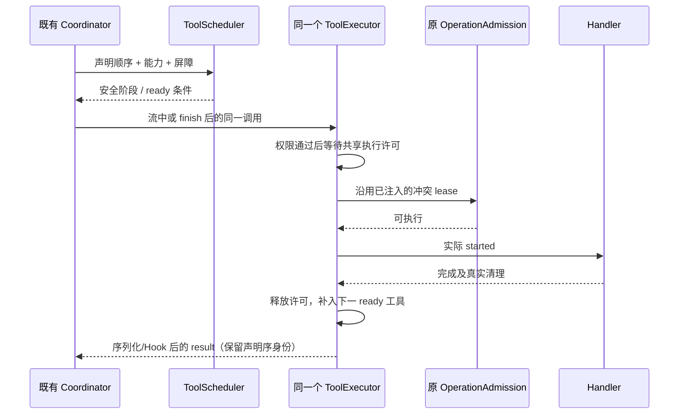

# 模型流与工具执行流水线修复方案

日期：2026-10-19。P0-A、P0-B、P1 已实施，回归和性能结果见第 11 节及 [验证报告](../benchmarks/model-stream-tool-pipeline-2026-10-19.md)。下文保留设计依据与验收目标；P2、实际安装版和三平台验收尚未实施。

行为与接口以 [spec](../../specs/model-stream-tool-pipeline.md) 为准。

## 1. 结论与优先级

建议拆成四个可独立验证的阶段：SDK 假边界修复、Runtime 内容批量提交、统一工具调度、减少模型往返。前两个解决已观察到的工具启动前秒级停顿；后两个解决调度效率及执行顺序缺口，不能只靠增加并发数。

| 阶段 | 改动                                           | 放行条件                                                           |
| ---- | ---------------------------------------------- | ------------------------------------------------------------------ |
| P0-A | 修复 SDK 把空 tool_calls 当作边界              | 实际安装补丁的 ESM/CJS fixture 通过；非空工具、usage、签名回归通过 |
| P0-B | 同 message 内容批量写，覆盖成功和取消          | 原子性、顺序、幂等和故障注入通过；SQL 放大消除                     |
| P1   | 同一 executor 管并发；阶段内补位；流式不越屏障 | 可控 Promise 测试证明顺序和上限，两类 delivery 恢复一致            |
| P2   | 工具说明、原生读取/搜索、已有结果预算优化      | 相同任务质量下往返减少，准确率和可追溯性不退化                     |

P0 可先独立交付；P1 不与 SDK 升级、shell 池、全局读写缓存或 UI 改版捆绑。

## 2. 当前项目证据与需要纠正的假设

### 修复前已确认

- 当前工作区 Node 约束来自 `mise.toml`；基线检查通过。架构模块为 `lcode-cli`，当前 unmanaged，允许依赖 provider/provider-node/shared，不需要为内部小改动新建 managed 模块。
- `pnpm-workspace.yaml` 已将 `@ai-sdk/openai-compatible` 锁在 2.0.60，并存在受控 patch。这是修复解析边界的既有入口。
- 当前 SDK 对 `delta.tool_calls != null` 收口思考；本地合成流证明，三个 reasoning delta 带空数组时产生三个 start/end，没有该字段时只产生一组。
- Runtime 按 provider block 收集 reasoning，`reasoning_end` 后删除活动 ID；这是保留真实块边界的正常职责，不能单独改成永远复用同一个块。
- 成功路径及取消快照路径分别逐块 `await persistPart`；repository 每次重新计算 sequence、写 part、touch session，没有内容批量 port。
- 本地只读样本存在 2,256 块对应模型流结束后约 9.70 秒才启动工具，另一次 1,335 块约 5.73 秒。睡眠前共观察到 7,150 个 reasoning block；不把睡眠时长算作处理耗时。
- 对睡眠前 635 个成功模型周期的边界统计，普通工具完成→下一次模型请求中位间隔约 34ms、p90 49ms。该值不等于整个 Runtime 的处理时间，也不能用于否定收尾阶段的异常值。
- `ToolScheduler` 默认 10 路并发；`executeToolSchedule` 对各 parallelGroup 串行等待。用当前源码、并发 2 的 A/B/C fixture 复现：B 已结束、A 未结束时 C 尚未开始。
- `StreamingToolCoordinator` 已支持安全只读工具提前执行。它逐个调用 `scheduleTools([toolCall]) / executeTools([toolCall])`，当前 ToolExecutor 的单条入口没有实例级总许可。
- 合成 coordinator fixture 接收 Write 后再接收 Read，Read 在 finish 前被派发；连续 12 个 Read 均进入单条执行入口。前者是顺序缺口，后者说明单次 batch 上限不足以约束全部流式入口。
- ProductProjection 实时合并与 transcript hydration 合并已经存在，当前测试覆盖万级片段。此次不重复实现 UI 拼接。

### 证据不足，不作为既定事实

- 历史请求原始 SSE 未保留；空数组是已复现触发条件，不能将历史上游帧形状写成已确认。
- 长上下文和供应商响应时长会影响整体任务速度，但现有记录不足以独立量化各自贡献。
- 暂无证据说明 shell 进程池或扩大跨轮缓存是本次主要收益点。当前 PowerShell 已带 NoProfile；每次 Bash 的时间不全是进程启动开销。
- operation admission 目前主要在 workflow actor 注入，不能把它描述成所有普通会话已有的全局工作区锁，也不能借此次提速放宽跨会话写入保护。

文档不保存会话标识、真实正文、工作目录、凭据或内部网络地址。基准使用合成数据。

## 3. 当前源码地图

下表路径均已在当前 checkout 核对。新增文件和新接口另行标为“拟新增”。

| 关注点         | 当前文件 / 符号                                                                                                                                | 职责及实施边界                                           |
| -------------- | ---------------------------------------------------------------------------------------------------------------------------------------------- | -------------------------------------------------------- |
| SDK 补丁       | `patches/@ai-sdk__openai-compatible@2.0.60.patch`、`pnpm-workspace.yaml`                                                                       | 扩展现有补丁；保留 usage、视频兼容修改                   |
| 补丁交付       | `scripts/workspace-patch-notices.test.mjs`、`scripts/generate-third-party-notices.mjs`、`THIRD-PARTY-NOTICES.md`、`third-party/inventory.json` | 核对补丁 hash、第三方归属及安装产物                      |
| 模型绑定       | `apps/lcode-cli/packages/adapters/src/model/model-execution.ts`                                                                                | API/OAuth 继续共用原绑定与 Runner，不新建 transport      |
| reasoning 收集 | `apps/lcode-cli/packages/core/src/runtime/methods/model-stream.ts`、`reasoning-stream.ts`                                                      | 保留真实 block/metadata；无按文本猜测的合并              |
| 流事件顺序     | 同目录 `model-streaming-event-queue.ts`                                                                                                        | 保留有序队列、128 高水位及 finish/tool-call drain        |
| 成功收尾       | 同目录 `turn-model-step-result.ts:commitModelStepResult`                                                                                       | 统一构造 parts，一次 batch 提交后继续                    |
| 取消收尾       | 同目录 `cancelled-stream-persistence.ts:persistCancelledStreamSnapshot`                                                                        | 复用相同内容构造与 batch port，保留取消事实              |
| Runtime 持久化 | 同目录 `assistant-content-persistence.ts`                                                                                                      | 成功/取消共用构造与公开 saveParts，不让 Core 接触 SQLite |
| 公开存储 port  | `apps/lcode-cli/packages/contracts/src/interfaces/session-store.port.ts`                                                                       | 必需 saveParts，兼容单条旧入口                           |
| SQLite         | `apps/lcode-cli/packages/adapters/src/storage/session-store/sqlite-session-store.ts`、`repositories/messages.ts`                               | 事务、sequence、编码、touch 均由 adapter 管理            |
| 工具计划       | `apps/lcode-cli/packages/core/src/tool/scheduler.ts`、`runtime/methods/tools.ts`                                                               | 声明顺序、安全阶段、依赖与屏障                           |
| 工具执行       | `apps/lcode-cli/packages/core/src/tool/executor/impl.ts`、`batch-runner.ts`、`call-handler-execution.ts`                                       | 共享许可、阶段内补位、实际开始与清理                     |
| 流式协调       | `apps/lcode-cli/packages/core/src/runtime/methods/streaming-tool-coordinator.ts`                                                               | 复用既有 accepted map、handles、恢复账本                 |
| 结果提交       | 同目录 `turn-tools.ts`、`turn-tool-result-persistence.ts`                                                                                      | 按声明序闭合全部结果、媒体、checkpoint、恢复锚点         |
| 展示恢复       | `apps/lcode-cli/packages/bootstrap/src/lcode-protocol-v4/`                                                                                     | owner 投影、continuous/replayable 验证                   |

受控上下文已执行 `pnpm architecture:context lcode-cli`。当前没有独立 core/adapters 的架构 module ID，不在方案里虚构这些命令。

## 4. P0-A：在真正的解析边界修复

变更条件收敛为“存在非空工具数组”，而非“存在工具数组字段”。在 schema 校验后进行，不对 malformed 数据宽容降级。

测试必须导入实际安装后的 SDK，两种模块入口分别验证：连续推理、空数组、null/缺省、混合 text、实际 tool call、usage-only、finish、取消和异常 EOF。同时保留真实多块、签名及不同 choice 的既有行为。第一阶段不通过升级整套 ai/SDK 来扩大变更面。

交付必须更新 patch hash 与依赖锁文件；用仓库现有第三方清单流程确认补丁追踪。不得只修改当前 node_modules 然后宣称安装版已修复。

## 5. P0-B：单 message 批量内容提交

### API 与存储实现

按 spec 增加 `SessionStorePort.saveParts`，同时更新所有真实实现、依赖它的窄接口和相关 fixture；不设置“可选能力缺失就逐条写”的隐藏慢路径。

建议将 parts 的序列化/归属校验与事务执行拆成 adapter 内部小模块，复用现有 JSON 兼容字段处理。`savePart` 保持原 arity 和 copyFrom 语义；原 fork/import 等拥有自身事务的调用方使用同一同步写原语，避免嵌套 BEGIN。不得在 transaction 中调用返回 Promise 的逐条 public writer。

事务外：构造/验证数据和准备稳定 ID。事务内：检查归属，读取既有 sequence，一次 prepare，逐行 upsert，最后一次 touch session，然后 commit。新 ID 顺序只由当前批次决定；既有 ID 更新保持原位置。无需新增表或索引，先消除 N 次 max(sequence) 扫描。

当前 SQLite 为同步 adapter；第一阶段通过减少自动提交和重复扫描降低阻塞，不将整个数据库搬到 Worker，也不降低持久性。大批次 event-loop delay 仍需基准测量，达不到门槛再单独设计 connection owner，不能用更多计时器或部分后台补写掩盖。

### Runtime 接入

已新增 `assistant-content-persistence.ts`，成功、取消共用；不扩展到无关持久化业务。构造阶段保持 reasoning 原始数组、metadata/signature、text、时间和当前顺序。helper 直接通过现有 sessionStore 公开 port 提交，无需新增 runtime prototype 写入入口。

保留 existing streaming queue 的最终 drain。内容 durable 后再进入原 mutating tool 路径；安全流式 Read 仍可提前完成。存储失败与模型失败分层，不能被 Runner retry/failover 捕获后重发模型。

工具结果、媒体和文件 checkpoint 的批量化放在测量后的独立改动：它们涉及多种 await 与取消补齐，不能与 reasoning 批量写简单拼成一个长事务。

## 6. P1：共用执行器的工具优化

### 6.1 一条许可路径

并发许可放入既有 ToolExecutor 实例；所有执行入口共用。Coordinator 继续独占当前 step 的工具接受和 handle 映射，不再为同一调用创建另一套待执行记录。

执行顺序为：参数归一化/Hook → 权限 → executor 许可 → 既有 operation admission（如已注入） → durable running 状态/ToolCallStarted → handler。真实 handler 的 finally 释放资源，然后沿既有序列化/Hook/结果路径收尾；许可约束实际 handler，不把后处理等待误算成执行占用。两类执行资源必须全路径按此顺序获取；权限对话不占执行槽位。handler 仍运行但外层已超时时，不能提前释放真实执行许可。既有 operation-admission 超时测试和新增共享许可取消测试已证明无重叠。

当前 `onBatchStart` 会一次把整组工具写为 running。改成反映逐工具真实启动的内部 callback，挂在执行器的权威开始边界，不在 UI 修补状态。事件先后和实际 handler 边界必须保持一致。

### 6.2 从固定波次改为安全阶段内补位

Scheduler 输出逻辑阶段和原声明顺序。安全阶段允许超过并发上限的候选，executor 只维持有限数量的执行任务：完成一个补一个。不要只改 batch-runner 的切片循环，因为当前 scheduler 本身已经切成最多 10 个的波次。

保留不可并行工具、用户交互、终止工具和未知能力的前后屏障。DAG 依赖满足后才 ready；没有明确依赖证据时不推测写操作可以互换。多个工具的最终 result 数组按声明序，不能按完成序回灌模型。

现有 ToolDependency 尚未携带全部交互/终止能力，实施需要由 registry 的已解析能力补充 needsApproval/alwaysAsk、requiresUserInteraction、stopTurnOnSuccess 等调度输入。审批工具作为屏障；Hook 或权限解析改变后的能力仍在实际执行前重查。单次 maxConcurrency 覆盖只能收紧实例上限，取消和重复收尾不能重复释放许可。

`ToolCallScheduled` 当前携带 parallelGroups/executionOrder，因此要同步审查事件契约、归约器、状态投影和旧快照；新运行可把 group 理解为逻辑阶段，旧持久事件仍按原载荷读取。若需要新增字段，再同步 shared protocol 与运行时校验，不能只改 Core 内部类型。

### 6.3 只提前执行安全只读前缀

Coordinator 在 accept 顺序中识别屏障。前序 Write、交互、未知工具或未收口依赖存在时，后置 Read 留待 finish 后调度。既有工具状态去重以当前 step + toolCallId 为准；不得用工具名/参数缓存替代调用身份。

共享 executor 许可限制所有 during-stream 单条执行。finish 后只调度未执行部分，复用先前 handle/result；取消、断流、provider-native、unknown_execution_state 和 failover 的保护继续生效。恢复不能为提升成功率偷偷重跑副作用。



图中的资源顺序固定为 E 并发许可后取得 A 冲突 lease；不能另一条路径反向获取。等待 A 的时间计入独立 admission 指标；此阶段沿用既有资源域，不把普通会话扩展成新的全局工作区锁。图不新增跨 Host owner。

## 7. P2：减少不必要往返，而非扩大权限

1. 在现有工具说明入口增加明确引导：独立 Read/Glob/Grep 可以同一响应声明；有依赖的查找→读取不能盲目并行。验证命令在语义明确且获同一审批时可合为一个 Bash。
2. 复用 Read 已有的新鲜度判断、原生搜索与 resultBudget/artifact。先测输出字节及重复读取，再决定是否调整预算；不能截断关键错误、文件 revision 或验收证据。
3. 基准任务涵盖查找多文件、单文件修改、构建失败修复、多个独立验证；比较成功率、模型请求数、工具次数、缓存/非缓存输入、总延迟和人工干预次数。
4. 不为降低请求数新增通用执行任意工具的 MultiTool，也不自动合并模型 Bash 命令。常驻 shell、跨轮去重缓存另立 spec，当前不排期。

## 8. 代表性验收矩阵

以下是设计验收矩阵。实际执行覆盖见第 11 节；不将矩阵中的全部外部环境组合自动视为已完成。

| ID  | 层          | 输入 / 动作                                  | 必须断言                                           |
| --- | ----------- | -------------------------------------------- | -------------------------------------------------- |
| S01 | SDK         | 10,000 推理 delta，每帧 tool_calls=[]        | 单 reasoning block；文字逐字守恒                   |
| S02 | SDK         | 缺省/null/[]、usage/finish 混合帧            | 不产生假工具边界，不丢尾帧                         |
| S03 | SDK         | 非空工具、正文间隔、合法签名块               | 真实边界及 metadata 不变                           |
| S04 | SDK         | 非法数组、异常 EOF、abort                    | 原错误/取消，不返回半截成功                        |
| P01 | Store       | 2,256 / 10,000 个真实 parts                  | 一事务、一次 sequence 读取、一次 touch；原内容不变 |
| P02 | Store       | 中途注入失败、第二连接读取                   | 无半批可见；原数据不变；rollback 后可继续用连接    |
| P03 | Store       | 同批次重交、更新既有 part、新旧混合          | 不增重复行；保留旧 sequence/time_created           |
| P04 | Store       | 跨 session/message/part 归属、重复 ID        | 明确拒绝且不写入其它 owner                         |
| R01 | Runtime     | 成功 / Stop / 模型切换收尾                   | 共用 batch；取消反馈及时；无下一轮提前 admission   |
| R02 | Runtime     | 内容提交失败                                 | 不执行后置写工具，不触发网络重试冒充修复           |
| T01 | Executor    | 并发 2，A 慢 B 快，C ready                   | B 结束后 C 开始，无需等 A；实际并发≤2              |
| T02 | Coordinator | 流中 12 个完整安全 Read                      | 共用 executor 上限，finish 后不重复执行            |
| T03 | Coordinator | Write→Read、Read→Write→Read                  | 只提前安全前缀；不读到前序写入前的旧状态           |
| T04 | Executor    | 权限等待、Hook 改参、operation 冲突          | 未获许可不报 running，执行输入与审批一致           |
| T05 | Executor    | Stop、超时但 handler 未退出                  | 不启动后续调用，真实收尾后释放许可/lease           |
| T06 | Recovery    | 部分工具完成后断流、provider-native、unknown | 有且仅有一个结果/明确状态，不重复副作用            |
| T07 | History     | 工具乱序完成、媒体、checkpoint、follow-up    | provider history 声明序闭合，锚点在 durable 后产生 |
| V01 | Protocol    | Desktop continuous 实时开始/停止/完成        | owner 序列、工具和思考状态正确                     |
| V02 | Protocol    | 手机 queued/running/提交中断线重连           | replayable snapshot + gap repair 与 owner 一致     |
| V03 | UI          | 桌面和手机宽度的合成流 / 会话切换            | 无重复思考行、假 running 或旧 turn 复活            |

P0 回归可扩展现有 `reasoning-history-normalization.test.ts`、`store-transactions.test.ts`、`product-projection-reasoning.test.ts`、`transcript-hydration-reasoning.test.ts`。

拟新增 SDK wire fixture、parts batch、模型收尾和调度补位测试；具体目录分别位于当前 adapters/model、adapters/storage/session-store、core/runtime/methods、core/tool/executor。浏览器 E2E 拟在 `packages/web/test/` 增加合成 pipeline fixture，沿用该目录已有 runner 模式，不虚构统一 test 命令。

## 9. 基准、度量与放行

- 建立无真实账号请求的合成基准：2,256/10,000 块、相同总字符量但不同碎片数、1/10/100 个独立工具、混合慢快工具、写屏障、取消。
- 分开量度流解析、live event drain、parts 构造、SQL、工具排队、权限、operation admission、handler、artifact、结果提交、context assemble。计数 trace 记录 ID，指标标签避免高基数。
- 事务数从随块数增长降为每 message 一次；next-sequence 与 session touch 均从 N 次降至一次。这是确定性硬门槛。
- 在相同文件系统/SQLite 持久性配置下记录至少 5 次预热和 20 次采样。2,256 块纯存储/收尾 p95 目标≤200ms，且相对旧路径至少下降 90%；10,000 块分别报告总耗时与 event-loop delay。这是工程放行目标，不是现已达到的结果或脆弱单测阈值。
- 如果硬盘或共享 DB 锁竞争使目标未达，分开记录锁等待与 SQL 执行；先保持正确性，再决定是否需要独立 connection owner。不得调低持久性换取数字。
- 验证默认 10 路并发不变；任务成功率、权限结果、模型选择、请求次数/失败重试预算与对照一致。P2 才单独评估模型往返变化。
- 最后执行根目录与 CLI 的 typecheck/lint、changed 架构检查、目标测试、Desktop continuous / 手机 replayable 协议及浏览器 E2E；安装包 fixture 确认补丁进入实际 bundled agent。

## 10. 实施前基线与剩余风险

已执行：

| 验证                                                                    | 结果                                                                                                     |
| ----------------------------------------------------------------------- | -------------------------------------------------------------------------------------------------------- |
| `node scripts/check-workspace-freshness.mjs`                            | 通过；与跟踪分支同步，相对 origin/main ahead 121 / behind 3                                              |
| `pnpm architecture:check --changed`                                     | 通过，baseline/new/violations 均 0                                                                       |
| `pnpm architecture:context lcode-cli`                                   | 已读取；模块 unmanaged，公开边界为现有 contracts                                                         |
| `pnpm typecheck`、`pnpm lint`                                           | 通过                                                                                                     |
| `pnpm --dir apps/lcode-cli typecheck`、`pnpm --dir apps/lcode-cli lint` | 退出码 0，Turbo 缓存命中；输出有 workspace lockfile 闭包告警，不能作为全量无缓存重跑的证据               |
| 七个现有测试文件，Node/tsx                                              | 38 项通过，0 失败；覆盖签名投影、原子事务、流式恢复、operation lease、两种 delivery 的推理恢复及补丁清单 |
| SDK 空数组探针                                                          | 缺省与 [] 的边界差异已复现；尚未施加修复                                                                 |
| 当前 scheduler / coordinator 合成探针                                   | 波次等待、Read 越写屏障及 12 笔单条派发已复现                                                            |

已运行测试入口：

```powershell
node --import tsx --test apps/lcode-cli/packages/core/src/runtime/methods/streaming-tool-coordinator.test.ts apps/lcode-cli/packages/core/src/tool/executor/operation-admission.test.ts apps/lcode-cli/packages/adapters/src/storage/session-store/store-transactions.test.ts apps/lcode-cli/packages/bootstrap/src/lcode-protocol-v4/product-projection-reasoning.test.ts apps/lcode-cli/packages/bootstrap/src/lcode-protocol-v4/transcript-hydration-reasoning.test.ts apps/lcode-cli/packages/adapters/src/model/reasoning-history-normalization.test.ts scripts/workspace-patch-notices.test.mjs
```

当前工作区有大量既有改动，包含 model-execution、SQLite store、memory、routing 和 UI；实施只追加本方案范围的补丁，不重置、不把它们打包提交。新文件按仓库要求控制职责及 400 行源文件限制。

graph-drift-candidate：现有 feature graph 缺少本流水线的专门 seed，且注释引用的 `docs/skills/feature-boundary-graph.md` 在当前 checkout 不存在。保留现有已修改 graph，本轮先记录缺口，不恢复缺失历史文档、不把静态目录当作能力。

本节为实施前记录。修复后的回归、性能与浏览器 E2E 结果见下节；实际安装版/三平台验证仍未执行。

## 11. 实施与验收记录

- **P0-A**：扩展现有 pnpm patch，ESM/CJS/source 都以非空 tool_calls 判断真实工具边界。锁文件 patch hash 已更新，原 usage/视频兼容逻辑保留；第三方清单通过现有 generator 重建。新增安装依赖和 Desktop agent esbuild 解析链路 fixture，不依赖对 node_modules 的临时手改。
- **P0-B**：公开 saveParts；adapter 的 `repositories/message-parts.ts` 持有一次同步事务，`message-compat.ts` 复用旧字段兼容；store 方法借用同一个连接/写守卫。成功/取消共用 `assistant-content-persistence.ts`。归属校验、重复 ID、更新旧 NULL sequence/time_created、失败回滚、跨连接不见半批及确定性 SQL 次数均有回归。
- **P1**：executor 内 `execution-permits.ts` 共用 FIFO 许可；scheduler 形成逻辑阶段，batch-runner 阶段内补位、最终结果按原声明序返回。`onToolStart` 代替整批 running。流式 coordinator 仅提前安全前缀，并保留原恢复账本。审批等待不占许可，终止工具取消后续阶段，取消/超时以实际 handler 清理为释放边界。
- **验证入口**：`node scripts/test-model-stream-tool-pipeline.mjs --browser`。新增和既有用例一起覆盖 SDK、Store、Runtime、Executor、ProductProjection、冷恢复、两类 delivery、1280/390px 浏览器行渲染及长历史时间线。新增浏览器 fixture 使用实际 ConversationRowView 和合成权威行；执行器与投影的结合由 CLI 集成测试验证，不冒充连接真实 provider 的全链路 E2E。
- **性能**：2,256 parts，5 次预热/20 次采样，逐条保存 P95 16,273ms → 批量 34.2ms，下降 99.79%；10,000 parts 压力组 2 次预热/5 次采样，P95 73,245ms → 258ms。序号读取和 session touch 都从 N 降至 1。工具混合慢快组，5 次预热/20 次采样，固定波次对照 P95 139.7ms → 补位 95.7ms，下降 31.47%。原始 JSON、环境口径、样本限制与复现命令见验证报告。
- **质量门禁**：组合回归 164 项通过，0 失败/跳过。根目录与 CLI typecheck/lint 已通过；changed architecture 的 violations/baseline/new 均 0。CLI 的目标包真实重编译通过；其余包有 Turbo 缓存命中，并存在子 workspace 不在锁文件的既有闭包告警，未掩盖为无告警全量重跑。
- **边界**：不重写历史 transcript，不新建 Host/accepted queue，不调整默认 10 路并发。P2 工具提示、模型往返优化尚未实施。未重启用户正在运行的桌面实例，未回放带真实账号的原会话，也未进行 Windows/macOS/Linux 安装包矩阵；esbuild fixture 只验证当前依赖解析与补丁可进入 bundle。
