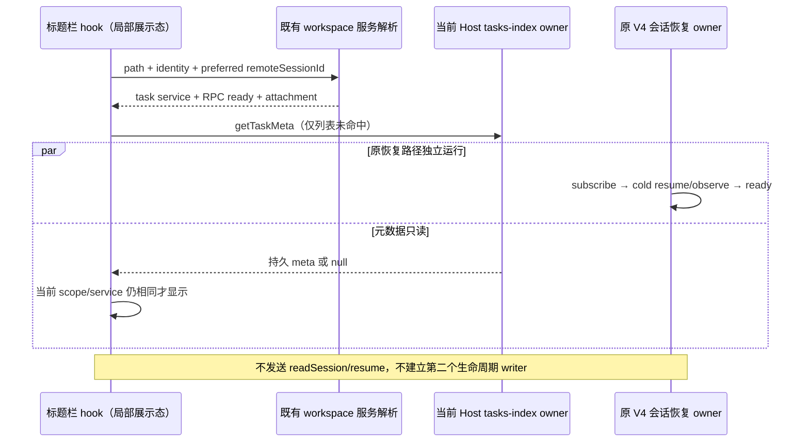

# 冷会话的标题栏元数据读取

## 已确认问题与规则

重启日志中 `session/read` 的 inactive 错误先于同一历史会话的 V4 subscribe 成功。当前执行目录 hook 已等待共享 projection ready，并优先使用 executionWorkspace；这条已有修复保持。另一个仍存在的入口是 `useActiveTaskSnapshotMeta`：列表缺少当前任务时直接请求仅支持活跃 Runtime 的 `readSession`，失败后清空标题兜底，且不会因订阅恢复而重新执行。其旧结果仅按 taskId 判断，还可能在不同 workspace/Host 使用相同 taskId 时短暂串用。

- 标题栏只读元数据兜底使用已有 `ILCodeTaskService.getTaskMeta`，其唯一事实来源为 tasks-index；归档任务可按 ID 读取，不要求进入普通列表，不启动/恢复 Runtime，不读取消息或修改模型、MCP、权限。
- 已有列表/乐观合并的 meta 优先。无 taskId、已有列表 meta、RPC 未就绪时不发兜底请求。不存在或读取失败返回空兜底，不能自动创建、恢复或补造任务。
- workspace identity key 继续为 `workspaceIdentity?.trim() || workspacePath`。本地展示结果同时绑定请求路径、taskId、解析后的 remoteSessionId 和 task service 实例；跨 workspace、跨 Host、断连及同 Host 服务换代时立即隐藏旧结果。迟到成功/失败不得写入当前目标。
- 保留 hook 的现有调用签名和 `LCodeTaskMeta | null` 返回值。返回 task meta 原始完整字段，保留手动标题、provider/model、traceId、归档、分支/执行目录等事实，不从 summary 猜测身份。

## 所有者与时序

Desktop continuous 与手机 replayable 的流、水位和恢复不变；标题兜底只通过现有 workspace 服务路由读索引，不新增协议、持久化字段或全局缓存。

## 验收与验证

- 真实 React/browser hook 在 Runtime 冷态下仍展示归档任务的标题、traceId、provider/model，且 session read/resume 次数为零。
- 列表已有 meta 不额外读取；切换 taskId、同 ID 不同 identity/attachment/service 时旧值立即隐藏；迟到成功/失败不污染新结果。
- RPC 断开不发请求、不保留旧显示；重连后重新读取。不在索引中的任务返回 null，不创建任务。
- 已有执行目录 cold-child/legacy 兼容与 stale owner E2E 回归不变。

验证结果（2026-10-23）：

- 新浏览器用例在修改前复现冷 Runtime 下标题兜底失败，修改后通过。覆盖手动标题、provider/model/trace、归档、不在索引、当前读取失败、同 ID 不同 identity/attachment、相同服务引用、服务换代、本地路径 fallback、断连/重连、迟到成功与失败。新逻辑的 session read 次数为零；未调用 resume 或创建任务。
- `pnpm test:renderer:ui` 6 项通过，已将新用例接入该既有入口；单独执行当前冷 child 执行目录 E2E 通过，保留 legacy 兼容和 stale owner 保护。浏览器 fixture 执行真实 React hook，通过注入服务控制冷态与乱序结果，不宣称已在用户安装版复测。
- 根 `pnpm typecheck`、`pnpm lint`、目标格式、`pnpm verify:pre-push` 通过；架构 baseline=0/new=0。完整 `pnpm test:release` 169 项通过、1 项已有 Chromium 可选用例跳过。服务契约只补充既有 readSession 的活跃要求，无 RPC/协议行为变更；生产源码净减 1 行（hook 净减 2 行，契约注释增加 1 行）。
- 用户确认重复 projectMemberId 调用截图来自旧版，本轮不重复修改已提交的路由修复。未打包、安装或发布；重构建后应在原机器打开历史任务并确认标题及原会话恢复。
