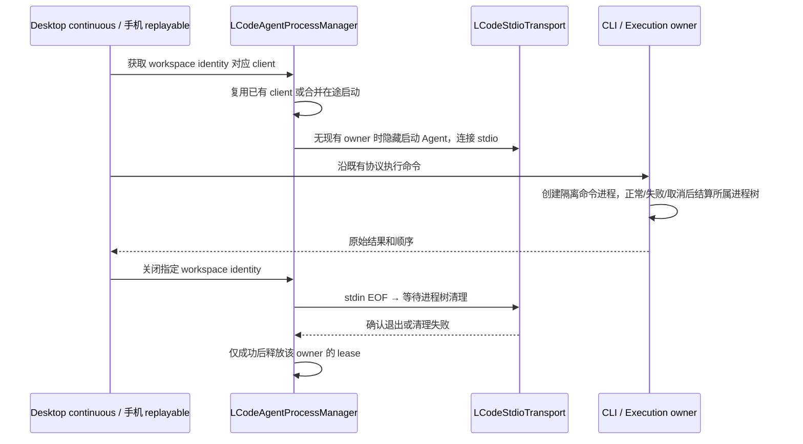

# Agent 后台控制台、复用与回收

## 2026-10-23：自动弹出的 Windows 终端

用户确认截图中的多个 `lcode` 标签属于 AI 执行时自动出现的独立 Windows 终端，不是应用内终端面板。截图没有 PID 和启动参数，不能据此断言每个标签都对应仍存活的进程或同一个启动入口。

源码已确认：`LCodeAgentProcessManager.startClient` 使用 stdio pipe 启动后台 Agent，但缺少 `windowsHide`；此入口包括默认 CLI、自定义命令及各控制面 lane。CLI Execution adapter、stdio tap 和当前 MCP SDK 的 spawn 已显式隐藏 Windows 控制台。此次补齐 Host 的遗漏，不重写已经存在的 Bash/MCP 进程树回收。

## 产品规则与边界

1. Host 启动的 stdio Agent 是后台进程，显式隐藏 Windows 控制台；stdout/stderr 继续由现有 transport 消费，输出、错误和取消仍通过会话展示。隐藏不等于终止，不能以窗口是否可见作为清理依据。
2. 同一 manager 内，`workspaceIdentity?.trim() || workspacePath` 是进程复用 key。并发启动共享同一在途 promise；正常连续请求复用已有 client/进程。不因每次命令、切换会话视图或任务完成而再创建独立控制台。
3. 同路径不同 workspace identity、不同 manager/lane 继续隔离。Agent 可以管理多个会话，但 CLI 的单次 shell 执行仍保持原隔离，不跨会话共享可变 cwd、环境、stdin 或进程所有权。
4. Bash 正常结束、失败、停止及后台任务/service 的回收继续由现有 Execution owner/RuntimeTaskRegistry 决定。持续服务遵守既有显式保留授权，不因 UI 隐藏或短时无输出被停止。
5. workspace 关闭/运行时退出继续走 manager → transport → 原进程树清理。确认退出后释放内存/环境 lease；失败保留责任，可重试。关闭一个 identity 不影响另一个，之后再次启动得到新代际。
6. 不增加统一 shell 池、任务队列、空闲计时器或配置项；不改变协议、鉴权、MCP 配置、会话持久化及 Desktop continuous / 手机 replayable 语义。不自动认领或清理旧构建创建且无法证明归属的外部窗口。

## 唯一所有者和事件顺序

## 分阶段验收

- 本阶段：实际 manager 启动参数包含隐藏控制台，且保留 pipe、cwd、身份和环境注入；有界 stdio 夹具真实响应请求，正常输出及错误不受影响。
- 复用：同 identity 多个并发获取只启动一次；连续请求仍使用同 PID；同路径不同 identity 分别启动，关闭其中一个后另一个仍能请求；重复关闭幂等，重新启动采用新代际。
- 回收：实际进程关闭后不可再访问，owner/内存 reservation 结算；现有 spawn 失败、admission 期间关闭、cleanup barrier、Bash 派生进程清理、后台 task/service 回归继续执行。
- 平台：Windows 本机验证真实子进程生命周期及启动选项；macOS/Linux 依赖原有 detached 规则，不声称完成其它平台实机验证。自动弹窗最终仍需包含修复的新桌面构建在受影响机器确认，不能以源码测试代替安装态验收。
- 后续专项：只在证实有剩余进程/输出缓存持续增长后分别优化具体 owner；应用内 xterm 的 scrollback/隐藏订阅预算属于独立阶段，不从该截图推导自动终止手动终端的规则。

## 验证记录

- 新增真实 stdio 子进程集成 4 项：修复前明确复现 `windowsHide` 缺失（1 项失败、3 项通过）；补齐后全部通过。测试在调用真实 spawn 前记录产品参数，并始终隐藏夹具，红灯测试也不向用户桌面弹窗。
- 连同现有 Agent memory/admission barrier、worktree owner 与 MCP status 隔离共 19 项通过；正常连续请求、7 路并发去重、同路径不同 identity、指定 owner 关闭及新代际启动已执行。
- 原命令生命周期 20 项通过：包含本机 PowerShell 7 与 Windows PowerShell 的实际执行、失败、cwd 回传、取消；真实 HTTP 预览的父子进程回收与其它会话保留；Windows Job 退出核验/失败重试及后台 task/service 完成边界。Linux/macOS settlement 只验证受控分支，未做实机测试。
- 根 `pnpm typecheck`、`pnpm lint` 通过；架构 baseline=0/new=0，目标 4 文件格式检查及 diff 检查通过。实现仅在既有 spawn 添加隐藏设置和原因注释，无新状态、接口或计时策略。
- 未替换正在运行的客户端，未测量安装态内存收益。截图中历史外部标签的具体归属及新桌面构建是否完全消除弹窗，仍需受影响机器验收；本次不把启动选项回归写成已复现全部截图现象。
- 2026-10-23 提交前复核：Agent 启动、复用、内存 admission、worktree lease/owner 与 MCP 隔离共 25 项通过；
  PowerShell、真实 HTTP 子进程结算及后台结果交付共 27 项通过。测试中 Windows 进程表查询出现超时告警，
  夹具的真实子进程退出与 lease 释放断言均通过；未将该既有枚举告警记为本次隐藏控制台修复的成果。
