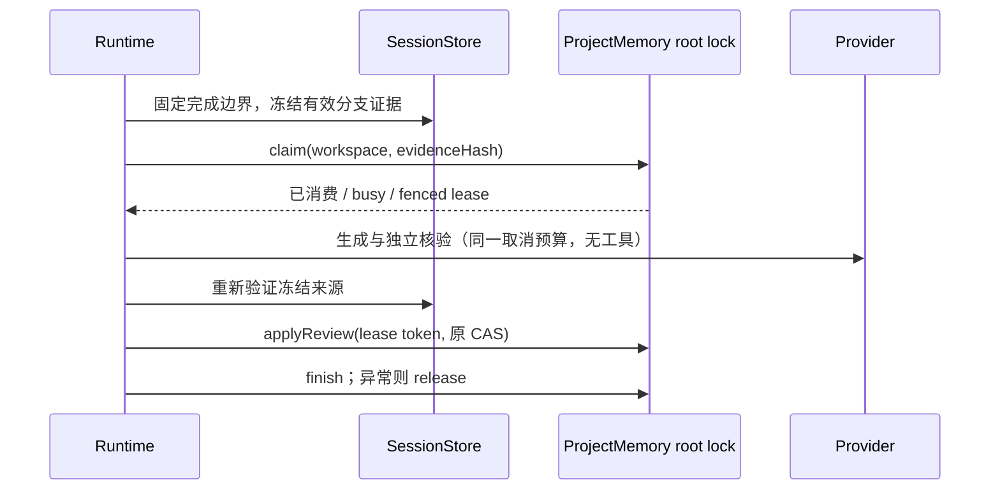
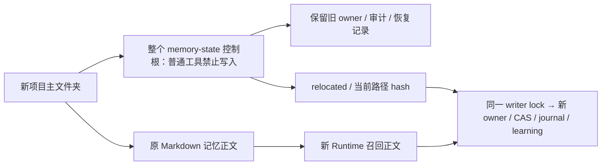

# Agent 主动记忆与历史召回增量实施

日期：2026-10-18。按用户授权分阶段实施；优先主动记忆与历史召回，最后输入框预测。本文补充现有记忆、召回、独立核验和 CAS 契约，不替代其身份隔离、预算或远端禁用边界。

## 第一阶段：交付正确片段并共享候选

- ProjectMemoryRecallIndex 仍是当前 Runtime 的派生索引。召回格式化改为选择命中段落及相邻上下文，内容不足上限时保持完整原文；无正文命中时保持前缀。截取不得拆坏 UTF-16 surrogate pair，单条 4000、总 attachment 12000 字符不变。
- 同一索引可产生冻结的候选选择器，仅返回当前 root 内的相对文件名。前台工具和后台提取通过可信 ToolExecutionContext 共享该纯选择接口，不追加文件读取、不把索引快照变成当前正文事实。
- 复盘先按共享选择器排序，再按原文件名匹配/稳定顺序处理未命中项；选择器的未知目标不进入枚举。完整 before 仍经原有安全读取/版本校验冻结，自动档最多两次记忆正文读取、合计 4000 字符。
- 未提供选择器的旧调用保持原兼容行为。根切换后不能复用另一根候选。
- 系统 Memory 提示与受控能力一致：不支持自动删除，错误记忆通过有依据的修订或外部编辑处理，不声称已删除。

  真实 query → 原 Runtime 索引 → 命中段落 → 当前 turn overlay
  └→ 冻结候选选择器 → 原复盘 → 完整 before
  → 独立核验 → 同一 CAS owner

验收：长正文后部命中及相邻否定条件保留；中英文/全角、组合字符规范化及 surrogate 边界；metadata-only 无正文命中；自动复盘能选择文件名无关键词但正文相关的旧记忆；无额外扫描读取；root 隔离；旧接口兼容。

## 后续阶段的共同约束

主动学习的持久消费、执行证据、历史发现及输入预测在各阶段补齐具体接口与验收后实施。验证中新问题必须记录原因并补回归，不能靠超时或失败后整库注入补偿。保持 workspaceIdentity?.trim() || workspacePath 身份规则；desktop-continuous 与 web-remote-replayable 复用同一 owner。

## 第二阶段：持久消费与并发隔离

- 原 ProjectMemory adapter 在同一个 root writer lock 下管理 `memory-state/learning.json`，只保存 workspace key、冻结会话证据 hash、租约 token/截止时间和消费状态，不保存对话正文。不改变数据库结构，不另建内容库。
- 可选 `ProjectMemoryPort.learning` 提供 claim/finish/release。增量复盘先读取并冻结当前完整 turn，以来源 revision 派生 evidence key，再 claim，成功者才可调用模型。已消费或其他有效租约为零模型请求；没有该 capability 的旧 adapter 保持原行为。
- 每次租约 180 秒，自动请求使用 120 秒取消预算，取消信号传给 provider；超时不会被记作成功。租约过期可重领，token 是 fencing token，原 token 无权释放、消费或提交新租约。applyReview 在原 root lock 内检查 token 后才进入原 CAS/journal 路径。
- 只有成功核验、无提交冲突、来源仍有效的完成或无变化结果才消费；异常、取消、容量不足和冲突释放租约，后续明确触发可以重新评估，不后台无限重试。每个 root 最多 2048 条、1 MiB；满时停止新学习并报告 learning-full，不静默删除消费历史。
- 他人租约占用或容量不足属于 deferred，不能作为 no-op 推进 Runtime cursor；already-consumed 可以推进。保持原调度规则：不在后台循环重试，后续显式 schedule 才重新评估。
- 输入 evidence 是派生快照，事实仍由原会话存储和 Markdown owner 决定。重启或多个 Runtime 共享 root 时不会重复消费同一冻结证据；回滚/分支或原文变化生成新 revision。

验收：并发仅一方获得租约；新 adapter 实例能识别已消费；旧 token 不能提交、释放或消费新租约；身份隔离；取消和失败后可重试；容量边界不驱逐历史；无变化也持久去重；旧 adapter 兼容。

## 第三阶段：结构化执行证据

- completed tool metadata 增加可选 execution 字段（exitCode、cancelled），由 Runtime 从真实 BashOutputSchema 解析；旧记录没有该字段时保持未知，不能从助手文字、stdout 或 completed 状态推断 exit 0。后台启动、spawn error、超时、取消都没有有效退出码。
- 同一有效分支/完成边界内最多 12 条工具检查，投影仅接纳可解析的结构化 execution；普通 Read、旧记录或未知输出不影响证据指纹。最多 1200 字符，与可见文本共用原 sessionCharacterLimit。只含 tool/callID/status 及结构化 execution，不读命令、输出、凭据或额外历史。超预算明确 partial。
- 冻结来源 revision 同时包含该投影；核验和提交前重读同一来源。exit 0 只证明该调用的退出状态，不等于全部测试通过，更不证明助手关于实现正确性的自述。
- metadata 是附加兼容字段，不增加会话表或 schema migration；原 transcript owner、跨设备事件语义不变。

验收：非零 exit、取消、后台启动与未知旧记录不会投影为成功；工具输入/输出不泄漏；证据变化使来源失效；上下文预算不增加。

## 第四阶段：查询感知的历史发现

- SessionStore 增加可选 discoverSessionHistory 能力，仍由原 SQLite adapter 执行，不新增表或 FTS migration。先限定 workspace identity（无 identity 时 directory 且 workspace_id IS NULL）、未归档、interactive/fork/workflow_parent、排除当前 session；最多 256 个最近会话，每会话最多 16 个最近 part，每行 JSON 最多 16 KiB、所有候选正文 JSON 合计最多 2 MiB，在 SQL 返回正文前准入。超过范围不宣称完整覆盖。
- core 传递最多 12 个规范化查询 term（每 term 最多 64 字符），adapter 只用标题与 text part 的词面命中发现候选，不把工具、隐藏文本或候选预览当事实。按命中数优先、更新时间和 id 稳定排序，仍仅返回原 8/20 个候选；无命中用最近项补齐。
- 每个候选附命中 message 之后最多两条消息的读取边界，标题/无正文命中使用最新 message。随后通过原 readTranscriptWindow 获取有界完整窗口，并复用有效分支、compact 和来源作用域校验；窗口不完整/分支无法证明时丢弃，禁止回落全会话读取。
- 可见文本投影在原单会话/总字符预算内选择查询命中段及相邻上下文，解决同一有界窗口内前缀截断丢掉后部命中。排序、最多三条自动 attachment 与 3200 字符预算不变。
- 旧 adapter 没有 discovery 时保留原 list/snapshot 路径；新 discovery 失败为可恢复 unavailable，不放宽范围。正文不会被记录到日志，不额外调用模型。
- 本地候选 scope 与最终证据校验使用相同的文件系统路径语义，以非空 session.path 优先、directory 回退。Windows 同一路径的斜杠、大小写和末尾分隔符差异不能漏召回；POSIX 保留大小写和反斜杠语义。identity 仍严格相等，不能借路径别名放宽跨身份读取；SQL 先限定 scope 再取有界候选，不全库读入后过滤。

验收：近期无关会话超过 8 个时，较早相关会话仍入选；600 消息会话后部可命中；规范化中英文查询；scope/归档/分支隔离；超大 part 不物化；取消、失败及旧 adapter 兼容；候选与读取预算不增加。

## 补充：连续完成轮次不互相覆盖

原 latest-pending 仅留最后一个快照，而增量复盘只读最后一个真实用户 turn，两者组合会跳过中间完成轮次。Scheduler 保留最多 8 个待处理快照并按完成 admission 顺序串行处理；没有第二条业务输入队列。溢出时保留前 7 个及最新快照，发出无正文的 overflow 诊断，不声称所有轮次已学习。失败不推进 cursor；关闭时取消当前并清空 pending；相同证据最终由持久 claim 去重。验收包含三轮连续完成、8 项容量边界、关闭与失败。

## 实际 Electron 端到端验收

标题、学习生成、独立核验和输入预测均通过原 Model.generateText；真实安装版暴露的流式/非流式兼容规则见 `auxiliary-model-stream-transport.md`。业务层不能因传输模式另选模型、绕过核验或重放请求。

实际验证发现并修复的默认路径契约：CLI 与桌面记忆目录、会话数据库、用户配置必须尊重同一个 `LCODE_DATA_BASE_DIR`（旧名 `ZCODE_DATA_BASE_DIR` 兼容）。配置、记忆根与数据库分别位于该目录的 `.lcode/cli/config.json`、`.lcode/cli/memories/projects`、`.lcode/cli/db/db.sqlite`；显式 STORAGE_DIR / SESSION_DB_PATH / userConfigPath 保持原优先级，未配置 base 时维持原用户主目录默认值。不得扫描或自动迁移另一个资料目录的会话和记忆。已有运行时保持原绑定，重启后使用新默认位置。

项目搬迁同时携带 `.lcode/memory-state` 时，旧 owner 的绝对路径会与新根不同。仅相同项目内存储布局（`.lcode/memory`，或同一 opaque identity hash 下的 memory）允许在原 controlDir 下选择 `relocated/<当前根路径 hash>` 作为新状态目录；Windows hash 归一化大小写。正文不复制、不改写，旧状态和审计不删除、不改 owner，不恢复旧根事务或租约。新目录仍由原 writer lock、Owner/CAS/journal/learning 管理；再次打开同一路径使用同一命名空间。旧系统的资料目录或不同 identity 状态继续拒绝跨根复用。

每个 controlDir 最多 16 个搬迁命名空间，满时停止新增状态而保留已有正文/记录；不自动清理历史。controlDir 与当前 active stateDir 分开表达：普通文件工具对整个 controlDir（含旧状态和所有命名空间）均无写入权限，根重叠和 symlink/junction 检查不放宽。路径选择只读目标目录内的 owner，不访问旧绝对路径。既有进程不切换绑定；关闭项目后再复制/搬迁是可重复恢复的验收边界。

验收：复制整个记忆与状态目录到新路径后，正文可召回且新学习可提交；原状态字节不变、旧租约无权提交、新命名空间重开幂等；不同 identity/资料目录不自动复用；所有 sidecar 均受保护；容量满和 symlink 失败不改正文。实际 Electron 必须用搬迁副本重跑。

在独立 `LCODE_DATA_BASE_DIR`、Electron userData 和测试 workspace 中启动当前源码的完整桌面应用，不替换 Renderer、Host、stdio Agent、SQLite 或记忆 adapter。可控 loopback 模型服务只替代外部模型响应；记录测试请求以断言链路，不能把它视为真实模型质量评测。

- 从实际设置界面启用三个独立开关，发送带稳定项目事实的真实输入；确认后台生成、独立核验、原 CAS 写入和学习消费账本。
- 新建同 workspace 会话，确认实际模型请求包含该事实的记忆 attachment；历史问题另查自动历史 attachment 的 session 来源和可见文本。
- 确认真实成功完成触发至多一次灰字预测，未接受不写入草稿/会话；Tab 接受、修改、手动发送保持原提交流程。
- 刷新/重启及重新选择历史会话不能触发预测或重复消费旧证据；关闭开关、输入期间和迟到响应保持既有取消与隔离边界。
- 用实际持久文件、请求证据和界面截图交叉确认；发现问题先更新对应契约、补回归再修复，随后重跑完整链路。

## 可重复验证入口

`node scripts/verify-agent-memory-and-composer-predictions.mjs` 使用当前 Node、现有 tsx/浏览器依赖，顺序执行相关 CLI/SQLite/CAS 集成回归、UI 协议/设置/投递来源单测及预测/记忆设置浏览器回归。文件从当前源码目录枚举并稳定排序；浏览器套件串行运行，避免多个 Vite 共用预构建缓存。任一组失败即非零退出并停止，不安装依赖、不调用真实计费模型。Node 版本以 mise.toml 为准；类型、Lint 和架构门禁仍使用根 AGENTS.md 的独立命令。
