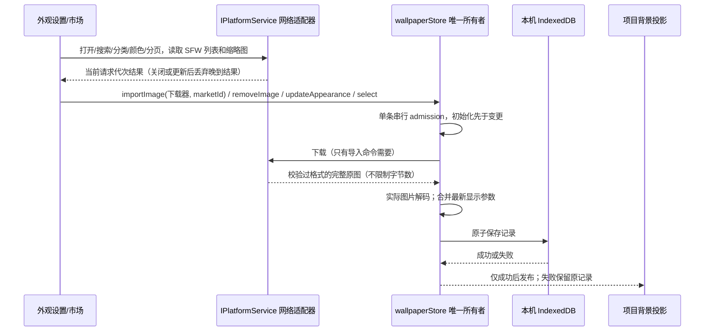
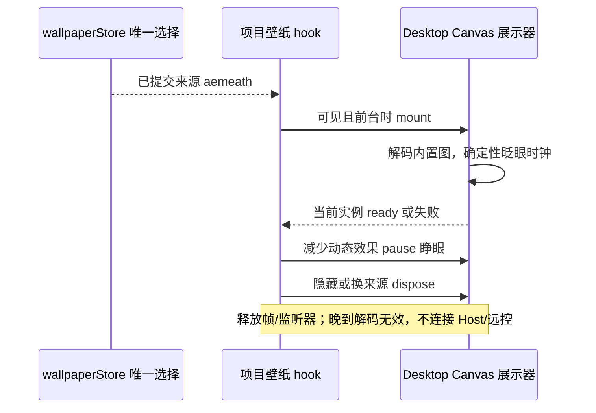
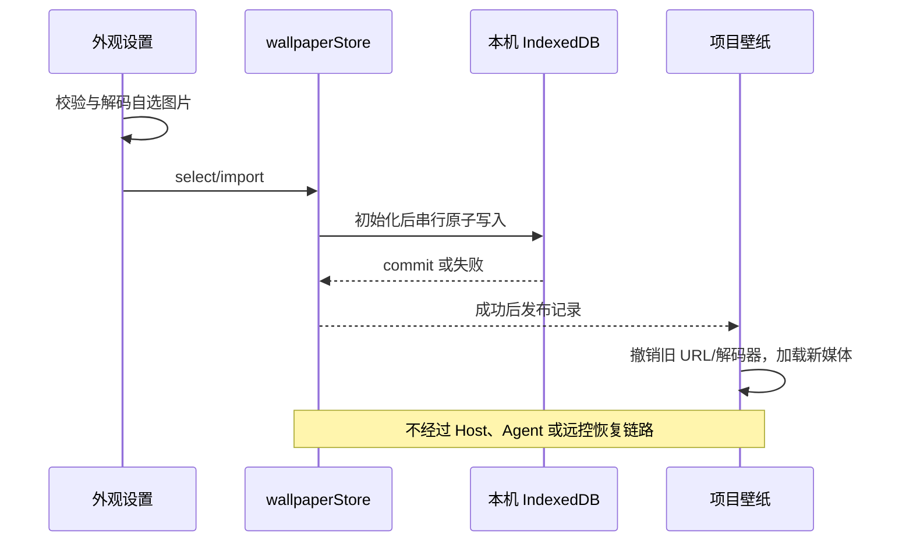

# 外观壁纸

## 产品规则

### 壁纸市场与显示调节（2026-10-20）

- 外观的工作区背景提供「壁纸市场」，浏览 Wallhaven 公开 SFW 图库；支持提交搜索、全部/风景/二次元/人物分类、分页、刷新、加载/空/失败重试、分辨率与当前使用标记。只有打开市场时请求列表和缩略图，关闭后晚到列表不得覆盖新页面。
- 点击卡片下载并应用为自选图片，沿已有图片导入路径实际解码、原子保存；不限制壁纸文件字节数和像素数，市场不再显示「超出上限」或因此禁用卡片。本地导入、下载响应契约与持久化恢复使用相同规则。网络、解码、保存失败均保留旧壁纸；本地重新选图清除市场来源标记。
- 本机沿用单张自选/市场图片记录。市场中展示已下载图片的 ID，并提供「删除已下载壁纸」；无需在当前搜索页找到该图片。删除经 wallpaperStore.removeImage 的同一串行写入路径清除图片 Blob 和市场来源；若正使用自选图片则切换关闭，若使用内置动态壁纸则保留该选择。显示参数不变；保存成功才发布，失败保留原图并显示错误。删除后重载不能恢复图片、来源或使用中标记，可重新下载。
- 「更换图片」支持本地 GIF：文件选择器接受 image/gif，沿相同导入/解码/IndexedDB 路径保存原始 Blob，不转换为首帧。工作区使用浏览器原生 GIF 动画与已有填充/遮罩/模糊参数，重载后继续播放；损坏 GIF 保留旧图并显示错误。背景卸载/关闭仍撤销对象 URL；GIF 不新增独立播放器、动画时钟或持久化状态，不修改启动动画制作区的格式规则。
- 分类行的「人物」之后增加「颜色」菜单，默认跟随当前主题推荐，提供不限颜色和 Wallhaven 的 29 个预设单色色卡。推荐为暗夜黑 424153、草木灰 999999、落晖黄 ffcc33、天空蓝 0099cc、远山绿 336600、朱砂红 cc3333、烟墨紫 663399；系统主题使用现有注册表解析到对应 Zai 主题，旧 light/dark 沿现有归一逻辑处理。主题仍由全局 LCodeStore 唯一持有，市场只读取主题及系统明暗投影；颜色选择仅在弹窗中，不持久化或广播。
- 颜色搜索使用 [Wallhaven 官方 API](https://wallhaven.cc/help/api) 的 `colors` 参数（单个无 # 的预设十六进制色值），与关键词、分类及 SFW 条件组合。UI hook → 既有平台 searchWallpaperMarket → Main 传递同一可选 color 字段，shared 契约严格校验；不限颜色时不发送 colors。筛选或主题推荐色变化后从第一页请求，翻页和刷新保留当前色；关闭或新请求后丢弃晚到结果，手动指定色不受主题变化影响。
- 填充方式为覆盖 cover、适应 contain、居中 center、平铺 tile。自选图片支持全部方式；动态视频支持前三种，平铺按居中显示；爱弥斯使用原有角色绘制布局。
- 遮罩不透明度范围 0–99%，图片模糊 0–24 px，面板不透明度 0–100%。遮罩跟随主题背景色，只叠一次；模糊只影响媒体，不模糊文字；面板参数仅作用于项目结构侧栏/面板/标题栏，卡片、输入和 Portal 继续使用主题颜色，不修改窗口透明度。
- 显示参数与图片、来源由 wallpaperStore 唯一持有，在同一 IndexedDB 记录中串行写入。导入/切换保留显示参数，关闭仍可调整；保存成功即发布，重启恢复。旧记录缺少参数时默认 cover / 80% 遮罩 / 0 px 模糊 / 0% 面板，保持原有外观；非法持久化参数归一为默认值，不增加迁移写入。
- 网络通过 UI hook → IPlatformService → Desktop IPC 执行，Main 仅做受限外部请求，不持有背景业务状态。严格校验请求和响应，URL 与重定向仅允许 HTTPS Wallhaven 域，保留时长与格式校验；列表 JSON 与缩略图继续使用各 2 MiB 响应上限，壁纸原图不设字节上限。图片只下载到本机记录。市场不加入 AppSettings、Host、Agent 协议、relay 或远控恢复链路；Web/手机维持零壁纸 IO。

验收：单测覆盖旧数据归一、参数范围、保存失败、导入保留参数、下载/删除/选择的顺序、市场协议及缩略图限额、大于旧字节/像素上限的壁纸成功导入、七个主题及系统/旧主题的推荐色和 API 颜色校验；E2E 覆盖原先超限卡片可应用、删除当前已下载图片及重载不恢复、人物之后的颜色入口、自动推荐/手动/不限颜色与翻页保留，搜索/分类/分页/重试、应用标记与重载恢复、四种填充和三项滑块、实际项目样式、深浅主题与窄窗，以及 Web 零壁纸请求。

- 壁纸选择增加「爱弥斯（动态）」：内置角色原图配合双眼眨眼，不叠加启动阶段、标题或副标题，也不读取制作动画的自选背景或位置配置。仍由 wallpaperStore 唯一持久化选择，保存/重启恢复使用现有串行路径。
- 眼部以外继续绘制原图。原始像素回归允许 GPU 读回重采样在极少数像素产生 1/255 舍入，禁止更大色差或可见变化；不以跨 GPU 的逐字节一致替代实际视觉验收。
- Desktop 经 `IPlatformService.mountAemeathWallpaper` 提供局部 Canvas 展示控制器；UI hook 只负责挂载及 play/pause/dispose。与启动使用同一眨眼绘制器。项目隐藏/后台/设置页/启动期间卸载；减少动态效果暂停并绘制睁眼静帧；加载失败回主题背景，过期加载不能重新激活。Web 不实现此能力，不创建媒体或读取本机配置。

- 验收补充：四个壁纸选项均可用；爱弥斯实际像素经历睁眼、闭眼、睁眼，脸部以外像素保持一致；减少动态效果时静态、设置页无 Canvas，重载恢复选择；旧主标题归一但字号/位置保留，旧默认副标题迁移而自定义保留。

- 设置页移除「项目背景预览」及其媒体实例；保留壁纸选择、更换图片，并提供市场和显示参数。验证从设置切回项目后的真实背景，不再用设置页小样替代项目渲染验收。

- 开发和安装包默认提供内置壁纸，资源随仓库和安装包分发，不要求环境变量或手动导入。选项按构建生成的同一份资源清单决定可选性，自选图片与启动动画不互相限制。
- 壁纸叠加一次主题遮罩；项目结构背景透出同一壁纸，面板不透明度仅在侧栏/会话/侧面板的根节点叠加一次，内部结构背景透明，避免逐层相乘。只影响壁纸启用的项目壳，卡片、输入和 Portal 保持既有主题。

- Windows、macOS、Linux 的「设置 → 外观 → 壁纸」提供关闭（默认）、白璃动态、爱弥斯动态、自选图片；与开机动画独立，改变后立即生效，重启保留。
- 删除龙娘壁纸的选项、静帧捕获及素材。白璃使用无文字的 wallpaper.mp4，静音循环，不使用 startup/handoff 作为工作循环。读取到已删除或未知来源时，wallpaperStore 投影为关闭并保留有效自选图片；下一次正常选择沿原串行写入路径持久化，不增加迁移写入路径。
- 自选 PNG/JPEG/WebP/AVIF/GIF，不设应用层文件大小与像素上限；先校验格式和实际解码，再原子保存。无效/存储失败保持原壁纸并显示错误。GIF 原始动画字节直接保存与恢复；关闭保留已导入图片，方便再次选择；更换图片覆盖旧 Blob，主动删除则清除图片与市场来源。
- 仅桌面启用；Web/手机远控不读壁纸存储、不请求视频、不增加恢复等待。桌面远端项目使用本机壁纸，图片不进入 AppSettings/RPC/relay/服务端文件。
- 壁纸在项目壳背后，按显示参数填充（默认 cover）、pointer-events:none、不可聚焦；结构背景适度透出，输入/卡片/菜单/对话框保持主题不透明，深浅主题文字仍清晰。不修改原生窗口透明度。
- 白璃仅项目壳可见、页面前台且启动动画退场后播放；后台、设置页、隐藏项目、减少动态效果时暂停。减少动态效果保留静态画面。加载失败恢复主题背景，不影响项目交互；更换/卸载释放视频、Blob URL 和监听器。
- 普通生产构建默认携带完整内置素材与来源声明；缺资源或校验失败时拒绝构建或打包。运行时媒体解码失败仍回到主题背景。

## 所有者与接口

| 状态                    | 唯一所有者                              | 接口                                                                                                            |
| ----------------------- | --------------------------------------- | --------------------------------------------------------------------------------------------------------------- |
| 本机壁纸选择及图片 Blob | UI wallpaperStore + 单条 IndexedDB 记录 | useWallpaper hook 读取/选择/导入                                                                                |
| 保存顺序                | wallpaperStore 串行命令路径             | 初始化先于写入，解码进入串行 admission，成功才发布；失败不替换当前值                                            |
| 内置素材 URL            | Desktop 平台适配器                      | IPlatformService.getBuiltinWallpaperUrl(id)，Web 不实现                                                         |
| 对象 URL、播放/暂停     | 当前壁纸展示 hook                       | 按 record/可见性创建，过期结果丢弃，卸载释放                                                                    |
| 动画模式/预设           | 既有 SettingService                     | 与壁纸无双写、无自动联动                                                                                        |
| 本机显示参数与市场来源  | wallpaperStore 的同一记录               | updateAppearance / importImage(下载器, marketId) / removeImage；useWallpaper 读取归一后的参数                   |
| 市场列表与缩略图        | 当前市场弹窗/卡片                       | useWallpaperMarket → IPlatformService.searchWallpaperMarket / loadWallpaperMarketImage；Main 仅执行外部网络请求 |

## 验收

1. 启动动画提供原始、白璃、爱弥斯、自定义、关闭；壁纸提供关闭、白璃动态、爱弥斯动态、自选图片，保存刷新后还原。自定义启动模板仍与壁纸分别设置；旧龙娘选择回到原始/关闭，保留其它偏好与有效图片。
2. 自选图片实际解码与重启恢复，GIF 原生多帧播放与恢复后播放通过真实画面像素变化验收；大于旧字节/像素上限的图片可导入；损坏（含 GIF）、错误类型和存储失败保留旧图；并发初始化/选择/删除无旧结果覆盖。
3. 白璃真实视频解码、静音/循环、后台暂停；关闭清理媒体；减少动态效果暂停；选择器无已删除选项，无静帧捕获解码器。
4. 深浅主题、窄窗口不溢出；壁纸不遮挡输入、菜单或焦点，设置页可直接更换。
5. 普通构建与实际 ASAR 内包含白璃启动/壁纸、爱弥斯模板素材、声明及清单；ASAR 相对 file URL 可播放；缺资源、空资源、损坏、过期或含额外媒体的输出不能出包。
6. Web/手机恢复零壁纸请求、零额外门禁；Windows 实测与 macOS/Linux CI 待执行结果分别报告。

## 本地验证（2026-10-17）

- 62 项核心回归与 Windows 无边框原生 Electron 25 项交互回归通过；壁纸包含关闭、白璃动态、爱弥斯动态、自选图片，旧来源回到关闭并保留有效图片。爱弥斯选择重载恢复、双眼闭合/睁开真实像素、眼部区域外原图保持（GPU 单级颜色舍入容差）、减少动态效果静帧及卸载清理通过。白璃、自选图片、无设置预览、真实项目背景与 Web 零壁纸 IO 通过；自定义启动模板和动态资源仅用于启动制作区，不改变壁纸存储或选择。
- 完整 Renderer 生产构建与实际 ASAR 校验通过，资源包含白璃两份视频、爱弥斯背景/轮廓/闭眼补帧、来源声明与清单。类型检查、Lint、架构检查通过，架构新违规为 0。
- macOS/Linux 运行时验收由现有 CI matrix 执行，本机未执行；正式安装包需重新构建安装。具体检查边界见 desktop-startup-animation.md。

## 壁纸市场验证（2026-10-20）

- `pnpm test:startup-animation`：69 项通过（新增 GIF 原始 Blob 导入与恢复）；市场网络测试 3 项、主题颜色测试 1 项通过，合计 73 项。覆盖参数/图片同记录保存、旧值归一、失败保留、串行下载/删除、URL/重定向/缩略图字节校验；大于旧文件/像素上限的校验与恢复、删除失败和保留内置选择、七个主题及系统/旧主题推荐色、API color 参数校验均通过。
- Windows 原生 Electron 壁纸回归：设置 `LCODE_WALLPAPER_ONLY=1` 后执行 `pnpm test:startup-animation:ui`，6 项通过（含父测试）。使用生产 Renderer 构建、真实图片解码和 IndexedDB，市场响应可控；GIF 选择、原生动画帧实际像素变化、重载后继续播放和损坏 GIF 保留原图通过。覆盖搜索/分类/分页/空/重试、晚到响应、原先超限卡片下载大于 11 MiB 的 PNG 并应用、失败后重试、使用中标记、删除后原图/来源不恢复且保留显示参数；颜色入口位于人物之后、29 色卡、手动色/不限色/主题推荐、系统明暗切换回第一页和翻页保色均通过。四种填充、三项滑块、单次面板底色、重载恢复、390 px 窄窗、深浅主题和 Web 零壁纸 IO 通过。截图位于 `packages/desktop/.e2e-artifacts/startup-animation/`。
- GIF 支持加入后的首次壁纸回归中，既有爱弥斯暂停时钟断言出现 4 ms 差异，后续市场场景因未回到设置页而超时；GIF 场景当次已通过。未修改已有时钟断言或延长超时，完整壁纸复跑 6 项全部通过，日志为 `wallpaper-gif.log` 和 `wallpaper-gif-final.log`。
- 真实外部网络及生产 IPC 烟测通过：Wallhaven 返回 24 项；Main → 生产 Preload → Renderer 传输 Uint8Array，下载 4,753,754 字节 JPEG 并解码为 3840 × 2160，外部域请求被拒绝。没有向 Host、Agent 或远控发送壁纸。
- 颜色搜索真实网络烟测通过：`category=general` 和 `colors=0099cc` 返回 24 项；色卡取自 Wallhaven 官方 API 帮助页面，主题推荐是产品配色选择，未修改主题事实源或广播写入。
- 完整启动 UI 首次 26 项通过；后续复跑有 2 个白璃视频等待场景超时（等待播放阶段与欢迎阶段），本次壁纸场景均通过。未提高超时阈值或修改启动业务逻辑。
- 仓库要求的 `pnpm typecheck`、`pnpm lint`、`pnpm architecture:check --changed` 及变更文件格式检查通过，架构 baseline/new 均为 0。涉及 ui/shared/client/desktop，背景 owner 和单条写入路径不变。
- 额外的 Desktop Renderer 独立类型检查未通过：只读 compiler-host 对照 HEAD 中的 desktopPlatform，基线 194 项、当前 196 项，新增两处方法访问触发同一既有 `Window.lcode` 全局声明缺失，无新诊断类型；其它诊断包括既有轮廓代码的严格数组检查。未为此修改类型配置。macOS/Linux 运行时本机未执行。
