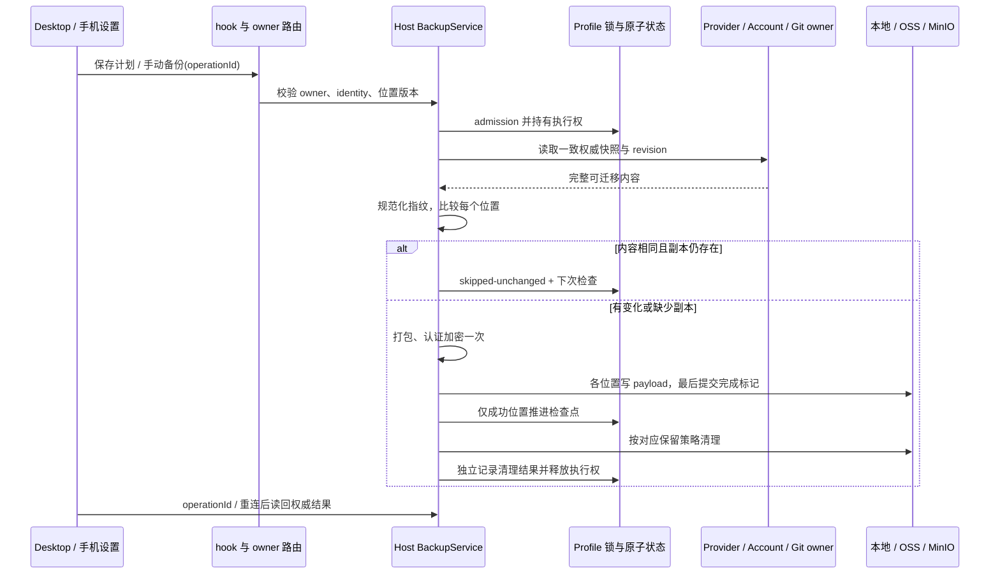
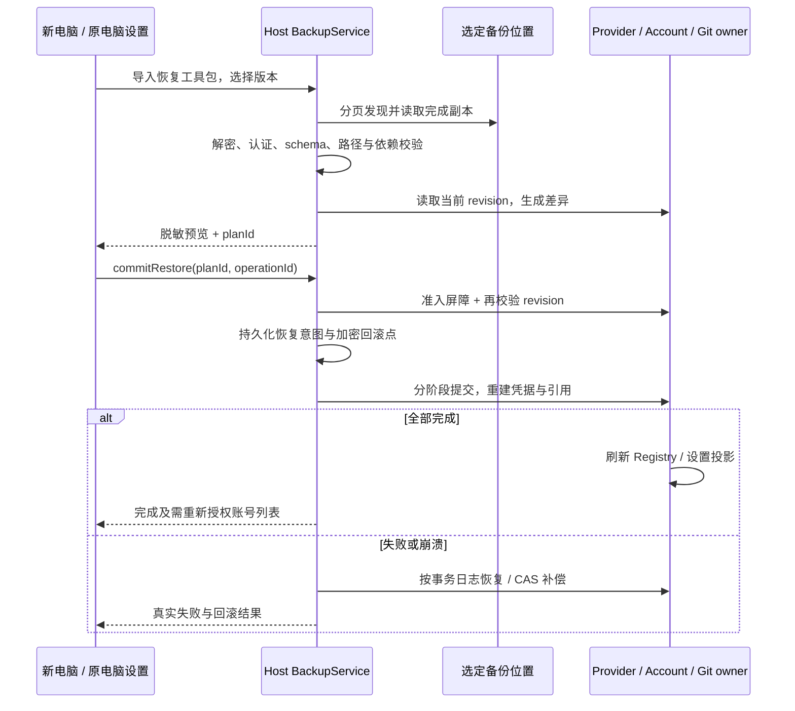

# 自动备份、供应商迁移与版本还原执行方案

状态：本期实现与 Windows 本机验证已完成。Git 原地覆盖、真实云账号及跨平台验证的边界见第 8 节。

日期：2026-10-21。依据当前检出源码、现有 spec、package.json 和 architecture-policy.yaml。

## 1. 目标与交付边界

将「设置 / 数据与统计 / Git 自动备份」升级为「自动备份」，用「Git 备份」「供应商备份」两个标签页管理两类数据，统一备份位置、版本列表、还原、删除和保留策略。将「模型设置」改名为「供应商管理」，桌面导航中紧随「远程控制」。

用户应能在旧电脑备份完整供应商信息，在新电脑连接同一备份位置、导入恢复密钥后，选择版本还原；也能只备份或还原一个供应商、一个 OAuth 账号或一个 Git 仓库。有变化且到达间隔才生成自动备份；没有变化不产生重复版本或上传。

本方案的“删除本地 / 云端”指删除备份副本，不删除当前供应商、账号、工作区或源码。源数据删除继续使用各领域原有入口。

## 2. 实施前已确认的事实与缺口

| 当前证据                                                                                                          | 已确认能力或限制                                                                                   | 对方案的影响                                                           |
| ----------------------------------------------------------------------------------------------------------------- | -------------------------------------------------------------------------------------------------- | ---------------------------------------------------------------------- |
| `packages/ui/src/settings/settingsPageConfig.ts` 的 `createSettingsPageConfig`；`specs/settings-sidebar-order.md` | 分组内按当前语言名称长度排序；`modelProvider`、`gitBackup` 是现有导航 ID                           | 单改名称或注册顺序不能保证指定位置；需要显式相邻规则和旧导航兼容       |
| `packages/services/src/git-backup/gitBackup.ts` 的 `IGitBackupService`                                            | 已有配置、手动备份、调度、连接测试、密钥导出；没有版本枚举、下载、还原、删除契约                   | 增加完整备份生命周期，不能仅在 UI 加按钮                               |
| `gitBackupService.ts` 的 `backup`、`poll`；`gitBackupStoreDocument.ts`                                            | profile 持锁调度、OSS / MinIO 独立结果、清单最后上传；只有上次结果，没有按数据对象持久化的成功指纹 | 保留跨进程互斥和晚到结果防护，补充版本目录及逐对象、逐位置检查点       |
| `gitBackupSnapshot.ts` 的 `captureGitSnapshot`；`specs/git-auto-backup.md`                                        | 只备份完整 `.git` 目录；不包含工作区未提交文件；拒绝 linked worktree、外部对象依赖等               | Git 还原不能承诺找回未提交文件；保持原范围并明确标注                   |
| `gitBackupDestinations.ts`、`gitBackupEncryption.ts`                                                              | 当前上传 v1 使用 AES-CTR / RSA；明文清单，归档无权限信息；没有可管理的本地历史归档                 | 新建支持认证与可恢复元数据的格式，本地副本也是新增能力；旧格式单独兼容 |
| `providerFacadeServices.ts`、`packages/provider/src/facades.ts`、`config-service.ts`                              | 供应商通过本机 Provider Settings owner 写入 Personal 配置；设置 RPC 可能省略大 Key 列表            | 备份从 owner 导出完整权威数据，不从页面投影或 `getView()` 拼装         |
| `providerAccountStorage.ts`、`providerAccountStoreSchema.ts`                                                      | OAuth 账号的 grant 在 CredentialService，公开视图不含完整凭据；另有本机 Host 身份                  | 不能只复制 Personal JSON 或直接搬运机器加密的 credentials 文件         |
| `providerProvisioningSource.ts`、`providerProvisioningTarget.ts`                                                  | 已有 Personal 编解码、凭据 allowlist、冲突检查与回滚基础；Provisioning 不等同完整账号备份          | 复用校验及事务机制；不可直接把远端分发信封当完整换机备份               |
| `useGitBackupRouting.ts`、`useModelProviders.ts`                                                                  | Git 跟随工作区 Host；供应商配置从本机服务读取                                                      | 两个标签页复用操作模型，但明确显示不同的执行 Host 与数据范围           |

已有文档：[Git 自动备份](./git-auto-backup.md)、[供应商设置](./model-provider-settings.md)、[设置侧栏](./settings-sidebar-order.md)。实施前同步修改这些 spec 中被本方案替代的规则，尤其是“没有内置恢复”及纯长度排序约定；不把待实施规则描述为当前功能。

## 3. 产品规则

### 3.1 导航与页面结构

```text
设置
├─ 基础设置
│  ├─ …其他现有项目
│  ├─ 远程控制
│  └─ 供应商管理       ← 原“模型设置”
└─ 数据与统计
   ├─ 自动备份         ← 原“Git 自动备份”
   │  ├─ Git 备份
   │  └─ 供应商备份
   └─ …其他现有项目
```

- 中文为“供应商管理”，英文为“Provider Management”；自动备份为“Automatic Backup”。页面标题、说明、可访问名称、欢迎引导与跳转文案同步调整。
- 保留 `modelProvider` 导航 ID。`gitBackup` 作为兼容入口解析为自动备份页的 Git 标签；本期由已有 Tabs 持有标签选择，不改变导航持久化。
- 先应用现有平台过滤和长度排序，再把供应商管理移动到远程控制后面；其余菜单相对顺序保持现有规则。Web / 手机没有远程控制时，不补假入口，供应商管理按原排序规则显示。
- 两个业务标签下使用一致的操作顺序：范围选择 → 自动策略 → 备份位置 → 立即备份 → 版本记录 → 还原 / 清理。现有 OSS / MinIO 配置标签属于“备份位置”，与业务类型标签使用不同可访问名称。
- 同一 Host 的位置配置与恢复密钥只维护一份；切换 Git / 供应商不复制凭据。不同 Host 的配置与密钥彼此独立，切换标签不能把远程位置配置自动复制到本机。
- Git 面板显示目标工作区及执行 Host；供应商面板显示当前供应商管理 owner 的 Host。Desktop 远程工作区激活时，供应商仍属于本机；手机访问桌面已有 attachment 的同一 owner，不把手机浏览器当备份 owner。
- 供应商备份不依赖打开 Git 仓库。任何 Host 未连接或缺少能力时显示不可用，不回退到其他 Host。

### 3.2 备份范围与完整性

| 数据               | 备份内容                                                                                                    | 还原规则                                                                       |
| ------------------ | ----------------------------------------------------------------------------------------------------------- | ------------------------------------------------------------------------------ |
| 个人 API 供应商    | 稳定 ID、名称、模板引用、地址、完整 Key 池及启停、模型参数、排除记录、模型 / 供应商顺序、用户配置的路由策略 | 按 ID 对齐，不因同名合并；Key、模型和配置必须完整还原                          |
| OAuth 供应商及账号 | 供应商个人覆盖、账号稳定身份、名称、启停、可迁移 grant、必要账号配置及模型信息                              | 经账号 owner 校验、重建当前机器凭据；过期或设备绑定的授权显示“需要重新授权”    |
| 供应商依赖配置     | 被选供应商引用的代理配置及必要凭据、完整备份中的默认模型与连接选择                                          | 导入依赖闭包；局部还原不改变未选择项、全局默认或无关顺序                       |
| 内置 / 模板来源    | 保存版本引用及用户覆盖；必要的可移植配置材料由 schema 明确定义                                              | 不覆盖新电脑随应用发布的内置目录；模板缺失或不兼容在预览中报冲突，不能静默降级 |
| Git 仓库           | 原有 `.git` 范围及恢复所需的文件模式等元数据                                                                | 一个工作区为一个备份单元；不包含未提交 / 未跟踪文件、LFS 外部内容等范围外数据  |

- 不备份应用登录态、远控配对、SSH 私钥、整个凭据库、Host ID、owner/lease、运行队列、临时失败游标、探测结果、签到记录、用量缓存和 `.runtime.json` 等运行状态。
- OAuth 通过渠道声明的可迁移字段导出；未知 grant 字段不盲目复制。不能跨机器复用的内容在清单内标注，仍保留可恢复的账号配置。每个渠道在实施时列出已验证 / 需重新授权 / 不支持迁移的能力矩阵。
- API 凭据完整性必须通过十万级 Key 池回读验证。公开列表摘要、`apiKeysOmitted` 和模型投影不能成为备份源。
- 全量供应商备份保存整个集合及集合删除事实；单项 / 多选备份标为部分备份。自动范围可选“全部（包含以后新增项）”或固定 ID 集合，不能把部分备份标为全量。
- 删除源列表中的已选项也算变化，记录删除事实；被全部删除的固定范围不再可用时提示用户处理。清空整个供应商集合可形成明确的空集合版本，避免错误保留旧配置。
- 手动提供全量、多选和行内“备份此项”；Git 按工作区，供应商按 provider，OAuth 可进一步选账号。版本详情提供同样粒度的还原勾选。模型 / 单个 Key 不另建版本链，随所属供应商恢复。

### 3.3 本地与云端副本

- 备份位置提供“本地”“阿里云 OSS”“MinIO”，每个位置独立选择、测试和显示状态。新建计划默认关闭；允许只备份到本地，也允许多位置并用。
- 先在 Host 受限临时区捕获并加密，已选本地位置经原子提交形成正式副本；云端各自完成数据上传后最后提交完成清单。未选本地位置时，临时文件不是本地历史版本，完成后清理。
- 同一份内容在一次运行中只捕获、加密一次，位置共享逻辑 backupId。版本列表一行展示各位置的副本状态，部分上传成功明确展示，不伪报总体成功。
- 新电脑必须能只凭位置配置列出云端版本，不能依赖旧电脑的本地索引。列表分页读取已完成清单，本机索引只作缓存；损坏条目、失败上传和无权读取分别展示 / 诊断。
- 手动导出备份包与导入文件可用于离线换机。路径选择和文件导入 / 导出走 `IPlatformService`；Web 使用文件字节与浏览器下载，不把浏览器路径当 Host 路径。
- 清除“位置配置”只清配置，不等于删除已有云端备份。版本列表中的“删除备份”是独立动作。

### 3.4 有变化才备份

自动间隔沿用 5–1440 整数分钟；Git 与供应商各有自己的启停、范围、间隔及下一次检查时间，位置凭据和引擎共享。

1. 保存策略不隐式增加数据项，也不自动启用；首次启用时以保存时刻加间隔作为首次检查时间。手动备份可立即执行。
2. 到期后申请跨进程执行权，重读权威策略、范围及位置版本；捕获一致快照后，对规范化内容计算指纹。
3. 指纹依据真实备份字段：包括增加、删除、值变化、语义顺序、Key / grant 变化和恢复相关文件模式；排除备份时间、随机 IV、文件 mtime、无意义 JSON 键序、探测 / 配额等不备份字段。Token 真实轮换属于需要备份的凭据变化。
4. 检查点按“owner profile + 业务类型 + 数据项 / 集合 + 选择范围签名 + 备份格式 + 位置版本”隔离。Git 数据项使用 `workspaceIdentity?.trim() || workspacePath`。
5. 与该位置上次成功提交且仍存在的完整副本一致时，记为 `skipped-unchanged`：不加密新包、不 PUT 对象、不新增版本、不更新上次成功时间，仅更新上次检查及下一次检查时间。
6. 只对不同或缺失副本的位置写入。OSS 成功、MinIO 失败后，下次到期只补 MinIO；成功位置不重复上传。位置 / bucket / 前缀变化、新增位置、备份格式升级，必须建立新位置检查点；单纯轮换同位置凭据不制造新版本。
7. 成功指纹只在完成清单提交后推进，失败不推进。已全部 unchanged 的周期正常延后检查，避免每次 poll 重扫；失败在下一间隔重试，不新增 Renderer 重试队列。应用恢复后最多补一次到期检查，不回补休眠期间每个周期。
8. 内容在间隔内改变又恢复为与成功副本相同，跳过。运行期间又有修改，当前快照只对应捕获版本，下一个周期重新比较，不能清除后续变化。
9. 手动“立即备份”同样去重并提示“无变化，已有可用版本”；首期不增加强制重复版本入口。还原前回滚副本属于独立用途，不推进自动计划检查点。
10. 手动 / 自动 / 还原 / 清理共用 admission 和锁；重复 operationId 返回同一结果，前端双击不产生两次已接受任务。

本地检查点是比较缓存，不是云端存在性证明；有检查点且内容相同时，至少核对当前副本的完成标记。删除最后一个可用副本使相关检查点失效；用户显式删除后，内容未改仍可在下一周期重建所需副本，文案说明该例外。

### 3.5 版本列表与还原

- 每个标签提供位置选择和按数据对象、来源电脑或时间搜索，列表显示全量 / 部分、时间、对象 / 账号数量、大小和格式，最近结果按位置显示；支持查看内容摘要、下载、还原、单项删除、多选删除与清理预览。
- 还原流程统一为：选版本及副本 → 解密与兼容校验 → 选还原范围 / 目标 → 展示新增、覆盖、跳过、删除及冲突 → 确认 → 保存回滚点 → 提交 → 刷新 owner 投影与展示结果。
- 默认“合并还原”：增加缺失项；相同 ID 且内容相同为 no-op；不同内容的冲突默认保留当前，用户可选择用备份覆盖。无关项保留。重复导入幂等，不重复创建供应商、账号或 Key。
- “替换所选范围”需明确选择并展示将删除的当前项。只有全量集合备份可执行“恢复整个供应商集合到此版本”；部分包不得删除包外数据。
- 局部导入的 ID 冲突按稳定 ID 和来源判断，不能按显示名覆盖；同 ID 的代理配置不同时阻断计划，需明确允许覆盖后重新预览，不自动重映射。账号 grant 与配置引用在同一恢复计划内校验。
- 预览生成短期 planId（10 分钟，同一 Host 最多保留 4 个未提交预览），绑定包摘要、选择范围、目标 owner、当前数据 revision 和位置版本。确认时重新校验，任何相关数据变化都拒绝旧计划并要求刷新预览。
- 提交前形成加密本地回滚副本。供应商跨 Personal 配置、账号凭据及必要设置使用持久化事务日志、CAS 和恢复屏障；所有常规写入及账号后台刷新也参与该屏障。先完成各 owner 写入，再统一刷新 Registry / 默认选择与 UI；不允许凭据写半份就显示成功。
- 失败按事务日志补偿；回滚只覆盖本次写入且仍保持预期值的内容，不能覆盖并发新编辑。崩溃后启动 owner 先恢复未完成事务，再开放相关写入与配置投影；回滚失败保留日志及回滚点，明确报告待修复状态。
- Git 默认还原到用户明确选择的新空目录，不根据备份中的旧绝对路径写盘。解包到同文件系统 staging，验证路径、长度、哈希、模式及 Git 完整性后再发布目标目录。
- Git 在用户确认后从恢复的 refs 重建已跟踪工作树；不运行备份中的 hooks、不自动访问 remote，不承诺未提交文件。外部绝对路径、危险 `core.worktree`、本地路径依赖等在预览中隔离或阻断；首期将 hooks 保存为不可执行的隔离副本，按需由用户另行启用。
- 已有非空工作区的原地恢复不在本期开放。后续必须先证明同一 Host / identity 的任务与全部 Git 写入排他，再实现回滚点和 `.git` 原子切换；当前明确拒绝非空目标，保留已有工作文件。
- v1 读取兼容现有长度编码和平台分隔符；拒绝绝对路径、`..`、重复 / 大小写冲突、符号链接及越界项。校验 SHA-256 不能声称为认证防篡改；无模式信息的旧包采用保守权限，hooks 不直接启用。未来格式和超限包明确拒绝。

### 3.6 换机密钥与格式

- 新包使用带 schemaVersion、backupId、sourceId、范围和 keyId 的版本信封；载荷及敏感清单采用认证加密，例如 AES-256-GCM，RSA-OAEP 包装数据密钥并兼容已有密钥对。新写入只用新格式，v1 继续只读兼容。
- 供应商名、账号、URL、Key、代理凭据及内容指纹不放入明文公共目录。云端只保留发现版本必需的最小元数据；认证上下文绑定类型、范围、格式及 ID，不能用未经认证的清单驱动写盘或删除。
- 增加恢复密钥导入和密码保护的“恢复工具包”导出：含私钥 / keyId 与必要格式信息；本期位置配置由新电脑手动填写，不将云端访问凭据放入工具包。密码使用有版本的 KDF 派生包装密钥；不上传明文私钥或工具包密码。
- 新电脑的操作为：导入工具包并解锁（或手动配置位置、导入原私钥）→ 扫描版本 → 预览 → 还原。无法只凭空白安装凭空找回加密凭据；工具包是换机必需材料。
- 本机私钥和导入密钥按 keyId 共存，不因导入覆盖旧密钥；保留密钥指纹校验，错误密钥 / 密码不会进入提交阶段。为旧密钥补充 keyId 映射，不自动轮换导致历史不可读。
- 新电脑还原不会自动继承旧电脑的调度开关、自动清理任务或 Host 身份。用户启用本机计划后使用新的 sourceId / writer namespace，保留旧备份来源信息。

### 3.7 删除与自动保留

- 单条、多选及按范围清理均先展示将删除的版本数、字节数和位置；明确提供“仅本地副本”“仅选中的云端副本”按位置切换选择，云端删除有最终确认。
- 删除只能处理当前命名空间内、已通过清单校验的备份对象；不得对 bucket、用户父目录或任意前缀执行递归清空，也不能顺带删除源数据或恢复密钥。
- 默认每个位置保留最近 10 个成功版本，可设置 1–100 或关闭自动清理。本地和云端分别设置，支持先手动“预览并立即清理”；0 表示关闭自动清理。
- 保留单位为“sourceId / writer + 业务类型 + 数据项 / 集合 + 范围签名 + 位置”。单个供应商备份不能挤掉完整供应商集合版本，不同工作区和不同电脑不能相互挤占版本数。
- 自动清理在该位置成功提交新版本后执行；降低保留数不立即删除，须手动预览确认或等下一次成功提交。没有新备份的 unchanged 周期不做云端全量清理扫描。
- 完成清单提交后新版本才计数。失败 / 进行中 / 还原占用的副本不能当作可替代的成功版本；删除期间同一个版本不能开始还原，已开始的还原持有引用，清理跳过。
- 最近一个恢复回滚点单独保留，不占普通 N；下一次成功恢复后可替换旧回滚点，也可明确手动删除。回滚失败对应的副本与事务日志必须保留到问题解决。
- 清理与备份结果分开：新备份成功但旧版本删除失败，展示“备份成功，清理失败”，逐副本报告并允许重试；不能因删除失败改写成功指纹或回滚新版本。
- 删除使用持久化删除意图 / tombstone，隐藏完成标记后删除受控数据对象，最后完成目录状态；中断重启继续同一 operationId，不留下伪完整版本。远端已不存在按幂等成功处理，本地缓存及检查点同步失效。
- 不同电脑的文件锁不能构成云端互斥。自动清理仅管理本 writer 创建的版本；跨电脑历史可查看、还原和显式删除。删除固定不可变 backupId 的精确对象清单，不修改共享总索引。还原必须先把整个版本下载到本 Host staging 并验证完毕，再允许修改源数据；其他电脑在下载时删除导致缺件，直接中止且源数据零写入，下载验证完成后云端删除不影响本次提交。重复删除通过 tombstone 和精确对象幂等处理，不引入依赖本地文件锁的跨电脑假互斥。
- 失败上传的孤立对象由独立清理流程按受控上传意图和存活 owner 判断，不能按时间超时猜测活跃任务已死亡。首期不清理无法证明归属的任意旧对象。

## 4. 状态所有者、接口与事件顺序

### 4.1 单一所有者

| 事实                                                          | 唯一 owner                                            | 其他层职责                                                     |
| ------------------------------------------------------------- | ----------------------------------------------------- | -------------------------------------------------------------- |
| 计划、位置引用、版本状态、指纹、运行 / 删除意图、事务恢复状态 | 所属文件系统 Host 的 BackupService/profile 持久化     | UI 只保存草稿、选择和请求投影；Main 只转发                     |
| Personal 供应商、Key、模型覆盖与顺序                          | Provider Settings / ProviderConfigService             | BackupService 通过注入的导出 / 恢复端口调用，不直接旁路写 JSON |
| OAuth grant、账号状态与刷新代次                               | ProviderAccounts + CredentialService                  | 账号 owner 导出可迁移内容并提交恢复，停用旧代次的迟到刷新      |
| 必要默认选择与账号设置                                        | SettingService 的原有字段 owner                       | 事务协调只改所选字段，不复制整份 AppSettings                   |
| Git 文件与写入准入                                            | 目标 Environment 的文件适配器 + 现有受控 Git 写入机制 | BackupService 协调 staging / 发布，UI 不接触 Repo              |
| 云端对象                                                      | OSS / MinIO 适配器                                    | 使用现有 Host 网络、代理、CA、签名、分页与取消边界             |

建议在现有 `git-backup` 基础上提炼受架构策略管理的 `backup` 模块，而不是复制成第二套供应商备份实现。`domain` 负责指纹 / 保留 / 选择规则；`app` 负责计划与生命周期；`adapters` 负责文件、锁、加密和对象存储。实施时注册 module、contract、node 入口及依赖，旧 `IGitBackupService` 先作兼容适配器；不能同时运行两套调度器或持有两份位置配置。

Provider 端导出 / 还原增加在既有 owner 合同上；不把原始 CredentialService 全库读取暴露为通用备份 RPC。复用 `provider-config-file-codec`，但不直接复用包含应用登录态的 Provisioning allowlist。

### 4.2 拟新增合同（接口名实施时按模块规范确定）

| 能力                                        | 输入 / 输出及约束                                                                             |
| ------------------------------------------- | --------------------------------------------------------------------------------------------- |
| `getCapabilities`、`getConfig`、`getStatus` | 可用格式、数据类型、迁移粒度、owner scope、配置 revision、逐数据项 / 位置结果                 |
| `configurePlan`、`configureDestination`     | expectedRevision、类型、目标 / 范围、间隔或保留策略；原子保存，凭据输出脱敏                   |
| `backupNow`                                 | operationId、类型、范围、位置；返回逐项 / 位置 `created / skipped-unchanged / failed`         |
| `listBackups`、`inspectBackup`              | owner、类型、范围、来源、位置、cursor；返回脱敏分页版本与副本状态                             |
| `planRestore`、`commitRestore`              | 包来源、所选稳定 ID、合并规则、目标；planId 绑定摘要与 revision，提交返回可回读的 operationId |
| `previewCleanup`、`deleteBackups`           | 精确 backupId / 副本集合、位置版本、预览 revision；逐副本幂等删除结果                         |
| `exportRecoveryKit`、`importRecoveryKit`    | 平台受控字节导入 / 导出、keyId 校验、密码保护；不返回原始供应商凭据给列表                     |

所有跨进程入参使用严格类型和运行时 schema；大包不塞进高频事件或普通设置快照。RPC 只负责操作准入及状态读取，UI 可通过 operationId 在重连后读回结果；手机断连不重发已接受的写操作。先核对实际 Host channel 注册 / capability 再落代码；本方案不要求新增 Agent stdio 业务命令，如实施确需改协议则同步公共协议与校验。





Desktop 的 `desktop-continuous` 与手机 `web-remote-replayable` 共用同一操作 owner 和持久化状态；前者连续读取执行进度，后者重连读取 operationId 和最终结果。云端、relay 和 Main 不保存业务队列；不为恢复新起 Agent、Host 或手机会话。

## 5. 分阶段实施与完成条件

实施决定：新 `backup` 模块只拥有备份生命周期，不自行创建定时器。现有 profile GitBackupService 作为兼容入口和唯一调度宿主，通过注入端口调用统一引擎；OSS / MinIO 凭据继续只在现有配置 owner 保存。Git 计划保留现有配置，供应商计划、本地位置、保留策略和生命周期记录由统一引擎保存，各字段只有一个写入所有者。新旧客户端共用原 Host channel，新增方法不建立第二个后台服务。

首期 Git 还原以新空目录为可发布目标；已有目录采用拒绝覆盖的安全边界，待全工作区写入排他准入可证明后再开放原地替换。恢复内容检查、还原预览和回滚不会因这一边界被跳过。

| 阶段                  | 变更与依赖                                                                                                                         | 完成条件                                                                                     |
| --------------------- | ---------------------------------------------------------------------------------------------------------------------------------- | -------------------------------------------------------------------------------------------- |
| P0 合同与案例         | 本方案细化到现有三份 spec；新增 backup 模块合同 / 架构注册；冻结数据 schema、渠道能力表、迁移和故障状态                            | 产品规则、owner、接口、冲突策略、测试矩阵先于实现；新的 sourceId 与旧 identity 不能混用      |
| P1 统一引擎与迁移     | 从旧 Git owner 提取锁、位置配置、网络、密钥、状态生命周期；接入旧合同适配；实现 v2、本地副本、远端 list/get/delete 和 key 导入导出 | 旧 OSS / MinIO、工作区选择、间隔、凭据、引导记录不丢；只剩一个调度 owner；v1 可读            |
| P2 内容检测与版本管理 | 一致快照、规范化指纹、逐位置检查点、可重建目录、失败重试、预览删除、保留策略                                                       | 连续多个 unchanged 周期零新版本 / 零上传；单位置失败仅补失败位置；删除重启可恢复             |
| P3 供应商完整闭环     | owner 的完整导出和部分选择、grant 可移植转换、差异计划、恢复事务 / 屏障与回滚                                                      | 两个全新 profile 的真实导出 → 加密备份 → 发现 → 还原 → 回读一致；单项还原不影响其他项        |
| P4 Git 恢复闭环       | v1 / v2 解析、路径与边界校验、空目录恢复、工作树重建；非空目录明确拒绝                                                             | 恢复仓库通过完整性验证，可读取分支及提交；不覆盖未提交工作文件、不执行 hooks                 |
| P5 设置与交互         | 改名 / 相邻排序 / 导航兼容；双业务标签、位置配置复用、范围列表、版本和差异 / 清理对话框；保留草稿与 stale scope 防护               | Desktop / 手机、中英文、主题及键盘可操作，断连 / 切 Host 不串结果，既有欢迎引导进入 Git 标签 |
| P6 联调与交付         | 浏览器 E2E + 真 Host / 文件 / 兼容对象存储集成；模拟重启、换机和权限失败；文档更新与 scoped 格式检查                               | 下列验收通过，typecheck / lint / architecture 必跑，真实远端和平台未覆盖项如实列出           |

每阶段先写可失败的行为测试再实现；UI E2E 不替代 Host 数据完整性与远端协议测试。阶段结束保留可运行的垂直闭环；P1–P5 全部完成才算用户需求交付。

优先修改路径：`packages/services/src/git-backup/` 与拟新增的 backup 模块；`packages/provider/src/`、`packages/provider-node/src/` 的公开 owner / codec 合同；`packages/services/src/model-provider/`；`packages/services/src/node.ts` 的注入装配；`packages/shared/src/` 的 schema / channel；`packages/ui/src/hooks/`、`settings/`、`lib/settingsNavigation.ts`、双语 locale。必要时扩展平台端口并分别实现 Desktop / Web，不直接使用 `window.lcode`。

## 6. 验收与风险裁剪

以下为 accepted 的计划场景，均尚未实现或执行。测试名和新增文件在对应实现阶段创建，不能将本表当已存在覆盖。

| ID  | 准备与动作                                            | 核心断言                                                                         | 必需证据                                |
| --- | ----------------------------------------------------- | -------------------------------------------------------------------------------- | --------------------------------------- |
| A01 | 中英文切换；桌面 / 手机打开设置与旧入口               | 正确改名；桌面紧随远控；Web 无假远控；旧 gitBackup 到 Git 标签                   | 设置配置单测 + 真实 SettingsPage E2E    |
| A02 | 三供应商 / 多账号 / 两 Git 工作区，只选一项备份和还原 | 仅选中项及依赖变化，未选项、默认与自动名单不变；全量 / 部分标识正确              | owner 快照差异 + 文件证据 + E2E         |
| A03 | 持续多个到期周期无变化；改后再改回                    | zero 新对象 / 版本，显示 skipped，检查时间推进，成功时间不伪变                   | 注入时钟 + 网络请求 / 版本计数          |
| A04 | Key / grant / 模型 / 排除 / 顺序 / Git 内容或权限改变 | 到期才备份；同内容 mtime、探测和配额刷新不制造版本                               | 参数化 owner / 文件测试                 |
| A05 | OSS 成功、MinIO 失败；重试、更换位置或轮换 Secret     | 成功指纹不重复推进；仅补缺副本；新位置有首份备份；Secret 轮换不造版本            | 逐位置请求与原子文档                    |
| A06 | 全新电脑 profile，只有备份位置和恢复工具包            | 从云端发现历史；完整恢复 API 信息与超大 Key 池；所需 OAuth 重新授权状态准确      | 两 profile 真服务集成 + 文件 / 凭据回读 |
| A07 | 错密码 / key、损坏密文、未来 schema、缺模板 / 缺依赖  | 预览前失败或明确冲突；不写源数据、不覆盖当前密钥                                 | 认证 / schema / 故障注入                |
| A08 | 合并、替换、重复提交、预览后另窗口修改                | 幂等无重复；部分包不删除包外项；旧 plan 被拒绝；冲突结果可解释                   | CAS / owner 并发集成 + E2E              |
| A09 | 恢复在各写阶段失败 / 崩溃；账号刷新晚到               | 重启完成恢复或回滚；无半份成功投影；旧 grant 不覆盖恢复值                        | 持久化日志、重启 / 刷新竞争测试         |
| A10 | v1 / v2 Git 在 Windows / macOS / Linux 恢复至新目录   | 分支、objects、refs 可读；文件分隔符与大小写冲突受控；工作树重建不执行 hooks     | Git 完整性命令 + 跨平台集成             |
| A11 | Git 活跃任务、外部路径、恶意归档、超限、非空目标      | 明确拒绝；工作区外零写入；已有工作文件与回滚点完整                               | 文件树前后对比 + 错误用例               |
| A12 | 多位置各超过 N；部分备份混合；删除中崩溃 / 云端拒绝   | 仅本范围成功副本计数；不误删完整集合、其他电脑或占用版本；清理失败不篡改备份成功 | 保留纯函数 + 对象存储集成               |
| A13 | 远程与本地同路径、不同 identity；切 Host 后旧请求完成 | 路由和检查点隔离；断连不 fallback；UI 草稿和结果不串 Host                        | client / desktop 路由测试 + E2E         |
| A14 | Desktop 连续进度；手机在上传 / 还原时断连再连         | 同一 owner 继续运行；operationId 读回结果；不重复执行 / 不新起会话               | 两种 delivery 语义的集成证据            |
| A15 | 本地 / 云端分别删除和批量清理；取消确认               | 取消无副作用；仅选中副本删除；源数据、其他位置、私钥不变                         | 文件 / 对象清单前后对比 + E2E           |

裁剪：不做任意 bucket 文件管理（命名空间和 schema 限制）；不备份工作区未提交文件或会话数据库（当前范围约束）；不承诺所有 OAuth 凭据跨机器免登录（渠道迁移能力限制）；不迁移源 Host 身份与活动运行（隔离不变量）；不把局部 Key / 模型拆成独立版本链（供应商为最小配置一致性单元）。

需在 P0 细化但不阻碍本轮出方案的事项：逐 OAuth 渠道的可迁移字段及验证环境；Git 现有受控写入机制如何给整个恢复切换提供排他准入；OSS / MinIO 分页发现、tombstone 过滤、下载与跨电脑删除竞争的兼容证据。若无法提供这些保证，应明确阻断对应操作，不能用超时或静默兜底代替。

## 7. 计划阶段的验证入口与记录（2026-10-21）

当前已核实的测试入口（实施后按变更范围选择执行）：

```powershell
node --import tsx --test packages/services/src/git-backup/gitBackupService.test.ts packages/services/src/git-backup/gitBackupService.destinations.test.ts packages/services/src/git-backup/gitBackupService.history.test.ts packages/services/src/git-backup/gitBackupSnapshot.test.ts packages/services/src/git-backup/gitBackupStore.test.ts packages/services/src/git-backup/gitBackupStore.migration.test.ts packages/services/src/git-backup/gitBackupEncryption.test.ts packages/services/src/git-backup/gitBackupOssClient.test.ts packages/services/src/git-backup/gitBackupMinioClient.test.ts
pnpm --dir packages/ui exec tsx --test src/settings/settingsPageConfig.test.ts src/settings/GitBackupSection.test.tsx src/hooks/useGitBackup.test.ts
pnpm --dir packages/web exec node --test test/settings-sidebar-order.test.mjs test/git-backup-workspaces.test.mjs
node --import tsx --test packages/client/src/remoteServiceAccess.gitBackup.test.ts packages/desktop/src/renderer/src/remoteWorkspaceSessionServices.gitBackup.test.ts
pnpm typecheck
pnpm lint
pnpm architecture:check --changed
```

现有 Web E2E 使用仓库内 `startWorkflowProgressBrowser` 与 Vite fixture；可扩展 `packages/web/test/fixtures/git-backup*`。供应商 / 还原新增测试将复用既有 Provider owner 和账号测试设施；不能假定存在统一单测命令。换机和真实存储读写必须另建集成场景，不能只靠 mock 页面宣称完成。

计划阶段已执行（以下不是实施后的功能验证）：

- `node scripts/check-workspace-freshness.mjs`：通过。
- Node `24.21.0`、pnpm `10.34.6`：与 `mise.toml` 一致。
- `pnpm architecture:check --changed`：通过，违规 / baseline / new 均为 0；services / provider / provider-node / ui 的受控上下文已读取，这些目前为 legacy unmanaged，检查通过不等同于设计保证。
- `pnpm typecheck`、`pnpm lint`：通过。
- 功能图 YAML、113 个唯一节点、176 条关系的端点与 rank、6 个相关节点的源码路径 / 符号已验证。
- 使用 `pnpm dep:refs` 核对备份创建者与供应商分发源的静态调用，未删除或改动这些导出。
- 仅方案和种子别名调整；未运行功能单测、浏览器 E2E、云端读写或实际还原。上述新增能力尚无本轮执行证据。
- 功能图补充“供应商管理”发现别名，保持原节点 ID；新备份能力等实现后再加入有源码证据的节点。技能引用的 `docs/skills/feature-boundary-graph.md` 当前缺失，记录为 graph-drift-candidate，不重建历史文档。

工作区原有远程连接、双语 locale、SSH 代理 fixture / 测试及 `specs/ssh-settings-proxy-mode.md` 改动均与本轮无关，保持原样。

## 8. 实施记录（2026-10-22）

### 8.1 已落地的分阶段结果

| 阶段 | 实际交付                                                                                                                                                                                        |
| ---- | ----------------------------------------------------------------------------------------------------------------------------------------------------------------------------------------------- |
| P0   | 先更新产品 spec，新增 `backup` 受管模块、12 方法契约、Node 端口及架构注册；功能图保留原导航 ID 并补充实际源码种子。                                                                             |
| P1   | Git 和供应商共用 `backupEngine`、位置适配器、认证加密、恢复密钥环和原 `git-backup` RPC channel。旧 Git 服务保留唯一 timer 和 profile 执行锁，旧存储配置、凭据及引导记录继续读取。               |
| P2   | 完整快照的规范化内容指纹，按数据范围和位置隔离检查点；无变化不加密或上传新包；失败副本补传，完成清单丢失检查点后可重建；本地和云端精确删除、v1/v2 删除中断恢复、逐 writer 与范围保留最近 N 版。 |
| P3   | Personal 配置及账号 owner 完整导出；API Key 池不受 UI 摘要限制；全量与部分备份、合并/替换预览、CAS、加密日志与回滚；普通编辑、后台刷新和恢复共享事务屏障，恢复 epoch 阻止旧 grant 晚到覆盖。    |
| P4   | v1/v2 Git 校验、旧分隔符兼容、新目录/空目录 staging 发布、Git 完整性验证和已跟踪文件重建。非空目标及危险外部配置明确拒绝，hooks 隔离；不覆盖已有工作文件。                                      |
| P5   | “供应商管理”改名并紧随桌面“远程控制”；“自动备份”包含 Git/供应商两标签；复用目的地表单，保留草稿，供应商不依赖当前 Git 工作区；版本发现、离线包、选项备份/还原、差异确认、删除确认及保留策略。   |
| P6   | 新增集中测试入口并运行真实文件、Git、双 profile、HTTP S3 兼容协议、RPC、组件及浏览器验证；最后一次结果见 8.3。                                                                                  |

实现入口：`packages/services/src/backup/app/backupEngine.ts`、`git-backup/gitBackupLifecycle.ts`、`model-provider/providerBackupSource.ts`、`packages/ui/src/settings/AutomaticBackupSection.tsx`。网络请求、文件 IO 和凭据读取均为异步，UI 只通过 hook 调用服务。

共享目的地配置仍由旧 Git store 持有；新的 `backup-lifecycle.json` 只持有本地位置、供应商计划、保留策略、检查点、操作回执和未完成意图。没有第二个计时器、第二份云端配置或第二个 accepted 队列。供应商秘密读取端口保存在 Host WeakMap，不能成为按方法名反射的账号 RPC 方法。

供应商表单以“只保存位置”方式提交，既不覆盖 Git 备份间隔，也不覆盖另一标签页刚修改的目的地开关。新策略使用 revision CAS，旧草稿保存冲突时要求重新读取，不静默覆盖。恢复预览保存在 Host 私有内存，最多 4 份、10 分钟有效，失效、切位置或源配置改变均拒绝提交。

### 8.2 换机流程与渠道边界

1. 旧电脑保存备份位置并执行供应商备份；全部范围包含后续新增项，也可固定勾选范围。
2. 导出至少 8 位密码保护的恢复工具包，需要离线迁移时同时下载备份包。工具包携带密钥环，不携带云端访问凭据、Host 身份或自动任务开关。
3. 新电脑配置相同云端位置并导入工具包，然后读取版本；或者导入工具包及离线备份包到本地版本列表。
4. 选择版本和供应商/账号，先预览，再确认合并或替换。缺少的插件模板、冲突代理及无效包在写入前拒绝；不迁移机器运行态。

| 授权来源                                                      | 当前迁移策略                                                                                               | 验证边界                                                         |
| ------------------------------------------------------------- | ---------------------------------------------------------------------------------------------------------- | ---------------------------------------------------------------- |
| Personal API 供应商                                           | 完整配置、Key 列表、模型规则、启停/排除、顺序及引用代理随加密包迁移                                        | 真实两 profile 文件回读与 100,001 个 Key 完整性验证              |
| codex / chatgpt-api / copilot / gemini / antigravity / claude | 由渠道适配器按明确字段 allowlist 导出可移植 grant；去掉本机来源/设备运行态，恢复后仍按原 driver 校验和刷新 | 已验证字段转换、事务和旧刷新隔离，未用真实上游账号验证登录可用性 |
| 其余或插件 OAuth 渠道                                         | 恢复账号信息，但不假定 grant 可移植；标记过期、禁用并提示重新授权                                          | 不承诺跨机器免登录                                               |

本期 Git 还原只接受新目录或空目录，重建备份 HEAD 的已提交内容；未提交文件本来就不属于备份范围。已有仓库的原地替换尚未实现，须先解决全部 Git 写入者的排他准入，不能仅依赖单次命令锁。

### 8.3 实际验证

集中入口：

```powershell
pnpm test:automatic-backup
pnpm test:automatic-backup:ui
pnpm typecheck
pnpm lint
pnpm architecture:check --changed
pnpm --filter @lcode/web build
```

| 验证                                | 实际结果                                                                                                                                 |
| ----------------------------------- | ---------------------------------------------------------------------------------------------------------------------------------------- |
| `pnpm test:automatic-backup`        | 231 项后端/文件/协议测试 + 33 项组件/设置测试通过，失败、跳过均为 0                                                                      |
| `pnpm test:automatic-backup:ui`     | 3 项浏览器场景通过，包含选项备份、无变化、还原预览/确认、删除取消/确认、超限导入、中英文、390px 和主题；既有工作区选择及设置侧栏回归通过 |
| `pnpm typecheck`                    | 通过，实际执行仓库全部配置项目                                                                                                           |
| `pnpm lint`                         | 通过，无警告；超长文件已按职责拆分                                                                                                       |
| `pnpm architecture:check --changed` | 通过，违规 / baseline / new 均为 0                                                                                                       |
| 本任务路径的 `oxfmt --check`        | 79 个匹配文件通过；未宣称整个工作区的格式检查通过                                                                                        |
| 功能图校验                          | 117 个唯一节点、180 条有效关系，10 个备份源码种子的文件/符号存在                                                                         |
| `git diff --check`                  | 通过                                                                                                                                     |

`pnpm --filter @lcode/web build` 通过（10.07 秒）；保留了已有的大分包及动态/静态重复导入提示，没有编译错误。日志为同目录 `web-build.log`。

架构范围涉及新增受管模块 `backup`，以及既有 services、provider-node、shared、client、desktop 与 UI/Web 适配边界。任务路径共 79 个，包含 45 个新文件；净行变化见 `.lcode/component-quality/automatic-backup/change-summary.json`（相关路径包含两份 locale 的既有改动，不将整个 diff 归因于本任务）。状态所有者、事件顺序与实际入口见 4 节及 8.1，原有未关联的工作区改动保留。

验证日志和桌面/390px、明暗主题截图位于 `.lcode/component-quality/automatic-backup/`。Web fixture 挂载真实组件但使用测试服务；它只证明交互。业务完整性由独立的真实文件/服务测试证明；HTTP 集成测试启动本地服务器验证 S3 签名、分页、上传、发现、下载与精确删除，不以页面 mock 宣称云服务已验证。

本轮在 Windows 执行。没有接入真实阿里云 OSS/MinIO 账号、没有真实 OAuth 登录、没有运行 macOS/Linux 或真实手机断网恢复验收。远程同 channel/identity 的命令转发已有 client/desktop 用例；本轮不将它等同于完整网络断线测试。

自动保留只管理本 writer 的完整 v2 副本；旧 v1 允许显式删除但不猜测其 writer 并自动清理。tombstone 作为防止历史复活的最小删除事实保留；无法证明归属的历史孤立对象不自动清除。供应商最近一次恢复回滚点保存在私有 profile 文件中，事务失败时不清除。

Windows 原生 oxfmt 批量写入发生异常并截断 3 个工作文件；文件已恢复，改用同版本 format API 加异步原子写入，随后重新验证。格式检查仍使用仓库 oxfmt，只覆盖本任务路径，不格式化并行任务的远程连接或工作区状态改动。
