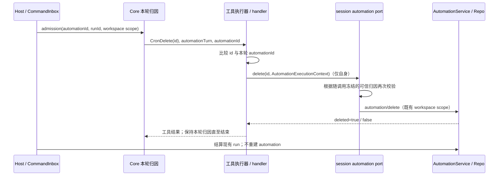

# 自动化执行轮仅删除自身

## 问题与产品规则

自动化 prompt 可以要求在观察到完成条件后删除自身。原实现将 CronCreate、CronUpdate、CronDelete 一起隐藏并在 handler 拒绝，导致任务完成后持续唤醒。

- 自动化执行轮允许 CronList 和 CronDelete；CronCreate、CronUpdate 仍隐藏且在执行边界拒绝。
- CronDelete 的目标必须精确等于当前执行轮的可信 automationId。禁止删除同 workspace 的其他自动化，也禁止用会话绑定、模型输入、列表结果或 workspacePath 推断自身身份。
- 已识别为自动化轮但缺少可信 automationId 时，删除失败关闭；不能因为身份缺失获得普通用户权限。
- 普通用户轮保留现有管理权限；先前执行过自动化、持久化 cronAutomationId、删除自身后的本轮身份均不能扩大权限。
- 额外的调用方工具禁用策略继续生效，不主动移除显式 CronDelete 禁用项。旧版本传来的全量禁用策略仍可拒绝删除。

## 状态所有者与接口

- CommandInbox/admission 持有每次输入的 automationId，Core RegularTurnLoopState 持有本轮不可由模型改写的执行归因。
- Core 将 automationTurn 与 automationId 通过普通批次及流式执行路径传给 ToolExecutionContext。automationTurn 表示受限轮，automationId 仅用于自删除目标比较；只有 boolean 或 queryId/denylist 信号不授予自删除权限。
- AutomationPort 的 create/update/delete 接收执行器传入的可信 AutomationExecutionContext（automationTurn、automationId）。bootstrap 端口优先使用这份随调用冻结的归因；旧调用方未提供上下文时才读取 session 的 activeAutomationId。不能用准入过程中暂变的 session 标记覆盖在途工具身份，也不读持久化会话绑定授权。该上下文只在进程内传递，既有 automation/delete 请求参数和运行时 schema 不变。
- AutomationService/AutomationRepo 是唯一自动化定义写入路径，按 workspaceIdentity?.trim() || workspacePath 校验隔离。删除定义保留会话及 automation_runs 历史，无 schema 或数据迁移。
- 调度认领、owner/lease、跨 Host 路由、stale run 保护和正常权限审批沿用现有流程。本次不改变运行授权、队列或重放协议。

## 事件顺序、幂等与失败

- 删除其他 ID 或无可信身份：PermissionDenied，在访问端口/持久化前失败；不得伪造成功。
- 首次删除成功返回 deleted=true；重复删除自身返回 deleted=false，沿用未找到语义。重复请求不重建定义、不删除历史。
- 删除完成不终止当前回复；本轮继续受限，直到真实 turn 结束才清理归因。迟到的 dispatch/outcome 更新只能更新已有定义或 run，不能复活定义。
- Desktop `desktop-continuous` 与手机 `web-remote-replayable` 使用相同 admission/执行权限与 workspace scope；前者实时展示工具结果，后者通过原事件序列重放结果，恢复不增加写入路径。
- 本轮正在运行或已被接受的输入沿用原 admission/lease 语义；删除阻止后续从定义认领，不能把删除当成取消现有输入。

## 验收与验证

1. Host/service 与 V4/legacy admission 注入策略保留调用方已有禁用项，只额外隐藏 CronCreate、CronUpdate。
   legacy 从 inputId 解析出的归因也必须继续传入 Core，不能仅保留在 session record 中，否则会错误拒绝自身删除。
2. provider 可见工具包含 CronList、CronDelete，隐藏创建/修改；Core handler 对直接提交创建/修改仍拒绝。
3. 普通批次与流式执行传递相同可信 automationId；删除自身到达端口，删除其他 ID 在端口前拒绝。
4. 自动化轮身份未知、只有 queryId 或 denylist 信号时拒绝删除；普通用户轮仍能管理自动化。
5. session port 在自动化轮拒绝修改及删除其他 ID，用户轮不因上轮归因残留受限。
   输入准入使 session 临时标记变化时，工具仍依据当前调用的可信归因；上下文缺失保留旧入口检查，明确为自动化轮但 ID 缺失时拒绝删除。
6. 使用隔离 SQLite 创建两个同 workspace 自动化：自身删除、重复删除、其他定义保留、跨 identity 不删除、run 正常结算、迟到派发不复活、后续不再认领已删除定义。
7. 执行相关 Node 测试、根目录与 CLI 的 typecheck/lint、changed 架构检查，并记录真实结果。

## 验证记录（2026-10-20）

- 按 `mise.toml` 使用 Node 24.21.0；根目录与 CLI 分别使用各自的格式化器。
- 13 个测试文件共 63 项通过，0 失败、0 跳过。覆盖 service 策略、V4/legacy admission、session port、真实 Core loop/执行器，以及隔离 SQLite；并回归 CommandInbox、流式调度、记忆处理的后台轮限制。额外覆盖 session 临时归因与本轮工具调用交错时的权限隔离。
- Core loop 集成覆盖 `desktop-continuous` / `web-remote-replayable` 与流式开关的四种组合；自删除之后尝试删除其他自动化失败，下一用户轮恢复管理权限；during-stream 路径单独验证可信身份透传。
- 根目录 `pnpm typecheck`、`pnpm lint` 通过；CLI `pnpm --dir apps/lcode-cli typecheck`、`pnpm --dir apps/lcode-cli lint` 通过。Turbo 提示现有 lockfile 中部分 workspace 未登记，检查仍正常结束。
- `pnpm architecture:check --changed`：0 违规、0 基线违规、0 新违规。模块为 services、session（测试）和 lcode-cli；所有者与依赖方向不变。
- 改动文件格式检查、`git diff --check` 通过。本次未改真实自动化数据，也未启动真实模型或桌面 UI；桌面/手机交付边界通过运行时配置及事件序列验证。
