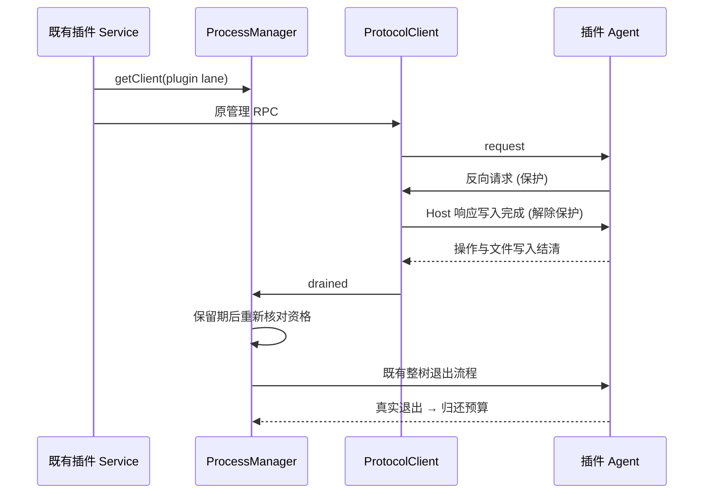

# 辅助 Agent 空闲回收

执行 chat、插件管理、MCP 状态保持独立 manager/队列。plugin lane 与现有 mcp-status lane 使用默认 5 分钟空闲保留；只在真实请求、数据库启动和反向 Host 请求全部结清后回收。chat 不启用空闲回收。

LCodeAgentProcessManager 是物理进程和预算唯一 owner；LCodeProtocolClient 是协议请求与反向响应写入状态唯一 owner。反向请求登记后必须保护进程，直到 respond/respondError 的 transport.send 实际完成；发送失败保留保护状态，不能把本机写入失败当成 Agent 已完成。dispose 才无条件清理本代集合。

计时器到期再次核对当前 workspace key、manager generation、pending operation、pending Host response、storageStartup。新请求打断空闲资格，最后结清重新计时。真实退出/既有 cleanup barrier 之后才结算预算。管理入口每次重新 getClient，复用同代，旧 client 不替代新代。

插件 RPC 已在远端操作完成/文件写入完成后返回；在途 install/update/configure 不因空闲定时器退出。现有健康超时策略保持不变，不另加重试或合并执行 lane。processLifecycleReporter 同时记录 plugin lane，供原内存诊断归因。

验收：真实 stdio 测试保护长请求和反向请求，完成后退出，重新请求新代，多个 identity 隔离；原 MCP/插件/聊天并发测试覆盖 desktop-continuous 和 web-remote-replayable。未改变账号鉴权实现，回收时不能绕过新代原鉴权握手。
