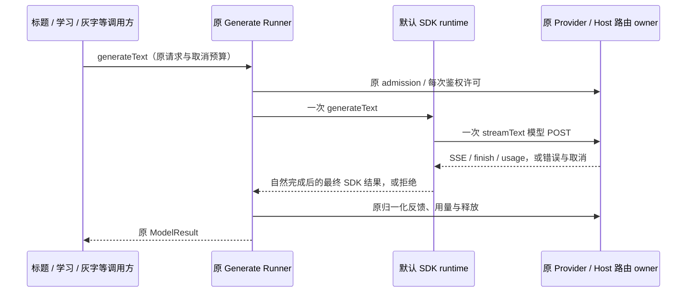

# 辅助生成的流式传输与最终结果

## 原因与契约

安装版真实 WorkBuddy 会话的主聊天成功，但标题、主动记忆提取和 composer prediction 均收到 `400 Non-stream chat request is currently not supported`。`Model.generateText` 表达一次性返回最终结果，不承诺 HTTP 使用非流式；不能在三个业务处分别切换模型或失败后重发。

- Model binding 冻结最终结果的传输方式：受控 OAuth 通道以其流式推理契约为准，generateText 使用同一 SDK streamText，以单次 SSE 请求收集最终结果；API 通道保留原非流式协议。默认 runtime 通过内部显式 transport 参数处理两者，业务调用方不选择协议。标题、记忆、预测等共用此路径，不按供应商名添加例外，不先发非流式再 fallback。业务 Model 接口、JSON schema、工具禁用、独立核验与 CAS 不变。
- 原 Runner 仍独占 admission、鉴权刷新、物理尝试预算、重试策略、路由反馈和用量；收集器不重试、不另建队列、不调用工具。沿用 maxRetries=0、AbortSignal 和原公开模型选项。
- 仅自然完成后返回完整 SDK 最终结果：text、reasoning、finishReason、usage/totalUsage、工具/来源、provider metadata、response headers 与结构化 output。错误 chunk、异常 EOF、取消不能返回半截成功；length 仍保持原结果状态，由原调用方决定是否接纳。
- 原 generate runner 的 skipTranscript/模型 I/O 规则保持；原始 SSE chunk 不新增持久化。状态 telemetry 与冻结 binding 的实际传输一致；旧 binding 缺省保持 HTTP。API HTTP、OAuth SSE 均需回归，不以改写全部 API fixture 掩盖协议兼容退化。
- 已存在的路由 owner、lease、绑定和保守额度保护不放宽。实际并发阻塞先在传输修复后复验，不能凭一次辅助失败绕过路由。
- 已被严格路由错误明确标为 dispatch=unsent、且没有提交输出的拒绝，不向不存在的原租约发送归一化反馈；避免误报 owner-stale 与“保留未知预留”。已派发、未知消费或已提交输出仍保留原反馈与保守保护；重试预算不变。

## 验收

真实 HTTP fixture 拒绝非流式：默认辅助生成仅发一个 stream=true POST，正确聚合文字、推理、用量、响应头和结构化输出；工具结果保留但不自动执行。分片后错误或取消不返回部分成功，取消关闭物理连接；HTTP 400 不重发其它协议。SDK/Runner 回归及类型、Lint、架构通过后，以 production 安装版 RecordingFreedom 再验证主动记忆、历史注入、位置复制与灰字；外部账号或容量失败必须与本地实现问题区分。

扩大回归发现旧 API failover 测试直接调用 SDK doGenerate，仍期待 HTTP 层隐藏重发，与现行 Runner 独占每次 Key 尝试的规则冲突。测试改走冻结 binding 和原 Runner，保留保存代次/供应商隔离断言；全部 Key 已失效后应零新 POST，不用最后一把失败 Key 探测。产品路由保护不改。
