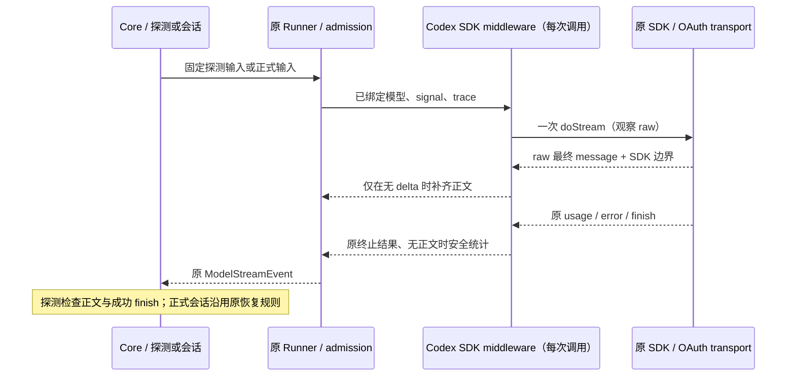

# Codex OAuth 正文完成与连通性校验

## 证据与范围

- 用户反馈 macOS 的 Codex OAuth 模型测试通过，正式新旧会话均无正文；切换速度、推理档位、关闭电脑操作和插件无改善。现有 Main 日志缺少该次上游响应事件，不能认定账号、平台、插件或具体事件变体是根因。
- 当前 Core 连通性入口只检查 `finish`，可将无文本结果判为成功。
- 当前安装的 OpenAI SDK 在 `response.output_item.done` 的 message 分支只发 `text-end`，未读取完整正文；`response.completed` 也不读取最终 output。最终消息有正文、但没有文本 delta 的数据可复现正文丢失。
- OpenAI Codex 的公开 SSE 实现将 `response.output_item.done` 作为权威 output item；本次只兼容 Responses 的这类标准最终消息，不添加未经实际证据确认的事件别名。

## 规则、所有者与接口

1. Core 的 `testModelConnectivity` 成功必须同时满足：收到非空白 `text_delta`、收到成功的 `finish(stop)`、流正常结束。usage、reasoning、未知/失败 finish 均不能替代文本回复。已有错误原样归一化传播，取消和 60 秒 deadline 不变。
2. Codex OAuth 的 SDK middleware 在每次 `doStream` 内拥有独立的临时消息状态；只观察 raw event 和 SDK 文本边界，不保存会话、路由或账号状态。
3. 对没有任何 SDK 文本 delta 的 message，从该 message 的 `response.output_item.done` 或 `response.completed.response.output` 补发原始 `output_text`。一旦该 message 已收到文本增量，保持现有 SDK 结果，不拼接推测的缺失尾部。多条 message 分别判断；不从 reasoning/refusal/tool arguments 提取可见文本。
4. 保持 message ID、phase、顺序及 start/delta/end 边界；已有 start/end 不重复生成。raw 仅在调用方原本要求时继续传递；usage、工具调用、SDK 错误、finish、取消及 backpressure 继续由原 SDK/Runner 所有。
5. middleware 只装配在 `oauth-account/channelId=codex` 且 Responses 协议的 binding；API Key、Copilot、其他 OAuth、非流式 HTTP 结果均不受影响。不新增推理 POST、刷新、重试或全局缓存。
6. 空输出结束时，在现有 Adapter Logger 的 warn 中记录固定类别事件计数、终止类别、SDK 文本/工具数量及当前 trace 关联；不记录原始事件、正文、headers、token、账号标识或 endpoint。此统计是诊断投影，不影响路由判定。

本次不改变 Desktop continuous 与手机 replayable 的交付语义，两条链都接收同一 Runner 的标准事件；不修改 workspace identity、session owner/lease、鉴权凭据或持久化格式。

## 验收

- 实际 SDK + Codex binding：标准 delta 不重复；只有最终 message 或 completed output 时正文可见；多 message 隔离；工具 ID/参数、usage、phase、原错误保留。
- 同一 binding 并发调用不共享消息状态；显式 raw 消费者保留 raw，普通消费者不多收到 raw；取消会取消原流。
- 探测：有文本且 stop 通过；空 stop、空 unknown、只有 usage/reasoning、失败 finish、未结束、错误、取消均失败；临时 Factory、admission、deadline 和最小输入保持不变。
- 不调用真实供应商；本地 fixture 不能替代 macOS 真实账号复测。升级后需以同一连接发送最小文字并核对安全事件统计，才能确认远端故障已消除。

## 验证记录

- 2026-10-23：实际 SDK/Codex binding 的最终正文兼容 8 项通过；连同已有 OAuth binding、
  Core 探测、NDJSON HTTP/proxy/鉴权探测和错误分类共 22 项通过。
- API Key binding 保持原行为；同一 binding 并发请求隔离，普通/显式 raw 消费、原 usage/tool-call、
  phase、错误和取消均已覆盖，记录日志不包含合成私有正文或票据。
- 根与 CLI typecheck/lint 通过；CLI 保留已有 registry lint warning 和 Turbo lockfile 提示。
  目标文件格式检查通过，架构 baseline=0/new=0。
- 本地协议夹具未调用真实模型；macOS 用户原始故障没有完整上游事件证据，仍需重新构建后复测。
  此提交只将已确认的 SDK 正文丢失与检测误报作为已修复结论。
