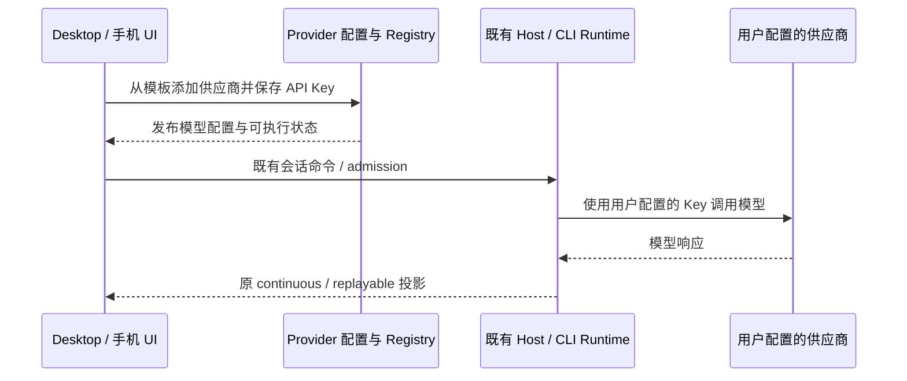
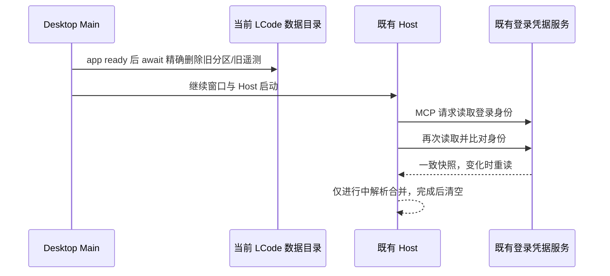

# 移除应用内 Coding Plan 产品链路

## 产品边界

- 移除应用内官方套餐的购买、续费、团队订阅、Start 领取、权益连接、额度重置、购买 WebView、计划身份遥测及依赖套餐权益的闲时任务。
- **保留「添加供应商」中的 BigModel Coding Plan、Z.AI Coding Plan 模板**，以及用户自行配置的 API Key、模型目录、模型调用、CLI API Key 登录和供应商用量查询。这些是普通供应商接入，不是应用内套餐。
- 两个模板的现有模型网关路由保持不变。CLI 独立 Key 登录所需的个人连接标识继续兼容；应用 Host 不再解析或刷新官方套餐权益。
- 保留其他供应商 OAuth、通用自动化、动态工作流、账号登录及应用更新。原订阅服务顺带承载的应用配置必须脱离支付和订阅服务。
- 不删除或改写用户磁盘上的旧凭据、历史会话和数据库。旧套餐配置不再进入可执行 Registry；历史记录仍可读取，不恢复旧套餐入口。
- 按用户要求，启动时移除当前 LCode userData/sessionData 中名为 `zcode-coding-plan`、`lcode-coding-plan` 的购买页分区，以及 userData 根目录旧 `zcode-data-size-telemetry.json`。保留其他浏览器分区和新 `lcode-data-size-telemetry.json`，不访问旧 ZCode 应用的数据根。

## 所有者与接口

- Provider 配置/Registry 继续拥有供应商配置与模型可执行状态；普通 API Key 不经过套餐权益门禁。
- 移除订阅 Service descriptor、Accessor、RPC 暴露、支付协议、WebView IPC/preload 和旧 Chromium 分区迁移映射。
- 通用应用配置使用独立服务契约；不创建第二套账号、任务或队列状态。
- 应用配置服务独占一小时快照与进行中的请求；并发调用共享已完成业务校验的结果，失败不写缓存。工作流查询失败使用既有默认值，更新查询向调用方保留错误。
- 官方 MCP 鉴权仅由既有登录凭据所有者提供应用 JWT，不再选择套餐、团队 scope 或拼接套餐身份头；前后读取比对防止凭据切换，并发请求只合并进行中的解析。
- 移除套餐专用 UI store/hook、付费身份投影、闲时任务 admission 与调度。普通 Cron 和工作流调度继续使用原 owner。
- Desktop continuous 与手机 replayable 都不再暴露已移除的套餐命令；两者保留原 CommandInbox、owner/lease、workspace identity 和会话恢复语义。

## 验收

1. 桌面及手机设置/输入框/侧栏无套餐购买、连接、重置和闲时任务入口；旧导航目标不会重新创建套餐 UI。
2. 运行时无订阅/支付/额度重置服务注册，无购买 WebView、桥接事件或专用分区迁移。
3. 两个受保护供应商模板仍可见，添加后可保存 API Key、添加/同步模型并使用正式 Adapter 发起请求；不要求应用内登录或套餐查询。
4. 普通 OAuth 供应商、自动化、动态工作流和应用更新保持原接口语义。
5. 相关测试、夹具、翻译、脚本、技能图谱和当前规范同步清理；允许仅在移除记录及历史数据库迁移中保留必要说明。
6. 执行根 typecheck、lint、architecture check；涉及 CLI 时执行 CLI typecheck/lint；真实报告已有失败和无法执行的交互验证。
7. 官方 MCP 在无套餐配置时仍发送应用登录身份；登出后不可继续复用旧凭据，解析期间身份切换必须重新读取。

## Knip 后续清理边界

- 以本轮重新生成的 Knip 报告为起点，结合 `dep:refs` 和动态入口查找，仅删除没有消费者的旧权益访问 hook、套餐额度排版/名称工具、套餐横幅投影、闲时专用拖拽辅助和废弃鉴权错误/外层类型导出。
- Scheduler 协议仍由 Main 与 Scheduler 共用，保留 Cron、唤醒、退出和资源采样消息；删除已经没有生产者及处理器的三类闲时消息。清理该协议旁遗留的、未跟踪的源目录编译产物，正式产物继续由 `tsconfig.scheduler.json` 输出到 `out/scheduler`。
- 浏览器夹具由 HTML/Vite 启动，不能因为 Knip 没有识别动态入口而删除。把供应商保留回归、使用统计兼容回归夹具声明为实际测试入口；旧使用统计导航意图的回归仍保留，用来确认存量意图不会重新打开套餐 UI。
- 保留两个供应商模板、API Key 类型、模型/网关路由、独立供应商用量、CLI Key 登录、历史身份兼容和冻结数据库迁移。不对无关 Knip 报告项作批量清理。
- 验证时比较前后报告，确认已确认的套餐专用残留消失；根目录类型/Lint、Scheduler 类型、架构、供应商请求与桌面/手机回归均需通过。不存在新增状态、写入路径或事件时序。

## 验证记录（2026-10-23）

- 影响模块：Desktop、Services、Shared、Provider 装配、UI、CLI Contracts/Core/Adapters/Bootstrap；既有 Provider Registry、登录凭据服务、CommandInbox 继续持有其原有状态。
- 根目录与 CLI 的 typecheck/lint 通过，Scheduler 单独类型检查通过；CLI lint 保留 `tool/registry.ts` 的一条既有 warning。
- 架构检查 baseline 0、new 0；91 项单测与 3 项浏览器场景通过，覆盖桌面/手机供应商添加、Key 保存、OAuth 导航及正式 Adapter 请求。
- 本次格式检查覆盖 181 个相关文件；Git whitespace 检查通过。Knip 全仓扫描仍失败，存在其他未使用文件/导出与配置提示，不将其写成通过。
- 当前工作区已跟踪文件差异为 +1824/-39770 行，包含开工前已有本地改动；该统计不表示本次独占改动量，也不包含新文件。

### Knip 后续清理验证

- 删除 6 个没有调用方的旧套餐辅助文件；`dep:refs` 与全仓引用查找确认后，同时删除不再使用的拖拽向外导出、鉴权错误类和外层类型导出。保留请求期鉴权边界实际使用的身份类型。
- 调度协议清除 3 类闲时消息，保留 Cron 与采样消息；源目录的 4 个旧编译产物已移除，Scheduler 正式类型构建通过。
- 前后 JSON 报告：unused files 256 → 247、unused exports 627 → 626、unused types 396 → 395。套餐专用候选已清理；浏览器实际测试入口已显式声明，没有增加忽略规则。全仓 Knip 仍失败，2 个与启动脚本有关的 unresolved 项保持不变。
- 根 typecheck/lint、Scheduler 类型及架构检查通过（baseline 0、new 0）；13 项针对性单测、4 项浏览器场景通过，包含两个供应商的网关请求、桌面/手机 Key 保存、OAuth 导航和旧导航意图兼容。
- 本轮涉及的已跟踪文件相对 HEAD 为 +17/-351 行，含此前相关改动，不含已经存在的未跟踪 spec 与测试文件；不改变状态所有者和事件顺序。
