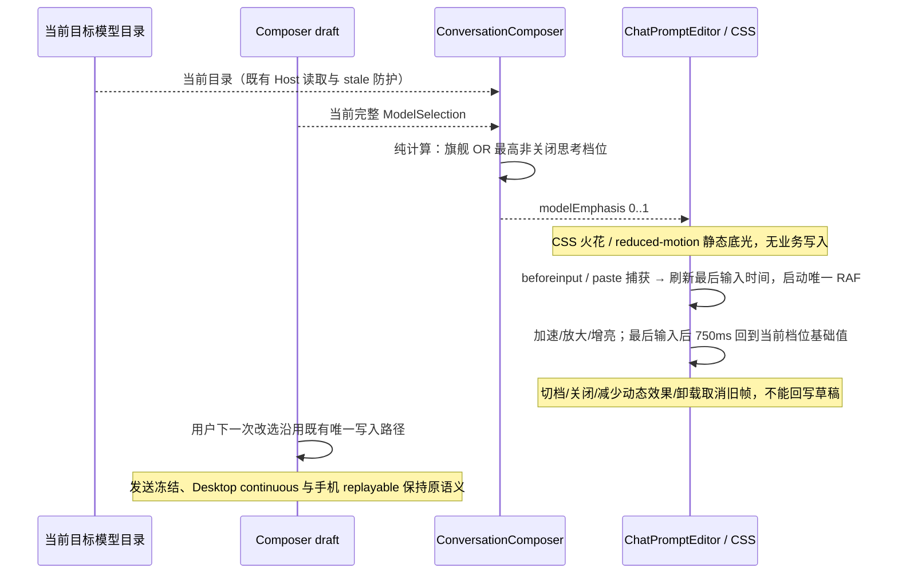

# Composer 旗舰模型与最高思考档位特效

## 产品规则

- 用户选择的触发条件为「旗舰模型 **或** 最高思考级别」。按用户补充的 Spark 参考，聊天输入框内部显示由下沿缓慢升起、独立漂移和明暗闪烁的小火花，下沿保留轻微主题色底光；替换上一版边缘流光。参考 [React Bits Prompt Bar](https://reactbits.dev/micro/prompt-bar) 的 Spark 预览；正文、工具条及键盘焦点保持可读可用。
- 整体外观按同一参考统一：主会话 Composer 使用 `prompt-bar` 呈现，普通/强调态共用稳定的中性输入表面，外边框视觉透明，不再在聚焦时出现整圈品牌色描边或背景突变；保留真实 1px 边框维持布局、子控件键盘焦点及拖放反馈。其他行内编辑入口保持默认呈现。
- 空输入区按一行内容高度起步，12px 内边距、8px 编辑区/工具条间距、16px 外圆角；随实际文本和手机安全字号自然增高。长占位文案单行省略，完整内容保留在既有 `aria-placeholder`，不能让绝对定位占位层折行覆盖工具条。工具条统一 `text-ui-caption`、28px 控件基线与 8px 内圆角。普通模型/速度/添加入口为次要文字色，最高有效思考档显示 Sparkles 图标和主题色；权限警示颜色保留原语义。发送键可提交时用前景/输入表面反色，禁用时为低对比中性色块，不叠加整体半透明导致图标发灰两次。
- 强调底光改为左下角起、向上及向右自然消散的柔和放射光，普通文字区保持中性。火花颜色从品牌色的 OKLCH 色相派生：暗色表面提升亮度，浅色表面限制亮度并保留色度，避免混入正文色后出现灰点，同时让最高档标签可读；输入反馈只增亮粒子，不放大整片背景。模型/思考入口接续左侧动作排列，速度靠近发送侧；不再把全部配置推到右边留下大块空隙。所有颜色沿用语义 token，过渡只涉及颜色/透明度及按钮按压；减少动态效果下无过渡。
- 最高思考档位按当前模型 `optionSpecs.reasoningLevel.values` 的有序末项判断，复用关闭档位识别。缺失、非法、关闭值不触发；只有一个开启档位的模型不因「开启」就被当作最高思考模式，至少需要两个非关闭档位。
- 当前目录没有旗舰元数据，本次将旗舰识别限定为集中的 UI 展示规则，不添加能力、价格或请求参数。识别当前仓库已有的系列：Claude Fable/Opus、GPT 主系列（排除 mini/nano/luna/terra）、Gemini Pro、GLM 完整版、Kimi K、MiniMax M、DeepSeek Pro/R、Qwen Max、MiMo Pro、Grok 主系列。按同一供应商目录中同厂系列的版本数字比较，版本相同时用 Fable/Opus、Astra/Pro/主系列等明确级别排序；最新最高候选触发，等价日期/路由别名均可触发。供应商排序、价格、展示名称和上下文长度不参与比较。网关前缀复用模型 ID 末段；未知自定义模型仅通过最高思考级别触发。
- 已选模型必须存在于当前目标目录且未禁用。读取中暂存的同目标目录沿用既有展示规则；无目录、模型被删除/禁用、切换工作区后目录未就绪时不显示旧特效。
- 普通模型切至较低思考档位立即退出；旗舰模型降低思考档位仍保留，但不能在所有档位使用相同效果：关闭/缺失/非法档位保留 0.28 的旗舰底光，开启档按当前模型非关闭目录顺序从低到高映射为 `0.28 + 0.72 × 档位进度`，最高有效档为 1。无思考配置的旗舰保留基础效果。强度同时控制底光、粒子数量、大小、透明度及上升速度，切档不改变输入框几何或草稿。输入不可编辑或正在提交时停用，运行中仍可编辑的下一条草稿按其自身选择展示。
- Desktop 与手机 Web 共用实现；所有主题使用现有 brand/foreground token。`prefers-reduced-motion` 停止漂移与打字反馈，隐藏粒子，仅保留静态底光；强制颜色模式隐藏全部装饰。
- CSS 负责固定数量火花的独立运动和闪烁，位置、大小、时长与相位由稳定的展示常量给出，不能在 render 随机生成或增加业务状态。粒子不越出输入壳，顶部正文区域逐步淡出，窄输入框减少可见数量。
- 打字时由原生编辑器 `beforeinput` 或 `paste` 捕获事件触发可见反馈：火花立即约 3 倍速上升、放大约 70%、提高亮度和光晕，持续键入保持激发；最后一次输入后先保持 100ms，再于 650ms 内平滑回到当前档位的基础效果。不能只检查动画存在而没有可感知变化，也不放大整片背景。Lexical 会阻止 `input` 冒泡，且首字符受控插入时不会产生后续 `input`；粘贴也由 Lexical 接管，不能依赖后续浏览器 `beforeinput`。两个捕获事件收口同一瞬态激发过程，不读取正文或剪贴板内容。`ComposerModelSparks` 独占瞬态激发值、最后输入时间和唯一 RAF；新输入刷新同一激发过程，不重建或增加粒子。关闭特效、切档、减少动态效果、强制颜色及卸载时取消 RAF 并复位，旧帧不得覆盖新档位。不增加业务状态或额外提交，不使用 React 每帧更新、指针追踪、额外依赖或持久化开关。装饰不接受指针，不进入无障碍树，不新增文字或键盘焦点。

## 所有者、接口与事件顺序

- Provider Registry / 当前目标的 `ModelSelectionView` 仍拥有目录，Composer draft 仍拥有下一次提交的完整 `ModelSelection`。
- `resolveComposerModelEmphasis(selection, view)` 是纯展示投影，返回 0（关闭）至 1（最强）的数值；同时保持「旗舰或最高档」准入，不读 Session、不补齐档位、不改写草稿。
- `ConversationComposer` 从现有 props 计算投影，通过 `ChatPromptEditor` 的可选 `modelEmphasis` 传给输入壳。后者默认关闭，启用时挂载 `ComposerModelSparks`；其他编辑入口保持原契约。
- `ChatPromptEditor.presentation` 仅决定外观；`ConversationComposer` 显式选择 `prompt-bar`。`ThoughtLevelCycleControl` 从既有目录强度派生最高档标记，不拥有另一份选择；Lexical 的正文/占位标记只供输入壳局部样式消费，不更改编辑和提交行为。
- 模块为现有 `ui`；浏览器回归位于 `web` 测试夹具。没有跨模块新接口、协议、运行时、队列、owner/lease 或远端恢复变更。

## 验收

1. 单元测试覆盖自定义最高档、关闭/空/非法/单档、目录丢失/禁用、供应商隔离、网关前缀、已知系列的版本与同版本等级比较；不修改输入选择或目录。
2. 真实 Composer 在普通模型上用滑块键盘切低档/末档，特效同步开关，发送冻结原 reasoningLevel 与 speed。
3. 真实 Composer 在低思考档切入旗舰模型出现特效，切回普通模型消失；新任务和已有会话一致。
4. 七种主题、1280px 桌面、390/320px 触摸和英文大字号无溢出，装饰不遮挡输入或发送；输入壳切换前后几何一致。
5. 同一旗舰模型上切换关闭/低/高/最高档，验证基础底光、可见粒子数、大小及实际播放速率逐级增强，降低档位同步减弱。真实首字符、连续键入、中文组合输入、粘贴和删除均触发粒子速度/大小/亮度的可见增加，停顿后恢复当前档位；不新增粒子或提交。减少动态效果取消正在进行的反馈且不允许后续旧帧复活，仅保留静态底光；恢复动态效果后输入可再次激发。
6. 执行定向单元、浏览器 E2E、`pnpm typecheck`、`pnpm lint`、变更架构检查和定向格式检查，记录真实结果与限制。
7. 对照参考的普通/最高档/可发送状态，检查稳定中性背景、无彩色焦点外框、紧凑垂直节奏、普通/强调控件层次和发送键反色。真实改选与键入后保留原参数冻结；浅色、深色和手机有有效键盘焦点，不遮挡工具条或正文。保存同状态的并排视觉比较及 `design-qa.md`。

## 首版实施与验证（2026-10-19）

- 完成集中式旗舰系列/版本规则、最高思考档位纯投影及输入壳 CSS 流光。关闭档位识别提取为无渲染依赖的共享函数，原滑块入口仍复用同一识别。选择所有者和事件顺序沿用上图；没有新增业务状态或 IO。
- 定向单元 10/10 通过，包含展示规则、草稿改选与冻结提交回归；浏览器 E2E 16/16 通过（新特效 4/4、原速度/思考/提交 12/12）。最终新增提交等待停用/恢复和系统强制颜色场景后，特效套件再次 4/4 通过。
- 实际验证 1280/390/320px、新任务/已有会话、中英文、20px UI 字号、七种主题、动画时间前进、减少动态效果、强制颜色、提交等待期间停用以及最终冻结参数。截图位于 `.lcode/composer-model-emphasis/`，已复核深浅主题与手机画面。
- 最终 `pnpm typecheck`、`pnpm lint`、定向格式检查与 `git diff --check` 均通过；`pnpm architecture:check --changed` 为 0 violations / 0 baseline / 0 new。涉及现有 ui 模块、web 测试与测试入库白名单，共 11 个文件净增 557 行，不新增架构依赖。
- 环境为 Windows、Node 24.21.0、pnpm 10.34.6、Chromium；手机使用触摸浏览器模拟，未验证真实手机远控、macOS/Linux 原生窗口。旗舰识别是本地展示规则，未知自定义模型仍按最高思考档位触发。

## Spark 修订与验证（2026-10-19）

- 实际打开参考站并将 Effort 调至 Max，确认内部火花由下沿升起、独立漂移闪烁、底部淡色铺光及输入反馈。以稳定的 24 颗火花替换旋转描边，窄 Composer 保留均匀分布的 16 颗；不保留旧角度属性或环绕动画。减弱顶部粒子，装饰位于正文/按钮下层。
- `ComposerModelSparks` 单独拥有一条短暂的增亮动画；初次 E2E 发现普通 `input` 冒泡无法到达装饰层。结合 Lexical 当前源码的 `onInput.stopPropagation()` 与真实事件记录，改用 `beforeinput` 捕获，覆盖首字符受控插入。未新增草稿状态、请求或持久化字段，提交及跨设备链路沿用既有所有者。
- 本轮单元回归 10/10、真实 Composer 浏览器回归 4/4 通过。除原有触发/提交/主题场景外，验证粒子数量、真实位移与透明度变化、首字符/连续键入只保留一条增亮动画、减少动态效果取消反馈及隐藏粒子、强制颜色隐藏装饰。1280/390/320px 截图已复核，新增烟墨紫预览；环境与上轮相同。
- 最终 `pnpm typecheck`、`pnpm lint`、定向格式和 diff 检查通过，架构为 0 violations / 0 baseline / 0 new。增量涉及 ui 展示组件与 web 测试；本次任务累计 12 个文件净增 734 行（含上轮实现、测试与规格），没有新增跨模块依赖。

## 整体提示栏重做与验证（2026-10-19）

- 根据本轮反馈统一表面、边框、空输入区高度、控件层次与发送键，而非继续叠加独立装饰。新增输入壳 `prompt-bar` 呈现，主会话显式接入，行内编辑保持默认；思考入口基于原有目录强度显示 Sparkles/Brain，模型、权限与速度仍从同一草稿和服务读取。
- 与源站实测 400px 宽普通、最高档空输入、相同中文输入后的可发送状态，保存并逐张检查归一化并排截图。视觉迭代记录见仓库根目录 `design-qa.md`，最终 `passed`；没有新增图片依赖或另一套图标库。
- 单元 10/10；输入框 E2E 4/4、思考滑块 11/11、速度及冻结提交 12/12。修正本地旧滑块回归中两个仍寻找已移除档位文字按钮的过期断言；新增占位不遮挡工具条、稳定中性表面、最高档颜色/图标及发送态对比检查。对原生颜色过渡和媒体 change 使用真实完成事件，无生产延时或重试掩盖状态问题。
- `pnpm typecheck`、`pnpm lint`、变更架构检查通过，架构 0 violations / 0 baseline / 0 new。Node 24.21.0 与 `mise.toml` 一致；实际验证 Windows/Chromium 与手机触摸模拟，没有真实模型费用或协议/远端所有者变更。预览空子代理目录通过既有只读 Service 契约返回，最终新浏览器会话控制台错误为 0。任务累计 20 个 Git 可见文件净增 1036 行（含前轮、测试和规格），另同步本地忽略规则下的滑块套件过期断言。

## 档位强弱与输入反馈修正（2026-10-19）

- 复现同一旗舰从关闭思考切至最高档，旧版仍为底光透明度 1、粒子周期 5.8s；原因是纯投影仅返回布尔值。现返回 0..1 强度，在当前草稿和目录的同一路径派生。旗舰关闭/低/高/最高档分别为 0.28/0.52/0.76/1（四档夹具），粒子播放速率分别为 0.83/1.07/1.31/1.55，底光透明度等于强度；切档同时改变可见数量与大小。
- 输入瞬态从短增亮改为同一组粒子的约 3 倍速、放大、增亮与光晕，单一 RAF 在最后输入后 750ms 内复位。粘贴回归先确认 Lexical 接管后没有后续 beforeinput，再增加只观察事件的 paste 捕获；两种事件共用同一激发所有者，没有第二条正文写入路径。
- 本轮单元 11/11、真实 Composer E2E 4/4 通过。新断言直接比较同一旗舰各档实际 CSS 底光/粒子尺寸与浏览器播放速率，首字符/连续输入/中文插入/删除/模拟剪贴板粘贴的速度与尺寸增强、停顿恢复、减少动态效果取消及恢复后重新激发，保留三个宽度、七主题和冻结提交验证。中文输入通过浏览器文本插入验证，未覆盖真实系统输入法候选窗。
- 同步去除内部用量状态栏顶部横线，规格见 `token-usage-statusbar.md`；原生用量栏完整 E2E 1/1 通过。最终类型、Lint、变更架构及定向格式检查通过；架构 0 violations / 0 baseline / 0 new。
- 新视觉证据位于 `.lcode/composer-feedback/`：`levels.png` 同一旗舰低档/最高档，`comparison.png` 与源站同宽度、相同输入内容对照，`token-footer.png` 为无横线的真实用量底栏。UI 与 web 测试边界及唯一草稿所有者保持不变。
