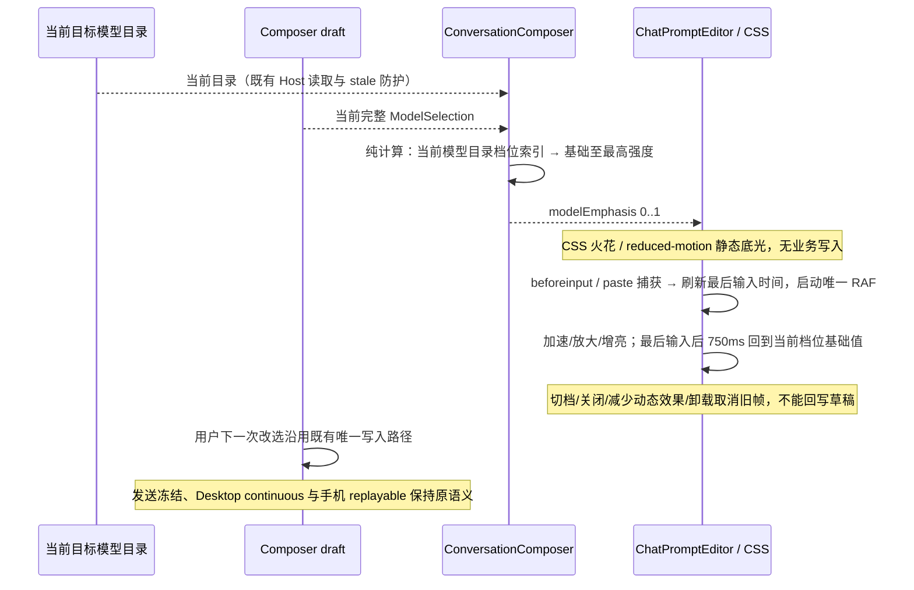

# Composer 各思考档位 Spark 特效

## 产品规则

- 按用户 2026-10-20 的最新要求，所有模型、每个思考级别都显示 Spark，包括显式 `default` 和未指定思考档位时的默认状态；取代旧版「旗舰模型或最高思考级别」准入。聊天输入框内部显示由下沿升起、独立漂移和明暗闪烁的小火花，下沿保留主题色底光。参考 [React Bits Prompt Bar](https://reactbits.dev/micro/prompt-bar) 的 Spark 预览；正文、工具条及键盘焦点保持可读可用。
- 整体外观按同一参考统一：主会话 Composer 使用 `prompt-bar` 呈现，普通/强调态共用稳定的中性输入表面，外边框视觉透明，不再在聚焦时出现整圈品牌色描边或背景突变；保留真实 1px 边框维持布局、子控件键盘焦点及拖放反馈。其他行内编辑入口保持默认呈现。
- 空输入区按一行内容高度起步，12px 内边距、8px 编辑区/工具条间距、16px 外圆角；随实际文本和手机安全字号自然增高。长占位文案单行省略，完整内容保留在既有 `aria-placeholder`，不能让绝对定位占位层折行覆盖工具条。工具条统一 `text-ui-caption`、28px 控件基线与 8px 内圆角。普通模型/速度/添加入口为次要文字色，最高有效思考档显示 Sparkles 图标和主题色；权限警示颜色保留原语义。发送键可提交时用前景/输入表面反色，禁用时为低对比中性色块，不叠加整体半透明导致图标发灰两次。
- 强调底光改为左下角起、向上及向右自然消散的柔和放射光，普通文字区保持中性。火花颜色从品牌色的 OKLCH 色相派生：暗色表面提升亮度，浅色表面限制亮度并保留色度，避免混入正文色后出现灰点，同时让最高档标签可读；输入反馈只作用于粒子，不放大整片背景。模型/思考入口接续左侧动作排列，速度靠近发送侧；不再把全部配置推到右边留下大块空隙。所有颜色沿用语义 token，过渡只涉及颜色/透明度及按钮按压；减少动态效果下无过渡。
- 强度只按当前模型 `optionSpecs.reasoningLevel.values` 的目录顺序判断，复用关闭档位识别；不依赖模型系列、旗舰猜测、价格或展示名称。非关闭档位（包含 `default`）从首项 0.28 递增至末项 1，中间按相对索引均匀映射；关闭、缺失、非法、无配置和单一档位均显示 0.28 的基础效果，不推断其为最高强度。删除旧旗舰系列/版本比较规则，不保留双重准入或模型名特例。
- 已选模型必须存在于当前目标目录且未禁用。读取中暂存的同目标目录沿用既有展示规则；无目录、模型被删除/禁用、切换工作区后目录未就绪时不显示旧特效。
- 所有有效模型的每个档位均有火花与底光，档位越高，速度、底光、可见粒子数量、大小及透明度越强；降低档位同步减弱。普通模型与旗舰模型遵守同一规则。`default/low/high/ultra` 四档时强度依次为 0.28/0.52/0.76/1。切档不改变输入框几何或草稿；输入不可编辑或正在提交时停用，运行中仍可编辑的下一条草稿按其自身选择展示。
- Desktop 与手机 Web 共用实现；所有主题使用现有 brand/foreground token。`prefers-reduced-motion` 停止漂移与打字反馈，隐藏粒子，仅保留静态底光；强制颜色模式隐藏全部装饰。
- CSS 负责固定数量火花的独立运动和闪烁，位置、大小、时长与相位由稳定的展示常量给出，不能在 render 随机生成或增加业务状态。粒子不越出输入壳，顶部正文区域逐步淡出，窄输入框减少可见数量。
- 打字时由原生编辑器 `beforeinput` 或 `paste` 捕获事件触发可见反馈：火花立即约 3 倍速上升、放大约 70%、提高亮度和光晕，持续键入保持激发；最后一次输入后先保持 100ms，再于 650ms 内平滑回到当前档位的基础效果。不能只检查动画存在而没有可感知变化，也不放大整片背景。Lexical 会阻止 `input` 冒泡，且首字符受控插入时不会产生后续 `input`；粘贴也由 Lexical 接管，不能依赖后续浏览器 `beforeinput`。两个捕获事件收口同一瞬态激发过程，不读取正文或剪贴板内容。`ComposerModelSparks` 独占瞬态激发值、最后输入时间和唯一 RAF；新输入刷新同一激发过程，不重建或增加粒子。关闭特效、切档、减少动态效果、强制颜色及卸载时取消 RAF 并复位，旧帧不得覆盖新档位。不增加业务状态或额外提交，不使用 React 每帧更新、指针追踪、额外依赖或持久化开关。装饰不接受指针，不进入无障碍树，不新增文字或键盘焦点。

## 所有者、接口与事件顺序

- Provider Registry / 当前目标的 `ModelSelectionView` 仍拥有目录，Composer draft 仍拥有下一次提交的完整 `ModelSelection`。
- `resolveComposerModelEmphasis(selection, view)` 是纯展示投影；有效模型返回 0.28 至 1 的强度，无目录/无效模型返回 0。不读 Session、不补齐档位、不改写草稿。
- `ConversationComposer` 从现有 props 计算投影，通过 `ChatPromptEditor` 的可选 `modelEmphasis` 传给输入壳。后者默认关闭，启用时挂载 `ComposerModelSparks`；其他编辑入口保持原契约。
- `ChatPromptEditor.presentation` 仅决定外观；`ConversationComposer` 显式选择 `prompt-bar`。`ThoughtLevelCycleControl` 从既有目录强度派生最高档标记，不拥有另一份选择；Lexical 的正文/占位标记只供输入壳局部样式消费，不更改编辑和提交行为。
- 模块为现有 `ui`；浏览器回归位于 `web` 测试夹具。没有跨模块新接口、协议、运行时、队列、owner/lease 或远端恢复变更。

## 验收

1. 单元测试覆盖所有模型、显式/隐式 default、不同数量与自定义名称的档位、关闭/空/非法/无配置/单档、目录丢失/禁用和供应商隔离；每档均有基础效果且有效档单调增强，不修改输入选择或目录。
2. 真实 Composer 在普通模型上从 default 用键盘切至最高档，始终有火花且速度和底光逐级增强；降档减弱，发送冻结原 reasoningLevel 与 speed。
3. 切换未知自定义模型、旗舰和轻量模型时，相同目录/档位保持同一效果；新任务和已有会话一致。default 下真实输入同样可激发火花。
4. 七种主题、1280px 桌面、390/320px 触摸和英文大字号无溢出，装饰不遮挡输入或发送；输入壳切换前后几何一致。
5. 在不同模型上切换默认/低/高/最高档，验证基础底光、可见粒子数、大小及实际播放速率逐级增强，降低档位同步减弱。真实首字符、连续键入、中文组合输入、粘贴和删除均触发粒子速度/大小/亮度的可见增加，停顿后恢复当前档位；不新增粒子或提交。减少动态效果取消正在进行的反馈且不允许后续旧帧复活，仅保留静态底光；恢复动态效果后输入可再次激发。
6. 执行定向单元、浏览器 E2E、`pnpm typecheck`、`pnpm lint`、变更架构检查和定向格式检查，记录真实结果与限制。
7. 对照参考的普通/最高档/可发送状态，检查稳定中性背景、无彩色焦点外框、紧凑垂直节奏、普通/强调控件层次和发送键反色。真实改选与键入后保留原参数冻结；浅色、深色和手机有有效键盘焦点，不遮挡工具条或正文。保存同状态的并排视觉比较及 `design-qa.md`。

## 当前实现与验证（2026-10-20）

- 所有模型统一从基础强度到最高强度显示 Spark，包括显式 default、未指定、关闭及固定档位。删除旗舰系列/版本猜测与最高档准入，纯展示投影只读当前目标目录和 Composer 草稿；无目录、模型失效或禁用仍为 0。
- default/low/high/ultra 四档分别为 0.28/0.52/0.76/1，基础播放速率约 0.83/1.07/1.31/1.55，底光透明度等于档位强度。沿用原粒子、主题、输入激发和 reduced-motion/强制颜色语义，没有新增业务状态、协议或服务依赖。
- 单元 12/12、真实 Composer E2E 4/4 通过。浏览器在 1280/390/320px 下，对未知模型、旗舰和轻量模型分别遍历 default/low/high/ultra，验证实际底光、播放速率、尺寸单调增强且模型间同档一致；默认档键入同样激发火花，保留七主题、减少动态效果、冻结提交及下一草稿恢复场景。
- E2E 等待当前草稿派生强度和伪元素实际 opacity 到达目标值，避免将原生颜色过渡的中间帧误判为不递增；没有增加生产延时。档位用例提取至 composer-model-emphasis-cases.mjs，所有测试仍使用真实 Composer 和原服务夹具。
- pnpm typecheck、pnpm lint、定向格式与变更架构检查通过，架构 0 violations / 0 baseline / 0 new。变更位于 ui 纯投影、web 回归与规格，所有者及事件顺序沿用上图。
- 当前证据：.lcode/composer-all-levels/ 中的 default/ultra 截图为普通模型、同主题及相同几何；.lcode/composer-model-emphasis/ 中保存手机及七主题回归。视觉核对见 design-qa.md。Windows / Node 24.21.0 / Chromium，手机为触摸模拟；未覆盖真实系统输入法候选窗、手机远控恢复或 macOS/Linux 原生窗口。
