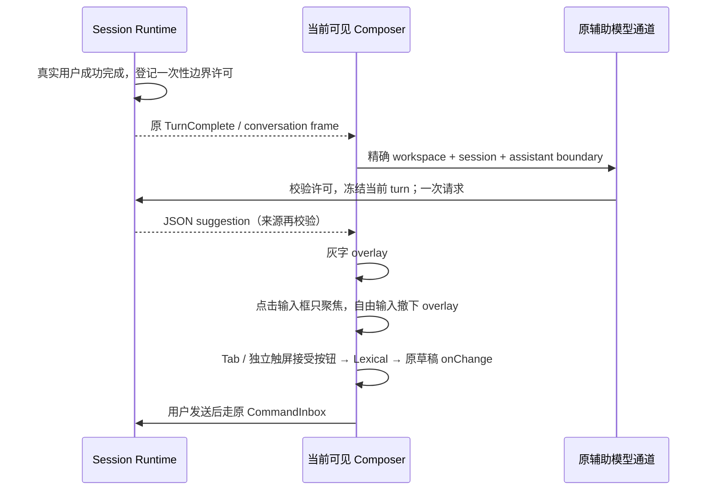

# 完成轮次后的输入建议

日期：2026-10-18。主动记忆、历史召回修复后实施。

## 产品规则与所有者

- 独立设置 `composerPredictionsEnabled`，缺省 false。设置说明明确：启用后每个符合条件的完成轮最多一次辅助模型请求，使用当前会话模型，计入现有用量；没有合理下一步可返回空建议。
- 只在当前可见且活跃的普通会话经历 running → completedSuccess 后、空草稿且无附件/引用/阻塞/队列/目标/运行工作时请求。首屏、历史恢复、切换回来、重连快照、自动任务和子会话不会触发；关闭设置或开始输入立即撤下并取消。
- 原 ConversationProjectionStore 与 snapshot 同次发布 `lastUpdateIsOnlineDelta` 派生投递标记。只有可信 deliveryKind=online 的连续 delta 为 true；initial/recovery delta 及所有 snapshot 为 false。SessionPane 同时要求非 syncing。Composer 不能仅凭 phase 差异把修复投影当成在线完成；不增加协议业务状态、事件总线或超时推断。
- Runtime 在真实用户普通成功 turn 完成前登记一个临时许可，包含当前 assistant message、branch generation。该许可只活在同一 Runtime，冷恢复不重建。请求精确匹配 session/workspace/边界，来源仍有效才能请求与返回。一个许可只允许一次生成，重复请求共享同一 promise；失败/取消也不重发收费请求。
- 复用现有 workspace/generateText 通道，增加严格 `composerPrediction` 请求形状。该分支必须命中同 workspace 已存在的精确 session，禁止使用任意首个 Runtime 或为预测创建 Runtime；不允许调用方提供 prompt/messages/tools/output budget。后端读取固定边界的同一 turn 可见文本（最多 6000 字符，原有界窗口），不读取别的会话、记忆、工具输出或文件。
- 固定边界前最后一条 user 必须具有真实用户可见文本，不能跳过 synthetic/隐藏来源后回退较早用户。复用已完成的预测也重新核对冻结证据指纹，不能因缓存绕过来源校验。
- 原辅助模型路径拥有 provider 鉴权刷新、取消、trace 和用量；预测使用独立 querySource，最低公开推理/速度档，最多 256 输出 tokens、20 秒 deadline、tools=[]。拒绝非 JSON、未知字段、tool calls、超长/多行建议或来源已变化的返回。输入文本是不可信材料，不能授权工具或执行。
- `generateText` 只约束最终结果，不要求厂商提供非流式 HTTP。OAuth 流式聚合与 API 原协议通过统一模型 adapter 处理，见 `auxiliary-model-stream-transport.md`；不能为预测单独重发另一种协议。
- 预测仍是 operation，参与原请求在途计数与空闲生命周期；仅该分支的协议超时标记 `timeoutAffectsRuntimeHealth=false`，拒绝本次请求并保留取消路径，不因可选模型耗时回收整个 Agent。默认业务请求的超时通知和 observation 语义不变；输出因 length 截断时不呈现建议。
- Renderer 通过服务代理末尾 CancellationToken 传递取消，不能把 AbortSignal 放进普通 DTO。Host 本地桥接后使用原 operationId 取消；详情见 rpc-cancellable-service-calls.md。实际 Electron 覆盖成功请求与在途取消。
- workspace/generateText 的严格 usage schema 与 ModelUsage 对齐，接纳可选 boolean cacheWriteTokensReported，保留供应商是否明确报告缓存写入量的证据；false 和缺席不同，不能删掉字段或放宽未知键来绕过校验。
- 预测唯一事实所有者为 Runtime 临时许可；UI 仅持有可丢弃的展示结果。草稿仍由 Lexical 原 onChange 路径写入；桌面仅 Tab 接受，触屏通过单独且明确标注的“接受输入建议”按钮接受，之后才变成可编辑文本。灰字正文、Tab 提示与输入区空白均不拦截指针；点击或轻点只聚焦原编辑器，不能接受建议。用户可直接输入自己的内容，首次输入撤下灰字，不能拼入建议或阻止输入。Enter 不接受或发送灰字。Escape 丢弃；Shift+Tab、IME、非空编辑器和提及/命令面板保留原行为。
- 灰字用 overlay 呈现，不进入 Lexical JSON、撤销历史、草稿持久化、会话、记忆或反馈。接受后仍需用户发送。不新增自动工具或执行授权。
- 辅助 ModelRequest / ModelComplete 事件只保留 trace、模型、用量和结束事实，不保存预测请求/响应正文。现有用户显式启用的模型 I/O 完整留存仍由原设置控制，不因开启预测自动启用。
- Desktop continuous 和手机 replayable 共用原辅助请求/取消路由，不引入第二个 Host 或业务队列。旧 CLI 严格拒绝新请求形状且零生成，UI 静默停止该轮，不重试。

## 验收

普通成功完成只请求一次；空结果；首屏恢复零请求；新输入/切 workspace/切会话/关闭开关/取消丢弃旧返回；模型失败不自动重试；旧 CLI 无生成；无正确来源不请求；工具注入不执行；目标/队列/子任务抑制；Tab 接受可编辑但不发送；桌面真实点击灰字正文、空白与 Tab 提示均只聚焦，随后自由输入只保留用户文本；Escape；IME；Shift+Tab；手机轻点正文仅聚焦且可自由输入，独立按钮接受但不发送；附件草稿抑制；未接受预测不进入持久化。覆盖纯策略、Runtime 并发与 stale、协议 schema、组件交互及 E2E 场景。
