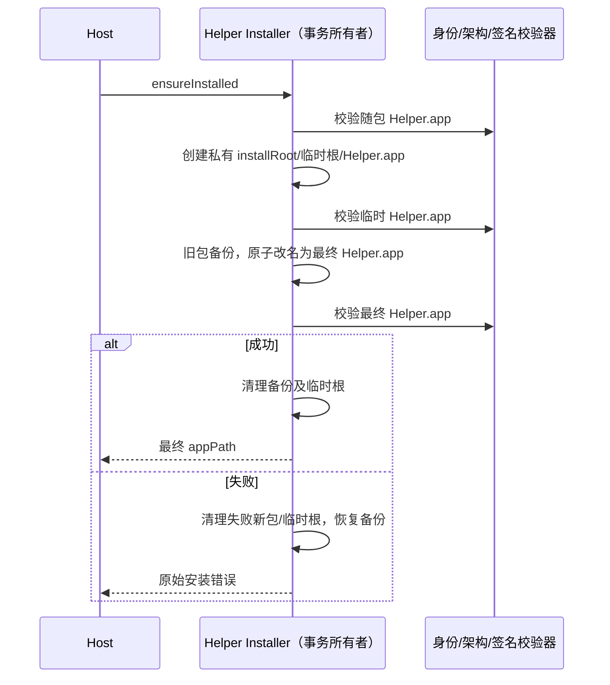

# macOS 电脑控制 Helper 安装校验

## 已确认问题

macOS 安装版日志记录 `Helper installation failed: ... path is not an application bundle`。
源码将合法 `.app` 复制到 `.app.install-<nonce>` 后交给真实身份校验器；后者要求目录以
`.app` 结尾，因此首次安装及升级都会被拒绝。旧测试替换了身份校验器，没有覆盖此冲突。

## 产品规则与所有者

- `createCuaHelperInstaller` 唯一负责安装事务、验证、替换、回滚和临时文件清理。
- 临时根目录位于已有 installRoot 内，以私有权限创建；其内部保留原 `.app` 文件名。
- 临时包与最终包继续经过同一真实身份校验，不放宽扩展名、目录边界、bundle id、架构或签名规则。
- 首次安装成功后可复用；升级成功才替换旧包；复制或最终验证失败后清理临时根并恢复旧包。
- 不改变插件启停、Broker capability/generation、TCC 主体、Windows/Linux 路径和会话生命周期。

## 验收

使用真实文件系统与 `resolveHelperPermissionSubjectIdentity`；仅替换平台命令（plist、架构、签名）。
覆盖带空格路径、首次安装、重复调用复用、构建升级、复制失败、最终验证失败回滚、临时根清理。
在 macOS 实机对真实随包 Helper 执行身份校验与隔离临时目录安装回归；不修改已安装应用或用户配置。
实际桌面操作仍需 macOS 授权及重新构建后的完整产品链路验证。

## 本次验证记录（2026-10-23）

- 修复前新增真实文件系统回归复现相同 `invalid_helper_bundle`；修复后首次安装、复用、升级、失败回滚和清理通过。
- macOS 15.2 x64、应用 3.20.7 的真实随包 Helper 在隔离临时目录安装/校验/复用成功，
  使用现有 IPC challenge 和 capability/generation 启动后健康检查成功。
- 只读权限查询返回 accessibility/screen recording 均为 denied，`list_apps` 明确返回系统辅助功能权限错误。
  没有请求或修改系统授权，未修改安装应用、用户配置或插件目录；临时 Helper 关闭并清理诊断目录。
- 因系统授权未授予，未宣称实际鼠标/键盘/截图及重新构建后的完整模型链路已通过。
