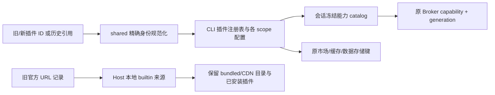

# Computer Use 身份迁移与旧官方源停用

## 范围和产品规则

用户确认仅电脑控制改名，现有市场 ID 保留；随后要求移除旧官方市场源，但保留插件，待自建市场完成后再接入。

- 新电脑控制身份为 `computer-use@lcode-plugins-official`。
- `computer-use@zcode-plugins-official`、`zcode-cua@zcode-plugins-official` 是精确兼容别名。
  不接受其他市场中的同名插件作为官方电脑控制，也不通过修改 label 推断权限。
- 旧市场 `zcode-plugins-official` 保留为历史分发归属；其他插件 ID 不变。
  Computer Use 的 canonical 身份是此规则的明确例外，不能从它反推或新增网络市场。
- shared 的纯函数统一规范化身份、配置键和存储键；CLI 插件注册表是启用状态和能力的权威。
  metadata/catalog/新生成引用使用新 ID，历史引用在严格格式校验后规范化。
- User/Workspace 各自规范化后再按已有优先级合并。显式新键优先，其次当前旧键，再其次最早旧键；
  `false` 不丢失。suppression 取别名并集；配置写入清除别名，保留其他字段及敏感配置。
- 缓存、已安装记录、插件数据目录继续使用原存储归属，不复制、删除或重建用户数据。
  管理操作将新身份解析到已有来源；不更改账号、鉴权、会话 owner 或工具命名空间。
- Broker 独立 JS 运行时仅接受同一组精确别名，机械测试与 shared 常量保持一致。

## 旧源停用

- 删除旧 CDN manifest 默认源；既有该官方源记录迁移为本地 `builtin` 来源。
  保留合并目录、CDN 快照、安装记录、缓存、开关与 suppression。
- `builtin` 表达无网络源的本地目录；自动刷新不触发，手动刷新为保留快照的本地操作。
  不伪造新 URL，也不自动切换到未来尚不存在的市场。
- 旧官方 manifest URL 不再被旧配置、刷新、安装前懒加载或显式添加重新激活。
  其他用户手动添加的来源保持原行为。现有插件可离线使用、启停、配置、卸载和恢复内置插件。
- 新的远程市场源需要日后显式配置及单独的来源迁移校验。

## 验收

测试规范化幂等、旧/新键冲突、显式关闭、Workspace 覆盖、suppression、配置保存/重置、
新旧引用去重/恢复、第三方同名隔离、Node Repl 能力与 Broker authority 注入、
内置卸载恢复、推荐引用解析、数据目录复用、离线源迁移及重复刷新零网络。
Mac Helper 修复和 Windows 现有链路独立回归；不以品牌改名代替平台修复。

共享导出是 OAuth 内嵌 worker 的构建依赖；同步运行仓库生成器和 notice 生成器，
并使用 `scripts/desktop-agent-sync.test.mjs` 验证生成物与当前依赖一致，不手改鉴权实现。

## 验证记录（2026-10-23）

- Computer Use runtime 全量 190 项、插件迁移/配置/管理相关 30 项、Renderer 6 项通过。
- 发布回归首轮 168 项通过、1 项跳过，唯一失败为内嵌 worker 过期；重新生成后对应同步门禁 7 项全部通过。
- 额外鉴权 owner、刷新和取消回归 8 项通过。
- 根目录与 CLI 的 typecheck/lint 通过，架构检查无新增或基线违规。
  CLI 仍报告原有 `tool/registry.ts` lint warning 及 Turbo workspace lockfile 提示。
- 使用仓库生成器更新 worker 与 inventory 的对应摘要；未打安装包，用户自行重新构建后验证完整产品链路。
