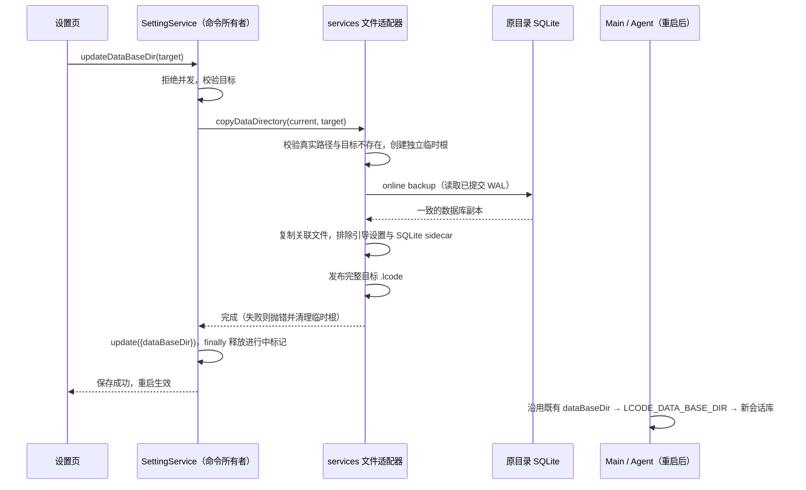
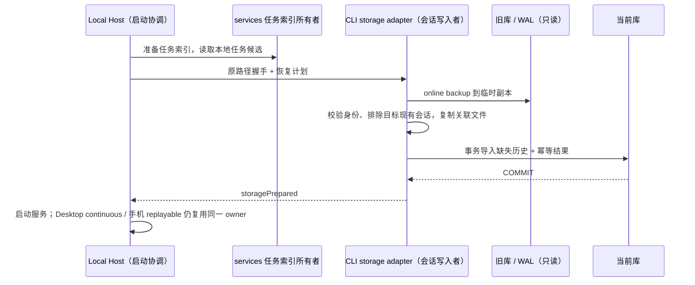

# 数据存储目录迁移

## 问题与范围

原 `copyDataDirectory` 仅复制 `.lcode/v2`，而 Agent 会话、消息、事件与相关索引位于
`.lcode/cli/db/db.sqlite`，附件与工具产物位于 `.lcode/cli/artifacts`。修改数据路径并重启后，
任务入口仍可见，但新数据库没有对应 Session，冷订阅返回 `fault.subscribe.sessionNotFound`。

迁移入口继续使用 `ISettingService.updateDataBaseDir`，不增加 UI、RPC、Host 或远程会话。
本次不修改数据库 schema，也不改变 workspaceIdentity、workspacePath、remoteSessionId 或历史记录中的路径。

## 产品规则

- 迁移范围是当前数据根下完整的 `.lcode`，包括 `v2`、`cli/db`、`cli/artifacts`、
  `cli/agents`、记忆、插件、配置、默认工作目录、粘贴原件、检查点与 Git 备份等关联普通文件。
  不能用一个易遗漏的子目录白名单决定会话数据范围；源数据保留。
- `v2/setting.json` 及其 `setting.json.*` 临时/锁/备份文件仍属于固定引导位置，不随数据复制。
  只排除这个位置，同名的普通附件必须保留。沿用不跟随、不复制符号链接的边界。
- SQLite 数据库使用 Node SQLite 的异步 online backup，包含 WAL 中已提交的事务；
  不直接拼接复制活跃数据库的主文件、WAL、SHM 和 journal。至少覆盖 Agent 库与 v2 下的任务库，
  同时识别其他 `.sqlite`、`.sqlite3`、`.db` SQLite 文件。普通同扩展名文件仍按普通文件复制。
- 先生成数据库快照，再复制引用的关联文件，避免先复制附件目录后才生成包含新附件引用的数据库。
  每个 SQLite 备份自身一致；不承诺多个独立数据库的全局事务。
- 迁移沿用“保存快照，重启生效”：当前进程和既有 Agent 继续使用原根；迁移完成后的新写入
  不进行双写或持续同步。迁移应在停止编辑和任务后保存，并及时重启。
- 源、目标归一化后为同一路径时无需复制。目标不得位于源 `.lcode` 内，也不得包含源根，
  包括经目录链接解析后重叠的路径，避免递归复制或覆盖原数据。
- 不静默合并两套数据根。目标 `.lcode` 已存在时拒绝迁移，保留双方数据；
  用户应选择尚无 `.lcode` 的目标目录。拒绝同一设置服务的并发目录变更。

## 所有者、接口与失败语义

- 设置服务是路径变更命令与保存顺序的唯一所有者，沿用 `update(patch)` 保存设置。
- `copyDataDirectory(oldBaseDir, newBaseDir): Promise<void>` 保留现有公开入口，
  文件与 SQLite 备份实现在 services 的文件适配器内；不导入 CLI/runtime 私有实现。
- 文件适配器在目标父目录创建独立临时目录；复制全部成功后将其发布为目标 `.lcode`。
  任何读取、备份、复制、目标冲突或发布错误均向上传播，不保存新路径；清理本次临时目录。
  源根从不删除或修改；任何已有目标都不能被迁移覆盖。
- 设置保存失败时旧设置仍有效，已经完成的目标副本保留以供检查，不删除用户数据。
- 操作完成或失败后释放服务的进行中标记，不靠定时器解决并发；源/目标目录没有新的事实所有者。

Desktop 的 continuous 与手机 replayable 链路不变：迁移不接管运行时，也不产生新的会话或同步通道。

## 3.19.4 → 3.19.5+ 的旧会话库补迁

旧 CLI 忽略 `LCODE_DATA_BASE_DIR`，始终把会话写到 Node `homedir()` 下；新版遵循应用数据根。
显式更换过目录，以及 Windows 上 `HOME` 与系统用户目录不同，都可能留下任务索引与会话库分离。
三平台统一按最新版当前数据根写入，保留原任务索引、设置和路径优先级，不再通过切回旧目录修复。

- window Local Host 在任务库准备成功之后，经 services 的任务索引公开启动入口生成恢复候选。
  只包含当前索引仍存在的本地任务及其 workspace 身份，跳过远程任务、删除记录、空白隔离资料根。
  旧源只取本机 `homedir()/.lcode/cli/db/db.sqlite`，不扫描磁盘，不访问其它远程环境。
- Host 在既有 `startup/storagePathReady` 严格控制帧中传递可选恢复计划；仅当 Worker 报告的
  实际数据库是当前根的默认会话库时授权恢复，显式 `LCODE_SESSION_DB_PATH` 等自定义库不补迁。
  会话 storageState 增加与 Host 一致的 `maintaining` 阶段，补迁成功后才发布唯一的 `ready`。
  不新增环境变量、UI、运行时或 owner。协议在 shared 统一定义、运行时校验。
- CLI storage adapter 是会话补迁唯一写入者：异步 online backup 旧库（包含 WAL），仅在临时副本
  执行现有 schema 迁移。源库和旧文件从不修改、移动或删除。
- 导入范围是候选中身份匹配、目标缺失的会话及其同身份子会话。任务索引只提供候选，不覆盖
  持久化 workspaceIdentity；远程身份、父链跨域和路径不匹配不可借此恢复。
- 目标已有同 ID 会话整条优先，不能混入旧消息、恢复已回滚内容或覆盖新状态。补迁消息、parts、
  输入、todo、目标、用量、session entries、工作流历史及会话级设置；不导入全局配置、项目权限、
  信任模板或 `workflow.execution` owner/lease。DWF 自增序号重新分配，不按旧 rowid 覆盖另一库。
- 先复制候选的 `cli/artifacts/<session>`、`cli/agents/<session>` 普通文件，再事务提交数据库。
  不覆盖现有文件，不跟随两端目录链接。原绝对路径与 workspacePath 不改写，旧文件仍可读取。
- 目标级文件锁串行补迁，SQLite 事务内重查目标事实；用既有 `local_setting` 记住每个源/会话
  已处理结果，与导入原子提交。重启、并发 Host 和重试不重复导入，之后删除的会话不会复活。
- 读取、备份、关联文件复制、schema 不兼容或事务失败时不报告 prepared，保留源和现有目标事实，
  交由原启动失败链路展示并重试；不吞错继续让 UI 进入找不到会话的状态。不改数据库 schema。

补充验收：真实 WAL 旧库与含新任务的目标库合并；同 ID 的新内容不被旧库覆盖；父子历史、工作流、
附件可读；跨 workspace/远程/自定义 DB/空白隔离根不导入；多次和并发执行幂等；已删除导入会话
不复活；复制失败不提交会话；启动握手必须等待补迁完成后报告 prepared。平台路径覆盖 Windows、
macOS、Linux，原生文件操作以实际执行环境为准。

### 补迁验证（2026-10-20）

- 使用真实 SQLite/WAL、原始 tasks-index、两条目标连接和实际启动控制帧验证；与原目录迁移、
  设置命令、路径配置一起执行，30 项定向测试通过。
- 根 typecheck/lint、CLI typecheck/lint、改动文件格式与架构检查通过；架构 baseline/new 均为 0。
- 只改变 Desktop Host 的存储准备流程；手机继续复用已有 Host，未新增业务状态或读库兜底。
  保留其它本地改动。测试使用 Windows 临时资料根；macOS/Linux 原生安装包尚未实机验证。

## 验收与测试

1. 临时根创建 v2 任务索引、真实 SQLite 会话/消息数据、附件、工具产物、记忆、工作目录和未知目录；
   迁移后新根包含全部普通文件，源文件仍在，只有引导设置及目录链接被排除。
2. 保持真实 SQLite WAL 连接打开并关闭自动 checkpoint；写入只存在于 WAL 的会话/消息，
   迁移后仅凭新根的主库即可查询这些记录，`PRAGMA integrity_check` 为 `ok`，不携带旧 sidecar。
3. 源根只有 cli 没有 v2 时仍完整迁移；普通 `.db` 附件与嵌套 `setting.json` 保留。
4. 目标已有数据、相同/嵌套/链接等价路径均按上述规则处理；已有源和目标内容不变。
5. 通过真实设置服务完成复制和设置持久化，确认当前根保持原值，重建服务读到新设置；
   失败不提交路径，临时根不残留。并发第二次变更失败，前一次完成后可再次调用。
6. 损坏的必需会话数据库使备份失败，目标不发布且旧路径保持；源数据和固定设置保留。
7. 执行相关 Node 测试、`pnpm typecheck`、`pnpm lint`、改动文件格式与架构检查。
   不修改交互和主题，UI 继续使用原有保存/失败/重启提示。

## 验证记录（2026-10-20）

- 新增 11 个迁移/设置集成场景，使用临时数据根、真实 SQLite 与保持打开的 WAL 连接；
  目标主库可查询源 WAL 中的会话、消息与产物引用，完整性检查为 `ok`。
- 定向执行迁移测试与 setting 目录全部既有测试，20/20 通过；覆盖完整根复制、未知目录、
  固定引导设置、普通同名附件、目标冲突、双向嵌套、Windows junction、备份失败清理、
  重试、并发变更拒绝与设置提交失败后的副本保留。
- `pnpm typecheck`、`pnpm lint`、改动文件格式检查通过；架构检查 0 violations / 0 baseline / 0 new。
- 修改仅属于 services，保留原公开入口与 SettingService 的单一提交路径；无 schema、协议和 UI 改动。
  本机 Windows 实测；macOS/Linux 未做原生实机验证。迁移仍是保存时快照，不持续同步保存后的写入。
