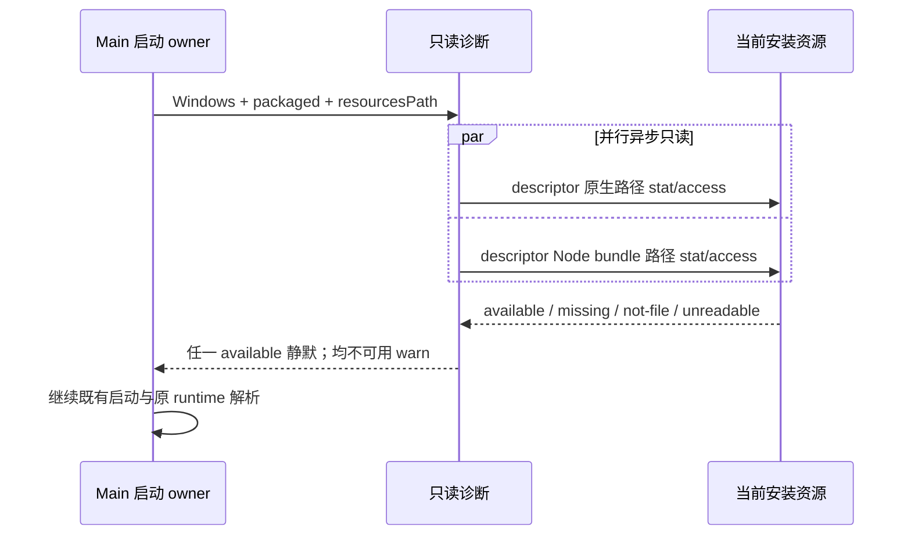

# 桌面随包 Agent 入口诊断

## 原因与边界

当前 Windows 启动诊断只通过 `resolveBundledGlmBinaryPath` 检查原生入口。现有实际命令解析支持 Electron Node runtime + `resources/glm/lcode.cjs`，日志已证明先报 missing providers、随后同一进程通过该 bundle 启动并 ready。不能把有效 Node bundle 安装形态报告为缺少 Agent。

- Main 启动诊断检查当前安装 `resourcesPath` 下的原生入口与 Node bundle 入口，路径都由 `LCODE_AGENT_RUNTIME` descriptor 派生；任一入口为可读普通文件即不报告缺失。
- 诊断异步读取文件状态和权限，不执行入口、不写资源目录、不启动 Agent、不扫描用户目录、不将环境变量覆盖或开发/远端缓存当作随包完整性证明。
- 两种入口都不可用才 warn；不存在、非文件、不可读分别保留受控状态，不将 EACCES/其他 IO 异常都说成文件缺失。检查失败不阻断启动，但不能静默算作完整。
- 保持现有 Windows packaged 启动诊断边界，开发态、macOS、Linux 不新增启动检查；辅助检查函数的路径解析可跨平台验证。
- 不改变 `resolveBundledGlmBinaryPath` 的原生可执行语义，不把 `.cjs` 作为二进制环境变量下发；不修改原命令选择优先级、ELECTRON_RUN_AS_NODE、远端原生兜底、鉴权或会话行为。

## 验收与验证

- 实际临时安装目录：仅 Node bundle、仅 native、两者都有均不误报；都没有、目录冒充入口、不可读故障保留真实诊断。
- 检查路径覆盖 Windows/macOS/Linux descriptor；损坏的一种入口不掩盖另一种有效入口。
- 非 Windows 或非 packaged 不访问文件；诊断不产生 spawn/写入。
- 原 Main/runtime 边界与 Agent Node bundle 启动测试保持通过。

验证结果（2026-10-23）：

- `bundledRuntimeDiagnostic.test.ts` 10 项通过；真实临时目录覆盖三平台 descriptor 的仅 bundle/仅 native、两种入口并存、均缺失、目录冒充 native，以及受控不可读状态和非 Windows/开发态不探测。测试在 Windows 执行，macOS/Linux 仅验证路径描述和分支规则，未做对应平台安装包实机启动。
- 已将诊断用例接入原 `main-runtime-boundaries.test.mjs`，随既有发布门禁执行。原 startupWorkspace 8 项回归通过；完整 `pnpm test:release` 169 项通过、1 项已有 Chromium 可选用例跳过，保留原 Agent、签名、更新、远端/本地与 Renderer 边界检查。
- 根 typecheck/lint、目标格式、verify:pre-push 通过，架构 baseline=0/new=0。生产源码净增 39 行（Main 入口净减 19 行，新诊断模块增加 58 行）。变更只涉及 Main 的一次性只读诊断，不改 runtime command resolver、Host/Agent 生命周期或鉴权。
- 未打包、安装或发布；用户自行重构建后确认 Node bundle 正常安装不再产生旧缺失告警，真实缺失/不可读仍有受控 warning。
