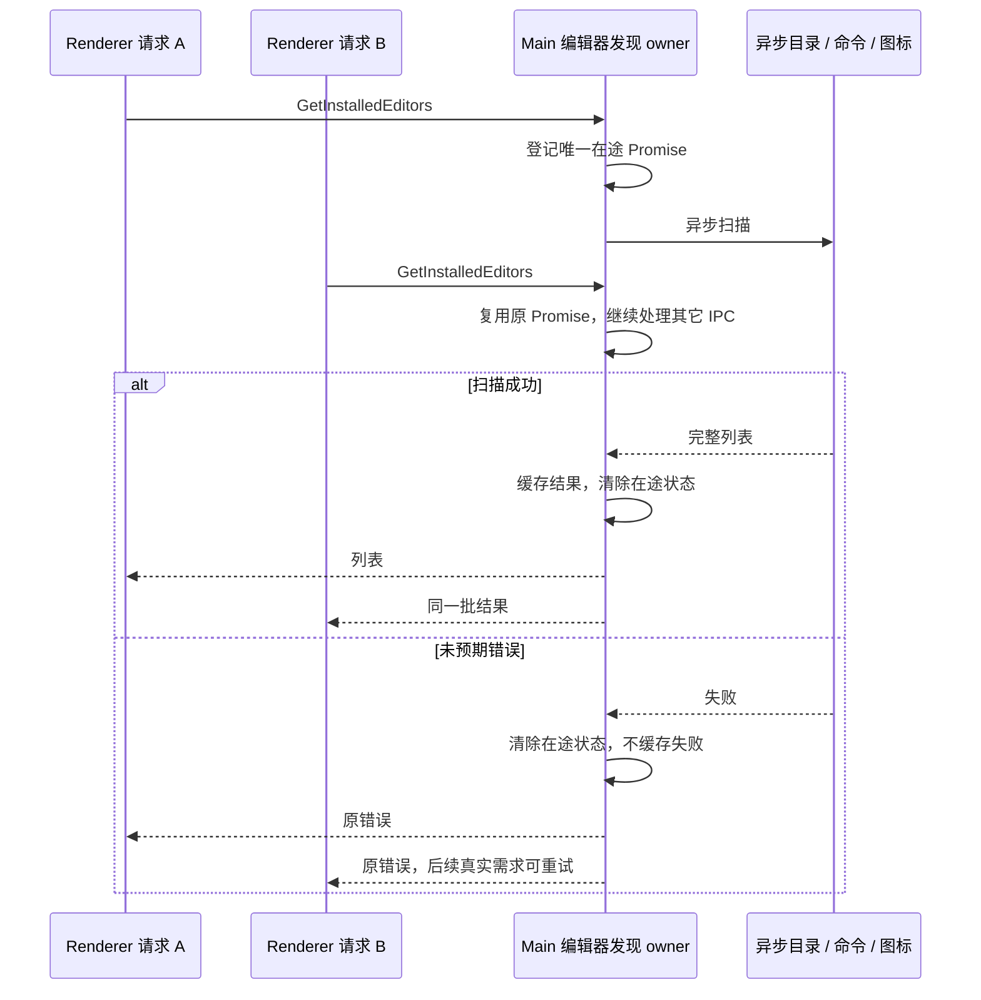

# 桌面编辑器发现与启动响应

日期：2026-10-23。状态：代码修复与定向验证完成，安装包场景待新构建复测；属于桌面 Main 平台能力修复。

## 问题和证据边界

界面挂载会经 `GetInstalledEditors` IPC 请求编辑器列表。修复前 Main 在第一次 `await` 前串行执行同步 `where.exe` 和文件探测；图标尚未完成时，第二个请求会重复整批扫描。Windows 的每次命令探测有 1 秒超时，但同步等待会阻塞 Main 消息循环，串行和重复请求还会放大总等待。

Windows JetBrains 目录还在模块加载时同步扫描；macOS 的 plist、ICNS、sips 和临时文件处理也使用同步 IO。仅把一处 where 调用替换成异步不能关闭整条阻塞链。

用户提供的 Agent JSONL 中可确认 MCP 慢连接和模型选型保存错误，但没有本次桌面 ANR 堆栈。本文修复的是已确认的代码缺陷，不宣称已证明截图中的唯一根因，不调整 MCP 网络预算或 Agent 执行生命周期。

## 产品规则

1. 编辑器发现、候选路径检查、图标文件 IO 与外部系统命令都异步执行，不阻塞 Main 等待磁盘或进程退出。模块加载时不执行安装目录扫描。
2. 同一 Main 中多个 `GetInstalledEditors` 请求共享一个在途扫描。只有完整成功后缓存结果；失败清除在途状态，下一次真实请求可以重试。成功的空列表仍是有效缓存。
3. 保持列表顺序、编辑器 ID、文件管理器、Windows CLI shim → 应用 exe 推导、JetBrains 版本优先级、macOS 图标解析与 fallback 的现有语义。
4. 优先检查已有固定安装路径，只有找不到时再探测 PATH。缺失 / 超时的可选命令不影响其它已安装编辑器。
5. 每个图标沿用原有 fallback 和无图标过滤规则；异常目录、ICNS 解码失败或转换失败不能中断其它编辑器的正常显示。临时文件由创建者在转换完成 / 失败后异步清理。
6. “打开编辑器”继续使用同一异步定义与路径解析入口；本地文件 / 目录判断也异步。VS Code SSH / WSL、Explorer 定位文件和 Finder 的调用语义保持不变，远端路径不按本地文件事实重新解释。
7. 一次冷扫描完成时记录总时长、路径发现时长、图标时长及条数，使用已有 Main logger，不输出新用户路径或代码正文，不新增高频探测、诊断端口或第二份缓存。

## 所有者与接口

- Main 的 `editors.ts` 拥有静态定义、异步发现、结果缓存和唯一在途 Promise；Renderer 只有本地显示状态。
- IPC channel、IPlatformService 和 `Promise<EditorInfo[]>` 合同不变，不新增跨包服务或 UI 直接调用 Repo 的路径。
- Main 内部 `getEditorDefsForCurrentPlatform` 与 `resolveEditorDefAppPath` 变为 Promise；同步更新直接调用者 `openInEditor.ts`。`getAppIconDataUrl` 继续返回 Promise，兼容 `applicationIcons.ts`。
- 外部命令通过 `execFile` 参数数组执行，不使用 shell 拼接；保留 where / plutil / sips 原有超时并隐藏 Windows helper 窗口。超时只限制可选外部操作，不用于假装完成同步或生命周期事务。
- 定义、路径和列表依然各只有原有写入 / 查找入口；并发失败不能留下永远 rejected 的全局 Promise。
- 此改动只影响桌面本机平台操作，不改变 Host、CLI CommandInbox、workspace identity、remoteSessionId 或 desktop-continuous / web-remote-replayable 的所有权。

## 验收场景

| ID   | 场景                                                  | 断言                                                               |
| ---- | ----------------------------------------------------- | ------------------------------------------------------------------ |
| ED01 | 导入 Windows / macOS 实现                             | 不探测安装目录、不启动外部命令，不执行同步文件 IO                  |
| ED02 | 多个冷请求，图标或命令尚未完成                        | 只运行一批扫描；期间事件循环和其它 IPC 可继续                      |
| ED03 | 已完成的热请求，包括空列表                            | 复用缓存，不重复目录 / PATH / 图标扫描                             |
| ED04 | 冷扫描出现未预期异常后再请求                          | 第一批共享失败；在途状态清除；第二批可以成功                       |
| ED05 | 固定安装路径已存在                                    | 维持路径优先级，不为该编辑器额外运行 where                         |
| ED06 | 只有 PATH shim 或命令缺失 / 超时                      | shim 推导真实 exe；缺失工具不影响 Explorer / 其它应用              |
| ED07 | JetBrains 多根目录、多版本、同名前缀文件              | 异步读取，每个根在一批定义中读取一次；保留原排序并只选目录         |
| ED08 | macOS plist 与有效 PNG ICNS                           | 异步读取；解析图标、缩放和列表内容保持正确                         |
| ED09 | ICNS 不支持、sips 失败、临时目录不可写                | 正确 fallback；已经创建的临时目录在转换结算后清理                  |
| ED10 | 本地打开文件 / 目录及 VS Code SSH / WSL               | 等待异步解析；保留参数、远端 URI 和原隔离语义                      |
| ED11 | 隔离 Electron 中两次列表请求等待慢命令，同时点击 ping | ping 返回时列表仍在等待；没有同步 IO；释放慢操作后两次请求正常完成 |

## 验证与交付

- 修改前先补回归并确认原实现失败，再实现修复。
- 复用桌面现有 source bundling fixture 和隔离 Electron / preload 的 E2E 模式；原生图标的替身测试不能被描述为全部真实 OS 图标路径已验证。
- 执行定向回归、`pnpm typecheck`、`pnpm lint`、本轮文件格式检查和 `pnpm architecture:check --changed`，记录真实结果与无关工作区失败。
- 持续入口为 `pnpm test:desktop-editors` 和 `pnpm test:desktop-editors:ui`；无 UI 的回归同时进入现有 `test:release`，防止发布时重新引入同步扫描或重复在途请求。
- 不重启用户正在运行的应用、不覆盖现有安装包、不修改正在执行的任务和用户数据。
- 本次不顺带修改内存优化方案中的 Agent 预热、Worker 和缓存策略，避免启动问题修复与其它行为变更无法归因。

### 本轮实测结果（Windows）

| 检查                                                                    | 结果                                                                                                     |
| ----------------------------------------------------------------------- | -------------------------------------------------------------------------------------------------------- |
| 原实现对新增的首批 8 项回归                                             | 8 项失败，覆盖导入同步扫描、并发扫描、异步解析和图标 fallback                                            |
| `pnpm test:desktop-editors`                                             | 11 项通过；包含慢命令 / 慢图标、失败重试、空缓存、超时命令、JetBrains、macOS 图标、本地 / SSH / WSL 打开 |
| `pnpm test:desktop-editors:ui`                                          | 1 项通过；真实 Electron Main / Renderer / IPC 与 Windows 原生文件图标，文件和命令探测使用受控替身        |
| `pnpm test:renderer`                                                    | 10 项通过                                                                                                |
| `node --test packages/desktop/scripts/main-runtime-boundaries.test.mjs` | 14 项通过，1 项已有条件跳过（Chromium 页面 helper）                                                      |
| `pnpm typecheck` / `pnpm lint`                                          | 均通过                                                                                                   |
| `pnpm architecture:check --changed`                                     | 0 violations、0 baseline、0 new；修改仍在现有 desktop Main 适配边界内                                    |
| 本轮 7 个文件的 `oxfmt --check`                                         | 通过                                                                                                     |
| 本机 `@fiahfy/icns` 动态导入兼容性                                      | `Icns.from` 可用                                                                                         |

在隔离 Electron 中，测试先挂起全部 3 个可选 PATH 探测，发送两次列表请求，再点击另一按钮通过 IPC 获取 `pong`。此时列表仍处于 loading；释放探测后，两次请求都完成，图标只读取一次，后续热请求不再探测。

macOS 行为由编译实际源码、替换 OS IO 的回归覆盖，尚未在 macOS 原机执行。没有生成或覆盖安装包，也未使用用户数据复现重启 / 安装后启动；不能据此宣称原 ANR 的全部原因已消除。

提交前复核（2026-10-23）：重新执行 `pnpm test:desktop-editors` 11/11、`pnpm test:desktop-editors:ui` 1/1，均通过；异步定义和路径解析的直接调用者已同步使用 await。根目录与 CLI 类型检查、Lint 通过。按功能提交测试入口及对应 package.json 库存摘要，未替换安装版。
