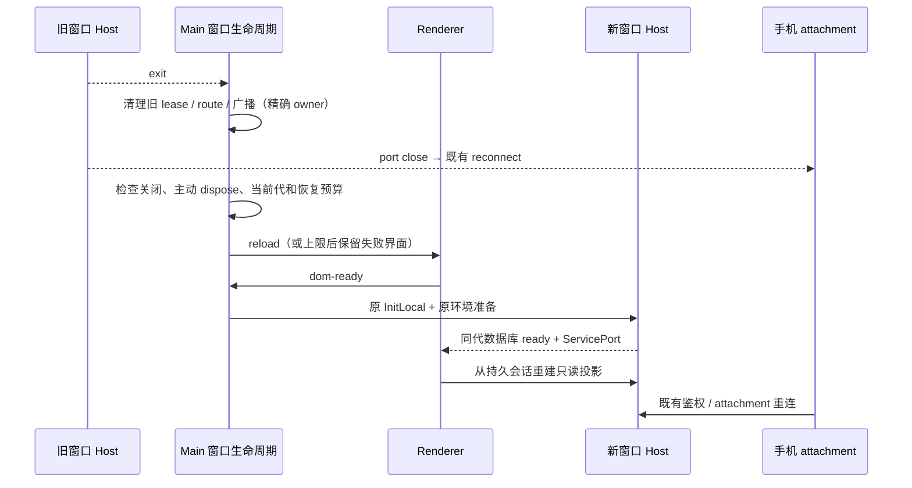

# Host 退出、工作区隔离与生产诊断

## 已确认事实与边界

2026-10-22 日志记录一次 Utility Host code 5 崩溃；Main 随后仍存活，但没有重建 Host。日志没有原生堆栈，不能据此判断 OOM 或原生组件。当前源码确认退出处理只有清理，Renderer 又只在首次启动接收本地服务端口，单独 fork 新进程不能恢复业务连接。

100 次工作区订阅失败来自 43 个子会话，同一子会话在另一稳定工作区有成功订阅。旧 Agent child 丢失父工作区配置及冷读父链比较问题，沿用 `subagent-history-and-resume-ownership.md` 的现有修复；补充 worktree origin、父子独立绑定及两种交付语义的验证。没有原机数据库时，不宣称每条旧记录都已重放。

## 单一所有者与产品规则

- Main 的窗口生命周期拥有 Local Host 恢复；不增加 Host、Agent、业务队列或会话状态所有者。复用已有 renderer reload → dom-ready → InitLocal → 数据库 ready → ServicePort 的恢复路径，恢复持久窗口、会话及已有草稿存储。未持久的临时 UI 状态按现有 reload 语义处理。
- 非主动退出自动恢复；每窗口 60 秒内最多自动恢复 3 次。窗口关闭、应用退出、主动 dispose、旧 Host 迟到退出均不触发恢复。不用延时替代代次/owner 校验。达到上限显示已有存储启动失败界面；用户显式重试可重新开启恢复预算。
- 退出先使旧 Host 的 lease、广播、RPC、attachment 失效，然后重建 Renderer/Host。旧 Host 退出不得注销替代 Host 的广播和资源登记。恢复不重放模型请求、已接受输入或写命令；CLI 继续通过 stdin 关闭终止孤儿运行时。
- Client 的公共 MessagePort 连接拥有 close → dispose 边界；对端端口关闭必须立即拒绝在途 RPC，桌面本地与远程 scoped connection 共用，不能等业务超时或新请求才清理。
- 手机通过既有 relay bridge 关闭和重连恢复 `web-remote-replayable` attachment，仍连接同一窗口 Host；桌面重建 `desktop-continuous` 订阅，不合并两种恢复语义。
- 继续使用历史读取的唯一 workspace 解析入口。显式 identity、execution binding、origin、remoteSessionId 和父链一致性校验不能因恢复而放宽。独立 workspace 的只读历史不得错误借用另一工作区父 runtime。
- 工作树输入建议复用同一 scope 校验；目录 hook 消费同代投影的 executionWorkspace，旧 CLI 才回退 readSession。`live` 不是“可执行 runtime 已创建”的证明，冷 child 历史不创建执行资源。

## 其他已确认的公共能力缺陷

- PiP 的缺凭据/连接失败共用一次 30 秒恢复窗口；新 focus 不能不断重置窗口或推迟现有重试。成功、没有活跃 turn 或 dispose 结束该窗口；相同版本拒绝不持续轮询同一凭据。事实快照仍同步更新，终态不会被迟到 IO 复活。跳过事件用 debug，一次窗口耗尽才 warn。
- 下载 progress 仍逐条更新原产品状态，生产进度日志复用既有 10% 分桶并保留首次、终点与新下载重置；不改变取消、菜单、强制更新或完成事件。
- Account Config 的 revision 继续原样比较和传输；生产日志只记录摘要和长度，不落盘完整 revision 内容。
- 自动签到对确定性 `dependency_required` / `sign_in_required` 失败当天停止定时重试，人工重试不受此限制；重授权更新凭据后清除这种阻塞失败，保留自动开关与已成功领取事实。网络/部分失败仍按已有间隔恢复，不伪造成功，不安装未知依赖。
- 模型目录 HTTP 成功但返回 HTML/损坏 JSON 时，在共享 catalog client 给出不含正文的协议错误和检查 API 地址提示；不猜测替换地址或凭据。无可用 Key 的现有拒绝保持不变。

## 验收与验证

1. 故障注入 Host exit（含 code 5 / 意外 code 0），清理完成后只恢复一次；旧代 exit、主动 dispose、关窗、退出均不恢复。
2. 短时连续崩溃预算有界，稳定窗口后可恢复；显式重试可恢复；异步恢复前窗口/owner 改变应取消旧动作。
3. 旧 child exit 不删除新广播/资源登记；数据库启动失败显示与显式 retry 仍有真实可执行路径。
4. 两种交付语义下，子会话在父 active/cold、嵌套、worktree origin 与显式独立工作区的读取规则保持一致，不创建运行时或模型请求。
5. PiP 事件风暴不能延长恢复期限，终态/成功/凭据轮换行为仍正确；日志不包含 capability。
6. 数千次下载 progress 的日志量有界，新下载与完成可见；revision 摘要日志不包含配置正文；签到依赖失败自动有界、手动可重试。

原始 macOS code 5 的崩溃点仍需匹配 `.ips`/dump。自动恢复验证不能当作原始崩溃点已修复。

## 实施与实际验证（2026-10-22）

已按上述边界修复：窗口 Host 有界恢复与显式重试、旧进程精确清理、公共 MessagePort 关闭结算、独立 fork 冷读隔离、工作树输入建议 scope、冷历史目录读取、PiP 恢复窗口/关闭竞态、所有渠道共用的签到阻塞策略、模型目录无正文错误和生产日志限量。中文注释记录修复依据；无协议字段变更、数据库迁移或新增依赖。

| 验证                                                 | 实际结果                                                                                                 |
| ---------------------------------------------------- | -------------------------------------------------------------------------------------------------------- |
| 20 个文件的定向回归（包含真实 Chromium helper 检查） | 115 通过，0 失败/跳过                                                                                    |
| `pnpm test:remote-control`                           | 159 通过，0 失败/跳过                                                                                    |
| 现有侧面板 UI 回归                                   | 3 通过                                                                                                   |
| 新增 Electron / 浏览器 E2E                           | 2 通过；真实 Utility exit 5 后新 Host/端口恢复，持久草稿保留；冷 child 目录、旧快照与迟到 owner 隔离通过 |
| 根 `pnpm typecheck` / `pnpm lint`                    | 通过                                                                                                     |
| CLI `typecheck` / `lint`                             | 27 / 14 个任务成功；保留既有 Turbo workspace 警告与 `core/src/tool/registry.ts` 的一项 Lint warning      |
| 独立 Renderer 类型检查                               | 失败；与修改前 HEAD 的对比均为 196 项，新增诊断 0；不计作通过                                            |
| Desktop `build:no-runtime-assets`                    | 通过；既有 chunk 大小与动态/静态重复导入提示保留                                                         |
| `node scripts/build-desktop-agent-cli.mjs`           | 通过；重建 worker、声明、17.6 MB Agent 及必需插件 runtime，staging 到本机桌面 bundle                     |
| 架构检查                                             | baseline / new / violations 全部为 0；desktop、client、services、ui、lcode-cli 保持现有 owner 边界       |
| 功能图                                               | 118 个唯一节点、180 条关系端点有效；补充既有工作树节点的快照目录读取规则                                 |

共 279 项验证通过。源码（不含测试、脚本与文档）增/删：CLI 30/14、Client 12/8、Desktop 165/31、Services 78/18、UI 16/9，净增 221 行。新增恢复状态只归窗口生命周期，派生目录只归原 hook 请求范围；没有复制业务 accepted queue。证据日志位于本机 `.artifacts/host-recovery-20261022/`。

截图中的 `projectNative.js` 缺失来自本轮隔离 Electron 测试最初将 workspace TypeScript 包 external 化，原生 Electron 无法把 `.js` specifier 解析到 `.ts`。已停止残留测试进程、改为完整 bundle，并加启动前导入检查和异常捕获入口；验证窗口保持隐藏。正式 Desktop tsup 已有 workspace noExternal 配置，生产构建通过，未通过添加同名 JS 文件修改业务源码。

未验证边界：没有原 macOS `.ips`/原数据库的逐会话重放，没有实体手机或 macOS/Linux 安装包实机验证，未替换用户已安装应用。Qoder 原生设备运行时缺失仍需有效厂商依赖；本轮避免无效自动请求，不伪造依赖或成功结果。WS 1006、staleRevision、foreign workspace 与无可用 Key 仍按原边界处理；这份日志不足以将所有拒绝视为缺陷，因此没有删除这些保护。
