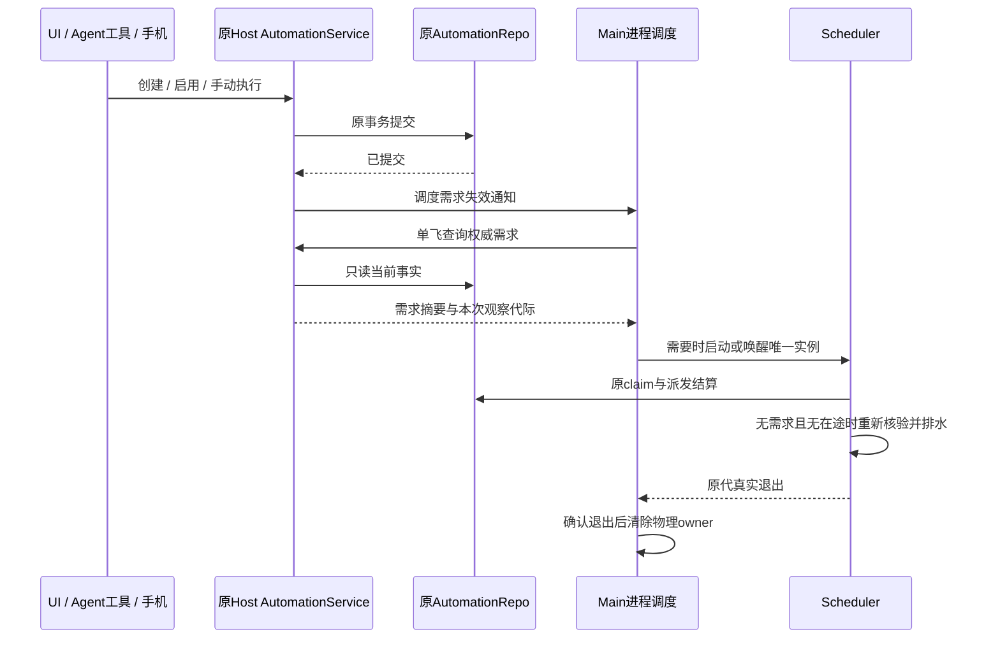
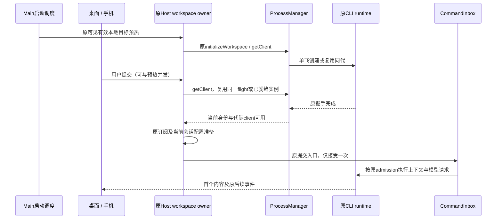

# 桌面空闲资源优化方案

日期：2026-10-23；实现更新：2026-10-24。状态：P1 按需求驻留、P2 定点优化与分段诊断已实现，P4 增补资源回收回归；整包收益及长稳验收待用户重新构建后执行。

需求修订：用户明确要求保留预热，并反馈发送消息后需要等待十几秒。撤销原 P2「取消本地预热、空白页零执行 Agent」方案，改为保护预热与缩短响应等待；不以增加首次发送等待换取内存下降。该旧策略未实施，无需回退产品代码。

源码阅读基线：`c76de99e` 及当时工作区可见源码；已安装程序的观测版本为 `3.20.8 / 41895bb1`。工作区存在其它任务的改动，实施时重新检查基线，不把不同版本的运行数据合并为前后对照。

本方案承接[桌面内存总方案](desktop-memory-optimization-plan.md)和[已实施资源优化记录](desktop-resource-optimization-follow-through.md)，聚焦“只打开应用、没有执行任务”的常驻成本，以及浏览历史后回到该状态的资源回收。

## 1. 目标与已经确定的要求

1. 保留输入框粒子动画的持续播放、输入增强效果及模型档位视觉差异。用户已明确要求该效果；取消、暂停或降低该效果不作为本轮收益来源。
2. 保留当前可见且有效的本地 workspace 预热及后续复用。减少没有调度需求的 Scheduler 和已经失去合法使用者的辅助资源；必要的预热 Agent 不属于待回收对象。
3. Host 和 Renderer 按实际分配与引用证据优化；不能因进程内存较大、CPU 为零就认定泄漏或直接结束进程。
4. 保留现有账号登录、鉴权、刷新、Provider 配置、会话恢复、项目范围及跨设备隔离。优先定位发送后十几秒等待的真实阶段，不把原来可以提前完成的准备移到发送之后；不得丢失、重复或改变用户已提交的输入。
5. 不重复实现已完成的 Diff Worker、终端背压、媒体释放、Settings 按需加载和缓存预算。只有新证据表明原规则失效时才进入修复范围。
6. 先按阶段完成代码与必要的保护测试，最终整包性能和跨平台验收集中放在最后。开发排查不自动重启用户正在使用的生产应用。

## 2. 已有证据与证据缺口

### 2.1 单次本机观测

下表为同次采样的 Windows 私有工作集，单位 MiB；不是私有提交量、JS heap 或显存。原始脱敏数字保存在未提交的 `.artifacts/desktop-memory/idle-open-investigation.json`。

| 角色            | 私有工作集 | 当前证据                                                                       | 结论边界                                                     |
| --------------- | ---------: | ------------------------------------------------------------------------------ | ------------------------------------------------------------ |
| 会话 Agent      |      122.5 | 启动后有一个 chat Agent；没有任务运行的用户确认与诊断计数吻合                  | 启动预热及持续保留有成本，不等于已证明存在孤儿进程           |
| Scheduler       |       96.4 | 自动化配置共一条，已停用；无运行、有效排程或已认领 run；进程仍常驻             | 现有无条件启动策略存在可优化空间                             |
| Local Host      |      197.2 | 终端为零，plugin / mcp-status Agent 为零，文件观察者为三个                     | 尚未定位内部主要分配，不能承诺节省具体数量                   |
| Renderer        |      174.5 | 本次空白页之前的诊断为零 Diff Worker、零 xterm；其它时刻打开历史会话后数值变化 | 页面与历史资源需要分别测量，不能将不同页面直接作优化前后对照 |
| Main            |      146.5 | 单窗口、原窗口 Host 架构                                                       | 继续观察，不以移走业务或进程合并作为首选手段                 |
| GPU             |       74.9 | 包含应用绘制；粒子效果属于保留需求                                             | 不通过牺牲指定视觉效果压低这部分指标                         |
| Network / Audio |       12.8 | Chromium 辅助进程                                                              | 本轮不按 CPU 为零直接回收                                    |
| 合计            |      824.8 | 一次运行状态的快照                                                             | 不是冷启动基准，也不是已经实现的优化收益                     |

Agent 的约 122.5 MiB 属于保留预热所需的观测成本，不计入本轮拟回收收益。Scheduler 的约 96.4 MiB 是无调度需求时的优化候选占用，仍不等于净节省承诺；需扣除需求查询与生命周期管理的成本后实测。不能用取消预热后的空闲数字替代相同就绪能力下的对照。

用户新反馈的「发送后十几秒才有回应」尚未关联到具体请求，不能直接归因于预热、记忆召回或模型网络。当前源码保留 `warmUpLCodeAgent → initializeWorkspace → getClient`，成功后建立原 TaskIndexSyncer 订阅；发送时仍可能经过会话准备、配置同步、上下文 / 工具准备和模型请求。只读扫描当天桌面日志得到 9 次初始化完成记录，耗时约 1.76–4.65 秒，且 9 次 warmup ready、未匹配到 warmup failed / unavailable / waiting。这些跨次启动样本证明预热有实际成本，不足以解释这次十几秒等待。当前检查的桌面日志未提供配对的 turn 阶段与模型首内容耗时；不得将未知部分归给服务端。

约二十分钟的既有日志中，Main heap 在约 29–35 MiB、Host heap 在约 32–51 MiB 范围变化。期间 UI 状态有变化；这不是严格空闲长稳实验，也不足以证明或排除泄漏。Renderer 的 `performance.memory` 读数不能替代真实 heap profile，更不能用进程内存减 heap 后把差额全部叫作原生泄漏。

### 2.2 仍需补齐的证据

| 缺口                   | 下一步取证                                                                                        | 不提前宣称的结论                           |
| ---------------------- | ------------------------------------------------------------------------------------------------- | ------------------------------------------ |
| Agent 预热与复用       | 跟踪 Host 预热、存储准备、workspace presentation、历史打开和首次提交是否复用同一目标 / generation | 进程已存在就代表会话与模型请求已经全部就绪 |
| Scheduler 全部变更入口 | 枚举 UI、Agent 工具、手机、多个窗口及 scheduler 自身结算的写入与通知                              | 仅修改 runNow 唤醒就覆盖所有功能           |
| Host 内存组成          | 隔离合成环境记录加载图、服务初始化、heap、external、数据库连接及 watcher 数量                     | 模块数下降就是常驻内存下降                 |
| 历史与子智能体切换     | 固定历史夹具，测打开、切换、关闭、回空白后的引用和内存轨迹                                        | 打开长会话后的合理占用都是泄漏             |
| 发送后十几秒等待       | 关联提交、admission、准备、请求派发、首个 provider event、首个内容及 UI 可见时刻；区分首发与续发  | 所有等待都来自模型或都能通过预热消除       |

## 3. 权威状态、接口与影响范围

| 状态 / 资源                        | 唯一权威所有者                                                       | 本轮允许的变化                                         | 必须保留的边界                                                    |
| ---------------------------------- | -------------------------------------------------------------------- | ------------------------------------------------------ | ----------------------------------------------------------------- |
| 自动化定义、手动 run、claim 与结算 | 现有 AutomationService / AutomationRepo、Scheduler 的事务与 inFlight | 新增可查询的调度需求事实、提交后的失效通知             | Main 不持有另一份任务列表、队列或 cron 规则                       |
| Scheduler 物理进程                 | Main 的现有进程调度入口                                              | 增加 single-flight 启停与代际状态                      | 仍为应用级单例，不变成每窗口一个 Scheduler                        |
| 窗口服务与 attachment              | window-scoped Local Host                                             | 按需装配非必要服务，消费生命周期失效通知               | 一个窗口一个 Local Host；手机复用已有 attachment                  |
| Agent 创建、复用、退出与预算       | LCodeAgentProcessManager、原 Host / runtime 使用资格                 | 保留预热，消除同目标重复准备；复用原准备和退出入口     | 不因空白页或 CPU 为零回收有效预热；pending RPC 为零不等于业务空闲 |
| 已接受输入与运行任务               | CLI/runtime CommandInbox 与原会话 owner                              | 不增加第二条提交链路                                   | busy/running 输入继续串行 admission，不丢失、不重复               |
| 历史列表与 workspace 元数据        | 原 Repo / 索引同步 owner                                             | 无 runtime 时允许原有 dormant 状态，真实需求后恢复订阅 | 元数据镜像不能冒充执行 runtime 的最新事实                         |
| 账号、凭据、Provider 与刷新        | 原 credential / provider runtime owner                               | 只调整使用时机和公开依赖入口                           | 不复制凭据、不新增刷新 owner、不跨账号复用授权结果                |
| 展示缓存、快照与预览               | 原 Renderer store / SessionDataLayer / viewer owner                  | 修复无消费者仍持有的引用                               | 不删除历史、不终止后台任务、不重挂 Root 或清空草稿                |

身份键始终使用 `workspaceIdentity?.trim() || workspacePath`。文件操作继续使用 workspacePath；远程链路贯穿 workspaceIdentity 与 remoteSessionId。相同路径不同远程身份不能共用进程、准备结果或缓存。

### 3.1 表面与语义差异

| 场景                                           | 拟定行为                                                        | 原语义保持                                             |
| ---------------------------------------------- | --------------------------------------------------------------- | ------------------------------------------------------ |
| 本地空白页 / 只恢复项目和列表                  | 保留可见有效本地目标的一个预热 Agent，不重复创建                | 默认 cwd、目录不可用提示、标签与历史保持               |
| 打开历史详情、显式刷新、请求命令目录或工具探测 | 根据真实需要进入原准备链路                                      | 同目标 single-flight，失败仍可恢复                     |
| 本地首次提交                                   | 优先复用预热中的 flight 或已就绪 runtime，再交给原 CommandInbox | 只接受一次；草稿和 optimistic overlay 不变成已接受队列 |
| 桌面切换历史或子智能体详情                     | 只调整展示资源资格                                              | desktop-continuous 不因查看切换中断执行                |
| 手机发送或重连                                 | 复用现有桌面 Host 与 runtime                                    | web-remote-replayable 的快照、补放和输入去重保持       |
| SSH / WSL / Docker                             | 保留现有按需策略与 owner 屏障                                   | 不为本地优化新增远程预热，不按路径猜身份               |
| 多窗口                                         | 原 Host 各自持有合法使用者；Scheduler 仍应用级唯一              | 一个窗口离开不能释放其它使用者的资源                   |

## 4. 分阶段实施

| 阶段                        | 交付物                                                     | 顺序与退出条件                                 |
| --------------------------- | ---------------------------------------------------------- | ---------------------------------------------- |
| P0：冻结可比基线            | 固定页面、数据与粒子设置的角色采样；启动入口与写入入口清单 | 是后续比较前提；旧版本数字不能替代新基线       |
| P2：保护预热与响应等待归因  | 分阶段耗时、预热复用与必要的重复准备修复                   | 优先于驻留削减；先查十几秒等待，保留预热       |
| P1：Scheduler 按需求驻留    | 需求读取、完整变更通知、单例启停、退出屏障及专项测试       | 无需求为零进程，有需求准确唤醒；不阻塞聊天首发 |
| P3：Host 分配归因与定点优化 | 成本表和有实测收益的最小服务 / 加载调整                    | 测量先于改动；无明确收益的候选不扩大重构       |
| P4：Renderer 切换与关闭回收 | 固定历史 / 子智能体场景、引用回归与实际残留修复            | 保留正在使用的内容和已实现预算                 |
| P5：最终验收                | 同版本整包 A/B、延迟、真实工作负载、平台及长稳报告         | 用户自行新构建后执行；缺口与失败明确列出       |

保留原阶段编号用于追踪，实施顺序调整为 P0 → P2 → P1 → P3 → P4 → P5。P0 的测量工具和必要保护测试在开发期间完成；P5 才进行整包最终验收。每阶段提交产品代码前仍执行类型、Lint、架构和相应专项检查。

### 4.1 P0：基线与场景冻结

- 使用固定合成 workspace、历史条数、附件大小、模型目录和自动化配置；测试数据目录与生产数据隔离，不复制用户凭据。
- 粒子效果、主题、缩放、窗口尺寸、硬件加速和壁纸设置在前后版本保持一致。持续粒子播放产生的正常开销保留在基线中。
- 同机交错执行至少五对冷 / 热启动；分别记录登录页、已就绪空白页、历史详情和关闭后的页面。就绪依赖真实握手与 attachment，固定等待只用作采样窗口。
- 五对启动先报告全部样本与中位数；延迟的正式P95至少采集30次对应操作，并公布样本量及计算方式。样本不足时只标为探索估计，不写成稳定性保证。
- 记录 role / lane、进程代际与数量、私有工作集、私有提交量、heap、external、线程 / handle、数字资源计数，以及首次本地准备时间。
- 时延分组覆盖「预热完成后首发」「预热中立即发送」「同会话续发」「打开旧会话后续发」。固定模型、思考强度和速度档位；不能靠降低模型档位、关闭 MCP / 电脑操作或删减上下文冒充性能修复。
- 现有采集器默认是隔离的 login-ready 场景。实施时补充已就绪空白页和历史往返夹具，不能把现有默认报告写成这些新场景已经通过。

### 4.2 P1：Scheduler 按需求驻留

产品规则：没有启用的自动化、待派发手动 run、未结算 claim 或 inFlight 时，不长期保留 Scheduler。任一启用的自动化即保守视为有效需求；本阶段不把未来触发时刻迁移成 Main 的另一套定时任务引擎。

实施步骤：

1. 在原 AutomationService / Repo 边界提供只读需求摘要。不能只看 enabled 数量，还要覆盖手动执行、认领、重试和未结算派发。
2. 审计 create、update、setEnabled、restart、delete、runNow、run 结算及任务自删除入口；所有成功提交后经原 Host 通道发送失效通知，失败写入不发布成功事实。列表读取不唤醒执行 Agent。
3. Main 仅管理物理进程与观察代际。收到失效通知后向原领域 owner 查询，合并重复通知；在途查询若被新通知或数据根 / Host 代际更新覆盖，则丢弃旧结果并重新查询。
4. 数据库已准备且需求确定为空时跳过 spawn；确定有需求时按原 spawn 入口单飞启动。需求未知或读取失败不能被解释为空；沿原调度可用性策略处理并留下诊断原因。
5. Scheduler 运行中发现无需求，先排水并重新核验 Repo / inFlight，再进入退出握手。新的需求取消尚可取消的退出；已经退出中的原代则等待真实退出后启动新代。原数据库 claim 仍是派发去重依据。
6. Main 的手动唤醒在 Scheduler 已停止、启动中、运行中和退出中均有效。合并的是唤醒信号，已接受 run 仍保存在原数据库，Main 不缓存另一份 run 队列。
7. 多窗口共用数据根时只允许一个进程；Host 重连、崩溃恢复、应用恢复和数据根切换时从权威 Repo 重查，旧 Host 的迟到通知不覆盖新代。先证明全部写入入口与重连失效链完整，再启用按需退出，不能靠延长轮询掩盖通知缺失。
8. 空闲退出以匹配代际的真实 exit / close 为完成证据。不能把当前退出 helper 的强杀等待超时直接当作进程已经释放；退出失败保持旧 owner，不并行启动冲突实例。

协议：Main↔Host 的新增需求查询 / 失效通知同步更新 shared channels、严格类型和 validation；Main↔Scheduler 的新增排水 / 退出握手同步更新 schedulerProtocol 并在接收侧校验。若未修改 CLI wire，不为此增加 CLI 命令；涉及 CLI 时同步其协议与运行时校验。

实施接口补充：`AutomationRepo.hasSchedulingDemand()` 只查询 enabled、claim、待派发 run 和未结算运行，不读取 prompt 或账号配置。同进程多个 Repo 的成功提交按数据库路径发布失效事件，Host 订阅现有 Repo 并转发；UI、工具和手机仍走原有写入入口。Main 合并查询，Host 断开、重连和恢复时使旧观察失效；未知需求保守启动 Scheduler。Scheduler 在 tick、结算全部结束后重新读取需求，确认空闲才通知 Main 并关闭自身。Main 只在收到真实 exit 后清除进程句柄，并再次向 Host 查询，覆盖“最后一次读取为空之后恰好有新写入”的窗口；不将退出超时视为已经退出。已有进程接收唤醒后仍自行核验数据库，Main 不强制结束运行中的任务。测试覆盖空库、暂停但存在 manual run、任务删除后仍有在途 run、写入失败、多个 Repo、迟到查询、退出时唤醒、Host 重连及两种会话传输的投影回收。



### 4.3 P2：保护预热与响应等待归因

2026-10-23 实施补充：已核对当天 CLI 与桌面日志，五次真实模型步骤在 regular loop 开始至工具注册之间分别约 3.07、3.68、4.75、5.27、4.95 秒。相关会话 MCP startup 早于本轮完成且仅 1–9 毫秒，不能把该区间直接记作 MCP 建连时间。现有日志缺少记忆、历史、Git 读取的独立生产耗时，具体占比待新诊断验证。确认的源码问题是 `readRepositoryContext` 复用完整账号候选发现，即使所有远程目标已有显式绑定仍扫描系统账号。首批修复按下面的规则收敛：

- 原 Git routing owner 每次重新读取仓库远程、共享 worktree 根、当前 profile / bindings 和 legacy 绑定。仅模型只读上下文在所有目标都有确定显式选择（含失效 / 冲突）或没有远程时省略外部候选发现；任一目标处于自动选择仍完整发现。候选菜单、绑定 CAS、实际执行鉴权继续原路径，不新增 TTL、缓存或另一个账号 owner。
- 显式选择存在时只投影当前 profile 中匹配该选择的账号。账号删除、revision 变化、URL / 用户名提示变化继续呈现 stale / conflict；其它检测账号不能冒充已选账号。自动 tombstone 与 legacy origin 规则保持。
- 原 turn loop 在原调用顺序上测量压缩检查、项目记忆、历史召回、Git 背景与 MCP 注册。每次进入 regular loop 的首次准备耗时达到 1 秒时至多记录一条 info 数字摘要，包含总耗时、各段耗时和完成 / 失败 / 取消状态；快速步骤和后续模型步骤不新增生产日志。不记录正文、路径、账号或地址，不增加请求或改变取消 / 失败结果。
- 保护测试覆盖全显式绑定跳过发现、自动目标仍发现、绑定变更 / stale / URL变化 / 同路径不同identity、无远程、实际鉴权不走简化读面；耗时测试覆盖顺序、失败 / 取消、快速无日志以及日志失败不影响执行。真实耗时改善另行测量，不将少调用一次解释成已缩短固定秒数。

保留现行“当前可见本地目录最多预热一个 Agent”的规则，以及原有默认对话目录预热。不缩减预热范围、不延后到第一次发送、不在用户仍停留该目标时因没有运行任务而回收预热实例。远程 active / 失效本地目录的原有空名单规则继续保持，不扩张为全项目或远程预热。

实施步骤：

1. 先关联同一发送的时间线：UI 提交 → Host 接收 / getClient → 原 CommandInbox admission → 会话 / 配置 / 上下文准备 → 模型请求实际派发 → 首个 provider event → 首个有效内容 / 文本 → Renderer 可见。逐段区分正常业务排队、重试等待、网络与本地准备；各进程使用单调时钟耗时及既有时钟关联，不直接相减不同进程的未校准时间。
2. 复用现有 turn phase、模型首事件 / 首内容 / 首文本及 UI TTFT 观察入口，核验采集边界和安装版本是否具备这些字段。缺失时补最小数字里程碑，不开启原始流式内容或凭据日志。请求开始标记若只代表进入 SDK，也须与真实 transport 派发区分，不能直接命名为「网络耗时」。
3. 按证据确认慢点后修复：重复初始化、串行等待与相同依赖的重复读取分别归到原 owner；能够安全并行的独立读取才并行。未经定位不增加第二套预热服务、共享跨会话缓存或超时兜底，不移除鉴权、范围校验、必要 hooks 和记忆规则。
4. Main 每次窗口创建仍异步、幂等准备 app 管理的默认 cwd。保留现有 `agentWarmupTargets` 选择、上限一和空数组 / 缺失字段的兼容区别，不重建被删的用户项目。Host warmup 与真实发送复用原 ProcessManager single-flight；预热未完成时发送加入同一 flight，不能重复创建。
5. 预热完成后继续建立原 TaskIndexSyncer 订阅，历史与配置摄入不中断。预热完成不代表模型请求已经完成；会话特定上下文仍由原会话 owner 准备，不能为提前准备而触发模型计费调用、真实工具或任务副作用。
6. 新代鉴权、Provider 配置同步、MCP 配置与项目范围注入照常执行；初始化失败沿原恢复链路处理。不得跨账号或 runtime generation 复用成功状态。原 CommandInbox 保持唯一已接受输入队列，首发与中断后续发均不重复提交。
7. 首批不对 chat Agent 新增通用 idle TTL；当前预热目标继续复用。其它已失去使用资格的资源仍依原 owner、运行任务、已接受输入、后台命令和跨端消费者证明释放，不把「没有运行任务」当作取消预热资格。
8. 必要代码修复实施前更新对应阶段 / 请求组装 spec，并补并发预热、首发、热续发、身份变更和恢复测试；现行启动与远端预算 spec 的预热约束继续有效。



### 4.4 P3：Host 归因后定点优化

- 在合成环境分别采集模块加载前后、服务装配后、打开项目后、首次执行后、关闭展示后的数字与分配 profile。分析工具不能注入生产用户内容或提交原始凭据 / heap dump。
- 对 `createLocalServices` 的每项较重依赖区分“导入代码”“构造服务”“启动 watcher / timer / DB / 网络”“第一次调用”；列出各自成本和不可延后的消费者。构造函数数量不能代替分配测量。
- 优先处理没有使用者的对象引用、未退出的辅助进程及未使用能力的提前初始化。需要按需加载时使用现有公开包入口和原 Service facade，保持同一服务身份与并发初始化 single-flight。
- 账号刷新、Provider 注册、任务索引、文件监控和远控 attachment 有明确常驻职责，不能整体停掉 Host 或重建所有服务来追求数字。
- 每个候选单独记录净收益、首次使用成本和释放证据；仅缩小模块图、把内存转移到其它进程或不能复现的微小变化，不作为完成指标。不设未经测量的 Host 节省承诺。

### 4.5 P4：Renderer 历史往返回收

- 使用固定长历史、多工具输出、子智能体和附件夹具；分别测打开详情、切换另一会话、关闭详情、回到空白页。展示仍打开时的合理引用不作为泄漏。
- 复查原 SessionDataLayer、conversationProjectionStore、Controller registry、预览和事件订阅的 owner。按已有预算和真实消费者释放，保留在途、运行、待确认和手机使用者的保护集合。
- 数字计数应在对应释放完成事件后回到预算内；用 retaining path 确认残留引用。迟到 snapshot、旧订阅和旧 generation 不得重新挂回已释放展示。
- 不通过删历史、截短模型上下文、清空草稿或暂停指定粒子效果降低数值；不重新实现已有缓存预算。

## 5. 验收矩阵

以下为计划覆盖，不代表已经执行。新增 Scheduler 驻留控制与预热 / 响应时延 E2E 尚无完整覆盖；实施时补入现有 runner。

| ID  | 初始条件与操作                                        | 必须断言                                                       | 证据层                              |
| --- | ----------------------------------------------------- | -------------------------------------------------------------- | ----------------------------------- |
| I01 | 本地项目，零有效自动化，启动后停在空白页              | 无长期 Scheduler；原可见目标 Agent 预热完成并保留；粒子持续    | 整包 E2E + OS进程 + 原诊断          |
| I02 | 仅有停用 / 完成的配置，重启应用                       | 保留配置与历史、原本地预热；不为自动化列表另起执行进程         | Repo + E2E                          |
| I03 | Scheduler 停止时创建 / 启用 / restart 自动化          | 及时启动唯一实例；到点 claim 一次，原排程规则保持              | Service + 协议 + 真实子进程         |
| I04 | Scheduler 停止 / 启动 / 退出时分别点击立即运行        | 已接受 run 不丢、不重复；不等待下一轮20秒才处理                | Repo事务 + 握手 + E2E               |
| I05 | 最后一个配置停用，但还有 claim / inFlight             | 结算完成前不退出、不释放错误claim                              | Scheduler集成                       |
| I06 | 空需求查询在途时另一窗口启用配置                      | 旧查询结果不能关闭新需求；始终最多一个实例                     | 可控事件顺序 + 多窗口               |
| I07 | Repo读取失败、Host断线、重连、应用恢复                | 未知不当空；重连重查；不遗漏已有排程                           | 故障注入 + E2E                      |
| I08 | Scheduler退出失败或旧代迟到回报                       | 原owner保留；无冲突实例；旧回报不修改新代                      | 真实进程退出 + generation断言       |
| I09 | 预热完成首发、预热中并发首发、热续发及历史读取        | 复用单一Agent / prepare flight；输入只执行一次；分段时延可归因 | ProcessManager + CommandInbox + E2E |
| I10 | 缺失默认cwd、无Git项目、被删用户项目                  | 默认目录按原规则准备；普通文件项目可用；不重建用户项目         | 真实文件系统 + 启动回归             |
| I11 | 打开旧会话、再续发；中断第二条后立即执行第三条        | 原会话恢复；旧run事件不污染新run；不重复发送或长期重连         | 会话协议 + E2E                      |
| I12 | 运行时切换独立会话和查看子智能体                      | 展示切换不重启执行链、不丢事件；关闭后展示资源回收             | 双会话 / 子智能体 E2E               |
| I13 | 运行 / compact / busy输入 / 后台命令 / 权限等待时切走 | 保护原runtime与已接受输入；显示释放不等于任务结束              | Runtime集成 + 真实工具进程          |
| I14 | 手机断线恢复，同时桌面切换页面                        | 复用原Host；continuous与replayable各自正确；输入去重           | 远控回归 + 双端E2E                  |
| I15 | 相同路径不同远程identity、多个窗口 / owner            | 准备、缓存、路由与释放互不串用                                 | 身份隔离 + 多owner集成              |
| I16 | API Key / OAuth，预热中或预热后切换账号、刷新与发送   | 原鉴权owner和握手；旧就绪状态失效；无重复刷新或跨账号缓存命中  | Provider回归 + 授权环境smoke        |
| I17 | 运行中修改MCP，再恢复或继续发送                       | 插件 / status lane独立；请求组装使用当前目标范围；旧会话可恢复 | MCP隔离 + 会话集成                  |
| I18 | 固定长历史 / 附件 / 子智能体往返20轮                  | 关闭后引用回预算；草稿与历史不丢；没有无解释增长               | 真实Renderer + 数字轨迹 / profile   |
| I19 | 粒子在空闲、输入、任务后、页面切换继续显示            | 视觉规则与原版一致；不以关闭效果取得CPU收益                    | 真实界面与人工视觉核对              |
| I20 | Windows / macOS / Linux 及最终8小时混合负载           | 按实际平台报告；无孤儿资源、漏派发、错误重连或持续失控增长     | 实机 + 整包长稳                     |

裁剪：不为“列表中的每一条历史 × 每一种模型”穷举；选择长历史、子智能体、两种鉴权与两种交付语义的代表组合。运行过真实任务的 Agent 通用冷回收不属于本期。故障注入不能用任意 sleep 代替确认事件顺序。

## 6. 测量与通过门槛

### 6.1 拟定门槛

- 功能硬条件：零输入丢失 / 重复、零跨会话或账号串用、零错误claim释放。任何一个失败都不以性能收益抵消。
- 结构硬条件：I01 场景中 Scheduler 为零，原可见有效本地目标的一个预热 Agent 保留；发送复用原实例 / single-flight。不能以取消预热、重复启动或延迟准备满足内存指标。临时存储准备 Worker 的退出也须有真实证据。
- 空闲收益目标：在相同硬件、粒子效果和预热就绪能力下，公布整包同口径绝对 MiB、五对样本、离散度及每角色增减。撤销包含取消预热假设的原约20%目标，P0 / P3 归因后再确定可实现的量化目标；不能用219 MiB旧占用或96.4 MiB候选占用替代实测净收益。
- 延迟要求：撤销原「首次本地准备允许新增1秒」取舍。首发、热续发与预热中发送分别测量；本地准备和到首个可见内容的等待不因内存策略新增冷启动或串行依赖。统计上超出基线噪声的回退需修复后再交付；模型 / 网关等待单列、固定条件对照。缩短用户反馈的十几秒等待必须有对应阶段前后证据，不能用 loading 提示或更换计时起点冒充变快。
- CPU：保留相同粒子效果，比较60秒窗口的平均值和P95，不要求空闲CPU为零。整机口径平均值新增超过0.5个百分点时必须归因。
- 回收：资源数量在真实释放 / 退出完成后回到原有预算；20轮后仍持续增长时追踪引用。GC 或操作系统未立即归还内存不能单独作为失败或通过依据。
- 长稳：至少先完成30分钟开发压力，最后完成8小时真实任务 / MCP / 多智能体 / 手机混合负载；孤立显示夹具不能代替整包结论。

### 6.2 使用已有入口并补足缺口

已存在、可复用的命令：

```sh
pnpm typecheck
pnpm lint
pnpm architecture:check --changed
pnpm test:desktop-memory
pnpm test:provider-routing
pnpm test:remote-control
pnpm test:release
pnpm verify:pre-push
pnpm benchmark:desktop-memory --executable <安装程序绝对路径> --output <隔离报告目录>
```

最后一条默认只验证隔离登录入口，不自动覆盖 I01–I20。新增场景需接入实际 runner 后才写入“已覆盖”。长稳参数沿现有采集器使用，但其默认空闲场景不能冒充真实混合负载。

| 现有覆盖 / 文件                                                                                                                                                                                                  | 本轮复用及补充                                                                 |
| ---------------------------------------------------------------------------------------------------------------------------------------------------------------------------------------------------------------- | ------------------------------------------------------------------------------ |
| `packages/desktop/src/main/startupWorkspace.test.ts`、`packages/desktop/src/host/startupWarmup.test.ts`、`packages/desktop/scripts/window-host-recovery.test.mjs`                                                | 保持原可见本地预热，验证缺cwd、真实Host校验、恢复与远程空名单不意外fallback    |
| `packages/services/src/lcode-agent/lcodeAgentIdleLifecycle.test.ts`、`packages/services/src/lcode-agent/lcodeAgentMemoryBudget.test.ts`、`packages/services/src/lcode-agent/lcodeAgentBackgroundProcess.test.ts` | 保留辅助lane退出和真实进程树证据，补首次需求并发；不把旧测试当作chat冷回收证明 |
| `packages/services/src/session/automationSelfDelete.test.ts`                                                                                                                                                     | 保留任务自删除语义，新增其它调度需求写入的通知与状态测试                       |
| `packages/desktop/scripts/scheduler-loading-boundary.test.mjs`                                                                                                                                                   | 保留窄加载边界；按需驻留与退出竞态另加测试，不能由加载图测试代替               |
| `packages/ui/src/v4/sessionDataLayer.budget.test.ts`、`packages/ui/src/v4/conversationProjectionStore.workflowSync.test.ts`                                                                                      | 保留预算 / 迟到帧保护，补历史往返与子智能体场景                                |
| `packages/desktop/scripts/renderer-memory-lifecycle.e2e.test.mjs`、`packages/desktop/scripts/renderer-resource-surfaces.e2e.test.mjs`                                                                            | 复用真实Electron，增加完整页面与固定历史夹具；保持粒子效果                     |
| `scripts/test-desktop-memory.mjs`                                                                                                                                                                                | 注册本轮新增专项；文件建立前不声明测试已经存在                                 |

真实模型 smoke 与合成回归分开记录。使用已授权测试连接，不把凭据写入方案或报告；比较输入、请求及工具行为时使用合成内容与脱敏标记。本轮合成验证见第 8 节，真实模型与整包新增验收尚未执行。

## 7. 变更文件与提交安排

| 阶段 | 优先核对的现有边界                                                                                                                                                                              | 实施前同步的规范                                                |
| ---- | ----------------------------------------------------------------------------------------------------------------------------------------------------------------------------------------------- | --------------------------------------------------------------- |
| P1   | desktop Main 的 `desktopCronScheduler.ts` / `index.ts`、Host转发、Scheduler `index.ts` / `schedulerProtocol.ts`；services AutomationService / Repo及Agent工具入口；shared channels / validation | 本方案、`scheduler-loading-boundary.md`；保持窄入口与业务owner  |
| P2   | 原启动预热、Host / ProcessManager复用、CLI turn preparation / model stream里程碑、UI TTFT观察与实际请求派发边界                                                                                 | 保持启动 / 远端预算预热规则；有实证修复时补对应请求与上下文spec |
| P3   | `packages/services/src/node.ts`及被实测定位的公开服务入口、Host装配                                                                                                                             | 对应领域spec；不提前列未经归因的重构                            |
| P4   | 原SessionDataLayer / projection / viewer与订阅owner                                                                                                                                             | `renderer-resource-lifecycle.md`及资源后续实施记录              |

本期按“测量夹具 → 保护预热与响应等待修复 → Scheduler → 经验证的Host候选 → Renderer实际缺陷 → 最终验收记录”分功能提交。每次提交只包含对应功能与保护测试；保留工作区其它任务的改动。隔离检出仅在需要稳定对照时使用，不自动复制生产状态。

开发中发现功能回退，撤回本阶段尚未发布的生命周期策略，保留既有领域状态与数据；回退不删除自动化或会话，不绕过鉴权，不给新旧进程同时写入的机会。

## 8. 方案完成与执行状态

- P1 已实现：Repo 只读需求查询、同数据库提交后通知、Host 严格协议、Main 单例观察与真实退出屏障、Scheduler 空闲自退。未知状态不按空库处理，未 ready 不抢先开库；创建失败/异常退出有限速重试。手动执行、重试、claim、删除定义后尚未结算的 run 都保留调度需求。
- P2 已实现：显式 Git 绑定/无 remote 的模型上下文读取跳过外部账号候选扫描，仍实时读取 profile、仓库和 URL。菜单与实际 Git 鉴权路径保持完整；新增首次慢准备分段诊断，保持记忆/历史/Git/MCP 顺序与取消传播。预热和粒子效果不变。
- P4 已检查：新增 40 次父/子会话切换、共享分屏、不同 Host 同名会话、过期释放与监听解除测试；既有预算与关闭实现满足这些断言，未添加另一套回收逻辑。
- 尚未完成：P0 新构建的可比基线；P2 真实首响应改善幅度；P3 Host heap/原生分配归因及有证据的后续改动；P5 整包、跨平台和真实混合负载长稳验收。不能以源码专项通过声称这些已完成。
- 图索引：复用现有 `state.runtime-memory-admission`、`capability.automations`、`capability.conversation-runtime` 与其一跳关系；已补充空闲资源检索别名，并在 automations 种子记录 Repo、进程驻留 owner 和空闲退出边界。没有把待测量的 Host 优化写成既成事实。
- 本轮源码包含上述运行行为变更；没有重启或替换用户安装程序。旧文档的测试结果仍只适用于原提交。

### 2026-10-24 开发验证

| 检查                                | 实际结果及边界                                                                                                                    |
| ----------------------------------- | --------------------------------------------------------------------------------------------------------------------------------- |
| `pnpm typecheck`、`pnpm lint`       | 当前工作区通过                                                                                                                    |
| `pnpm architecture:check --changed` | 通过，baseline 0 / new 0；涉及 desktop、shared、services、git-management、ui、lcode-cli 现有边界，无新增业务 owner                |
| CLI core `typecheck` / `lint`       | 通过；Lint 保留原 `src/tool/registry.ts` 的一条 warning                                                                           |
| `pnpm test:desktop-memory`          | 103 项单元/集成 + 11 项真实 Electron/进程/加载边界测试通过；包含原预热、进程预算、终端、设置、投影和本地/远程缓存回归             |
| 最终 Scheduler 专项                 | 12 项通过，含其后新增的 fork 失败恢复、异常退出退避；真实子进程在空库退出、有需求派发、删除定义后等待回执、结算后退出且不重复派发 |
| Git、上下文与准备专项               | 43 项通过，含本地 HTTP fixture 的真实 fetch/branch/tag push，账号绑定变更、旧选择、冲突、身份隔离、记忆召回、取消与原异常传播     |
| `pnpm test:remote-control`          | 200 项通过，包含本地/远程 Host attachment、重连、项目范围、手机 replay/桌面 continuous 语义与加密配对恢复                         |

各测试组有重叠，不相加宣称独立用例总数。测试日志写入忽略目录 `.artifacts/desktop-memory/idle-*-final.log`。真实 Scheduler 入口的进程测试只适配 parentPort 为 Node IPC，证明业务派发与真实退出；不冒充 Electron utilityProcess/macOS/Linux 整包验收。生产安装包尚未重建，因此此前 96.4 MiB 仍是候选进程占用，不是本轮已测得的净节省。

### 本次方案交付检查

2026-10-23 在当前工作区执行：`pnpm typecheck`、`pnpm lint` 均通过；本轮三个文档 / 索引文件的格式检查通过。方案中的链接、完整源码 / 测试路径、20个场景编号及所改种子的文件存在性已核验，YAML解析与节点ID唯一性检查通过。这些结果只证明当前基线与方案文件的检查状态，不代表P0–P5新增策略和验收已经执行。
