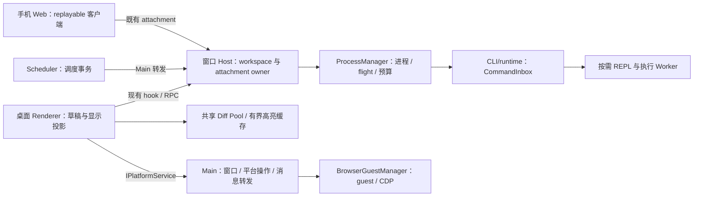
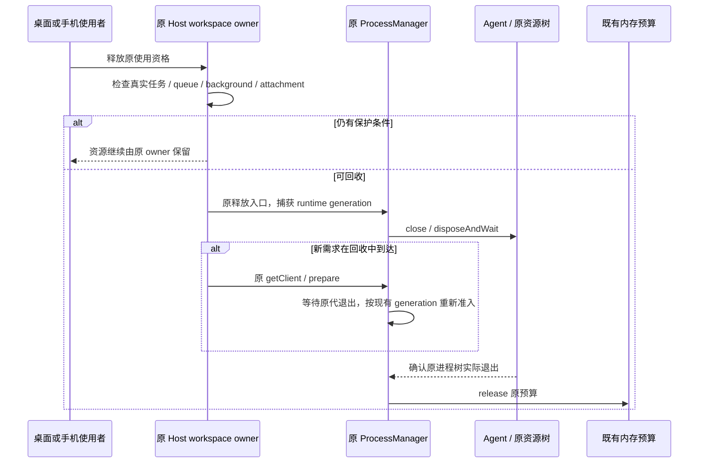
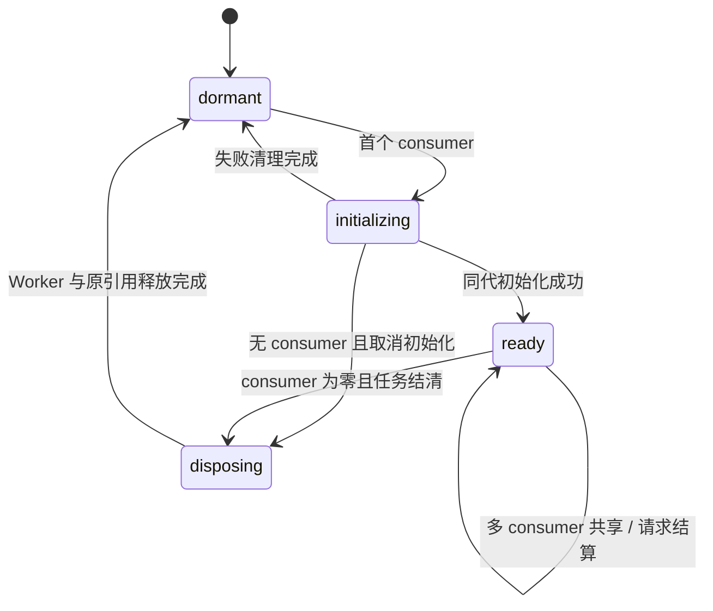

# 桌面端内存系统优化方案

日期：2026-10-23（Asia/Shanghai）。

状态：方案评审稿；本轮不修改实现、不调整正在运行的应用。

源码基线：`4406c614`，根包版本 `3.20.6`；Node `24.21.0`，pnpm `10.34.6`。
范围：保留 Electron、React、TypeScript 和当前 Host / Agent / 远控架构。

> 本文中的新默认值、预算和性能目标均为建议，尚未成为现行产品规则。实现前先完成对应 spec、接口与测试变更。内存收益须由同版本、同场景的生产构建验证，不能用本次安装版现场数字直接推算。

## 1. 方案结论与实施顺序

问题分为两类：**没有实际需求时仍占用的基础资源**，以及**随着使用次数持续保留的资源**。前者主要检查预热、Worker 和模块初始化，后者主要检查缓存、订阅、进程与资源句柄的释放。

建议按以下顺序分批交付，每批独立验证、独立回退：

1. **P0：建立同版本基线和资源归属证据。** 先能回答每一类进程、Worker、缓存为何存在、何时退出。
2. **P1：收缩本地预热，降低 Diff Worker 基础开销。** 优先处理确定存在的提前初始化，不改变已接受任务的执行语义。
3. **P2：治理高亮、查询及已关闭 workspace 的可重建缓存。** 解决长时间使用后驻留集合增长的问题。
4. **P3：完善辅助 Agent 的闲时回收，精简 Main / Host / Scheduler 加载图。** 保留控制面隔离和现有状态所有者。
5. **P4：按实测选择浏览器、媒体、终端和大文件专项。** 不把当前未使用的能力误认成现场内存大头。
6. **P5：生产包长稳验证与发布门禁。** 同时验证桌面实时链路和手机恢复链路。

第一批产品建议是：**启动时只允许当前可见的有效本地工作区预热一个 Agent；Diff 默认使用一个 Worker，并把按需创建作为同一工作流的后续步骤。** 本地全面零预热、执行 Agent 自动冷回收、浏览器自动休眠不混入首批。

## 2. 当前证据与结论边界

### 2.1 已确认的现场观测

以下来自本次会话前序对运行中的安装版进行的只读采样，以及 2026-10-23 00:11—00:13 的既有诊断日志：

| 观测                           | 数值 / 事实                                                                                            | 可以说明什么                                      | 不能说明什么                                         |
| ------------------------------ | ------------------------------------------------------------------------------------------------------ | ------------------------------------------------- | ---------------------------------------------------- |
| 运行安装版                     | `3.20.4`，可执行文件不在当前 checkout                                                                  | 这是用户当前运行现场                              | 不能代表 `3.20.6` 源码构建后的基线                   |
| 整个进程树                     | 一次快照私有提交量约 `1689.8 MiB`，工作集合计约 `1970.6 MiB`                                           | 占用分布于多个进程；含采样时短暂存在的 Git 等后代 | 不是稳定空闲基线，也不是可直接相加得到的实际物理内存 |
| 主界面 renderer                | 一次快照私有提交量约 `357.5 MiB`                                                                       | Renderer 值得单独剖析                             | 不能全部归因于 React 对象或 Diff Worker              |
| 窗口 Host                      | 一次快照私有提交量约 `320.4 MiB`                                                                       | Host 基础依赖与服务资源值得检查                   | 不能凭进程大小直接证明 Service 泄漏                  |
| Host 下两个 stdio Agent 子进程 | 一次快照分别约 `197.0 / 191.2 MiB` 私有提交量                                                          | 不必要的额外 Agent 可能带来较大的驻留成本         | 尚未把两者逐一归因到预热、插件或其它真实需求         |
| GPU 进程                       | 一次快照私有提交量约 `227.8 MiB`                                                                       | 应检查合成表面、媒体、Canvas 等来源               | 不是完整显存读数，也不能据此认定 GPU 应被关闭        |
| 浏览器计数                     | `guest.tabs=0`                                                                                         | 该时刻没有登记在 BrowserGuestManager 中的标签     | 不能说明多标签场景无需优化                           |
| Renderer 诊断                  | `projection.rows=0`、`sessionStore.workspaces=2`、`taskQueryCache.queryKeys=0`、`shiki.highlighters=1` | 当前现场没有用查询条目或消息行数量证明缓存失控    | 不能把源码中的增长风险认定为该时刻的已确认根因       |

这里的 Windows `PrivatePageCount` 是私有提交量，可能包含未驻留页；工作集跨进程相加会包含共享页。Renderer 的 `performance.memory`、Node 的 `heapUsed`、整个进程的私有提交量和 GPU 资源不是同一口径。不能把这些数值相减后，把差额全部叫作“原生泄漏”。

### 2.2 当前源码确认的机会

| 编号 | 源码事实                                                                       | 优化解释                                             | 证据入口                                                                            |
| ---- | ------------------------------------------------------------------------------ | ---------------------------------------------------- | ----------------------------------------------------------------------------------- |
| E01  | 启动预热上限为 3，候选包含最近项目                                             | 非当前项目可在用户尚未进入时占用 Agent               | `packages/desktop/src/main/startupWorkspace.ts`，`resolveStartupAgentWarmupTargets` |
| E02  | Host 消费启动名单，`agentWarmupTargets` 为空时还会回退到 `workspacePath`       | “传空数组”不能被当作可靠的零预热协议                 | `packages/desktop/src/host/index.ts`，`warmUpLCodeAgent` 和 InitLocal 处理          |
| E03  | Root 挂载 DiffsWorkerPoolProvider；poolSize 按 CPU 核数计算，最高 4            | CPU 核数没有表达当前 Diff 需求和内存成本             | `packages/ui/src/Root.tsx`、`packages/ui/src/root/DiffsWorkerPoolProvider.tsx`      |
| E04  | 当前安装依赖的 WorkerPoolManager 构造时排队初始化；Provider 挂载会创建 manager | 只把界面组件动态导入，不一定能消除根层 Worker 初始化 | `@pierre/diffs` 当前安装版本的 `WorkerPoolContext`、`WorkerPoolManager`             |
| E05  | Shiki tokensCache 没有常规淘汰；highlighter 按 theme + language 缓存独立实例   | 访问不同代码与主题可能扩大长期驻留集合               | `packages/ui/src/lib/shikiHighlighter.ts`                                           |
| E06  | taskQueryCache 有 clearAll 和按 scope 失效删除，但没有常规 LRU / 预算驱逐      | 显式清空不等于长期运行时有界；不能说它“绝无删除路径” | `packages/ui/src/store/taskQueryCacheStore.ts`                                      |
| E07  | Session store 的 workspace 桶缺少关闭后常规回收机制，且同时包含用户草稿等状态  | 可以清理可重建部分，但不能直接给整个 store 套 LRU    | `packages/ui/src/store/lcodeSessionStore.ts`、`lcodeSessionStoreTypes.ts`           |
| E08  | MCP status lane 有默认 5 分钟空闲回收，plugin manager 没配置同样策略           | 需要按操作性质检查辅助 Agent 的完整存活理由          | `packages/services/src/lcode-agent/lcodeAgentService.ts`                            |
| E09  | Scheduler 是独立常驻进程，通过 services 的 Node 公共入口使用 Repo 和调度计算   | 应测量启动依赖和副作用，再决定是否增加窄公共入口     | `packages/desktop/src/scheduler/index.ts`、`packages/services/package.json`         |
| E10  | Browser 有 32 个逻辑标签的数量门禁、恢复与 generation 防护                     | 数量门禁不是按内存进行后台休眠的策略                 | `packages/desktop/src/main/browserView/browserTabResidencyPolicy.ts`                |

E04 属于当前依赖实现的事实，实施时还须核对锁文件解析版本及已应用 patch，不能把第三方内部 API 当作稳定跨版本合同。

### 2.3 已有机制应复用

- 远端空白草稿不预热 Agent；内置 REPL 工具描述可先发现、执行时再启动。
- REPL 一次性执行 Worker 在真实退出后归还预算；已有并发、堆和可用内存保护。
- 预算中的 `512 MiB` Agent 预留、`192 MiB` Worker 预留是 admission 账目，不是启动时预分配的物理内存。
- 同窗口的本地 workspace 共用一个 Local Host；远端连接由窗口内注册表管理。
- taskSidePaneMemory 已有 50 条上限，timelineRowHeightCache 已有 4000 条上限，不能重复提出“首次给它们加上限”。
- 壁纸已有可见性判断、卸载时的媒体释放；自选图片对象 URL 已在相应 effect 清理中 revoke。
- Conversation 投影已有 close / unsubscribe / generation 处理；列表和时间线已有部分虚拟化机制，应先核对实际渲染路径。
- 资源诊断已有进程级来源注册表、Main / Host / Renderer 日志出口；不再建立平行遥测链路。

## 3. 目标、非目标与成功判定

### 3.1 目标

1. 降低打开应用、尚未使用代码审查或额外项目时的常驻资源。
2. 让可回收缓存和辅助执行资源在重复使用后形成稳定平台，而不是与访问次数线性增长。
3. 保留响应速度、后台执行、用户草稿、手机重连、浏览器控制及跨 Host 路由正确性。
4. 让每个保留资源都能解释为真实消费者、正在执行的操作或有界的复用策略。
5. 将优化与可重复测量、生命周期回归和回退开关一起交付。

### 3.2 非目标

- 不切换 Wails / Tauri，不重写 React 或 Agent 语言。
- 不合并 Main、窗口 Host、Scheduler 或独立控制面来单纯减少进程数。
- 不停止已接受的 busy/running 输入、队列、后台命令或等待用户授权的任务。
- 不用 `--max-old-space-size` 充当 RSS 硬限制，不把强制 GC、周期性重启或工作集裁剪作为常规优化策略。
- 不修改“项目 Memory / 长期记忆”的业务能力来治理应用 RAM；两者不是同一问题。
- 不创建新的用户设置页、公开性能档位或新的业务状态服务；首批使用内部可回退策略。
- 不为恢复性读操作额外启动 Agent、Local Host 或手机专属运行时。

### 3.3 两类验收门槛

**确定性正确性门槛，必须满足：**

- 非当前最近项目不因启动预热获得 Agent；同 workspace 同代并发需求仍只启动一个进程。
- 在保护集合外的缓存满足各自条数 / 估算字节预算；被保护集合单独报告，不能暗中删除用户数据以达标。
- 关闭、取消、初始化失败、回收期间重新进入等路径没有新增孤儿进程、Worker、订阅或悬挂回调。
- 任务、草稿、权限 / 问答、远控恢复与跨 workspace identity 不串台、不丢失、不重复提交。

**性能目标，P0 建立正式基线后冻结：**

| 指标                       | 建议验收办法                                              | 初始目标 / 边界                                                          |
| -------------------------- | --------------------------------------------------------- | ------------------------------------------------------------------------ |
| 冷启动后稳定空闲私有提交量 | 同机同生产构建配置，至少 5 次运行，比较场景中位数         | 将降低 20% 作为首轮目标候选；P0 后确认是否合理，不能当作收益承诺         |
| 场景峰值                   | 相同负载期间记录进程树峰值与主要角色峰值                  | 不以降低空闲占用换取明显更高的任务峰值；异常变化必须解释                 |
| 缓存增长                   | 固定语料完成 6 轮访问 / 关闭循环，比较后 3 轮             | 可回收计数有界；空闲区间内存中位数无持续单调增长；超出基线波动范围须剖析 |
| 首次任务准备               | 从用户提交到本地 runtime / storage 就绪，排除模型网络时间 | P95 相对基线回退不超过 500 ms，作为预热收缩的初始护栏                    |
| 首次 Diff 可用             | 从打开到可读内容、从打开到完成高亮分别记录                | 可读内容优先；高亮 P95 不超过基线的 1.2 倍，超出则调整 Worker 策略       |
| 二次切换                   | 已打开任务、代码审查切换的 UI 延迟                        | P95 不回退超过 10%；不出现整棵 Root 重挂或草稿丢失                       |
| 资源回收                   | 从最后一个消费者释放到真实退出 / 可达引用释放             | 按各资源的资格与保留期判断；不是要求工作集立即回落到完全相同数值         |

性能数字均是建议护栏。CI 非固定硬件上以正确性和资源计数做硬门禁，绝对内存 / 延迟作为报告；固定基准机上才执行冻结后的性能阈值。

## 4. 资源模型与唯一所有者

### 4.1 资源分类

| 类别           | 示例                                                                   | 生命周期原则                                            |
| -------------- | ---------------------------------------------------------------------- | ------------------------------------------------------- |
| 窗口基础资源   | Main、主 renderer、window-scoped Host                                  | 按窗口 / 应用生命周期保留；优化依赖初始化，不随意冷杀   |
| 持续调度资源   | Scheduler、已认领 automation / off-peak 调度                           | 保留现有调度 owner 和事务；先精简加载图                 |
| 按需执行资源   | Agent、REPL 控制进程、执行 Worker、辅助 Agent                          | 真实需求准入；由原所有者在真实退出后结算                |
| 可重建缓存     | tokens、AST、已失效查询、无引用 task meta、已关闭 workspace 的派生配置 | 按预算和引用保护驱逐，后续从原权威来源恢复              |
| 用户未提交状态 | 输入草稿、附件、问答草稿、pending optimistic overlay                   | 不按缓存策略直接丢弃；不能被当成可重建的服务器事实      |
| 外部网页与终端 | Browser guest、PTY、浏览器操作 / 录屏                                  | UI 可见性不代表任务是否结束；必须遵守自身 owner / lease |

### 4.2 所有者矩阵

| 状态 / 资源                           | 唯一所有者                                              | 其他层职责                                          | 持久 / 恢复来源                           |
| ------------------------------------- | ------------------------------------------------------- | --------------------------------------------------- | ----------------------------------------- |
| 启动候选与可用 cwd                    | Main 的 startupWorkspace 入口                           | Host 消费已确定的启动策略，不扫描补位               | 现有 app settings / 目录事实              |
| workspace 的执行准备与使用者          | 窗口 Host 和既有 workspace attachment / execution owner | Renderer 只表达用户需求与本地草稿                   | 现有 workspace / session 绑定             |
| Agent 物理进程、启动 flight、退出预算 | LCodeAgentProcessManager                                | 不在 Main / UI 建第二份进程准入表                   | 原进程 lifecycle 与实际退出               |
| 已接受输入与运行顺序                  | CLI/runtime CommandInbox                                | Renderer 只持有未提交草稿与 optimistic overlay      | 现有 inbox / journal / 会话协议           |
| 远端 workspace 路由与 lease           | 窗口内连接注册表、原 Host attachment owner              | Relay / Main 只转发和调度 attachment                | 既有 identity / session / generation      |
| Diff Worker 与 AST 缓存               | Renderer 中现有共享 Worker Pool 的稳定 owner            | 各代码 / Diff 消费者申请和释放使用资格              | 文件服务、Git 服务或原会话投影            |
| 通用代码高亮结果                      | shikiHighlighter 模块                                   | 组件订阅结果并在卸载时取消自己的回调                | 完整代码内容、语言、主题                  |
| 列表查询结果及 task meta 引用         | taskQueryCacheStore                                     | hooks 提交现有查询 / mutation；不另建影子缓存       | 原列表 / membership / sessions-index 服务 |
| workspace UI 桶                       | lcodeSessionStore                                       | Host 只提供权威事实，不能把本地草稿变成服务端状态   | 原配置服务；未持久草稿仍保留原 owner      |
| Browser guest / CDP / residency       | Main 中 BrowserGuestManager 与既有 coordinator          | Renderer 执行物理卸载并 ACK；CLI 保留 scoped broker | 现有恢复记录及原连接路由                  |
| Scheduler 已认领任务                  | 既有 Scheduler + Repo 事务                              | Main 转发执行结果；Host 执行 create/send            | tasks-index 与既有运行记录                |
| 资源观测                              | 现有各来源注册表及内存诊断 registry                     | 只读采样；观测结果不成为第二份业务准入依据          | 不持久化任务事实                          |

### 4.3 身份和范围

- workspace key 统一为 `workspaceIdentity?.trim() || workspacePath`；路径只用于文件操作、cwd、Git 和展示。
- 资源回收关联至少保留原 workspace key、窗口 / Host、进程或 runtime generation；远端保留 `remoteSessionId` 与原路由。
- 测量用 `PID + 启动实例` 去重，不能把 PID 重用看成旧进程复活，也不能重复计算同一 PID。
- lane 表达执行 / 插件 / MCP 状态通道的隔离；不能只凭 workspacePath 合并它们。
- 浏览器继续保留 browserId / browserGeneration、workspace identity、会话归属和 stale run 防护。



桌面 `desktop-continuous` 与手机 `web-remote-replayable` 使用同一业务 owner 和顺序，但保留各自实时交付与断线恢复语义。

## 5. 工作流 A：建立可解释的测量基线

### 5.1 生产诊断继续走现有出口

复用 `packages/shared/src/memoryDiagnostics.ts`、UI 的 `lib/memoryDiagnostics.ts`、services 的 `memoryDiagnostics.ts`、桌面进程来源注册表和资源管理器。

新增计数优先只记录数字和原因分类：

- Agent：按 lane 的存活数、启动中数、纯预热数、受保护数、回收中数、回收失败数。
- Diff：consumer 数、初始化代次、Worker 数、排队 / 在飞任务数、file / diff cache 数和估算成本。
- Shiki：engine 数、loaded language / theme 数、tokens 条数、估算字节、在飞任务和订阅数。
- 查询：活跃 / 非活跃 query 数、引用 / 无引用 meta 数、驱逐数、拒绝迟到写入数。
- workspace UI：打开、已关闭可回收、草稿保护、运行 / pending 保护的桶数。
- Browser：逻辑标签、物理 guest、受保护、恢复 / 挂起事务数。

不在日志中输出代码正文、草稿、凭据、内部地址或完整用户路径；生产高频逐项信息使用 debug，不新增逐 chunk 的 info 日志。

已有生产 60 秒诊断采样不因本方案提高为高频。基准测试可由**独立测试驱动**更密集采集 OS 指标，不能把 PowerShell / CIM / 外部命令探测加回 Main 的资源采样循环。

### 5.2 正式基线要求

1. 使用相同源码版本、同一构建模式生成优化前后生产包；记录 commit、依赖版本、OS、CPU、RAM、屏幕尺寸 / 缩放、媒体设置和测试数据版本。
2. 使用独立测试 HOME / 数据目录，复用同一份脱敏固定语料；不能删除用户当前数据、重启用户正在运行的应用或改变已有任务。
3. 隔离开发服务器、DevTools、热更新、浏览器扩展等干扰；冷启动和已有缓存的热启动分开记录。
4. 启动稳定点通过 renderer 就绪、Host attachment、storage 状态及所需初始化完成判断，之后再测固定空闲窗口；固定等待仅用于采样窗口，不作为业务同步方式。
5. 先测空壳，再分别添加一个 workspace、任务、代码预览、浏览器、终端，建立增量成本曲线。
6. 围绕每次真实关闭 / 取消记录资源数量和状态转移；默认不强制 GC。可在额外诊断轮次使用 GC / heap profile，但不得拿该轮替代正常用户场景。
7. Windows 记录私有提交量与工作集；Linux 优先记录 PSS / cgroup，总 RSS 另列；macOS 记录相应进程内存口径。跨 OS 不比较未经统一定义的绝对数字。

建议基准产物写入隔离的 `.artifacts/desktop-memory/` 下，包含脱敏 JSON、场景时间线、结果表和必要图表。新的采集器和场景文件属于后续拟新增产物，本轮不创建可执行入口。

## 6. 工作流 B：本地预热与 Agent 生命周期

### 6.1 建议产品规则

- 恢复 workspace 标签、最近项目与 task 列表本身不构成每个项目都要启动执行进程的理由。
- 启动最多预热当前**可见、有效、本地**工作区一个 Agent；不扫描 recentProjects 补满额度。
- 当前激活远程标签时，本地不为隐藏项目补位预热；远端继续沿用不预热规则。
- 显式打开本地项目可以选择该项目预热；删除的用户项目不得重建或静默改 cwd。
- app 管理的默认对话目录仍由现有 startupWorkspace 入口异步、幂等创建；减少预热不能重新引入缺失 cwd 问题。
- 用户首次发送、显式配置探测和真实工具操作继续复用原 prepare / getClient / CommandInbox 链路；预热与真实需求共享原 single-flight。
- 主动需求到来时接管已存在的预热进程；不丢弃再重建，不用超时竞速出第二个实例。

这些规则会改变现行 spec 中“本地草稿预热保持原行为”和“本地预热目标选择及数量沿用当前规则”的部分。进入 B 实现前，须同步修订 `specs/remote-runtime-memory-budget.md` 与 `specs/desktop-startup-workspace-recovery.md`，保留远端和目录恢复的不变量。

### 6.2 接口与状态边界

Main 的 `HostInitMessage`、当前 InitLocal 消息与 Host 消费逻辑必须表达“明确不预热”和“使用一个确定目标”的差别。当前 `packages/shared/src/validation.ts` 的 `hostInitLocalMessageSchema` 已有可选的 `agentWarmupTargets`，上限为 3；优先复用该字段，不增加第二份预热策略状态。

建议将合同明确为：

| InitLocal 输入                 | 建议语义                                                                |
| ------------------------------ | ----------------------------------------------------------------------- |
| `agentWarmupTargets: []`       | 明确不预热，不再回退到 workspacePath                                    |
| `agentWarmupTargets: [target]` | 仅该目标获得预热资格；不扫描最近项目补位                                |
| 字段缺失                       | 兼容原本地路径调用方：有 workspacePath 时最多回退到该目标；没有则不预热 |
| 两个及以上 target              | 新合同校验拒绝；新 Main 不发送此输入                                    |

新 Main 对所有启动分支都发送明确的空 / 单目标数组。同步将 shared schema 上限收缩为 1，更新公共推导类型、Main 发送侧、Host 消费侧及已有 fixture；Host 必须区分“字段缺失”和“存在但为空”。运行时校验必须覆盖实际生产接收路径，不能只在单测中 parse。默认 cwd 的准备与该字段是否为空无关。

本阶段只改变既有 Main↔Host 初始化合同，不新增 CLI 命令或独立预热通道；如果后续修改了 CLI wire 字段，再同步 `packages/shared/src/lcode-protocol/index.ts` 的严格类型与运行时校验。缺省输入保留本地路径兼容，不在业务代码手写远端 identity。

ProcessManager 的启动、退出与预算 owner 保持原位；启动列表是建议需求，不是已接受命令队列。

### 6.3 分层回收范围

| 资源                           | 首轮处理                                      | 回收资格                                                               |
| ------------------------------ | --------------------------------------------- | ---------------------------------------------------------------------- |
| 尚未启动的非当前预热候选       | 不再创建                                      | 无真实需求                                                             |
| 已启动、未用于任务的预热 Agent | 复用原 releaseWorkspacePreparation 退出       | 原 workspace owner 证明最后一个使用者离开，且没有在途真实初始化 / 使用 |
| 插件管理辅助 Agent             | 在 P3 增加受保护的保留期                      | 操作、回调和文件写入均结清；无消费者、无重新进入                       |
| MCP status Agent               | 保留已有独立 lane 和 5 分钟策略，补充分支测试 | 原条件满足；不与插件命令合并 stdio                                     |
| 已承担执行任务的 Agent         | 首轮不新增通用冷回收                          | 后续必须证明运行状态、已接受队列、后台命令及跨端恢复均安全             |

辅助 Agent 首次建议沿用 5 分钟保留期，先减少无界保留；是否进一步缩短由 P0/P3 的重启频率和延迟数据决定。时间只决定符合资格资源的复用保留期，不替代实际完成 / 退出确认。

### 6.4 保护条件

至少包括：运行 / compact / 排水中的任务、已接受未完成输入、后台命令、权限 / 问答等待、初始化 / 存储握手、插件变更 / 安装写入、原物理资源未确认释放、其他窗口或手机 attachment 的真实使用者。

`pendingOperationRequestCount === 0` 只说明 RPC 状态，不足以证明业务空闲。UI 切走、手机断线也不能直接作为已接受任务结束的事实。



清理失败保留 owner、原路由和预算，不能以 finally 或等待超时宣称已释放。进程实际完成后再结算；晚到事件只影响原代。

## 7. 工作流 C：Diff Worker 与高亮执行资源

### 7.1 两步交付

**C1：低风险缩池。** 将默认 Worker 数从按 CPU 最高 4 个调整为 1 个；显式配置 AST 缓存条数，记录首次 Diff 和大文件延迟。先获得独立的资源 / 性能对比结果。

**C2：按消费者初始化和释放。** Root 保留稳定 Provider / controller 身份；没有代码 / Diff 消费者时不创建实际 Worker。首个消费者触发同一初始化 flight，最后一个消费者离开且没有在飞工作时进入可释放状态。

当前 `@pierre/diffs/react` 导出了 `WorkerPoolContext`，但 manager 构造会排队初始化。实现前先做 API 可行性检查：用稳定的既有 context 适配按需 manager，核对销毁和再次创建是否支持。不直接导入第三方私有 dist 路径；若必须依赖内部行为，先形成可验证的包版本 / patch 合同。

不能通过“首次需求后给整个 Root 多包一层 Provider”的方式实现按需加载，这会重挂子树并破坏草稿、滚动、订阅和窗口状态。只动态导入某个 viewer 也不能被当作 Worker 已按需启动的证据。

### 7.2 Worker 生命周期

- 一个 renderer 继续共享一份 Pool；多个预览并发共享初始化，不各建一份。
- consumer 资格由实际 viewer 申请和释放，使用幂等 disposer；普通渲染次数不增加引用。
- Root / pool generation 管理初始化、主题更新与销毁；旧初始化结果不能重新注册到新 pool。
- viewer 取消先使本次结果失效，再按原任务取消接口处理；不能终止别的消费者正在使用的 Worker。
- Pool 无消费者、无在飞任务时释放 owned Worker 和 AST 引用；第三方共享 highlighter 的清理由其自身 owner 负责，不能误删 Markdown 高亮资源。
- 首个 consumer 等待 Pool 就绪期间沿用可读原文或既有加载态；防止因 context 暂无 manager 而让第三方 viewer 隐式回退到 UI 主线程执行重型高亮。
- 恢复时从原文件 / Git 服务重新请求，不在新 controller 保留第二份完整源文件缓存。
- Worker 失败走已有可见错误 / 有界降级；不把超大高亮任务静默移回 UI 主线程。



### 7.3 首轮建议预算

- 实际 Worker：默认 1；2 个以上只在独立测量证明收益后考虑，不按 CPU 核数直接推导。
- 第三方 Pool 的 file / diff AST 缓存：初始各 20 条；这是利用当前公开配置能力的建议值，实施时核对实际选项语义。
- 大文件成本按内容长度、解析行数、token / AST 数量观测；单条超过预算时不驻留缓存，不影响按既有大文件规则展示原内容。
- 若现有库只有条数配置，先落实条数上限；不能把自定义“估算字节数”说成库已提供的原生硬限制。

## 8. 工作流 D：缓存与 UI 状态的系统治理

### 8.1 每个缓存都声明五项合同

1. key 的业务身份与版本，尤其 workspaceIdentity / remoteSessionId 的边界。
2. authoritative source：被驱逐后从哪里恢复。
3. consumer / 在飞任务 / 未提交用户状态构成的保护条件。
4. 条数、估算字节、单项最大成本和驱逐顺序。
5. 迟到结果能否写入，以及回收后的重新申请属于哪个 generation。

缓存管理留在现有 owner 内。可以共享纯预算 / LRU 算法，但不能新增一份全局业务状态表，或为每个历史 key 留下永久 tombstone，导致“回收机制”本身无界增长。

### 8.2 Shiki：结果缓存与引擎分开治理

当前 `tokensCache`、`highlighterCache` 和 subscriber Map 是不同资源，不应一起 `clear()`。

**结果缓存建议：**

- 初始最多 256 条，估算总成本 16 MiB；单项超过 1 MiB 不进入结果缓存。这些只是首轮预算建议，实际对象大小必须通过 heap profile 校准。
- 使用 LRU：命中更新访问顺序，插入后驱逐未使用结果；组件已获得的结果不因缓存驱逐突然消失。
- 缓存命中必须对应完整代码内容、语言和主题。当前 key 使用长度及首尾片段；预算改造不能使中段不同内容被当作同一结果，须补全内容身份 / 等价校验场景。
- 同一内容的并发请求共用一次 tokenize flight；最后一个 consumer 离开后撤销其 callback。已无需求的大结果不因晚到 completion 再次驻留。
- 保留当前 effect 中调用、cache-hit 异步通知和幂等 setter 的行为，防止重新引入 render 阶段 setState / React 嵌套更新问题。

**引擎建议：**

- 先测量当前 theme + language 独立 createHighlighter 的重复成本；评估同一模块内复用少量引擎并按需加载语言 / 主题。
- 初始建议最多 2 个空闲可复用引擎；在飞 tokenize 持有原引擎使用资格，完成或取消结算后才允许 dispose。
- `@pierre/diffs` 的共享 highlighter 与本模块的 highlighter 是不同所有者；不跨模块强行合并或互相销毁。
- 创建失败移除本代失败 flight，允许下一次真实需求重试；不能永久缓存 rejected Promise，也不能后台无限重启。
- 若活动语言、主题集合超过建议预算，优先保护当前真实消费者并记录超预算原因，不以破坏正在展示内容换取硬凑条数。

### 8.3 查询缓存与 task meta

- 保留现有 query descriptor、membership join、unread optimistic overlay 和 invalidationVersion 语义。
- 初始建议只允许保留 64 个非活跃 query；当前有消费者的 query 不按非活跃额度驱逐。
- 无引用 task meta 初始建议最多 2000 条，并设整体估算成本观测；不是对全部历史任务或当前可见任务施加数量上限。
- meta 的引用来源至少包括活跃 query、当前已打开任务和待确认 mutation / overlay。持久 pinned 身份不等于永远保留所有 pinned task 的内存对象，实际显示查询才形成引用。
- 驱逐 query 与减少 meta 引用在同一 store 事务内完成；保留跨 query 复用和对象引用稳定性，避免整列重渲染。
- `clearAll`、workspace 失效和常规驱逐继续使用同一写入路径；不能在 hook 层私自删 store 内部对象。
- 查询退出或被驱逐后使原消费 lease 失效；晚到结果提交时检查原 lease / generation 与 invalidationVersion，不能因为 key 已不存在就重新创建它。
- generation 状态只保留给当前活跃 / 在途请求；不能为每次搜索词永久留下一个“防复活”记录。

### 8.4 workspace UI 桶

先按字段分为三组：

| 分组                | 例子                                                      | 回收规则                                                |
| ------------------- | --------------------------------------------------------- | ------------------------------------------------------- |
| 可重建派生状态      | 配置候选、旧初始化展示、已结束任务的派生 meta             | workspace 关闭且无消费者后可清理；再次进入从原服务恢复  |
| 用户未提交状态      | composer 草稿、附件、分组草稿、问答表单草稿               | 继续保护，除非既有用户操作明确丢弃或已有可靠持久 owner  |
| 运行 / pending 投影 | 运行状态镜像、权限 / 问答请求、pending optimistic overlay | 原权威事件确认结束 / 对账后再释放，不能由 UI 可见性决定 |

初始建议最多保留 10 个**无保护状态的已关闭** workspace 桶，或者只保留其轻量导航信息。打开中的 workspace 和未持久用户内容不纳入该可驱逐额度。若大量真实草稿导致超预算，先报告保护集合，不在本方案里顺手新增草稿持久化系统。

任务导航记录、侧栏组织、workspace tab 与浏览器恢复记录有自己的 owner；移除重型缓存不能等同于删除这些用户结构。

### 8.5 其它缓存按证据纳入

已有 50 条侧面板缓存、4000 条高度缓存先保留，增加成本观测后再决定是否调整。对 conversation snapshot、文件预览、终端 scrollback、工具输出和流式文本，只在确认实际当前入口、保留引用与成本后单独立项。

虚拟化减少 DOM，并不自动减少完整消息、代码正文、解析结果或高亮对象驻留。反过来，也不能因为看见大量历史内容就跳过订阅 / 投影证据而断言存在泄漏。

## 9. 工作流 E：辅助 Agent 与进程加载图

### 9.1 辅助通道保持隔离

pluginProcessManager 与 mcpStatusProcessManager 的存在有实际串行 stdio 隔离原因。方案保留隔离，优化“是否需要启动、需求结束后是否继续保留”，而不是把慢 MCP 握手重新并入执行通道。

实施时给每类辅助操作建立清单：读请求、写请求、后台完成回调、状态订阅、原运行资源。只有所有使用资格真实结清后才开始保留期；新的操作取消回收资格或等待原代清理结束。权限、安装写入和资源清理不能被普通请求计数遗漏。

### 9.2 Main / Host / Scheduler 的依赖审计

1. 为三个生产入口生成实际构建加载图，记录冷启动模块、解析 / 执行耗时和堆分配；bundle 字节大小只能作为线索。
2. Scheduler 重点核对调度 Repo、数据库初始化与公共 Node 入口的副作用；Main 重点核对平台基础入口是否拉入非当前功能的业务依赖。
3. 若证据支持，给现有 services 模块增加窄公共入口，并同步 package exports 与架构策略；禁止改成跨包导入内部 Repo 实现路径。
4. 重型能力按真实使用动态加载，确认 tsup / esbuild 最终产物保留了真正延迟边界；不能只改成 `import()` 语法就声称运行时延迟加载已经成立。
5. 无业务需求的对象不要在模块顶层创建；需要保留的进程继续使用原 Service / Repo 所有者。
6. Scheduler 保持 automation / manual run / off-peak 的认领、幂等、misfire、失败退避和结算语义；不把调度事务移到 Main。

文件 / 网络 IO 使用异步接口。日志写入、事件循环卡顿等 CPU / IO 问题如在剖析中发现，单独记录，不与内存收益混为一项指标。

## 10. 工作流 F：浏览器、媒体与终端专项

### 10.1 浏览器驻留：独立高风险阶段

当前标签上限控制逻辑数量；未来可增加物理 guest 驻留预算，但首批不默认启用自动休眠。后台网页可能包含未保存表单、长连接和登录现场，恢复 URL 不能保证完整恢复页面状态。

进入该阶段前必须先明确产品规则：哪些标签允许丢失页面内存状态、是否只接受用户显式挂起、恢复体验如何表达。不能依靠“暂时没有声音 / 请求”证明网页没有用户状态，也不能通过统一 timeout 自动关闭全部后台标签。

实现须复用现有 BrowserGuestManager / residency coordinator，保留：

- 可见 / 选中、运行操作、截图 / 录屏、音视频、下载、加载和恢复事务的保护。
- 原 workspace / session / browser generation 和原路由，拒绝 stale 操作。
- Renderer 物理卸载 ACK 与 Main guest 销毁的事实，不把发出挂起通知当作已经释放。
- 并发恢复 single-flight、失败终态、迟到 attach 拒绝和持久关闭顺序。

验收使用真实 Electron guest 和 CDP 操作；普通浏览器组件 fixture 不代表真实 guest 生命周期通过。

### 10.2 媒体 / GPU

先在相同窗口尺寸下比较静态背景、动态背景、代码审查和浏览器场景。复用现有不可见卸载与对象 URL 释放，检查分辨率、解码资源、Canvas / WebGL surface 和滤镜成本。

不以全局关闭硬件加速作为默认节省策略；该操作可能改变 CPU、合成和交互表现，必须独立实验。也不把 GPU 进程私有内存当作全部显存。

### 10.3 终端和预览

区分 PTY 的真实进程 / 后台任务与 xterm 的显示缓存；关闭面板不等于终止 PTY。检查 scrollback、隐藏面板订阅、Blob / 解码资源和大文件解析结果，保留用户未保存编辑。只在确认当前实现与恢复来源后设置预算。

2026-10-23 补充：用户确认多个 `lcode` 标签为 AI 自动弹出的独立 Windows 终端。按[后台控制台、复用与回收专项](agent-background-console-lifecycle.md)先补齐 Host 启动 Agent 时遗漏的隐藏控制台设置，并验证已有同 identity 启动去重、连续复用及精确关闭回收。CLI 命令保持每次执行隔离与既有进程树清理，不跨会话建立持久 shell 池；应用内 xterm 缓存预算后续单独测量。

## 11. 首轮建议参数与降级原则

所有参数在各自现有 owner 内集中声明；不同资源不共用一个含业务状态的全局“内存调度器”。测试允许注入更小预算与时钟，避免依靠固定 sleep 验证生命周期。

| 项目                         | 当前事实                             | 首轮建议                                          | 需要测量 / 审查的代价                 |
| ---------------------------- | ------------------------------------ | ------------------------------------------------- | ------------------------------------- |
| 本地启动预热                 | 最多 3 个候选                        | 最多当前可见有效本地目标 1 个；远程激活不本地补位 | 首次发送、配置候选、目录恢复          |
| Diff Worker                  | 按 CPU 最高 4                        | 默认 1，后续按消费者初始化                        | 首次与大 Diff 的延迟                  |
| Diff AST                     | 当前库默认缓存，项目未显式配置该预算 | file / diff 各 20 条起测                          | 大文件单项成本与命中率                |
| Shiki tokens                 | 无常规淘汰                           | 256 条且估算 16 MiB；单项 >1 MiB 不驻留           | 命中率、重复 tokenize、真实对象成本   |
| Shiki 空闲可复用 engine      | theme + language 分别创建并缓存      | 2 个起测，实际使用资格优先                        | 语言 / 主题切换与共享资源边界         |
| 非活跃 query                 | 无常规 LRU                           | 64 条起测                                         | 搜索 / 展开 / 排序反复访问            |
| 无引用 task meta             | 无常规 LRU                           | 2000 条起测                                       | 活跃引用与 optimistic mutation 正确性 |
| 可回收已关闭 workspace UI 桶 | 缺少常规驱逐                         | 10 个起测                                         | 草稿、问答、导航和快速切回            |
| 辅助 Agent 保留期            | MCP status 5 分钟；plugin 未配置     | MCP 先保持，plugin 在证明资格后从 5 分钟起测      | 插件写入与重启频率                    |
| 浏览器自动休眠               | 没有上述新增策略                     | 首批不启用                                        | 页面内存状态与真实自动化兼容          |

预算超出时先驱逐无保护的可重建资源，再停止非必要预热；无法回收的真实工作继续保留并报告原因。新执行的资源拒绝仍走现有 admission 的明确可重试错误，不增加平行接受队列，不静默取消已接受输入。

## 12. 影响面与依赖优先级

### 12.1 用户表面

| 表面                    | 变化                               | 需要保持                                           |
| ----------------------- | ---------------------------------- | -------------------------------------------------- |
| Desktop 启动 / 最近项目 | 减少非当前项目后台预热             | 原标签顺序、identity、默认目录恢复与不可用项目提示 |
| 本地 / 远端发送         | 接管已有进程或真实需求时启动       | CommandInbox admission、取消、stale run 与队列顺序 |
| 代码预览 / Git Diff     | 减少 Worker 和 AST 驻留            | 内容、主题、评论定位、滚动与面板稳定性             |
| 任务列表 / 搜索 / 展开  | 冷缓存按原服务重新获取             | membership、未读、乐观修改、分页数量与行引用稳定   |
| workspace 切换 / 关闭   | 清理无保护的可重建 UI 数据         | 草稿、附件、问答、导航、后台任务                   |
| 插件 / MCP 设置         | 辅助进程在操作结清后可回收         | 写入完成、状态隔离和显式错误                       |
| 手机远控                | 不创建额外资源；恢复仍走同一 owner | replayable snapshot / gap repair、身份与原路由     |
| 资源管理器              | 增加必要的数字化计数或报告         | 不把估算预算显示为真实物理内存，不增加高频外部探测 |

UI 如需改动，复用 DESIGN.md 组件、字体 token、主题与国际化；共享逻辑覆盖桌面和手机 Web。UI 通过 hooks 访问服务，平台能力通过 IPlatformService，不直接调用 window.lcode 或 Repo。

### 12.2 依赖检查顺序

| 优先级         | 关系                                                                    | 原因                                               |
| -------------- | ----------------------------------------------------------------------- | -------------------------------------------------- |
| must-inspect   | Main startup → Host InitLocal → workspace prepare → ProcessManager      | 决定是否真实 spawn，以及零预热是否被 fallback 覆盖 |
| must-inspect   | Host execution / attachment owner → CLI CommandInbox / background state | 防止把无 RPC 错当成无任务                          |
| must-inspect   | Root → Pool context → viewer consumers → Worker manager                 | 防止 Root 重挂、重复池和在飞结果复活               |
| must-inspect   | query store → mutation overlay → consumer / generation                  | 防止驱逐后丢状态、异步查询重新填回旧数据           |
| must-inspect   | workspace UI 桶 → composer / permission / elicitation                   | 明确哪些是不可丢弃的用户状态                       |
| conditional    | Browser owner / broker / guest                                          | 仅在实施浏览器驻留优化时进入完整生命周期           |
| invariant-only | relay / Main remote forwarding、workspace identity                      | 任何阶段均不能改变原边界和路由                     |
| evidence-only  | 既有遥测、heap profile、OS 指标                                         | 解释成本，不成为业务事实 owner                     |

## 13. 分阶段交付与退出条件

| 阶段     | 交付                                             | 完成门槛                                               | 可单独回退内容                                 |
| -------- | ------------------------------------------------ | ------------------------------------------------------ | ---------------------------------------------- |
| P0       | 同版本基线、角色映射、场景报告；补齐必要数字计数 | 能解释主要进程的 owner / lane；固定 fixture 可重跑     | 新增观测项，保留原日志链路                     |
| P1-B     | 启动仅当前目标预热；InitLocal 意图明确           | 预热 / 用户需求并发、远程激活、失效 cwd 回归通过       | 仅预热选择策略，不能回退身份与目录修复         |
| P1-C1    | 单 Worker 和显式 AST 条数预算                    | Diff 首次 / 热切换与大文件护栏通过                     | poolSize / 缓存参数                            |
| P2-C2/D1 | 按消费者创建 Pool；Shiki 有界结果缓存和使用资格  | 无消费者后 owned Worker 可回收；并发 / 主题 / 卸载正确 | 各资源策略分别切回；保留取消与 generation 修复 |
| P2-D2    | query / meta 驱逐；workspace 可重建数据回收      | 草稿 / overlay 不丢；迟到查询不复活；身份隔离          | 单项 LRU 参数或驱逐策略                        |
| P3       | 辅助 Agent 回收与窄公共入口                      | 操作完整结算；控制面不互相阻塞；启动成本有对比         | lane 回收策略与模块懒加载分别回退              |
| P4       | 有证据的浏览器 / 媒体 / 终端专项                 | 产品边界冻结，真实 Electron / 平台验收                 | 对应专项策略，不影响其它阶段                   |
| P5       | 打包生产包、长稳和跨平台报告                     | 正确性硬门槛通过，冻结后的性能目标满足或差异有评审结论 | 发布版本与各策略；不回退数据和任务事实         |

每批遵循“更新对应 spec → 补行为测试 / E2E → 最小实现 → 实测验证”。不一次性修改所有预算，否则无法归因收益和回归。

内部实验控制如确有需要，统一由现有配置 / DI 路径注入只读策略，缺省值有明确产品定义；不在各组件散落环境变量，不持久化另一份设置，也不新增未经鉴权的诊断端口。

## 14. 验收场景与证据层

下表是**拟执行场景**，不是已经通过的测试。每项实施时填写实际测试位置、命令、结果和未覆盖边界。

| ID  | 前置与动作                                                      | 必须断言                                                    | 所需证据                                    |
| --- | --------------------------------------------------------------- | ----------------------------------------------------------- | ------------------------------------------- |
| M01 | 独立数据目录冷启动，不打开额外能力                              | 一个窗口一个 Host；无额外 recent-project 预热；基础计数稳定 | 单测 + 真实 Electron 进程树                 |
| M02 | 保存多个最近项目，当前可见一个本地项目                          | 仅当前项目有预热资格；列表读取不补位                        | 启动单测 + Electron E2E                     |
| M03 | 当前是远程标签，后台有本地标签和 recentProjects                 | 不本地补位预热；远端草稿仍无 Agent                          | Host 装配 + Desktop / Web 远控回归          |
| M04 | 默认对话目录已删除 / 被文件占用                                 | 幂等恢复 app 目录；真实 IO 错误保留；不恢复用户项目         | 现有 startupWorkspace 回归扩展              |
| M05 | 预热过程中首次发送；并发打开同 workspace                        | 共享同代 flight、单个物理进程、单次输入 admission           | ProcessManager 集成 + Electron E2E          |
| M06 | 切走纯预热 workspace，随后立即切回                              | 原 owner 结算；回收完成前不创建冲突实例；无迟到状态覆盖     | lifecycle 集成 + 进程退出证据               |
| M07 | 运行 / busy queue / compact / background / 权限等待时关闭面板   | 不误杀任务，不丢已接受输入，不把 UI 关闭当作执行结束        | CLI / Host 集成 + 双端 E2E                  |
| M08 | 插件安装或 MCP 握手很慢；同时进行其它控制面操作                 | 通道隔离；保留期不能中断写入；结清后才可回收                | 控制面集成 + 子进程实际退出                 |
| M09 | 无代码预览启动，之后并发打开两个 Diff                           | 无需求时实际 Worker 为零（C2）；并发共享 Pool，数量符合策略 | Worker 单测 + 浏览器 / Electron Worker 计数 |
| M10 | Diff 初始化 / tokenization 中关闭；立即重新打开或切主题         | 旧 generation 不复活、无僵尸 Worker、Root 身份和草稿不变    | 异步故障注入 + 真实组件 E2E                 |
| M11 | 大 Diff、超长行、多文件；重复开关                               | 缓存符合预算；首个可读内容 / 完整高亮延迟满足护栏           | 固定大文件基准 + UI 交互                    |
| M12 | 访问大量不同代码、语言与主题，重复 6 轮                         | tokens / 引擎 / subscriber 集合稳定；失败可在真实需求下重试 | 高亮单测 + heap / 数字计数                  |
| M13 | 代码首尾、长度相同而中段不同；并发请求 / 缓存命中               | 不返回错误内容高亮；通知顺序不引入嵌套更新                  | 内容等价单测 + 真实组件 E2E                 |
| M14 | 连续搜索、排序、展开与分页，再回到原查询                        | 非活跃 query 有界；membership / 未读 / 分页无回退           | store 测试 + 侧栏 E2E                       |
| M15 | 驱逐 / 失效后旧查询返回，新查询同 key 已创建                    | 旧 lease / invalidationVersion 不可提交；新查询正常         | 可控 Promise 的竞态测试                     |
| M16 | 关闭大量 workspace，其中包含草稿、附件、问答和 pending mutation | 可重建桶回收，用户状态受保护；切回不串台                    | store / lifecycle + E2E                     |
| M17 | 本地与不同远端有相同 workspacePath                              | 回收 / 缓存 / 请求仍按 identity 和 remoteSessionId 隔离     | identity 边界集成                           |
| M18 | 桌面运行时手机断线再连，期间发生空闲回收或拒绝新资源            | 复用原 Host；continuous / replayable 正确；不重复输入       | 现有远控回归 + 实际恢复 E2E                 |
| M19 | 同时运行 Scheduler 的 automation、manual run、off-peak 认领     | 精简入口后无重复派发、漏结算或跨 owner 状态                 | Scheduler / Repo 集成 + 隔离真实调度        |
| M20 | 预算不足、进程启动失败、Worker 失败、清理 ACK 迟到              | 新需求明确失败 / 可重试；原任务不被杀；实际退出后释放账目   | 故障注入 + 真实进程树                       |
| M21 | 浏览器含下载、音视频、表单和自动化操作，尝试驻留回收            | 保护状态不被挂起；原 generation 与恢复错误可见              | P4 独立产品场景 + 真实 guest / CDP          |
| M22 | 静态 / 动态壁纸、隐藏 / 恢复窗口、终端与大预览                  | 复用现有释放；不杀后台 PTY；GPU / CPU / 内存分别报告        | 平台运行时 + 组件交互                       |
| M23 | 多窗口 / shared owner / 手机 attachment 同时使用                | 不因单一 UI 退出释放仍被使用的资源                          | Host lease 集成 + 多窗口 E2E                |
| M24 | 生产包持续运行并循环开关能力 30 分钟，发布前扩展到 8 小时       | 无孤儿资源、保护集合可解释、稳定区间无未解释持续增长        | 进程 / heap 时间线 + 原始脱敏数据           |

### 14.1 控制组合数量

- 纯缓存算法用注入的小预算、假时钟和可控异步完成测试，不组合全部主题、OS、传输和预算档位。
- 同步 owner / generation 的共性先在单测与集成验证；窗口、guest、Worker、平台桥必须有真实运行时证据。
- 1280px 桌面与 390px 手机覆盖共享 UI 的代表性布局，明暗主题与中英文覆盖关键显示面；不为每个缓存条目穷举主题。
- SSH / WSL / Docker 共享不变量先验证；存在不同释放所有权的路径分别保留代表场景，不因“都远端”而剪掉。
- 真实 Browser / CUA 不可用时明确标为未覆盖；普通 JS fixture 不能冒充设备验收。

## 15. 当前可用验证入口与拟新增测试

### 15.1 已核对存在的入口

以下从仓库根目录执行，按实际改动范围选择；完整交付必须包含类型、Lint 和架构检查。

```powershell
node scripts/check-workspace-freshness.mjs
pnpm architecture:check --changed
pnpm architecture:context desktop
pnpm architecture:context ui
pnpm architecture:context services
pnpm architecture:context shared
pnpm architecture:context rpc
pnpm typecheck
pnpm lint
pnpm fmt:check
pnpm test:startup-animation
pnpm test:renderer
pnpm test:renderer:ui
pnpm test:remote-control
pnpm test:remote-assets
```

`architecture:context` 读取实际受影响模块，不要求每批固定跑完上述全部模块。实施代码前按 architecture-governance 技能先检查，再阅读受控上下文；不刷新 baseline 来掩盖新违规。

已存在的直接测试入口包括：

```powershell
node --import tsx --test packages/desktop/src/main/startupWorkspace.test.ts
node --import tsx --test packages/services/src/lcode-agent/lcodeAgentMemoryBudget.test.ts
node --test packages/web/test/side-pane-recovery.test.mjs
```

`packages/web/package.json` 提供 `test`，但不存在统一的根目录 `pnpm test` 合同。UI alias 相关的直接测试必须按既有 harness 设置 TSX 配置，不假定所有 `.test.ts` 都能直接无配置运行。

本次核对到的可复用测试 / fixture：

- `packages/desktop/src/main/startupWorkspace.test.ts`：目录恢复和启动 target 解析。
- `packages/services/src/lcode-agent/lcodeAgentMemoryBudget.test.ts`：资源 admission 与预算释放。
- `packages/services/src/lcode-agent/worktreeClientLeases.test.ts`、`worktreeExecutionOwner.test.ts`：工作树 / 资源 lease 边界。
- `packages/desktop/src/host/windowRemoteConnectionRegistry.test.ts`、`hostLifecycle.test.ts`：远端 / Host 释放。
- `packages/ui/src/store/lcodeSessionStoreSelectors.test.ts`：workspace identity 的 UI 读侧。
- `packages/ui/src/v4/conversationProjectionStore.workflowSync.test.ts`：投影与工作流事件处理。
- `packages/web/test/side-pane-recovery.test.mjs`、`packages/ui/src/app-shell/workspaceSidePaneRecovery.test.tsx`：冷会话和面板恢复。
- `packages/desktop/scripts/renderer-boundaries.e2e.test.mjs`：真实 Electron / preload 的隔离启动模式。

`scripts/build-memory-regression.mjs` 以及 `specs/remote-runtime-memory-regression.md` 是已有远端运行时相关入口 / 记录；不能把其中的旧测试结果当作本桌面方案已经通过。

### 15.2 拟新增的测试能力

以下目前是计划项，实施时选择与现有测试结构一致的位置，不声称文件已存在：

- 桌面生产包内存场景采集与同版本对比驱动。
- 预热策略及 InitLocal 的显式零 / 单目标合同测试。
- 辅助 Agent operation lease 与 idle / cleanup / re-entry 竞态测试。
- Diff Pool consumer 生命周期、无需求 Worker 数量、Root 不重挂的真实组件测试。
- Shiki 预算、完整内容身份、失败重试、并发与卸载取消测试。
- query / meta 驱逐及 stale completion 保护测试。
- workspace 可重建字段清理与草稿 / pending 状态保护测试。
- 30 分钟及发布前长稳基准报告；新场景覆盖不足时不得仅依靠存量测试宣称通过。

## 16. 主要风险与控制方式

| 风险                        | 控制                                                                 |
| --------------------------- | -------------------------------------------------------------------- |
| 少预热导致首次任务慢        | 分开记录首次 / 热路径；先保留当前目标一个预热；保留原 single-flight  |
| 没有 RPC 但任务仍在执行     | 使用原 Host / runtime 权威事实和使用资格；不只读请求计数             |
| 清理期间新需求到达          | generation + 原 flight；等待实际退出后重新准入，避免同时存在冲突实例 |
| 减少 Worker 造成 UI 卡顿    | 首个可读内容与高亮分别测；大文件回归；不静默把重型工作移回 UI        |
| 缓存回收使用户输入消失      | 字段级分类与保护集合；只有可重建数据可驱逐                           |
| 驱逐后被旧异步结果重新写满  | 活跃 lease / generation 与 invalidationVersion 同时检查              |
| 引擎 dispose 影响别的代码块 | 本模块引擎真实使用资格；不同 highlighter owner 保持分离              |
| 改公共入口绕过架构          | 新增窄 package export，遵守公开入口；依赖图和产物都核验              |
| 观测反而增加 Main 开销      | 复用既有采样；外部 OS 探测只在隔离测试驱动执行                       |
| 性能数据混入其他版本 / 状态 | 安装版现场只作线索；同 commit 配置构建比较；隔离 HOME 和固定语料     |
| 自动休眠破坏网页内存状态    | P4 独立产品决定，首批不启用自动浏览器休眠                            |

## 17. 评审决策与证据缺口

| 项目                        | 本方案建议                               | 实施前需要补齐                                                     |
| --------------------------- | ---------------------------------------- | ------------------------------------------------------------------ |
| 本地预热默认值              | 当前可见本地目标最多 1 个                | 对应现行 spec 调整；显式无预热的 InitLocal 语义与 schema           |
| 主执行 Agent 通用 idle 回收 | 首批不做；只处理纯预热与辅助进程         | accepted queue / background / 手机使用者的完整资格证明和冷恢复测试 |
| Diff 按需 manager           | 稳定 context owner，不重挂 Root          | 当前依赖公开 API 的创建 / terminate / recreate 合同验证            |
| 缓存初始预算                | 按第 11 节建议起测                       | 真实 heap 成本、活跃保护集合大小与命中率                           |
| 内存与延迟收益门槛          | 使用第 3 节候选目标                      | 同版本生产包基线及基准机噪声范围                                   |
| 浏览器自动挂起              | 独立后续阶段                             | 用户页面状态丢失规则与真实 guest / CDP 验收                        |
| 跨平台                      | Windows 先定位，macOS / Linux 做发布门禁 | 当前现场只有 Windows 运行观测，其它平台不能标为通过                |

feature-boundary-planner 的已有种子覆盖 `state.runtime-memory-admission`、`capability.conversation-runtime`、`state.conversation-projection`、`state.browser-scope-authority`，本方案保持其 owner 与恢复不变量。Diff / Shiki / UI cache 的细分覆盖可在实施时按已验证符号补充；现阶段不从图的缺失推断功能缺失。

技能引用的 `docs/skills/feature-boundary-graph.md` 在当前 checkout 未找到，属于图维护文档的 drift 候选；不据历史引用重建该文件。若后续需要改图，先核对当前维护合同。

## 18. 本轮交付与验证记录

- 已完成：当前源码、现行相关 spec、包脚本、架构策略、资源 owner、已有测试与现场证据的只读核对；形成本文。
- 本轮仅新增方案文档；未修改实现、依赖、配置、预算、运行进程或用户数据。
- 运行基线检查：通过，工具报告工作区基线新鲜。
- `pnpm lint`：通过。
- `pnpm typecheck`：未通过，退出码 2。检查输出 `packages/ui/src/WorkspaceSidebarItem.tsx:256` 的 TS2353（`onReconnectRemoteWorkspace` 不属于目标对象类型）和 `:911` 的 TS2304（找不到名称 `X`）。该检查针对包含其它本地 / 并行改动的工作区，本轮没有修改相关实现，也未把失败记为通过。
- 本文核验：24 个本地链接目标和 13 个已识别的脚本 / 测试 / spec 引用均存在；文档定向格式检查通过。该链接检查不等于执行了相关业务测试。
- 本文新行为、内存改善、生命周期回归与跨平台场景均未执行，不能标为实现或验证通过。

后续每批附上：实际改动文件和 owner、spec / 测试变更、命令结果、前后基准数据、未覆盖项及回退策略。只有经过同场景测量后，才写入已实现的内存收益。

提交前复核（2026-10-23）：当前工作区的根目录与 CLI 类型检查、Lint 已通过；上文首次检查的失败作为历史记录保留，不代表当前仍失败。本文仍是桌面内存生命周期优化方案，不把另外已实现的启动动画、编辑器发现或请求上下文修复记作整份方案已落地。

## 19. 资料与当前源码入口

- [远端运行时预算与生命周期](remote-runtime-memory-budget.md)
- [已有远端内存回归记录](remote-runtime-memory-regression.md)
- [桌面启动工作目录恢复](desktop-startup-workspace-recovery.md)
- [架构策略](../architecture-policy.yaml)
- [UI 设计规范](../DESIGN.md)
- [启动目标解析](../packages/desktop/src/main/startupWorkspace.ts)
- [Main / Host 初始化合同](../packages/desktop/src/main/desktopHostProcess.ts)
- [共享消息运行时校验](../packages/shared/src/validation.ts)
- [窗口 Host 装配与预热](../packages/desktop/src/host/index.ts)
- [Agent 进程 owner](../packages/services/src/lcode-agent/lcodeAgentProcessManager.ts)
- [执行与辅助 Agent manager 装配](../packages/services/src/lcode-agent/lcodeAgentService.ts)
- [运行时预算](../packages/shared/src/node/runtimeMemoryBudget.ts)
- [Root 与 Diff Provider](../packages/ui/src/Root.tsx)
- [Diff Pool 策略](../packages/ui/src/root/DiffsWorkerPoolProvider.tsx)
- [Shiki 缓存](../packages/ui/src/lib/shikiHighlighter.ts)
- [查询缓存](../packages/ui/src/store/taskQueryCacheStore.ts)
- [workspace UI 状态](../packages/ui/src/store/lcodeSessionStore.ts)
- [workspace UI 状态字段](../packages/ui/src/store/lcodeSessionStoreTypes.ts)
- [会话投影 owner](../packages/ui/src/v4/conversationProjectionStore.ts)
- [Scheduler](../packages/desktop/src/scheduler/index.ts)
- [浏览器数量策略](../packages/desktop/src/main/browserView/browserTabResidencyPolicy.ts)
- [浏览器驻留协调](../packages/desktop/src/main/browserView/browserTabResidencyCoordinator.ts)
- [现有进程采样来源](../packages/desktop/src/main/processResourceSampleSourceRegistry.ts)
- [共享诊断格式](../packages/shared/src/memoryDiagnostics.ts)
- [Electron 官方性能建议](https://www.electronjs.org/docs/latest/tutorial/performance)：先剖析实际成本，再减少不必要模块和过早初始化；本文具体产品决策以当前源码和上述验收为准。
