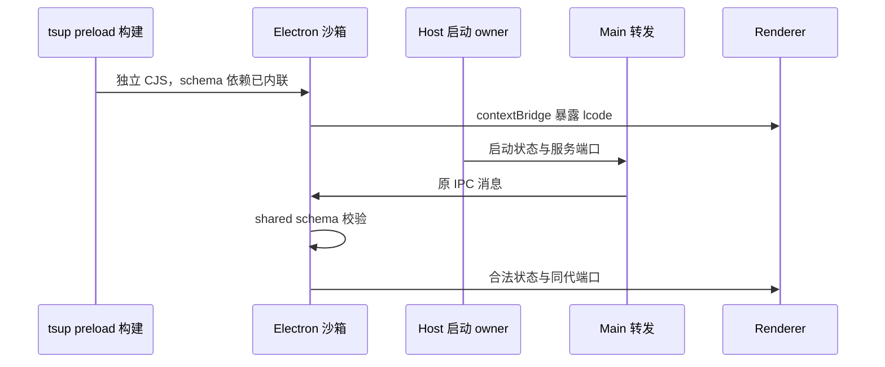

# 桌面 preload 沙箱打包边界

## 已确认问题

2026-10-24 在已安装 Windows 3.20.8 的隔离数据目录复现空白主窗口。Main、Host 和数据库已经 ready，但 preload 加载报 `module not found: zod`，随后 Renderer 因 `window.lcode` 未建立而读取 `printPageToPdf` 失败。不是数据库迁移或 Agent 预热阻塞。

`tsup` 默认将 package dependencies 外置，原 preload 配置仅内联 `@lcode/shared`。启动协议 schema 经 shared 引入 Zod 后，产物留下 `require("zod")`；沙箱 preload 不支持任意 npm 模块加载。

## 产品规则、所有者与边界

- `packages/desktop/tsup.config.ts` 是 preload 打包策略的唯一所有者。所有 preload 入口将 JavaScript 包依赖内联，每个入口独立成文件，不依赖共享 chunk；仅 Electron API 保留 external。
- preload 的生产压缩保留，但关闭 `keepNames`：其插入的命名 helper 位于 preload 闭包；浏览器对话框通过 `executeInMainWorld` 传递函数时不能携带该 helper，真实沙箱中会出现未定义引用。Main/Host 的命名策略保持不变。
- 保留 `sandbox: true`、`contextIsolation: true`、`nodeIntegration: false`，不通过放开 Renderer 权限或删除协议校验恢复启动。
- Main 继续只转发启动状态；Host 拥有数据库启动事实；preload 使用原 shared schema 验证并投递状态、控制命令与 MessagePort。无新增业务状态、超时或写入路径。
- 不修改用户配置、会话、账号、预热、Scheduler 驻留策略或桌面/手机交付语义。修复由重构建交付，不直接覆盖已安装 app.asar。

## 验收

1. 使用真实生产 tsup 配置构建所有 preload 入口，检查产物依赖图不存在 npm/相对 chunk/不支持的 Node external。
2. 真实 Electron 沙箱加载主窗口 preload，桥接可用；Renderer 无 Node require，原权限设置不变。
3. 启动状态和控制 IPC 的有效消息可通过，非法消息仍被拒绝；服务 MessagePort 可传递。
4. 资源管理器、CUA 权限面板、浏览器对话框、录像 preload 均可在沙箱加载，无 preload-error。
5. 在隔离副本使用已安装完整 Renderer 与修复后 preload，验证进入界面。安装程序与用户数据保持原状；实际执行结果单独记录，不以单测替代整包检查。

## 2026-10-24 验证记录

- 原安装包使用全新隔离数据目录可稳定复现 `module not found: zod` 和 Renderer `printPageToPdf` 初始化失败。
- 回归先红后绿：真实生产 tsup 配置构建加 Electron 沙箱测试，在修复前捕获外置 Zod；修复后主窗口桥接、非法启动消息拒绝、合法状态与 MessagePort 双向通信、四个辅助 preload 均通过。另捕获并修复 `executeInMainWorld` 中 `keepNames` helper 丢失的问题。
- 使用安装目录的隔离副本，仅替换重新构建的 preload：欢迎页、初始化向导、完整工作台均可进入，未捕获 pageerror/console error。未调用模型；不声称首响应延迟已解决。副本的两个非当前 Windows x64 架构的缺失 sidecar 条目未参与验证。
- 自动测试接入现有 `renderer-platform-bridge.test.mjs` 发布入口和 `test:desktop-memory`。无显示服务的 Linux 仍执行生产产物依赖检查，明确跳过 native 部分；使用 `xvfb-run -a node --test packages/desktop/scripts/preload-sandbox.test.mjs` 可执行完整 native 检查。本次 native 验证在 Windows，未实测 macOS/Linux。
- 根 `pnpm typecheck`、`pnpm lint`、目标文件格式和架构检查通过，架构 violations/baseline/new 均为 0。状态所有者、权限、账号与会话协议不变；产品代码仅调整 preload 构建策略。
- 最终发布回归 `pnpm test:release` 为 173 通过、0 失败、1 项原有可选测试跳过；此前两项许可证输入摘要失配，按 `node scripts/licenses.mjs notices` 同步当前清单后通过。最终独立 Renderer/preload 入口 5 项通过。原有工作区改动保留。
- 本轮不覆盖 `D:\LCode`。用户按既有安排重新构建安装后获得修复。隔离验证完成后已将副本自动注册的 Explorer/协议关联恢复为原安装路径。
- 临时安装验证副本的清理被工具自动审批拒绝（仅返回 `blocked by policy`），副本仍位于忽略目录；没有换用其他方式绕过清理拦截。所有测试启动的进程已经关闭。
