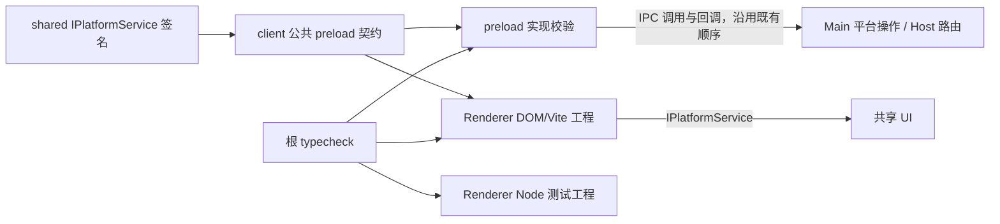

# Desktop Renderer 类型边界与启动画面安全

## 已确认原因（2026-10-22）

独立 Renderer 检查复现 196 项诊断：146 项来自未加载 `@lcode/client/globals`，
44 项来自轮廓提取与眼部补帧的数组索引，2 项来自 CSS，4 项来自 Node 测试环境。
根 `pnpm typecheck` 未包含 Renderer，生产打包只转译而不检查这些类型。
只读加载公共声明后，还发现声明缺少实际 preload 的 15 个方法，远程绑定与 guest
挂接返回类型互换、文件输入边界过窄，以及旧 preload 的 Chrome 导入失败码不符合契约。

## 规则、所有者与接口

- `IPlatformService` 是平台能力签名的唯一所有者；`@lcode/client/globals` 只选择
  preload 实际暴露的能力并声明 `window.lcode`，不复制共享方法参数和返回类型。
  preload 特有的日志与遥测上下文仍留在该公共桥契约；getDeviceId 的原生 IPC 查询
  为异步，平台适配器仍读取同步启动快照。通用桌面命令的 unknown 返回值在只等待完成的
  反馈/社群入口被显式消费。实际 preload 必须满足契约，并验证公开声明与暴露方法完整一致。
  DesktopZoomState、WindowControlsOverlayMetrics 通过 shared 的公开入口导出。
- Renderer 是 DOM/Vite 工程，显式加载 Vite 的资源声明与现有 client 公共桥声明；
  不依赖其它工程偶然引入的全局声明，不把 Node 全局暴露给 nodeIntegration=false 的页面。
  同目录 Node 测试归独立测试工程检查，仍纳入根检查，不以排除测试掩盖错误。
- 根 `pnpm typecheck` 覆盖 Renderer、Renderer 测试与 preload。保持现有
  noUncheckedIndexedAccess；这些叶子检查不产生运行时代码，也不覆盖 tsup 产物。
- 文件桥接受平台契约中的 unknown，先验证 Web File 再调用 Electron webUtils；
  无效输入返回 null。旧 preload 缺失 Chrome 导入能力时使用已有共享失败码。
  远程绑定返回 void，guest 挂接返回 BrowserGuestAttachResult；保持 identity、owner/lease
  与桌面 continuous / 手机 replayable 的原有路由及事件顺序。
- 轮廓算法仍由 Renderer 启动画面模块拥有，供启动、预览和壁纸复用。入口验证 RGBA
  尺寸与缓冲长度，不允许截断数据把 undefined 传播为 NaN；合法空图和小尺寸图返回空轮廓。
  所有数值读取使用同一个有边界检查的入口；连通追踪不跨图像行边界。
  路径片段只从存在的起点构造，眼部矩形用固定四元组表达，不改变原图坐标和混合规则。

## 验收

1. Renderer 独立检查从 196 项变为 0；根类型、Lint 与 changed 架构检查通过。
2. 检查入口回归验证三个工程均受根门禁覆盖、严格索引检查及 noEmit 保留、生产页面
   不含 Node 全局；编译正反例验证公共桥返回值、缺失方法和 IPC 专属契约。
3. 真实 preload 通过测试 Electron 适配器验证无效 File、有效文件路径、远程身份参数
   与 guest 返回结果；旧桥的 Chrome 导入失败仍满足共享契约。
4. 轮廓回归覆盖有效图、平坦/小图、损坏尺寸/缓冲、边缘连通、确定性及有限坐标；
   真实浏览器执行补帧与轮廓到片段绘制，验证启动、预览和壁纸共用的像素行为。
5. 执行现有启动动画回归与生产构建，记录真实结果和未执行的平台范围。

## UI 测试环境一致性

扩展回归首次在无头 Chromium 下得到 25 项通过、1 个欢迎场景失败（加上父测试共 2 个
失败计数）。独立诊断捕获 `video.play()` 的 NotAllowedError，确认是有声音频的用户手势
策略阻止播放。本机 Electron `WebPreferences.autoplayPolicy` 声明的默认值为
`no-user-gesture-required`；使用同策略的 Chromium 已正常进入白璃 ambient/welcome。
测试的浏览器分支显式对齐此策略，保留原有音量、未静音、持续播放与 Root 准入断言。

## 发行契约测试不依赖构建产物（2026-10-22）

`v3.20.5` 的 Linux x64 发行在 `pnpm test:release` 失败：fixture 保留 Renderer 的
project references，但普通 `ts.createCompilerHost` 默认读取引用工程的声明输出。
干净 CI 尚未生成 `shared/dist/index.d.ts`，因此出现 TS6305，随后两个返回值反例
产生 TS2578。本地已有声明输出时，旧测试无法暴露这个前置构建依赖。

- 测试 compiler host 负责 fixture 和文件可见性，通过 TypeScript 的
  `useSourceOfProjectReferenceRedirect` 使用引用工程的当前源码；公共类型仍由
  `IPlatformService` 和 `@lcode/client/globals` 拥有，不复制类型或改写生产工程配置。
- 回归递归读取实际 project references，屏蔽各工程的 `outDir` / `declarationDir`，
  同时覆盖文件存在查询和读取，使已有本地产物也无法参与 fixture 检查。不删除、移动或
  生成工作区产物，不增加预构建步骤，不通过忽略诊断或移除返回值反例使测试通过。
- 验收：屏蔽输出后，公共桥返回值、暴露方法完整性以及 Node 全局隔离检查全部通过，
  且 program 实际包含 `shared/src/index.ts`；取消源码重定向时，回归必须失败。
- 范围只包含测试及本 spec，运行时状态所有者、IPC、事件顺序和生产构建边界沿用原状。
  执行完整 `pnpm test:release`、根 `pnpm typecheck` / `pnpm lint`、changed 架构检查，
  并记录真实通过、失败及跳过项目。

本次在 Windows / Node 24.21.0 验证：先屏蔽输出，旧实现复现 TS6305 和两个 TS2578；
启用源码重定向后 Renderer 契约 2 项通过。完整 `pnpm test:release` 共 159 项，158 项
通过、1 项 Chromium 场景因未设置浏览器路径跳过；显式提供本机 Chromium 路径后，
该场景单独补跑通过。根类型检查、Lint、改动脚本显式 Lint、两文件格式检查均通过，
changed 架构检查 baseline 0、new 0、violations 0。未实际重跑 GitHub Linux 发行任务。

## 实际验证（2026-10-22）

- Renderer、Renderer 测试与 preload 的独立 `tsc -p ... --noEmit` 均退出 0；
  `pnpm typecheck` 与 `pnpm lint` 通过。未新增 any、忽略源码诊断或放宽索引检查。
- `pnpm test:renderer`：10 项通过；`pnpm test:startup-animation`：72 项通过。
  首次新增回归已捕获旧公共桥返回类型、声明环境和损坏 RGBA 未拒绝的问题。
- `pnpm test:renderer:ui`：5 项通过，使用真实、隐藏的隔离 Electron 窗口和生产 preload
  源码；验证文件输入、无 Node 全局、identity/guest 的真实 IPC，以及实际 Canvas 像素。
- `LCODE_STARTUP_ELECTRON_E2E=0 pnpm test:startup-animation:ui`：27 项通过，
  包括三种欢迎、进入/取消后等待 Root、补帧、连续轮廓、视频 seek、编辑保存和壁纸。
  此套件为无头 Chromium 的业务隔离 fixture；不将它描述为完整原生 Host/Agent 冷启动。
- 与修改前源码逐项对照 5×5、17×11、384×256、768×512 的确定性像素输入，
  所有有效输入的轮廓与片段序列完全一致。
- `pnpm --filter @lcode/desktop build:no-runtime-assets` 通过；保留既有大 chunk 和
  混合动态/静态导入告警。本轮实际运行平台为 Windows，未运行 macOS/Linux。
- 检查入口新增至发行回归；变更根脚本后使用 `node scripts/licenses.mjs notices`
  同步生成库存，保持既有材料记录及发行基线，不手改输入哈希。
- 刷新后 `pnpm test:release` 141 项全部通过、无跳过（显式提供真实 Chromium 路径）；
  暂存区发行输入校验通过 3014 项，只更新根清单的一行输入哈希。
- changed 架构检查：baseline 0、new 0、violations 0；状态所有者与原有事件顺序保持不变。
- 范围为 Desktop、Client、Shared 及根检查入口，共 20 个文件，净增 412 行（含测试/spec）。
