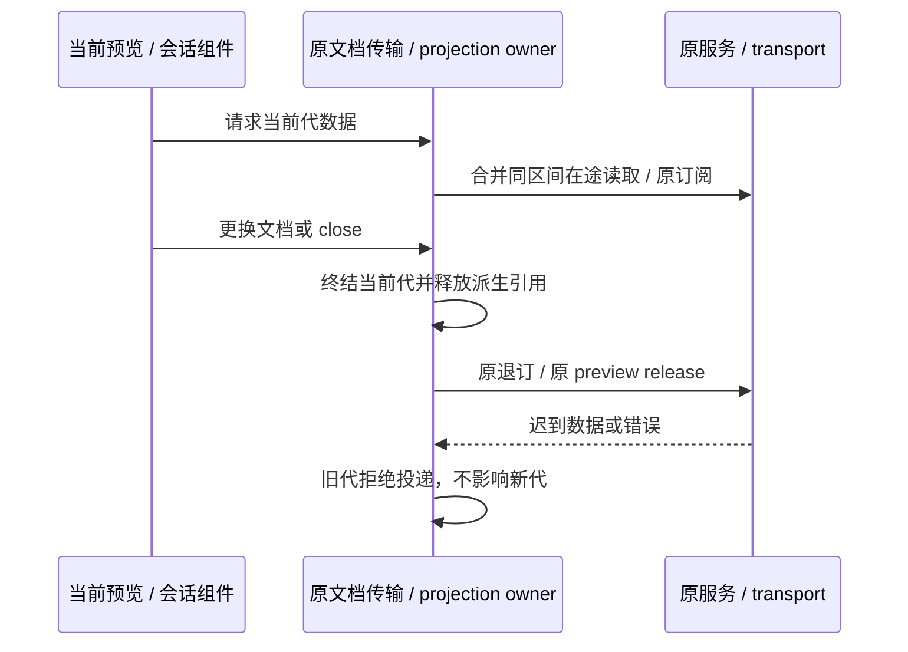
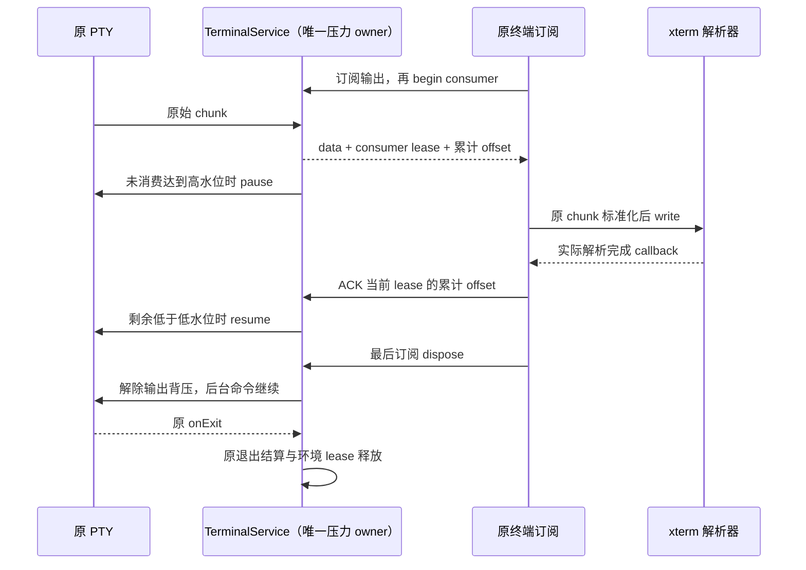

# 桌面资源优化后续实施

新增空闲成本专项见[桌面空闲资源优化方案](desktop-idle-resource-optimization.md)：保留用户指定的持续粒子效果和当前本地预热，优先排查发送后的响应等待，再处理无有效调度需求的 Scheduler，并对 Host / 历史展示先归因再优化。该专项目前是方案，下面的既有实施与测试记录不代表专项已经完成。

日期：2026-10-23。基线：7a40e997。承接 desktop-memory-optimization-plan.md 第 20 节。

## 规则与边界

1. Main 的平台服务经窄公共入口加载，仍复用原 credential、setting、paths、telemetry、storage、CUA owner。Host 的会话、鉴权、CommandInbox、lease 和恢复顺序不变；不为减模块数合并控制面。
2. PDF 分段读取由当前文档的传输 owner 合并同区间在途请求；完成即移除，没有跨文档结果缓存。abort 后不再交付旧数据或旧错误。底层不支持 AbortSignal 时只取消投递，不声称取消远端 IO。
3. 关闭会话投影时清空只读 snapshot、临时 overlay 与监听器；先保留原 subscription ID，再沿原 transport 退订。关闭不删除持久历史、不重发命令、不停止任务。其他会话不受影响。
4. 媒体预览卸载或更换 URL 时显式 pause、清除 src 并 load，以释放解码器；仍由 PreviewPane 释放 URL / previewId。用户查看中的播放、音量、范围读取和续租不变。
5. 终端保留现有每实例 scrollback 和隐藏渲染策略。对 xterm WriteBuffer 的异步消费增加兼容性输出背压：新 create 结果声明 capability，新 UI 先订阅带 flow 的输出帧，再启动当前消费 lease；PTY 累计未消费 UTF-16 字符达到 64 Ki 时 pause，降到 16 Ki 时 resume。阈值只管输出压力，不是任务结束判断；不丢字节、不使用超时、不按隐藏时间杀 PTY，不跨会话共享 shell，不截断额外历史。旧服务/客户端仍走原 string event。
   - terminalService 是消费 lease、累计 offset、暂停事实的唯一 owner；xterm write callback 只 ACK 实际已解析的累计 offset。ACK 单调且绑定 lease，旧 consumer/重复/越界 ACK 无效。
   - 只有最后一个输出订阅离开才解除背压并恢复 PTY，避免断线后的后台命令永久停在已离开的 UI 消费者上；隐藏的持久终端保留原订阅，继续消费历史。
   - 同一 PTY 出现多个输出观察者时退出单消费者背压，沿用兼容事件；不让最快观察者替其它观察者确认消费。
   - 真实进程退出仍由原 onExit 结算环境 lease；暂停或 ACK 不参与任务状态、CommandInbox 和进程退出证明。
   - Windows node-pty 1.1.0 自然退出只完成输出 socket 的关闭，遗漏输入 socket 与 Conout Worker；DLL 后端在原生退出回调中直接跳过清理，实测留下 MessagePort/PipeWrap 并阻止驱动自然退出。版本绑定补丁在输出 socket 的 close（EOF / 原有尾部 drain 已结束）释放这两项资源，同时覆盖 DLL 和系统 ConPTY；不枚举/kill 已退出 PID，不修改活跃 PTY 和非 Windows 行为，不增加超时作为退出证明。真实 smoke 必须由父驱动确认子进程自然返回 0，不能用 force-exit 冒充资源释放。
6. 浏览器沿用现有 guest / residency owner。真实 guest 测试覆盖页面状态、卸载/关闭、CDP 与 generation；没有显式挂起授权时不销毁后台页面。GPU/壁纸沿用原可见性和 decoder 释放，实测决定进一步改动。
7. SettingsPage 使用共享的按需加载入口；无项目设置与项目内覆盖层沿用原 ServiceProvider、导航意图和错误边界。仅设置内容显示本地化 loading，不能挂起或重挂 Root、会话和输入框。代码模块加载后由浏览器模块缓存复用，不承诺卸载模块代码。
8. WindowController 列表 registry 的请求缓存仍由该 registry 独占，保留最多 40 个已结算的最近查询；在途请求保护并继续同键单飞。停止订阅、source generation 和原版本失效仍清空原缓存。驱逐只影响下次是否重新查询，不删除会话 meta、草稿或 Controller 事实。
9. SessionDataLayer 保留原 30 秒 keep-warm，同时最多保留 8 个无引用、无 pending optimistic command 的暖投影。按最近 release 顺序回收更旧投影；活跃 pane、多 pane 共享引用及待确认提交不因数量预算退出。原 keep-warm 到期策略不变；重新 acquire 被驱逐会话仍沿原订阅恢复，不重放输入。

## 所有者与事件顺序

终端的输出压力与任务状态分离，沿原 Terminal RPC 通道传递；不改变 CLI stdio 或 conversation delivery profile：

## 验收

- Main 宽/窄入口在相同 external 规则下生成加载图，排除未使用的 Agent / plugin / terminal 实现；生产入口构建不能留下内部 TS 裸导入。
- PDF：并发同区间只读取一次；不同区间独立；失败后可重试；abort 后成功/失败均静默；新文档不复用旧区间。
- projection：关闭立即释放大 snapshot，退订延迟或失败不保留数据；迟到帧不复活；另一个会话、运行输入、手机 replay/desktop continuous 保持原语义。
- 媒体：真实 React/Electron 更换 URL、视频/音频互换与卸载；旧元素 decoder 释放，新元素正常加载；保留错误和 metadata 回调。
- 终端：真实 xterm 连续输出、多实例、隐藏/恢复和释放；记录历史行数、DOM 与 heap，验证原文/ANSI/输入不丢失。
  补充：高/低水位、累计与重复 ACK、旧消费 lease、订阅断开恢复、暂停时关闭、老版本 fallback、PowerShell 原分块标准化与尾部输出顺序。
- 列表 registry：历史查询有界、热查询复用、在途不驱逐、失败重试、旧版本迟到不能删除新版本。
- Settings：初始 Root 静态加载图不包含 SettingsPage 实现；两入口共用 lazy，设置加载期间会话输入和 workspace provider 不重挂。
- 整包测量工具使用显式隔离数据目录，记录版本/commit/硬件、5 次冷/热启动、角色计数、CPU/内存、readiness 和延迟。无模型连接的场景不冒充真实任务验收；不同版本不得直接作前后收益。
- 长稳报告记录实际持续时间、场景和完整标记；跨平台必须在真实目标 OS 执行，模拟 platform 不算实机通过。
- 必须执行 typecheck、lint、architecture、专项测试与相关 routing/remote 回归；记录失败和环境缺口。

## 实施记录

本轮实现：Main 窄入口、共享 Settings lazy、文档分段请求与解码器释放、关闭投影清空引用、8 个暖投影与 40 个已结算 Controller 查询预算、终端消费背压与 Windows 自然退出资源清理、隔离进程树采集器。Host 的任务、账号、路由与恢复 owner 沿用现有实现。

验证于基线 7a40e997 的隔离检出完成，只带本轮改动，避免混入同一工作区并行进行的 Coding Plan / 闲时任务移除。原工作区的整体检查曾被这些尚在修改的代码阻断；这里的通过结果只对应本轮完整隔离补丁，不代表并行改动全部通过。

| 验证                                | 实际结果                                                                                                                                |
| ----------------------------------- | --------------------------------------------------------------------------------------------------------------------------------------- |
| `pnpm typecheck` / `pnpm lint`      | 隔离检出通过                                                                                                                            |
| `pnpm architecture:check --changed` | 0 violations / 0 baseline / 0 new                                                                                                       |
| `pnpm test:desktop-memory`          | 88 项单元/集成 + 11 项构建/界面/采集器用例全部通过                                                                                      |
| 真实 Windows ConPTY                 | DLL 与系统后端各验证 legacy/flow，共 4 项；大输出实际触发原生 pause/resume，尾部到达，父驱动确认全部结束后自然返回 0                    |
| `pnpm test:provider-routing`        | 744 通过；先构建隔离检出的 CLI/contracts 后执行，没有借用原工作区 dist                                                                  |
| `pnpm test:remote-control`          | 181 通过，含加密身份重启恢复与两种 delivery 语义的既有回归                                                                              |
| 生产构建                            | Main / Host / Preload / Scheduler 与 Renderer 均通过；既有大 chunk 和预览包装层静态/动态导入警告仍存在，重量级预览叶子本身沿用现有 lazy |

Main 加载图在相同 platform exports、external 与 minify 规则下，从宽入口的 361 个有效模块 / 265792 字节收敛到窄入口的 78 个 / 107888 字节。该数字是加载图和压缩代码口径，不是整包常驻内存收益。

真实界面用例覆盖生产 React 与开发 StrictMode：PDF 切换文档后丢弃迟到区间、媒体源切换/关闭释放 decoder、6 个 xterm 连续输出与 detach/reuse、Settings 加载期间草稿和 Shell 不重挂、真实浏览器隐藏保留表单/关闭销毁 guest、local/remote 查询失效和旧请求隔离。遥测 loader 增加账号切换、provider 切换、损坏凭据、无效 Bearer 和原归因读取回归；没有更改鉴权算法。

采集器通过隐藏 Electron 夹具验证隔离平台目录、1 对冷/热启动、6 次真实 OS 进程树和 Electron 角色采样。第一次临时生产 stage 试运行暴露了 Windows Known Folder 需要 `USERPROFILE/AppData/Roaming` 和 `Local` 的目录前置条件，已修正并补回归；这次试运行没有形成有效整包性能报告，也没有重启用户已安装的 LCode。

尚未验收：新安装包的 5 次冷/热启动和 P95、低配机器、真实模型/MCP/多智能体/手机混合负载、8 小时整包长稳、macOS/Linux 实机。不能用本轮夹具、先前的孤立 Worker 长稳或模块图数字替代这些结果。用户自行重新构建安装后再开展这批最终验收。

基准、诊断和长稳产物统一存放 .artifacts/desktop-memory/，不含用户数据、密钥或内部地址。

采集入口：`pnpm benchmark:desktop-memory --executable <绝对安装程序路径> --output <隔离报告目录>`，默认 5 次独立冷启动及各自紧接的一次热启动。`--app <绝对生产构建目录>` 用于未安装的生产构建，不得将其报告标为已安装包验收。`--soak-ms 28800000` 可延长最后一次热启动采样到 8 小时，但默认场景仅为未登录空闲，不能替代真实任务/MCP/多智能体/手机操作长稳。

采集器通过显式 HOME、USERPROFILE、Chromium 和 LCode 数据目录隔离，不复制个人凭据；默认就绪条件是登录入口可见，报告写为 login-ready，绝不称为首次任务可用。全进程树 RSS 与 Electron 分角色 private/workingSet 分开报告；不把不同内存口径相加。OS 采样复用原只读 process reader，运行在独立驱动，不注入 Main。
