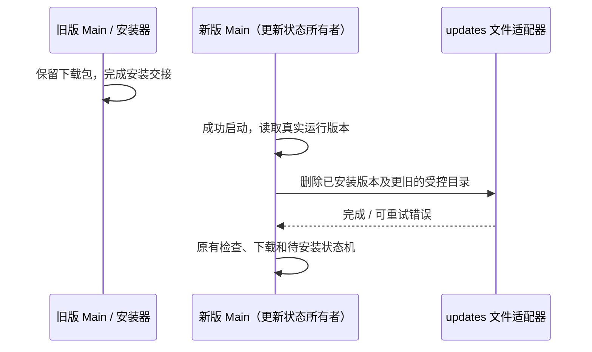

# 桌面更新缓存清理

## 规则与边界

- `autoUpdater.ts` 继续拥有下载、待安装版本与安装交接状态。更新安装完成后，下一次启动
  初始化 updater 时，在检查/下载新版本前清理 `userData/updates` 内已安装版本及更旧版本的缓存。
- 清理适用于 Windows、macOS、Linux；只识别应用管理的 `mac-<semver>`、`win-<semver>`、
  `linux-<semver>` 目录。版本按 semver 比较，包含 preview，不按字符串或文件时间比较。
- 比当前运行版本新的目录仍可能是下载中、待安装或安装失败的更新，必须保留。
  当前版本是安装已成功的依据，不能在点击安装或旧 Main 退出前提前删除安装包。
- 没有未来版本缓存时，清理后 `updates` 目录为空。保留目录本身；不清理 Electron updater
  自有目录、不识别的文件、非法版本或目录链接，不扫描或删除目录之外的文件。
- 只使用异步文件 IO。路径必须为缓存根的直接子目录；根是链接时不清理。
  并发退出/重复启动导致缓存已不存在视为完成；其它错误向 updater 返回，由其记录 warn，
  不阻断启动、检查更新或安装。下一次启动继续重试，不使用永久完成标记或超时推测安装完成。

## 验收

1. 多个历史版本和当前版本清空；未来版本保留，重新运行幂等。
2. 正式版、preview 及 `3.19.10` 等版本按 semver 顺序处理；非法版本不删除。
3. 三个平台的目录规则覆盖；未知文件、目录和根外目录不受影响。
4. 缓存根不存在、根是链接、子目录是链接时安全处理；链接目标字节保持不变。
5. updater 初始化在首次检查前等待清理；清理失败仍继续检查更新并记录 warn。

## 验证（2026-10-20）

- 3 个文件系统场景通过，覆盖三平台受控目录命名、当前/历史/未来版本、preview、幂等、未知文件
  与 Windows junction；并执行 6 项既有安装包选择、完整性校验及取消清理测试。
- 根 typecheck/lint、改动格式与架构检查通过。Windows 临时目录实测，macOS/Linux 原生更新安装
  尚未实机验证；未修改真实 updates 目录或发布安装包。
