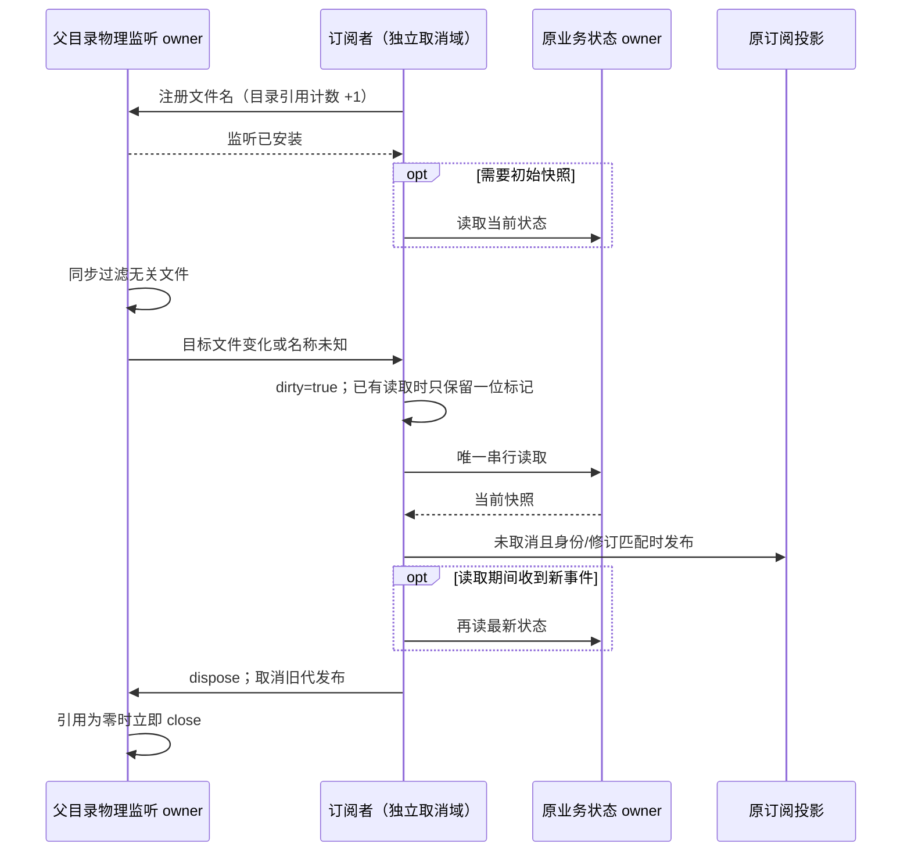

# 文件变更通知的有界消费与生命周期

## 问题与证据边界

Windows Host 日志在一次长请求期间出现上万次 `fs.watch maxQueue exceeded`。当前 Node 实现会在 `fs.promises.watch` 的队列满后，针对每个后续事件调用 `process.emitWarning`。不能通过关闭 warning、扩大队列或给业务读取添加超时来修复。

源码中有两处该模式：账号凭据订阅在 `for await` 内等待账号读取/发布；Git 审核订阅在循环内等待状态文件读取。读取期间所有目录事件（包括无关文件）先进入迭代器队列，文件名过滤发生得太晚。慢读取、原子替换和同目录高频写入会造成积压。仅凭现有生产日志不能区分当时两处监听各贡献了多少，也不能将该异常归因为全部模型等待。

## 规则与所有者

- 新增 Node-only `watchFileInvalidation`，经 `@lcode/shared/node` 公开；仅拥有物理监听句柄、引用及每位订阅者的有界刷新状态，不缓存业务快照或凭据。
- 按规范化绝对目录复用一个非递归 `node:fs.watch` 句柄。事件回调同步按文件名过滤，已知无关文件不产生刷新；文件名缺失时通知该目录的订阅者重读。
- 每位订阅者至多一个执行中的异步刷新和一个布尔 dirty 标记。读取期间的任意次失效合并为下一次读取，完成后追上最新状态；不重放每一次文件事件，不并发读取，不延长防抖计时器。
- 订阅先安装物理监听，再执行可选首次读取，避免安装窗口丢变更。原子替换通过监听父目录继续覆盖；删除/重建文件可正常通知。
- 一次刷新失败后，监听仍消费后续事件，下一个真实事件可重试；同一连续失败只报告一次，成功后重新允许报告。底层监听错误显式通知并关闭该代句柄，不假装同步成功、不无限重建或轮询。
- 最后一位订阅者取消立即关闭物理句柄。取消早于目录准备完成时不能迟到创建句柄；旧代回调不能影响重新订阅的新代。每位订阅者有独立 AbortSignal，退出后禁止发布迟到读取结果，不影响其他订阅者。
- ProviderAccounts 保留原加密存储、mutation barrier、文件锁和 public signature 判断；监听只通知原 owner 重读，不更新鉴权或路由真值，不触发模型请求。
- GitReviewWorkspaceState 保留原 Host accepted owner、CAS、字段修订与幂等；直接事件和磁盘通知仍通过同一身份/修订过滤发布。不同 workspaceIdentity/scopeId 不能混用。
- desktop-continuous 与 web-remote-replayable 的业务交付机制保持不变；手机重连读取原 Host 最新快照。

## 验收

1. 独立 Node 进程复现旧实现：阻塞刷新后在同目录生成超过默认队列容量的无关事件。修复后无 queue overflow warning、读取不并发，最终目标变更可见。
2. 确定性回调夹具发送十万次事件，验证一个执行中读取加一个待刷新标记；无关文件零读取，未知文件名会重读。
3. 同目录多文件及多订阅者复用句柄，释放一个订阅不影响其余；全部释放后关闭句柄。目录准备期间取消和旧代迟到错误不污染新订阅。
4. 读取失败不会永久停止监听；连续错误有界报告，成功后再次失败可报告；物理监听错误、初始化失败及取消均无未处理拒绝。
5. 实际磁盘原子替换、删除重建、不同目录隔离及高频写入最终收敛；账号存储与 Git 审核原生命周期、跨窗口、字段修订和手机重连回归保持通过。
6. 执行根 typecheck、lint、架构检查和相关业务测试。生产安装包不原地替换；源码验证不冒充用户新构建后的长稳收益。

## 2026-10-24 实施与验证

- 变更位于既有 shared / services 模块，新增工具只从 `@lcode/shared/node` 暴露。Shared 的目录 owner 只管理句柄引用；ProviderAccounts、GitReviewWorkspaceState 继续拥有各自业务数据与发布边界。运行源码增加 218 行、删除 53 行，净增 165 行，不含测试、夹具、runner 和本文。
- 独立 Node 夹具在一个刷新被阻塞时，对同目录无关文件顺序写入 3,500 次。旧实现触发 8,425 次 `fs.watch maxQueue exceeded`；修复后同样夹具为 0，最大并发读取为 1，最后一次目标变更可见。夹具的 `--no-warnings` 仅避免把数千行输出刷到控制台，仍通过 `process.on("warning")` 计数；产品进程未关闭 warning。
- 确定性测试将十万次相关失效压缩为一轮执行和一轮后续读取；十万次已知无关事件不读取。另验证共享句柄最后释放、目录准备期间取消、旧代迟到事件、未知文件名、Windows 大小写规则、不同目录隔离、连续错误有界报告、失败后恢复及真实原子替换/删除重建。
- 原 Git 状态测试和新增压力测试验证跨 Host 变更最终收敛、workspaceIdentity 隔离、修订不回退、手机重连读取完整快照以及取消后不发布迟到读取。账号存储的 barrier/加密/鉴权与原路由接口没有改动。
- 根 `pnpm typecheck`、`pnpm lint` 通过；架构检查 violations / baseline / new 均为 0；本轮文件格式及 `git diff --check` 通过。Oxfmt CLI 写入两个源文件时发生自身 panic，最终使用同版本格式引擎 API 完成格式化，再由原 CLI `--check` 验证通过。
- `pnpm test:desktop-memory`：120 项单元/集成、15 项真实 Electron/进程/加载边界测试通过；`pnpm test:provider-routing`：745 项通过；`pnpm test:remote-control`：200 项通过。测试组有重叠，不相加宣称独立用例总数。
- `pnpm test:release`：173 项通过、0 失败、1 项原有可选测试跳过，包含原生产 preload 沙箱与 Renderer 桥接回归。没有新增依赖或修改第三方材料输入。
- 本次在 Windows 执行。未替换用户安装包、未调用真实模型、未执行 macOS/Linux 实机压力或整包长稳验证；仍需重新构建后生效。不能将 queue overflow 修复写成模型首响应延迟已全部解决。
