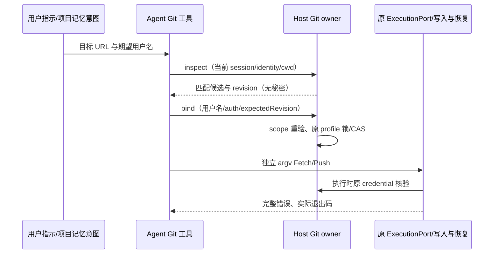
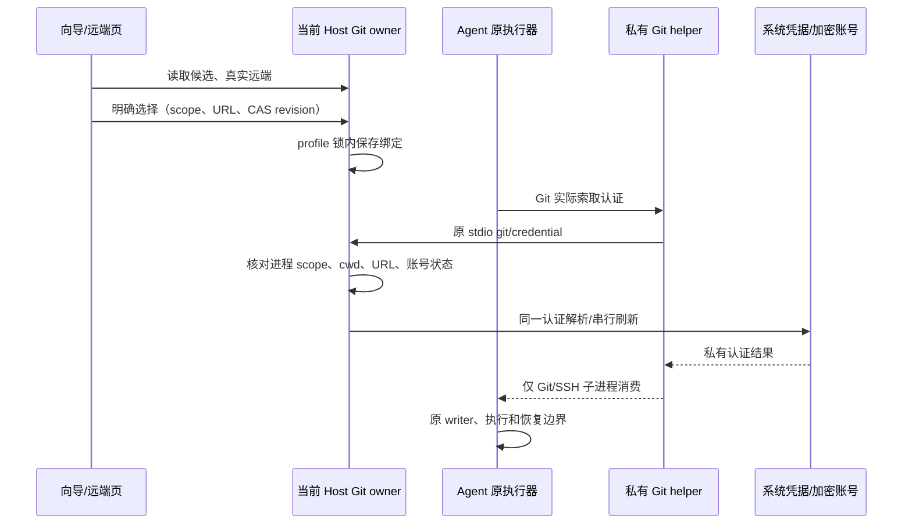

# 仓库、远端与 Agent 共用 Git 认证

## 问题与产品规则

### 账号约定落地与网络操作结果（2026-10-22）

- 用户明确指定的仓库/远端账号及已确认的长期账号偏好可作为选择意图。Agent 通过 `Git` 工具先 inspect 当前 URL 的匹配账号和 revision，再 bind 用户名与认证方式；Host 重新核对 session、identity、真实 cwd、远端 URL、唯一候选和 CAS，沿原 profile owner 保存。不能从仓库 owner、提交作者或候选顺序推断账号；记忆文本不能直接注入凭据或批准 Git 写入。
- `git/account` 是无秘密的私有请求，inspect/bind 均限定实际远端和当前授权目录；返回匹配账号元信息、revision 和派生仓库摘要。bind 是原配置 CAS 命令，不执行 Git 网络或改动仓库配置。旧 client 在 profile 锁内提交前拒绝；执行器取消停止等待，已提交命令不回滚，响应丢失通过重新 inspect 收敛，不自动重放。
- HTTP(S) 同一服务器、端口、路径的 Fetch/Push URL 仅用户名提示不同时，共享明确绑定；没有绑定时可复用该目标唯一的显式用户名提示。路径、协议、端口不同仍独立。若同一目标有不同显式用户名提示，继续按完整 URL 独立选择；旧 URL 绑定归并发现冲突必须停止认证，不能取第一条。查询仍返回 stale 选择及最新 revision，允许用户通过原 CAS 明确重选来修复，不要求手动编辑凭据文件。修改账号或清除自动状态仍沿原 CAS/tombstone 边界。
- `Git` 网络动作仅支持参数化 fetch/push/ls-remote，复用原 ExecutionPort、认证 helper、权限、checkout admission 和恢复。输出保留 stdout/stderr、实际 exitCode、status；大输出沿原 artifact 预算保存，无管道、Shell 串接或隐式重试。不能用再 Push 代替失败 Fetch 的验收。
- Bash 中可静态识别的网络 Git 若包含管道、重定向丢输出、OR 或后续顺序命令，执行前返回明确错误，要求使用 `Git` 独立调用；不改写 Shell、不执行其中任一步、不全局启用 errexit/pipefail。普通单次命令和本地 Git 行为保持兼容。未知 Shell 语法不宣称能恢复被用户脚本主动吞掉的状态。
- Git 实时摘要提示 Agent 比较记忆意图和实际绑定；不一致时走 inspect/bind，不能静默改用默认账号。长期记忆保存期望用户名/目标约定而非账号 ID、token 或实时绑定快照；实际选择仍以 Host 为准。用户的本机映射通过原服务命令配置，不在产品代码硬编码个人账号。

新增验收：双账号无绑定但 Push 带用户名时 Fetch 一致；共享目标绑定/清除/旧冲突、多远端独立账号；记忆约定经 inspect/bind 后 UI/Agent 一致；过期 revision、旧 client、越界 cwd、同名不同认证拒绝；管道/后续命令吞失败的复现执行前阻断；真实隔离 HTTP Git 推送/Fetch/失败退出码、完整错误与零重放；原写入、journal、lease/恢复测试。

旧代码只给经过仓库向导且保存了 `lcode.accountId` 的 UI Git 注入认证；Agent Shell 绕过该适配器。本轮统一认证解析，不改变 Git 写入、checkout writer、journal、审批和恢复语义。

- 检测账号在仓库向导和右侧 Git「远端」页直接选择，无须先去设置导入。明确选择后由 Host 原 profile CAS 保存账号和绑定；系统账号不复制令牌。
- 相同服务器/用户名的令牌与系统认证是不同选择，导入幂等判定包含认证方式；不能用原令牌账号吞掉用户明确选择的系统账号。
- 绑定隔离当前 Host、`workspaceIdentity?.trim() || workspacePath`、真实仓库根、规范化远端 URL。不同仓库/身份/URL 不覆盖。同一仓库多个 remote 指向同一 URL 时共享选择，因为 credential 协议只提供 URL。
- 真实仓库标识使用 canonical Git common-dir：同仓库的原目录和 linked worktree 共享 URL 选择，独立 clone 保持隔离。已知远程 identity 同时按 common-dir 路径归一并保留 Host/端口/用户 authority；不能按 checkout 路径另建一个认证事实。真实工作目录仍用于 Git 操作和原 writer/恢复授权。
- Fetch/Push URL 分别列出并去重；只接受当前真实远端 URL。改址后旧绑定不作用于新地址。选择不写 Git config/remote URL，旧地址恢复可重新读取其绑定。
- 只有一个匹配账号可直接使用；多个账号且未绑定时返回 `git-account-selection-required`，在应用内选择，不能猜第一个账号、仓库 owner 或提交作者。
- 账号删除/修改、候选消失和过期 revision 均明确停止，不能静默换号。清除选择恢复自动解析。OAuth 继续使用原加密存储和串行刷新。
- 显式恢复自动匹配保存无账号的作用域标记，避免重新读取旧 `lcode.accountId` 而复活原选择。已知远程 identity 使用现有 `replaceRemoteWorkspaceIdentityPath` 在真实仓库根归一，子目录和多源目录不丢绑定，其他 Host/端口仍隔离。
- 旧 `lcode.accountId` 只在没有 URL 绑定且目标属于当前 `origin` URL 时兼容读取并核对服务器，公开选择器显示该有效选择；不得被新添的其他 URL/remote 继承。相同 URL 仍共享选择。新克隆保留兼容 ID，重命名原 remote 后可以在远端页重新明确选择。
- UI 未显式选择账号的克隆与 Agent 克隆共用非交互 helper。在尚无仓库的目录中索取认证时，只按目标 URL 的明确用户名或唯一匹配账号解析，不借其他仓库的绑定；多账号未指定仍停止。已存在仓库只接受其真实远端 URL，损坏配置/无效 Git 路径不能当成“新克隆”回落。
- Windows/macOS/Linux 使用同一规则；检测阶段仍只读元信息，实际系统凭据由当前 Host 的 helper 在执行阶段读取。远程不能借本机账号回落。

## 唯一所有者和接口

Git 与项目记忆的联动遵循 [Git 实时上下文与项目记忆联动](git-project-memory-integration.md)：无秘密摘要是只读派生信息，账号绑定、凭据、审批与恢复的 owner 不变。

`GitManagementService` 是账号/绑定唯一持久 owner；新增有严格类型和运行时校验的 `getRepositoryAuthentication`、`bindRepositoryAuthentication`。返回无秘密候选、绑定状态和 CAS revision。Host routing adapter 通过真实 Git 只读发现根/远端，UI managed Git 和 Agent 共用它。

Agent 使用私有 stdio `git/credential` 请求，携带 session、cwd、URL；Host 使用当前进程的 workspace/identity，复核 cwd/真实远端。结果仅给内部 helper，不进 Renderer、会话事件、模型上下文、普通 service RPC 或日志。

UI 的仓库远端认证、未选账号的克隆和 CLI 原执行端口共用 `provider-node` 公开入口的私有 loopback Git credential/SSH helper，不解析/重写 Shell 字符串，不替代原执行器和写入 admission。该 helper 在 Git 真正索取认证时才请求 Host；令牌不进入 argv、环境配置、持久 helper 文件和工具输出。连接只听 loopback、随机 capability、请求体有界，命令/app 关闭时撤销与清理。CLI 保留前台、后台、取消、等待和输出读取能力。SSH 返回已验证的路径给系统 SSH，不读私钥字节；逐目标解析并保留自定义 SSH 命令。凭据诊断变量逐项清理，其中 `GIT_CURL_VERBOSE=0` 仍会开启输出，必须移除该变量。

向导显式选中账号的克隆继续使用原有前置 revision 核对、Host 账号解析和命令级认证注入：令牌/OAuth 通过进程级 scoped HTTP header，系统账号按用户名限定 helper，SSH 只注入路径。该现有采集路径的成功/失败和恢复收据保持不变；后续仓库操作转入统一 URL 解析。

桌面 Electron/Node 以 Node 模式运行固定 helper；原生 SEA Agent 复用自身的 `__lcode-git-credential-helper` 内部命令，不要求机器另装 Node。内部命令在账号/配置/数据库初始化和数据迁移前分流，只消费固定 helper 协议，不创建 Agent 会话。UI helper 沿用经过验证的 Git 可执行路径。原 execution 关闭失败时仍在 finally 撤销 helper，不吞掉关闭错误或留下认证通道。

执行阶段的系统凭据匹配指定用户名，非交互调用原 `git credential fill`，禁止递归调用本产品 helper；失败返回固定错误，不打开外部账号选择，不重放 fetch/push/clone。

桌面 `desktop-continuous`、手机 `web-remote-replayable` 继续观察同一个 Host，不新建 session/队列/发布收据。UI 迟到响应按 service、identity、remote session、请求代际丢弃。认证失败不自动恢复写入。

## 验收要求

1. 两个检测候选可直接选择；绑定后 UI/Agent 复用同一账号；单一匹配自动解析，多账号未选不猜测。
2. 多仓库、多 fetch/push URL、多 remote、远端 identity 隔离；相同 URL 共享选择。
3. CAS 竞争、账号删除/修改、候选消失、remote 改址/删除、旧 ID 和 OAuth 刷新不串号。
4. 隔离 HTTP Git 实测 clone/fetch/分支和 Tag push，联测 Host 私有请求与 CLI helper，失败不重放。
5. Shell 组合、`git -C`、子目录与 argv 无须改写；秘密不进入工具输出/错误、argv、持久配置和日志；错误 capability/跨 scope/关闭后访问拒绝。
6. 三平台路径、Electron Node 模式、helper 和关闭语义做代码测试；中文/英文、窄屏/主题、迟到 UI 响应做浏览器测试。
7. 执行目标服务/协议/CLI/UI 回归、typecheck、lint、架构和定向格式检查；安装版及其他平台真机留待用户构建。

## 实施记录

2026-10-22 本批已实现账号意图到 Host 绑定的通道、Fetch/Push 目标统一、旧冲突显式修复，以及独立 Git 网络结果和 Bash 吞错写法拦截。用户指定的两个本机账号选择已通过原服务配置并回读；个人映射保存在本机 profile/项目记忆，未写入产品源码，也未执行外部仓库 Fetch/Push。

- 账号/平台适配/私有协议/真实隔离 HTTP Git/执行器与 Bash：106 项通过。
- 全部 core memory、真实 Runtime/SQLite 记忆召回与偏好学习、inspect/bind、子 Agent/工作流接线：193 项通过。
- 原 Git writer、并行发布检查、journal、lease/reservation 与恢复：100 项通过。
- 远端账号浏览器交互 3 项、手动/自动审核与发布刷新浏览器回归 22 项、生成输入校验 7 项通过。合计 **431 项通过，0 失败、0 跳过**。
- 根目录 typecheck、lint，core/bootstrap/CLI 独立类型检查与 core/bootstrap lint 均已执行；架构 0 基线/新增违规，定向格式与空白检查完成。日志、并行改动排除记录和检查详情在忽略目录 `artifacts/git-account-selection-analysis/`。
- 修正一个旧测试对并发 realpath 内部调用顺序的假设，同时保留返回顺序、目录授权和四并发上界的断言；生产并发语义未修改。

验证环境为 Windows、Node 24.21.0；平台适配沿原注入接口测试。未构建或安装桌面/SEA 客户端，macOS/Linux 真机及安装版验收等用户构建后进行。真实系统凭据只保存账号引用，本轮未调用实际用户的 credential fill 或向外部仓库发布。

已实现以上规则。验证环境为 Windows、Node 24.21.0；实际命令、输出和审计文件保存在本机忽略目录 `artifacts/git-account-routing-investigation/`。

| 验证                                                                                               | 结果                           |
| -------------------------------------------------------------------------------------------------- | ------------------------------ |
| 账号、OAuth、三平台元数据、Host 私有协议、真实隔离 HTTP Git、SSH helper、CLI 执行和远端代理        | 62 项通过                      |
| checkout writer、发布并行检查、journal、恢复锁、Agent admission、关闭和项目执行环境                | 100 项通过                     |
| 向导直接选用、远端独立选择/持久化、身份切换、迟到响应、手机宽度与主题，以及手动/自动审核和发布刷新 | 43 项浏览器用例通过            |
| Agent 嵌入 worker、生成顺序和发布输入一致性                                                        | 7 项通过                       |
| 根目录 typecheck、lint、架构检查；CLI 和 bootstrap 独立 typecheck/lint                             | 通过；架构基线和新增违规均为 0 |
| 定向格式、diff 空白与功能图谱文件/符号校验                                                         | 通过                           |

回归包含：清除选择不复活旧 ID、linked worktree 共享原仓库选择、同名令牌/系统账号不混用、未选账号克隆不进入系统选择框、旧克隆账号不扩散到其他 remote。多 URL push 实测按每个目标独立索取账号；失效 scope、账号、revision 和真实变更的原有写入保护保持有效。

未执行安装版验收、原生 SEA 二进制验收或 macOS/Linux 真机系统凭据解锁；SEA 内部命令通过代码及真实 CLI 源入口子进程验证，其他平台通过元数据/路径适配测试。没有读取用户实际令牌或向外部仓库发布。用户重新构建后再验收已安装客户端。

实现依据：[GCM 指定用户名的账号匹配](https://github.com/git-ecosystem/git-credential-manager/blob/main/src/GitHub/GitHubHostProvider.cs)、[GitLab 系统凭据匹配与 OAuth 用户名](https://github.com/git-ecosystem/git-credential-manager/blob/main/src/GitLab/GitLabHostProvider.cs)、[Bitbucket 按用户名查询系统凭据](https://github.com/git-ecosystem/git-credential-manager/blob/main/src/Atlassian.Bitbucket/BitbucketHostProvider.cs)。检测与真正执行阶段分开；未在调试中读取用户的实际令牌或执行外部仓库发布。
