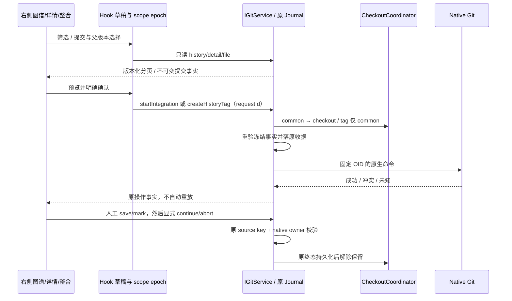

# F 阶段：高级历史操作

状态：2026-10-21，代码实现与本机自动化回归完成。承接 E1/E2；构建版及手机真机验收等待用户构建。

后续 G2–G4 已扩展候选/目录树/列宽/键盘/菜单、统一搜索与视区渲染、批量操作/显式 Merge 主线和可恢复 Reset。当前规则以 [差距收尾清单](git-graph-idea-gap-completion.md) 及其关联 spec 为准；下文“本批”仅描述原 F 批次，不能作为当前功能缺失的依据。

## 范围与产品规则

按原路线 P5 实施历史筛选/详情、Cherry-pick/Revert，以及附注/签名 Tag。Reset、强制改写远端、交互变基和任意 shell 参数不在该路线的本批范围内。

1. 右侧 Git 图谱增加历史筛选：完整分支/标签 Ref、作者字面文本、消息字面文本、日期范围。默认仍限 HEAD、用户分支、remote 分支和标签，不拉入内部 checkpoint refs。每页 50 条，分页绑定 refs 与筛选 revision；refs 变化要求刷新，不拼接过期页。筛选不是 checkout，不 Fetch。
2. 选择提交展示完整消息、作者/提交者、parents、文件范围，以及选中文件的真实父版本 Diff。Merge commit 明确选择比较的 parent；根提交使用空树语义；二进制/非 UTF-8/大文件/链接/子模块只显示分类和元数据，不伪造文本 Diff。列表/详情有明确大小上限与截断提示。任何筛选、预览、关闭都不写 Git。
   2026-10-21 的后续布局改造以 [图谱工作区布局 spec](git-history-layout.md) 为准：窄侧栏仍保留图谱、历史自适应高度、默认紧凑筛选，并提供可调整详情/Diff 分区。分页统一使用同一列表控件，不重复显示。当前 HEAD 单独标记，日期输入限制倒置范围。
3. 从选中提交预览 Cherry-pick 或 Revert，冻结完整 OID、原 HEAD/分支、index/工作树与原生状态。每次只操作一个普通提交；merge commit 在本批拒绝（不能暗选 mainline），根提交允许。Revert 对当前分支可达的提交创建逆向提交，不倒退分支；Cherry-pick 保留来源作者并创建新提交。空提交或额外决策保留原生现场，交由外部 Git，不自动 skip。
4. 继续复用 E2 的 preview/start/continue/abort 服务、右侧整合区、原 journal、同一 `integration` reservation，以及 E1 的人工保存/标记。发起必须是干净本地分支，无原生操作/冲突/隐藏标志和不支持的 checkout，防止 ignored 文件碰撞；普通 Merge/Rebase 的规则保持。目标 Cherry-pick 不要求与当前分支有共同祖先；Revert 必须可达。
5. 暂停只授权原 operation key；原 HEAD/分支、CHERRY_PICK_HEAD 或 REVERT_HEAD、sequencer 计划、索引与工作树 revision 都须匹配。拒绝外部操作和受管候选整合的接管。单提交完成必须生成原 HEAD 的一个新子提交；Abort 必须回到原 HEAD/分支，明确确认会撤销本次人工修改。中止只调用原生命令，不 clean、不自行 reset、不自动 stash。
6. Continue/Abort 使用新 requestId 关联原 sourceRequestId；重复只查原收据，不重放。冲突/未知保留 reservation；未确认退出的进程保留 writer，并在原 journal 记 unsettled。先持久化终态事实再解除保留；外部已结束可通过原核对入口解除，不能把未知冒充成功。
7. 创建 Tag 独立预览：固定目标提交、名称、消息、类型（附注/签名），检查名称未占用、Host 身份/签名配置 fingerprint。只创建一个新 tag，不 force、不 Push。消息和签名选项不注入现有任务发布队列。签名仅使用目标 Host 已配置的 GPG/SSH 等原生 signer，不接收或存储私钥/口令；配置变动使确认失效，缺配置明确拒绝。注释标签明确不受 tag.gpgSign 默认值影响。
8. Tag 只持有既有 common-dir repository writer，不占 checkout reservation；不同 checkout 共享同一 ref 保护。成功必须核对 refs/tags/name、tag object 类型、剥离后的目标、消息及签名存在；签名验证留给 configured signer。超时/丢响应按原 journal 查询，不删除可能已创建的 Tag，也不自动再签名；orphan 保留 repository lease。

## 所有者、接口与时序

Git 文件/markers/refs 是实时事实，原 Journal 是唯一已接受操作 owner。UI hooks 仅拥有筛选、选择、未提交确认；不增加 accepted queue、Main/relay 业务状态或单独历史 writer。新增严格 shared schema 与 IGitService 只读 history/detail/file、Tag preview/create；E2 模式扩展 cherry-pick/revert，保留旧请求本地路径 fallback。

身份隔离仍是 trimmed workspaceIdentity || workspacePath，workspacePath 只用于执行；Host/attachment/identity 变更后旧读取与确认失效。Desktop continuous 与手机 replayable 均使用原 Host RPC 与原请求查询，不新起 Agent/Host。平台差异通过注入的服务/command provider，主题/国际化和手机输入遵循 DESIGN。

## 验收计划

- 真实 Git：可见历史筛选、字面参数、分页 refs 变化、隐藏 refs；根/普通/merge parent 详情，增删/Unicode/二进制文件 Diff；只读不变更 HEAD/index/refs。
- Cherry-pick/Revert：成功、冲突→人工 save/mark→继续、中止、空变更保留；不要求 Cherry-pick 同祖先，Revert 不可达/merge mainline 未指定拒绝；dirty/stale/ignored/外部 marker/其它 identity/原生锁/Agent busy 拒绝。
- 原收据：两 Host、重建服务、相同/不同参数 requestId、模拟 orphan/超时/丢响应、原 reservation 和实际 Agent spawn admission；不重放、不误清现场。
- Tag：附注/签名、占用名、配置或目标变化、无隐式 Push、不覆盖现有 tag；可用 signer 使用隔离临时密钥，未配置/不可用不得写成验证成功。
- E2E：图谱筛选与详情/父选择/Diff，历史操作预览转整合/冲突，Tag 确认，中止警示/未知恢复、Host 切换、390px/中英文/浅暗主题/键盘；回归 A–E2。
- 实际运行针对测试、typecheck、lint、架构 changed、格式与 diff 检查，最终结果追加本文。构建版验收不在本轮自动化结果内。

依据：[git-log](https://git-scm.com/docs/git-log)、[git-cherry-pick](https://git-scm.com/docs/git-cherry-pick)、[git-revert](https://git-scm.com/docs/git-revert)、[git-tag](https://git-scm.com/docs/git-tag)。

## 实施记录与实际验证

`GitHistoryRepo` 只读服务位于 Git adapter，`gitServiceHistory.ts` 在同一个 `GitWorkspaceSafety` / journal 上装配，未新增持久业务队列。Cherry-pick/Revert 扩展现有 E2 模式和原生状态证明；Tag 通过既有 wrapper 的 repository 分类进入 common writer。IGitService 与 shared runtime schema 同步扩展，调用仍经 hooks 选择目标 Host。

已执行的入口以仓库现有 runner 为准：

- 新增原生测试：`node --import tsx --test` 加 `gitHistory.integration.test.ts`、`gitHistoryActions.integration.test.ts`、`gitHistoryTags.integration.test.ts`、shared `gitHistory.test.ts`。
- 专项继续覆盖 E2 integration、checkout coordination 和真实 Agent spawn admission；原生 timeout/orphan 由 provider 注入，写入资源锁和收据仍走实际实现。附注与 SSH 签名 Tag 使用真实 Git，SSH 测试密钥仅在临时目录生成并由 `git verify-tag` 验证，不读取用户私钥。
- 浏览器从 `packages/web` 执行 `node --import tsx --test test/git-commit-dialog.test.mjs`。F 使用 `LCODE_GIT_REVIEW_TEST_CASES=history`，E2 使用 `integration`，E1 使用 `conflicts`，D 使用 `workspace-operations`；A/B/C 不设置筛选变量。
- 原有 Git/shared/worktree 扩大入口使用 `--test-reporter=tap --test-concurrency=3`，准确清单保存在 `artifacts/git-review-pane/f-git-regression-files.json`。UI store/文件范围等沿用 E2 的实际测试入口。

首轮问题已保留失败证据并修正：文件读取向 strict 详情合同传入额外 path，需要显式字段投影；verbatim Tag 消息必须以换行终止，才能正确分隔原生签名块；测试 fixture 的根提交错误地指向自身，造成图谱遍历卡住，已改为真实 DAG 关系并删除临时诊断屏障。最终通过日志与首轮失败日志分开保存，不用扩大超时或自动重试掩盖问题。

资源与 UI 边界没有转移：原 journal 仍是唯一 mutation owner；UI 保存未提交筛选/选中项/确认；新分页受 refs revision 约束。Header 刷新或 Host 切换不重放写入，签名提示只表示存在签名，实际用户 signer 的信任验证和构建版验收仍按后续设备环境执行。

明确大小限制：每页默认 50、最多 100，分页 offset 最大 10000；提交/Tag 文本对象上限 512 KiB，详情最多显示 500 文件；文本文件 Diff 复用 E1 的 256 KiB 上限。超过这些界限应缩小筛选或使用原生 Git，不宣称已支持任意大小仓库/对象。Merge mainline、批量摘取/撤销、Reset、交互式重写和自动推送不包含在本批交付内。

### 本机最终结果

以下均为实际执行结果。多轮回归有重叠，不合并为去重后的测试总数；浏览器数字包含 runner 的父场景。证据保存在 `artifacts/git-review-pane/`。

| 验证范围                                                                   | 实际结果                                             | 证据文件                                    |
| -------------------------------------------------------------------------- | ---------------------------------------------------- | ------------------------------------------- |
| F、E2、checkout coordination、Agent spawn 与 shared 专项                   | 36 通过，0 失败                                      | `f-focused.tap`                             |
| 空 Cherry-pick/外部 marker、Revert 恢复 ignored 文件碰撞、Tag orphan lease | 3 通过，0 失败                                       | `f-extra-boundaries.tap`                    |
| Git/shared/worktree 扩大回归                                               | 288 通过，0 失败，1 个 POSIX 专属场景在 Windows 跳过 | `f-git-regression.tap`                      |
| UI store、文件范围与导航                                                   | 17 通过，0 失败                                      | `f-ui-regression.tap`                       |
| A/B/C 浏览器回归                                                           | 71 通过，0 失败                                      | `f-abc-browser-regression.tap`              |
| D 导入/Stash 浏览器回归                                                    | 10 通过，0 失败                                      | `f-d-browser-regression.tap`                |
| E1 人工冲突浏览器回归                                                      | 10 通过，0 失败                                      | `f-e1-browser-regression.tap`               |
| E2 Merge/Rebase 浏览器回归                                                 | 8 通过，0 失败                                       | `f-e2-browser-regression.tap`               |
| F 历史浏览器最终回归                                                       | 9 通过，0 失败                                       | `f-browser-final.tap`                       |
| 最终图谱共用组件调整后的侧栏/入口回归                                      | 22 通过，0 失败                                      | `f-pane-final.tap`                          |
| 最终 HEAD 标记与 parent Diff 原生回归                                      | 2 通过，0 失败                                       | `f-history-final.tap`                       |
| `pnpm typecheck`、`pnpm lint`                                              | 均退出 0                                             | `f-typecheck-final.txt`、`f-lint-final.txt` |
| `pnpm architecture:check --changed`                                        | 退出 0；violations/baseline/new 均 0                 | `f-architecture-final.txt`                  |

F 变更的 42 个受支持格式文件通过 `oxfmt --check`；`git diff --check` 退出 0，仅提示既有 Windows LF/CRLF 转换信息，无空白错误。对应证据为 `f-format-final.txt` 与 `f-diff-final.txt`。

最终宽屏截图已人工检查，移除重复简略详情与分页按钮，筛选输入同排；浏览器同时断言详情不重复、日期 min/max、宽窄屏分页单入口、390px 无横向溢出与确认焦点。截图位于 `artifacts/git-history/`，属于服务桩驱动的生产组件验证，不代表打包 Electron 或手机真机验收。

签名集成测试已在隔离临时仓库中调用原生 SSH signer 并成功执行 `git verify-tag`。实际用户 GPG/SSH/X.509 配置、系统交互及各平台构建版仍在后续验收范围内。
