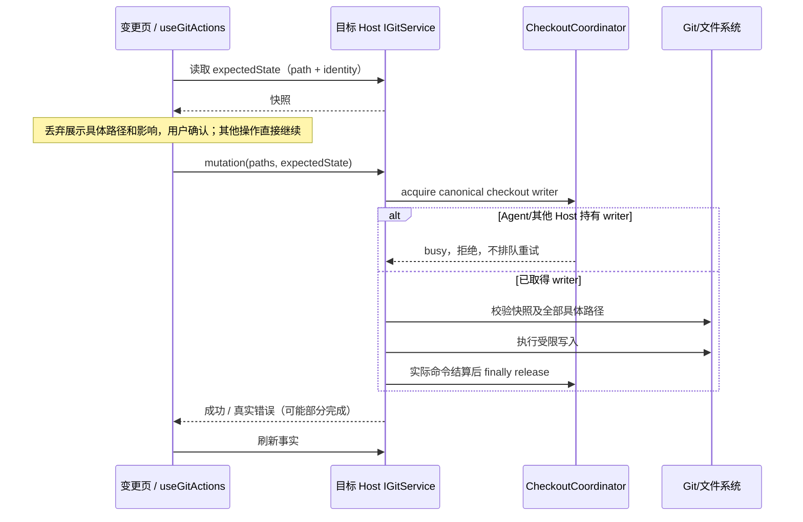

# B 阶段：Git 文件操作与统一写入边界

## 范围与 A 阶段收尾

2026-10-20：按用户最新要求，本轮先处理代码与自动化测试。安装包构建、Windows/macOS/Linux 原生客户端与手机真机验收由用户构建后继续，不能把浏览器模拟当成安装版验收。A 保留两入口统一右侧审核、原弹框移除及既有回归；本轮调查只读刷新 index 字节变化并增加确定性证据。

扩展回归发现本机 `git version 2.56.0.windows.2` 的原生 `update-ref` 会先通知 `preparing`；隔离探针在不经过 LCode 的情况下同样复现。Hook 测试兼容可选的这一次前置通知，仍严格要求随后 `prepared → committed`，不修改原生 Hook 执行或削弱拒绝测试。

双端同步回归确认同值默认范围初始化会制造 CAS 冲突：两端从字段版本 0 重复写入 true，第二端后续草稿被正确保留在本地但无法继续同步。同步屏障与命令日志稳定复现后，打开审核时跳过同值初始化补丁，保留真实编辑的 CAS；没有改变 Host owner 或冲突恢复规则。

B 在右侧 Git「变更」页提供单文件与当前来源全部文件的暂存、取消暂存、丢弃。审核页复选框仍是提交范围，不调用 Git 暂存。branch / last-turn、只读 dataset、加载失败和未连接远端不可写；冲突及子模块转后续专门流程，不在此隐式解决。

## 唯一所有者与接口

- Git 的 HEAD/index/工作树是服务端事实；现有刷新 hook 读取事实。UI hook 只保存进行中操作、错误和待确认的丢弃快照，不乐观移除文件。
- `IGitService.stagePaths / unstagePaths / discardPaths` 是唯一文件写入入口，严格运行时校验。路径是工作区相对或绝对的具体文件；拒绝空范围、目录、`.git`、仓库/工作区外路径、穿越符号链接目录和 Git pathspec 扩张。重命名处理原路径与新路径，跨工作区重命名拒绝。
- `expectedState` 复用现有 `GitPublishState`。暂存/取消暂存保留旧调用兼容的可选字段；新 UI 始终传递操作前快照。丢弃必须携带快照，用户确认后在 writer 内重新比较 HEAD、分支、index 和工作树；不匹配则拒绝并要求重新确认。
- 未暂存丢弃：已跟踪文件恢复到 index；未跟踪文件只 unlink 确认的具体文件/符号链接，绝不递归删除目录或删除 ignored 文件。已暂存丢弃：明确提示 index 和工作树都恢复到 HEAD；新暂存文件恢复为未跟踪，保留文件内容。unborn 分支可取消暂存，不能以不存在的 HEAD 丢弃 staged 内容。
- 所有路径先整批预检，Git 参数启用 literal pathspec，使用 `--`。不以 `git clean`、通配符或目录扩大范围。执行后即便失败也失效缓存并刷新事实；多命令可能部分成功，不伪称整体事务、不回滚新事实。
- 路径按已有 `batchGitPathspecs` 的字节预算分批读写，不用文件总数阈值代替 Windows argv 约束；全部路径预检后才执行首批，所有批次共用一次 writer。任何批次失败立即停止，按真实仓库事实刷新。
- `coordinateGitCheckoutWrites` 是唯一 checkout writer 申请与释放处；补齐 `deleteBranch` 和新的 `commitAndSwitchBranch`，底层只调 raw repo/service，不能嵌套申请。deleteBranch 保留现有 expected OID、当前分支/其他 worktree/未合并保护；共享 ref 依赖 Git 自身 ref lock，跨 worktree 的通用 common-dir 调度留待 C。
- 许可参数只从请求读取 workspacePath/workspaceIdentity；ownerId、exclusive mode、即时 busy 策略由 Host 生成，绝不展开 RPC 输入来接受外部 mode / waitMs / ownerId。
- 提交再切分支改为单个服务命令、一次 writer：精确 paths 提交（复用已有部分提交能力，保留无关暂存）→ 切分支。返回已成功 commit 的事实以及切换结果/警告，切换失败不重复提交。请求贯通 workspaceIdentity；UI 使用工作区服务选择，remoteSessionId 参与路由与本地异步隔离，不发送未知字段给严格服务 schema。

## 时序、身份与失败语义

scope key 使用 `workspaceIdentity?.trim() || workspacePath`，另含 remoteSessionId 与服务实例隔离。切工作区、切来源或断连后关闭旧确认；旧异步结果不能写新 scope 的 UI，也不能把旧快照提交到新服务。同步 ref 阻止同一视图快速双击重复发送；真正跨视图/Host 排他由 coordinator 负责。Desktop continuous 与 Web replayable 均走既有 RPC，未新增接受队列、重放记录或自动重试；丢失回复时先刷新，不能重放破坏性确认。

## 验收

1. 真实 Git：单项/批量、部分暂存、无关暂存保持；新增/删除/重命名、Unicode/空格/通配符字面文件名；unborn 取消暂存。
2. 丢弃：取消无写入；工作树恢复到 index；staged 明确双区域恢复；未跟踪精确删除、ignored/邻居保留；确认后内容、index、HEAD 改变拒绝；非法路径、目录、符号链接父目录整批拒绝且无前置写入。
3. writer：所有现有 mutation 都申请/释放；异常释放；busy 零副作用、读仍可用；两个 coordinator/Host 同 checkout 排他、独立 worktree 文件写入可并行。
4. 提交切分支：一次 permit、精确范围、无关 staged 保留、identity 贯通；提交成功切换失败仍保留 commitHash，禁止虚假整组失败。
5. 生产组件 E2E：暂存/取消/丢弃的行按钮及全部按钮；只读来源无动作；待确认路径/取消/双区域提示；忙碌、错误、双击、scope/来源切换、远端断连/迟到响应；390px 与中英文；手动/自动审核继续共用侧栏，确认弹框仅用于破坏性丢弃。
6. 执行受影响测试、现有审核全套、`pnpm typecheck`、`pnpm lint`、架构与格式检查。分开记录真实 Git、服务桩浏览器和待构建验收。

## 实施与验证记录（2026-10-20）

A 的代码与本机自动化收尾、B 的实现和相关测试已完成。安装包、原生窗口与手机真机按用户要求在后续构建后验收。本轮没有构建或覆盖已安装的客户端。

| 验证                                             | 实际结果 / 证据                                                                                                                                                                                                                                              |
| ------------------------------------------------ | ------------------------------------------------------------------------------------------------------------------------------------------------------------------------------------------------------------------------------------------------------------ |
| Node / 基线                                      | 使用 mise.toml 的 Node 24.21.0；开工前 freshness 通过                                                                                                                                                                                                        |
| `pnpm typecheck`                                 | 通过；[typecheck.txt](../artifacts/git-file-operations/typecheck.txt)                                                                                                                                                                                        |
| `pnpm lint`                                      | 通过；[lint.txt](../artifacts/git-file-operations/lint.txt)                                                                                                                                                                                                  |
| `pnpm architecture:check --changed`              | 通过，violations / baseline / new 均为 0；[architecture.txt](../artifacts/git-file-operations/architecture.txt)                                                                                                                                              |
| Git 全目录、shared 合同及 3 个 worktree 回归文件 | 193 项：192 通过、0 失败、1 平台跳过；[service-validation-final.tap](../artifacts/git-file-operations/service-validation-final.tap)                                                                                                                          |
| 最新 writer / 文件操作 / 只读刷新补充回归        | 21 / 21；包含许可字段注入、unborn 丢弃拒绝与 600 个长文件名；[git-focused-final.tap](../artifacts/git-file-operations/git-focused-final.tap)                                                                                                                 |
| UI / owner / drawer / 草稿投影 / 切分支预览单测  | 25 / 25；[ui-validation.txt](../artifacts/git-file-operations/ui-validation.txt)                                                                                                                                                                             |
| 完整浏览器审核与文件操作回归                     | 64 / 64，包含 63 个场景及根套件，约 238 秒；[browser-validation-final.tap](../artifacts/git-file-operations/browser-validation-final.tap)                                                                                                                    |
| 双端初始化竞争确定性回归                         | 修复前屏障稳定复现同值 includeUnstaged 的 accepted/conflict；修复后 2 / 2（场景及根套件）；[修复前](../artifacts/git-file-operations/shared-host-initialization-before.tap)、[修复后](../artifacts/git-file-operations/shared-host-initialization-after.tap) |
| 格式与补丁空白                                   | 变更文件 `oxfmt --check`、`git diff --check` 通过                                                                                                                                                                                                            |

唯一平台跳过项是 Git for Windows 不依赖 POSIX executable 位的 Hook 场景；不是以跳过规避失败。真实 Git 均在测试临时仓库运行，没有对用户工作区执行暂存、丢弃、提交或切分支。浏览器运行生产共享组件与服务桩；双端场景运行实际 GitReviewWorkspaceState 持久 owner 和测试 HTTP/SSE 适配，不能等同于已验证真实手机或 SSH 链路。

Git 全目录命令为 `node --import tsx --test --test-concurrency=3 --test-reporter=tap` 加 `packages/services/src/git/` 下实际的 20 个 `*.test.ts`、`packages/shared/src/gitPublish.test.ts`、`packages/services/src/worktree/worktreeSafety.integration.test.ts`、`worktreeCoordinator.process.test.ts`、`worktreeReview.integration.test.ts`。补充 21 项的文件是 `gitCheckoutCoordination.test.ts`、`gitFileOperations.integration.test.ts`、`gitRefresh.integration.test.ts`。完整浏览器入口为 `node --test --test-reporter=tap packages/web/test/git-commit-dialog.test.mjs`。

早期扩大回归曾出现 Hook 通知断言失败和双端初始化冲突；本节记录的是定位与修复后的实际结果，不把之前失败算作通过。Windows 下格式化 CLI 曾发生文件写入故障；恢复本轮文件后，使用仓库已安装 oxfmt 的 API 格式化，随后 CLI `--check` 和类型/测试均通过。格式化临时备份目录的清理被自动审批以“blocked by policy”拦截；保留在 `artifacts/git-review-pane/format-backup/` 并加入 `.gitignore`，不纳入源码提交。

后续构建验收重点：Windows 安装版两入口直达侧栏与旧审核弹框移除、真实仓库文件操作及 Agent busy、工作树/远端身份切换、macOS/Linux 原生交互和手机软键盘/焦点恢复。C–F 功能未在本轮实施。
