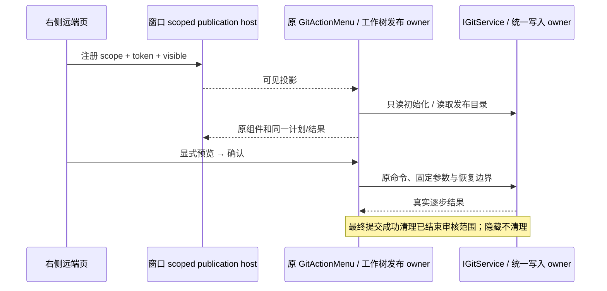
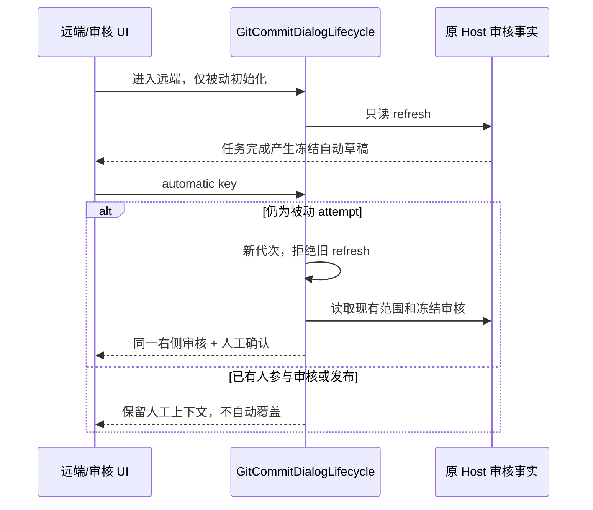
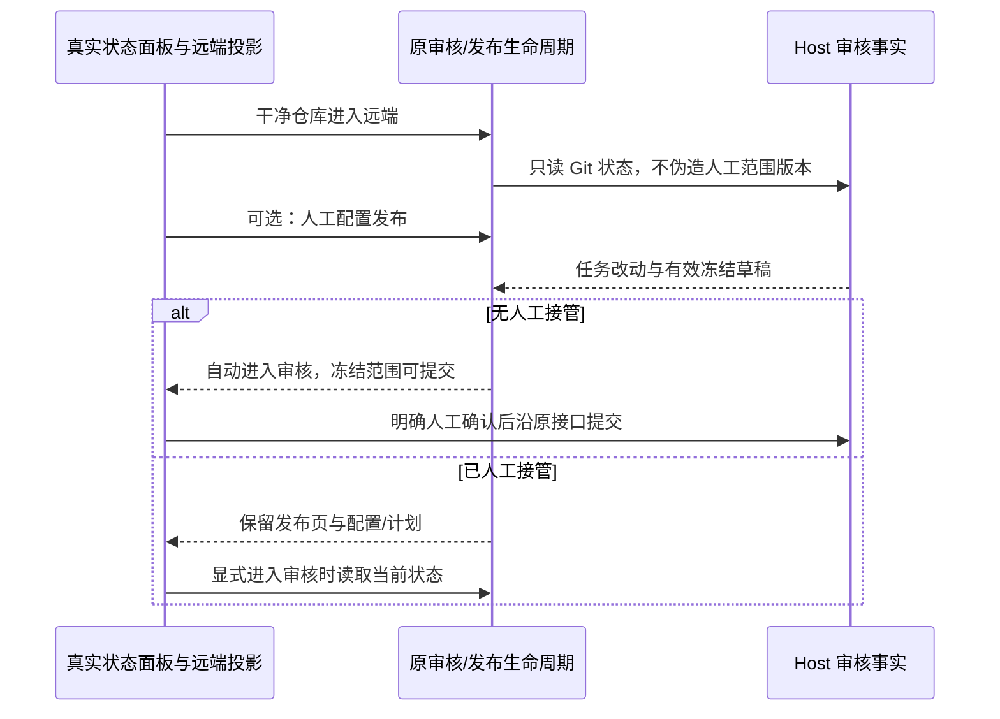

# 构建版 Git 验收与发布页归属（2026-10-21）

## 已验范围和集中问题

目标为 `D:\LCode\LCode.exe` 3.20.0，安装包与仓库构建产物 app.asar SHA256 一致。独立 applicationName、userData 和业务数据目录，操作仅使用隔离仓库与本地 bare remote。先收集后修改，报告与逐步截图在 `artifacts/git-build-acceptance/report.md`。

实际安装版已执行手动/自动侧边入口、冻结 Diff 与人工确认、批量 Cherry-pick、Revert、附注 Tag、Soft Reset 与原状态恢复、Fetch、窄宽布局、候选列表和键盘菜单。未将测试模型最初返回格式错误算作产品缺陷。录像工具编码失败，不声称存在有效实时录像。原生签名密钥、macOS/Linux 和手机真机未在此环境验收。

集中处理：

1. 提交审核中的“远端与 Tag 发布”移到右侧“远端”；发布选项、预览、逐项结果及失败重试一起迁移，提交审核只保留本地审核/提交和集成审核。
2. 自动审核最终提交后，重新手动打开时不再使用已完成审核的 selectedPaths、排除列表或旧自动草稿路径。新的未暂存/已暂存文件可见，已完成冻结审核不能再次预填或确认。

## 所有者与接口

- GitActionMenu 仍是当前 scope 的来源审核与发布唯一控制器。GitCommitReviewPane 负责审核展示；发布组件通过 scoped portal 投影到 GitNetworkPane 内，不复制控制器、服务实例、计划或执行结果。
- 工作树目标发布继续由既有 WorktreePublication/useWorktreePublication 持有，来源和目标标题、精确分支/目录保持明确。此控制器嵌入提交审核时，发布内容同样投影到远端；独立工作树管理入口沿用其原布局。
- commitReviewNavigationStore 只增加 publication host 的 DOM 注册/可见状态，key 仍为 identity fallback path + session，token 防止旧 cleanup 释放新 host；无 Git 事实、网络队列或持久化审批。
- 进入远端页只初始化现有控制器并读取本地状态。不得自动打开审核、生成模型草稿、建 Tag、提交或推送；公开的发布预览/确认仍调用原 IGitService 与统一写入协调器、journal 和恢复边界。
- 发布页切换或收起不销毁在途发布 owner；返回保留选项、冻结计划和逐项结果，重试不重复成功步骤。快捷键 Ctrl/Cmd+Enter 只执行当前可执行本地提交，不升级为发布。
- 需要本地提交但尚未审核文件/消息时，远端页提供返回“提交审核”的明确入口；工作树目标发布的返回提交/合并按钮也激活审核页，不停留在来源发布表单。
- 最后一个审核组提交成功时，由同一 Host review workspace admission 清理旧范围、sourceReview 和 browsePosition，重置下一次审核默认包含未暂存文件。普通隐藏或关闭不清理未提交草稿。读取旧自动审核时用 Host getCommitReview 的完成位置判定已完成，不以 UI 可见/隐藏代替提交事实；旧响应仍受 attempt/revision/scope 门禁。
- 提交返回 warning 时保留原范围与审核关联，并维持 requiresRegeneration 门禁；不能按无警告最终成功清理，也不能在随后读取已提交游标时自动清理该恢复上下文。

Desktop continuous 和手机 replayable 仍消费同一 Host 事实；切页、重连、恢复均不重放 Git 写入。

## 验收场景与执行计划

1. 先添加失败 E2E：自动冻结审核确认提交后，保留旧自动草稿并加入新文件，重开手动审核可选择新文件；不能复用旧 review id，未完成审核关闭重开仍保留编辑与排除。
2. 先添加失败 E2E：手动/自动审核内没有发布选项；点远端可看到原发布区，首次直接进入远端也可预览；不自动生成/写入，切审核/图谱再返回保留计划与结果。
3. 将既有发布、预设、部分失败重试、工作树目标发布和手机布局测试改为远端入口；保持已有门禁断言，不能删除能力测试来迁移 UI。
4. 修复上述状态边界并迁移展示；测试真实 Git 安全/历史/协调器和 UI 交互，执行 typecheck、lint、架构、格式与 whitespace 检查。
5. 本轮修改后不重建安装包。当前安装版结果与修复后源码回归分开记录，待用户重新构建后再验收新安装版。

## 实施与验证结果

- 已落地 scoped publication host/portal：GitActionMenu 仍持有来源计划与结果，WorktreePublication 仍持有目标发布；远端页只有 DOM 投影。来源/目标返回审核复用同一导航 admission，不生成第二个 owner。
- 最终无警告提交退出已结束范围；Host 完成游标阻止旧自动审核重新套用路径。warning 保留恢复范围和重新审核门禁，未完成草稿的隐藏/重开规则不变。
- 新增先失败再通过的 E2E 覆盖新文件漏出、发布归属和 warning 边界；首次直接进入远端、审核不可用后的人工提交、切页保留选项、跨会话迟到发布和本地快捷键均通过。
- 真实 Git/协调器/发布模型等 82 项通过；新增导航 host 单测套件 4 项通过（含前者已覆盖的 3 项）。浏览器侧栏 25、图谱 26、导航/主题 15、提交核心 27、发布 22、共享 Host 9、定向回归 5 均通过；这些计数含根测试且有重叠，不能相加为独立场景总数。
- `pnpm typecheck`、`pnpm lint`、架构 changed（baseline/new 均 0）、本轮文件格式和 whitespace 通过。特性图 112 节点、173 关系及 review 的 7 个源码 seed 已核对。
- Windows 安装版首轮证据、两个问题、修复前失败日志和修复后源码测试在 `artifacts/git-build-acceptance/report.md`。本轮未重建；修复后安装版、其它原生平台和手机真机仍待相应环境复验。

## 新安装版第二轮复验与被动初始化边界（2026-10-21）

已复验 app.asar `AFAC03729CEFBAABF13E5AD64CA99BA6DD0B1395D8A3B7DBEC8AEEF5E7287C8E`。连续人工/冻结提交后的新文件范围和远端发布迁移通过；Soft Reset 及恢复的 HEAD/index 已核对。报告为 `artifacts/git-build-reacceptance/report.md`。

确认新问题：停留远端后新建任务，完成态自动草稿已生成，仍停在远端；显式生成待完成后能进入右侧审核。原因是远端只读初始化创建了 lifecycle.current，自动入口把这个被动 attempt 当作已有人工作业并消费草稿 key。

规则及唯一所有者：

- GitCommitDialogLifecycle 继续持有窗口内 attempt、代次与自动草稿消费；为 attempt 区分被动只读初始化和已有人参与的操作。Host 仍是草稿/范围/冻结审核的唯一事实所有者，导航 store 只负责显示意图。
- 未被人工接管的 network attempt 不消费自动 draft key；可由后续 automatic attempt 升级，递增代次并读取现有 Host 后采用有效冻结草稿，直接导航到右侧审核。
- 远端只读初始化不预填自动消息或写入 sourceReview；在“仅生成草稿”模式下，后续手动点击审核也升级该被动 attempt，再采用有效冻结草稿，不复用空表单。
- 点击审核、编辑发布选项/预设、展开发布区或发起预览即接管 attempt。此后自动事件不得覆盖人工草稿、范围、发布配置、冻结计划或结果；重复/旧事件仍不重开用户关闭的审核。
- 接管只属于当前窗口的交互生命周期，不是新的 Git 写入事实，不增加协议、writer 或恢复路径。升级前旧只读响应受 attempt/revision/ticket 约束，不能覆盖新审核。
- Desktop continuous 与手机 replayable 均复用现有 Host 同步。scope/identity/attachment 不变；切会话和 epoch 后迟到结果仍失效。不以定时延迟修复竞态。

先补失败测试：远端初始化后自动草稿、初始化读取尚未结束时升级/旧响应、远端显式生成，以及已人工接管的草稿/发布选项/计划保持。再修复并执行入口、发布、布局、历史和共享 Host 回归；修复源码不替换当前安装包，等待用户重建后再验收。

第二轮实施完成：被动 attempt 升级与发布投影的人工接管已落地；远端不预填自动消息/审核引用，自动及手动入口采用有效冻结草稿。Host 事实和原 Git 写入/恢复接口保持原有所有者。

本轮定向 10、真实 Git 与单测 65、侧栏 31、图谱 26、核心 27、发布 22、共享 Host 9、导航/主题 15 均通过（计数含根测试且场景重叠，不相加）。typecheck、lint、架构 changed 和本轮格式检查通过。当前安装包 hash 未改变，新修复的安装版验收等待用户再次构建。

## 第三轮：干净仓库与真实状态面板的验收边界（2026-10-21）

安装版 SHA256 `F1BA56C65645373B598CA9429ABF076C7F72C8F3497F1644F3D6450D11674330`。远端起点的自动导航已恢复；实测收集到两个 Medium 问题，证据在 `artifacts/git-build-acceptance-pass3/report.md`：干净仓库经远端初始化后，任务自动审核显示 0/1 且人工确认仍不能提交；任务期间人工配置的发布选项在完成后被自动审核重置。手动新文件范围、连续提交及 Remote 内提交/分支/Tag 发布通过。

本轮产品规则：

- 远端初始化只读 Git，不根据当时是否干净写入共享审核范围的默认选项或人工字段版本。后续新任务产出未暂存改动，自动审核采用有效冻结范围，人工确认后可实际提交；不能只断言面板出现。
- Host 继续拥有草稿、范围、字段修订和冻结审核；初始化不能伪造人工编辑。已明确人工修改的范围不能被自动回填覆盖，提交 warning 的恢复上下文仍保留。
- GitActionMenu 继续拥有当前 scope 的窗口内发布配置/计划及生命周期；真实 ConversationStatusPanel 的隐藏、任务阶段切换、自动草稿到达和发布 DOM 投影不能丢失人工接管。原因以新增真实状态面板测试与运行日志收敛，不用延迟或第二 owner 掩盖。
- 来源及工作树目标的鼠标、键盘和辅助激活均应接管发布；已接管后不自动切页、不重置选项/计划/结果；稍后显式进入审核仍可读取新状态。
- 继续沿用 workspace identity fallback、session/epoch、attempt/revision/ticket 及统一 writer/journal/恢复接口；不增加后端 Git 写入路径。Desktop continuous 与手机 replayable 仍消费同一 Host 事实。

先添加干净→未暂存→自动确认提交的失败 E2E，并覆盖真实状态面板下人工发布配置与自动草稿。确认原因后集中修复，再回归新文件、手动/自动入口、发布、共享 Host、类型、Lint 和架构。安装包由用户后续构建，本轮不替换安装文件。

第三轮原因与实现约束补充：远端 openCommitDialog 当前总是 resetInclude，干净状态将 includeUnstaged=false 写入 Host 并增加字段修订；后续自动审核依照人工版本保护而不能改回。修复为 network 初始化不初始化共享范围。真实状态面板的摘要可用性条件会卸载 GitActionMenu；新增摘要缺席屏障已复现丢失配置，修复为 onRefreshGit 能力存在时保持同一 owner，摘要缺席只隐藏入口/禁用写入，不缓存摘要或构造成功事实。GitActionMenu 的 UI 输入明确接受缺席摘要，既有请求继续受原 attempt/scope 约束。

既有持久草稿若已含 false 范围，不猜测其是否由人工选择，不批量重写或清空恢复上下文；沿用“调整范围/重新生成”恢复。新增场景验证真正人工取消未暂存范围仍被保留。Git 分支控件仅在存在摘要时渲染，审核/发布 owner 在同 scope 下稳定；真正 workspace、session、epoch 变更仍使旧 owner 失效。

保留人工发布配置后，手动进入审核必须重新读取范围，不能复用任务运行前的干净快照。新增组合用例先失败；实现只在 network attempt 且没有冻结发布计划/执行结果或在途写入时，沿原 loadCommitDialogState 读取并按既有门禁采用草稿，保留发布配置/目录。已有计划/结果继续展示原冻结上下文，不被导航重新规划。

第三轮实施与源码回归完成：入口专项 13/13、真实 Git 与单测 65/65、侧栏 34/34、核心 27/27、发布 22/22、共享 Host 9/9、导航/主题 15/15 均通过（含根测试且场景重叠，不相加）。pnpm typecheck、pnpm lint、架构 changed（violations/baseline/new 均为 0）、本轮文件格式与 whitespace 检查通过。两个安装版问题的失败用例及修复后通过证据保留在第三轮报告；安装包开始/结束 hash 一致，源码修复仍等待用户重建后进行原生复验。

## 第四轮：两项修复的安装版复验（2026-10-21）

安装版 SHA256 `80C58221FFE1FE956B400E2F00D1C04A91B51BC72659CFFCE408E0DE5BEA98DA`，Windows `D:\LCode\LCode.exe`。第三轮两项问题已在本版本完成原生复验：远端起点的任务完成自动审核范围为 1/1，确认后实际提交成功；任务期间人工设置的分支推送、远端、Tag 模式与名称在完成后保留，不被自动切页覆盖。之后手动审核读取新范围、返回远端仍保留配置。提交后新增文件、手动消息/Diff/关闭重开、普通及冻结审核的提交/分支推送/创建 Tag/推送 Tag 均实测通过，最终工作区干净，Git 引用一致。

本轮未确认新增产品缺陷，不修改行为或放宽写入/恢复边界。首次发布在额外 Git 核对并行时保护停止，已成功提交/推送保留；去除干预后普通和冻结路径各完整通过，原因未确认，记录在 `artifacts/git-build-acceptance-pass4/report.md`。不把中间态或未确认假设记作新问题，也不将现有成功结果重放。安装包未被本轮替换，本轮仅补充验收记录。

第四轮自动化回归：入口专项 13/13、侧栏 34/34、发布 22/22、共享 Host 9/9 全部通过（含根测试且场景重叠，不相加）；pnpm typecheck、pnpm lint、架构 changed 均 exit 0，本轮文档格式与 whitespace 检查通过。前轮两项安装版修复已完成本次 Windows 复验；没有新代码修复等待重建。外部远端鉴权、其他桌面平台及手机真机不计入本轮通过范围。

后续专项调查已稳定复现第四轮保护停止的同类误判：外部 status / update-index --refresh 仅刷新索引缓存，原 raw index 指纹即变化，HEAD、逻辑条目和内容不变。修复规则、唯一所有者、迁移与验证范围见 [Git 发布语义状态](git-publication-semantic-state.md)；历史安装版记录保留，该修复的重建安装版复验见下节。

## 2026-10-21 第五轮复验

普通/冻结审核在并行 Git status 下完成分支及 Tag 发布；真实内容变化与持久 index 标志变化保持阻断，旧审批刷新后必须重新确认。手动审核进入右侧审核页，远端与 Tag 发布保留在「远端」页。收据、hash、截图、安装文件一致性与清理记录见 `artifacts/git-build-acceptance-pass5/report.md`。

用户追加的发布停止自动刷新、独立 Git 仓库向导及 Git 管理/认证为本轮后续源码变更，与已安装版本验收区分；本轮不构建或替换安装包。
