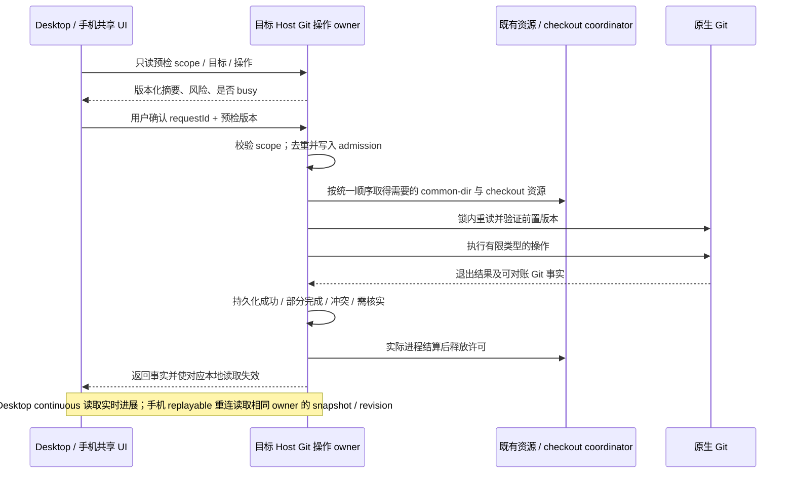

# Git 能力增强：系统调研与分阶段方案

图谱布局补充（2026-10-21）：[窄侧栏图谱与可调整分区](git-history-layout.md) 已完成代码和本机验证；所有宽度复用同一图谱，历史填满可用高度，筛选默认紧凑，详情与文件 Diff 可调整。构建版验收仍按用户安排后续执行。

状态：A/B 代码改造、C 远端同步、D 导入/Stash、E1 人工冲突解决和 E2 通用整合已经完成。2026-10-21 F 高级历史已完成历史筛选与 parent Diff、Cherry-pick/Revert 生命周期、附注/签名 Tag，以及本机专项和扩大回归。当前规则及证据见 [C](git-network-operations.md)、[D](git-import-and-stash.md)、[E1](git-manual-conflict-resolution.md)、[E2](git-integration-operations.md)、[F spec](git-advanced-history.md)。构建版原生/手机验收按用户安排后续执行。以下第 2 节保留调研时基线，不代表实现后的能力现状。

优先级更新（2026-10-20）：用户已要求先重构现有右侧面板，并将手动“提交审核”及“生成并打开审核”的自动入口直接迁入右侧，移除原审核弹框。先执行 [右侧面板重构与提交审核侧边化](right-side-workbench-and-git-review.md)，本文件的通用 Git 能力分期随后推进。

参考项目补充（2026-10-20）：已按本地 vs-idea-gittool `540de74` 完成 [系统源码调研](vs-idea-gittool-system-research.md)。用户选定第 2 版布局；[整体与详细实施计划](right-side-git-review-implementation-plan.md) 统一了导航、文件/Diff/消息/动作、状态隔离、R0–R5 和后续 Git 能力路线，并记录 A/B/C 实施进展。

## 1. 目标与证据边界

本方案承接 codeg 与 zcode-full 的 Git 能力对比，目标是补齐日常 Git 工作流，同时保留现有会话审核、工作树隔离、验证与跨端恢复边界。它不是重新实现 Git，也不表示引入完整 Git 二进制已经获得确认。

- 基线：`L-GO` / `e96dd63f`；开始时工作区干净。freshness 检查通过，与 `code/L-GO` 同步，相对 `origin/main` ahead 143 / behind 3。
- 实际环境：Windows，Node 24.21.0，pnpm 10.34.6，Git 2.56.0.windows.2。
- 方法：当前接口与直接调用链检查、架构受控上下文、导出引用追踪、已有真实临时仓库回归、共享组件浏览器回归、隔离 Git 实验，以及 Git 官方文档核对。
- codeg 是交互及操作覆盖的参考。没有执行 codeg 的测试，也没有据此比较两者的性能、稳定性或安装版体验。
- 本文中的“未见入口”限于已检查的产品服务与 UI；终端、Agent shell 能执行某个命令，不等于产品具备该操作的结构化审核、恢复或界面。
- 本文提出的新接口、文件和状态均为设计建议，不作为当前已存在能力描述；实施前需补充对应功能 spec、合同及失败测试。

## 2. 当前能力与实际接通程度

| 能力                 | zcode-full 已确认现状                                                                 | codeg 对照                                  | 增强判断                                   |
| -------------------- | ------------------------------------------------------------------------------------- | ------------------------------------------- | ------------------------------------------ |
| Git 执行引擎         | GitEnvironmentProvider 发现外部 Git，GitCommandProvider 通过 argv 启动进程            | Rust 后端调用外部 Git                       | 继续复用当前引擎，优先补产品能力           |
| 状态、差异、本轮变更 | GitPane 展示 unstaged / staged / branch / last-turn，现有刷新及懒加载链路有效         | 变更与提交日志面板                          | 复用，不建立第二套状态缓存                 |
| 暂存、取消暂存、丢弃 | IGitService 已提供；分支切换辅助实际调用 stagePaths；GitPane 未接通独立的通用操作按钮 | 支持选文件提交与回滚                        | 不能将服务存在等同于常规面板已完整接通     |
| 提交与发布           | 当前会话范围、冻结审核、提交分组、多远端显式推送、Tag 发布及逐步结果                  | 提交、推送窗口，任务合并可由 Agent 生成纪要 | 保留现有单一审核控制器及精确发布事实       |
| 分支                 | 本地分支读取、创建/切换、安全删除；可显示其他 worktree 占用                           | 通用分支操作及远端分支管理                  | 补远端跟踪分支及显式创建 tracking 分支     |
| Fetch / Pull         | GitService 未提供专门接口；现有 refresh 是本地读取，不是网络 fetch                    | 独立 fetch/pull 入口                        | 优先补 fetch 和仅快进更新                  |
| Remote               | 可列出发布目标与有效 push URL；无新增/编辑/删除接口                                   | Remote 管理、凭据重试                       | 补结构化配置与旧确认失效规则               |
| Stash                | 未见专门服务和界面                                                                    | 保存、预览、恢复、删除                      | 需先明确仓库共享范围和冲突恢复             |
| 通用 merge / rebase  | 未见通用入口；已有 WorktreeService 候选集成流程                                       | 分支菜单支持 merge/rebase                   | 不把已有受控集成改为原目录直接合并         |
| 冲突                 | 工作树集成展示冲突、可转交 AI、继续验证与集成                                         | 三栏编辑器、continue/abort                  | 补统一冲突模型及人工解决界面               |
| 初始化、克隆         | 未见专门入口                                                                          | 有初始化与克隆界面                          | 需要进入项目前的 Host 路径与目标目录规则   |
| 历史                 | 提交图、分支比较；Tag 创建及推送                                                      | 日志、作者/分支筛选、reset                  | 筛选和提交详情可后续增强，历史重写单独评审 |
| 工作树与备份         | 执行绑定、准备、归档/恢复、候选审核/验证/发布；OSS/MinIO 定时加密备份                 | 任务工作树、两阶段合入与串行任务合并        | 当前能力继续保留，不纳入本次重写           |

## 3. 源码定位与受控边界

| 关系等级       | 当前文件 / 符号                                                                                               | 调研结论与实施用途                                                                                   |
| -------------- | ------------------------------------------------------------------------------------------------------------- | ---------------------------------------------------------------------------------------------------- |
| must-inspect   | `packages/services/src/git/git.ts` / IGitService                                                              | 现有 Git 公开合同；新增能力必须有类型和运行时 schema，不能开放任意 argv RPC                          |
| must-inspect   | `packages/services/src/git/gitService.ts` / createGitService                                                  | 组合状态读取、审核、提交与发布；避免把新增操作继续堆入现有大文件                                     |
| must-inspect   | `packages/services/src/git/providers/gitCommandProvider.ts` / createGitCommandProvider                        | 唯一复用的 Git 子进程入口；已有超时、输出限制、UTF-8 解码与错误事实                                  |
| must-inspect   | `packages/services/src/git/gitCheckoutCoordination.ts` / coordinateGitCheckoutWrites                          | 当前应用 Git 写入与 Agent checkout 许可的接入点                                                      |
| must-inspect   | `packages/services/src/worktree/adapters/coordinator.ts` / createCheckoutCoordinator                          | 跨 Host 进程文件锁，按 canonical checkout root 协调；shared 与 exclusive 边界必须保留                |
| must-inspect   | `packages/services/src/worktree/contract.ts`、`CONTRACT.md`                                                   | WorktreeService 独占 binding、归档、集成操作与删除日志的所有权                                       |
| must-inspect   | `packages/services/src/git/gitReviewWorkspaceState.ts` / GitReviewWorkspaceState                              | Host 持久化审核编辑状态，具有字段版本与 commandId 去重；它不是 Git 操作队列                          |
| must-inspect   | `packages/services/src/git/repo/gitPublishState.ts`、gitPublishRepo.ts                                        | 已有 HEAD/index/working tree 快照、目标与发布前后校验；远端配置变化必须使旧确认失效                  |
| must-inspect   | `packages/services/src/node.ts` / Git 与 worktree 组合根                                                      | 此处注入原始 Git 服务、checkout coordinator 和 WorktreeService 源提交端口；防止重复取锁              |
| must-inspect   | `packages/ui/src/GitActionMenu.tsx`、GitPane.tsx、hooks/useGitBranchSwitcher.ts                               | 提交审核、变更浏览、分支切换是不同用户入口，不能因共用组件而混用授权和状态                           |
| must-inspect   | `packages/client/src/remoteServiceAccess.ts`、`packages/desktop/src/host/remoteWorkspaceServiceCollection.ts` | 既有 Git Channel 代理与目标 Host 服务注入；新增操作继续复用该连接                                    |
| invariant-only | `apps/lcode-cli/packages/core/src/runtime/methods/checkout-execution-lease.ts`                                | Agent 轮次和后台写进程未结束前保留许可；UI busy 或经过一段时间不是释放证明                           |
| conditional    | `packages/shared/src/lcode-protocol/index.ts`                                                                 | 普通 Git Host RPC 扩展不必自动新增 Agent 协议命令；确需改变 runtime admission/fence 时才同步严格协议 |
| should-inspect | `packages/ui/src/hooks/useGitAutoRefresh.ts`、useGitRepository.ts                                             | 复用既有 watcher、刷新调度、scope 和 stale response 防护；watcher 不是操作成功收据                   |
| evidence-only  | codeg 的 folders.rs、branch-dropdown.tsx、use-git-quick-actions.tsx、three-pane-merge-editor.tsx              | 借鉴入口与操作覆盖，重新按本仓库合同实现；不移植其单文件后端或状态所有者                             |

架构检查通过，violations / baseline / new 均为 0。受控上下文确认：`worktree` 是 managed 模块，公共入口为 contract.ts / node.ts；`services` 与 `ui` 当前为 legacy、managed=false，不能声称它们已有独立 managed Git 合同。

导出引用追踪结果：useGitActions 没有静态调用，仅有两处 re-export；coordinateGitCheckoutWrites 的生产接入位于 node.ts；createGitService 的生产组合根同样位于 node.ts。动态调用不在 dep:refs 的证明范围内。

## 4. 已确认问题、实验与待验证风险

### 4.1 当前链路的三个接入差异

1. `useGitActions.ts` 仍是 placeholder 实现，但未找到静态调用。它不证明当前 GitPane 的按钮失效；它证明不能直接复用该导出作为已完成的 mutation hook。建议在接通真实 hook 时先处理其公开兼容性，不贸然删除。
2. `deleteBranch` 未列入 coordinateGitCheckoutWrites 的 mutation 集合。对实际包装器注入探针后，调用 deleteBranch 的 acquire 次数为 0。原生 Git 的占用及合并检查仍存在；本次没有复现数据丢失，应标记为“协调策略不一致”，先明确预期并补回归。
3. 分支切换辅助仍执行 `stagePaths → commit → switchBranch` 三次服务调用；这些调用的请求未全部携带该 hook 已接受的 workspaceIdentity。每一步独立申请/释放许可，存在步骤间状态变化及范围一致性风险。尚未证明跨 Host 串仓或错误提交；先用已有暂存无关文件、远端同路径和并发会话构造回归，再决定组合命令和旧行为兼容。

### 4.2 两个锁域必须区分

在系统临时目录创建普通仓库与 linked worktree，调用当前真实 createCheckoutCoordinator / createWorktreeGitPort 后观察到：

```json
{
  "commonDirectoryShared": true,
  "separateCheckoutPermitsCanCoexist": true,
  "stashRefShared": true,
  "deleteBranchWrapperAcquireCalls": 0,
  "productionRepositoryMutated": false
}
```

实验目录已在验证绝对路径与临时目录边界后清理。实验没有对两个共享 ref 写操作制造真实竞争，因此只能证明隔离边界，不能宣称已复现 ref 损坏。

- canonical checkout 许可隔离各自 index / working tree，允许不同任务工作树并发，这是现有正确行为。
- `refs/stash`、普通分支 refs、多数仓库配置属于 common Git directory。Fetch、Remote 配置和 Stash 不能仅按 workspace 身份或当前 checkout 路径推断互斥范围。
- identity 决定请求授权、数据隔离和响应归属；实际 canonical checkout / common directory 决定本机文件资源的协调键。两个不同 identity 指向同一物理仓库时，不能绕过文件安全锁，也不能因共用物理锁而互相读取业务记录。
- 应用内锁不覆盖用户外部 Git 进程，也不能自动覆盖 Agent shell 中所有 Git 用法。既有 runtime shared permit 不是仓库共享 refs 的完整写入证明。新增应用操作仍需 Git 原生锁、版本重验和不确定结果对账，不能承诺全局原子性。

### 4.3 官方语义对产品规则的约束

- Fetch 会写对象与 remote-tracking refs，并非只读刷新；`--atomic` 的原子边界是该次本地 refs 更新，不是多个远端的全有或全无事务。[git-fetch](https://git-scm.com/docs/git-fetch)
- `--ff-only` 拒绝分叉历史；建议产品显式选择策略，不依赖用户 Git 配置或不同版本的默认 pull 行为。[git-pull](https://git-scm.com/docs/git-pull)
- Stash apply 保留 stash，pop 冲突时也不会删除它；`--index` 的暂存恢复可能冲突。初版应先提供“应用并保留”，删除是另一个确认动作。[git-stash](https://git-scm.com/docs/git-stash)
- Git 支持已有 credential helpers 与 askpass。复用目标 Host 的认证环境，与建设产品账号中心是不同范围。[gitcredentials](https://git-scm.com/docs/gitcredentials)
- linked worktree 的 HEAD 与部分状态独立，多数 refs/config 共享；路径应通过 Git 解析，而非拼接 `.git`。[git-worktree](https://git-scm.com/docs/git-worktree)
- merge --abort 在存在先前未提交改动时不保证还原全部内容；不得将“中止”描述为万能撤销。[git-merge](https://git-scm.com/docs/git-merge)

## 5. 建议的产品规则（待对齐）

1. 保持系统 Git / LCODE_GIT_BINARY 的发现规则，补版本与能力诊断；本轮不引入第二种 Git 引擎，也不默认下载/自动安装 Git。
2. 保持“提交与合并审核”是现有会话提交/集成的唯一控制器；通用仓库操作放在 Git 面板工具栏及分支菜单，不能另建重复的会话提交弹窗。
3. “刷新”只刷新本地事实；“抓取”明确发生网络与 remote-tracking 更新；“更新当前分支”初版只做显式 fast-forward。分叉后展示 ahead/behind 与处理入口，不自动 merge/rebase/stash。
4. 任何会改变 working tree / index 的操作遇到活动 Agent writer 时，展示可识别的 busy 状态与当前可用操作；不杀 Agent、不按 UI 状态释放其 permit。
5. 初版 fetch 以选中 remote 和受限 remote-tracking refspec 执行，不隐式修改本地 heads、全量 prune 或 prune-tags。自定义 fetch refspec 的支持范围需明确，不把任意配置原样当作允许的写入范围。
6. Stash 默认保留忽略文件；是否包含未跟踪文件由用户明确选择。提供预览、保存、应用并保留、单项删除；初版不提供 clear 或隐式 pop。仓库级 stash 列表标明来自共享仓库，不承诺每个 worktree 独立。
7. 冲突先保存 Git 的真实 index stages、文件类型和操作来源。AI 修复使用既有诊断追加链路，由用户发送；人工保存以版本校验为前提。stash apply 没有可直接等同 merge/rebase 的 abort 命令。
8. 已有 WorktreeService 继续独占候选集成、验证和发布；通用 merge/rebase 是另一个明确操作域，不接管既有候选记录。受管任务分支的操作需先通过绑定及生命周期约束。
9. 初始化只操作明确选中的普通目录，嵌套仓库需单独提示。克隆只操作目标 Host 上获授权的路径，默认目标不存在；失败保留可定位结果，清理仅处理本操作确实拥有的临时目录。
10. 通用 reset、force push、rebase 已发布历史、cherry-pick、revert、submodule 管理、LFS 管理及 Git 托管平台账号中心分别评审，不在补齐基础 Git 时隐式加入。

## 6. 状态所有者、接口与执行顺序

### 6.1 唯一所有者

| 事实 / 状态                               | 所有者                                        | 其他层的边界                                                                                |
| ----------------------------------------- | --------------------------------------------- | ------------------------------------------------------------------------------------------- |
| refs、index、工作文件与原生冲突状态       | 目标 Host 文件系统上的 Git                    | UI 和 journal 不得覆盖与 Git 不一致的真实结果                                               |
| checkout 许可及新增仓库共享资源协调       | 现有 CheckoutCoordinator 的受控扩展           | 不另建 Renderer mutex、第二个接受队列或基于超时的租约                                       |
| 新增通用 Git 操作的 requestId、阶段与收据 | 目标 Host Git 操作 owner，放在现有 Git 领域内 | 不复用会话审核草稿作为执行 journal；不重复持久化工作树集成事实                              |
| 来源草稿、文件排除、审核浏览阶段          | 现有 GitReviewWorkspaceState                  | 继续按 identity + 会话/epoch 版本同步，不能授权写入                                         |
| 工作树 binding、候选、验证与目标集成      | 现有 WorktreeService                          | Git 操作调用公共端口，不跨域读取其私有 store                                                |
| 未提交的选项、确认勾选、打开哪个窗口      | 当前设备 UI                                   | 重连、其他端和页面挂载不得自动重放确认命令                                                  |
| Git 凭据与 SSH 可用性                     | 实际执行目标 Host 的既有 Git/helper/SSH 环境  | 手机浏览器不代替远端 Host 存储或验证凭据；通用 CredentialService 不自动等于 Git 认证 broker |

### 6.2 合同设计方向

保留现有 IGitService 门面与 Channel；新增实现按高内聚的 repository operations、remote、stash、conflict 分片组合，具体方法名在各阶段 spec 固化。建议合同族如下，均是拟新增能力：

- 能力与检查：GitRepositoryCapabilities、GitOperationPreview、GitOperationSnapshot。
- 有限写入命令：FetchRequest、FastForwardRequest、RemoteMutationRequest、StashSave/Apply/DropRequest、RepositoryInit/CloneRequest，后续 Merge/RebaseRequest。
- 查询与恢复：读取指定 operationId、按明确 requestId 查收据、订阅目标 scope 的 operation revision；不得对外暴露通用 runGit(args)。
- 统一结果：operationId、requestId、scope、revision、阶段、已发生副作用、warning、结构化 error code；敏感参数不进入返回与日志。
- 确认关联：expected HEAD/ref、index/working tree 版本、remote 配置摘要、stash OID/列表版本或冲突 stages 摘要，按操作捕获所需维度，不对所有操作强制全仓哈希。
- 旧 Host：仅明确的缺方法/能力版本结果可判定不支持，断线/权限错误不能伪装为缺能力；旧提交与发布入口继续可用。

新增私有 journal 只记录操作身份、最小前置版本、执行阶段与结果凭证，遵循现有原子私有文件和跨进程锁模式；不保存 token、凭据 URL、任意文件正文或第二份 Git 仓库事实。重复 requestId 携带不同参数必须拒绝。

### 6.3 锁顺序与恢复



- 在现有 coordinator 合同中规划公共仓库资源与 checkout 资源的有序申请，不旁路再造独立锁系统。建议顺序 common-directory 资源 → 排序后的 checkout 资源；任何现存“持有 checkout 再回调 Git”的路径必须一起审计，不能直接叠锁形成死锁。
- 并非每条 Git 命令都需要全仓串行。只读状态和 diff 保持可并行；对 app 管理的共享 refs/config 写入按资源分类；不同仓库互不阻塞，独立 worktree 的普通文件写入继续保持当前并发语义。
- 已持有 writer 的 WorktreeService 源提交复用既有注入端口，不再次向公开包装器申请同一许可。CLI CommandInbox 仍只拥有会话输入 admission。
- 跨端请求的 workspaceIdentity 与 remoteSessionId 沿已有连接贯穿；common-directory 的发现始终在目标 Host 上完成，不能使用 Renderer 本地路径判断远端锁域。
- 网络断开不代表命令取消，超时不代表没有副作用。重连先查原操作；成功收据先于 UI 刷新，不能因刷新失败重复执行。
- 对 fetch 的多远端结果、clone 的部分目录、stash 的已创建 OID、merge/rebase 的冲突分别设计可证明的对账；无法证明时返回 needs-reconciliation，禁止盲目重放。
- 后续长时冲突若需要暂停并允许跨重启修复，操作记录本身拥有持久 fence；不能只保留进程内文件锁。runtime admission 必须读取该 owner 的 fence，修复执行使用有界授权端口，不通过普通 Agent 写入绕过。此项必须在开放会留下冲突的操作前完成。

## 7. 用户入口矩阵

| 场景                 | 入口与显示                                                   | 接受命令的 owner                             | 差异与限制                                                          |
| -------------------- | ------------------------------------------------------------ | -------------------------------------------- | ------------------------------------------------------------------- |
| 日常文件管理         | GitPane 文件/批量操作；刷新、暂存、取消暂存、明确丢弃确认    | 原 GitService + writer wrapper               | staged/unstaged 可写；branch/last-turn 保持只读                     |
| 同步当前项目         | Git 工具栏显示抓取时间、远端、ahead/behind、抓取与仅快进更新 | 目标 Host Git operation owner                | refresh 不能暗中 fetch；分叉不自动转换策略                          |
| 分支与上游           | 复用 GitBranchSwitcher、分支列表及占用原因                   | 原分支接口与新增 tracking 操作               | 同路径不同 identity 隔离；选择基线不切换分支                        |
| Remote 配置          | Git 工具菜单的配置窗口                                       | Git remote 分片 + 仓库资源协调               | fetch URL 与 push URL 分开；编辑使旧发布确认失效                    |
| Stash                | 仓库级列表与预览；保存、应用、删除分开                       | Git stash 分片 + operation owner             | 不把 stash 当任务快照或归档备份                                     |
| 冲突                 | 操作详情中的文件列表；大屏三栏，手机分步查看/编辑            | 原操作 owner；人工保存/AI 入口只是意图       | 保存与标记解决分开；未知、二进制、删除/重命名冲突不能伪装成普通文本 |
| 新建/克隆项目        | 复用项目打开流程，新增初始化和克隆入口                       | 目标 Host 的受限 repository acquisition 命令 | 克隆前尚无 repoRoot，需独立的父目录与路径授权检查                   |
| 会话提交及工作树合入 | 继续复用 GitActionMenu / WorktreePublication                 | 原 Git 与 WorktreeService                    | 不另建提交控制器，不用通用 merge 接管候选验证                       |

组件经 `packages/ui/src/hooks/` 调用服务；平台选择目录/剪贴板/编辑器走 IPlatformService。遵循 DESIGN.md 的 text-ui-\*、现有主题、菜单与 DialogBody；桌面与手机语义一致，长中文路径、键盘导航和 390px 不能只靠横向滚动解决。

## 8. 分阶段实施与完成门槛

| 阶段                   | 可独立评审的交付                                                                                  | 依赖                           | 完成门槛                                                                                                             |
| ---------------------- | ------------------------------------------------------------------------------------------------- | ------------------------------ | -------------------------------------------------------------------------------------------------------------------- |
| P0：协调与合同         | 明确 mutation 分类、deleteBranch 协调策略、分支辅助的 identity/组合范围；补资源协调与操作结果合同 | 产品确认本文第 11 节           | 新增失败测试先证明接入问题；跨进程、linked worktree、真实 writer、重复请求和锁顺序均验证                             |
| P1a：面板基本操作      | 接通真实 stage / unstage / discard hook；保留已有审核提交入口                                     | P0                             | 单文件/批量、只读来源、stale 文件、运行中 writer、取消与失败保留内容，Desktop/390px E2E 通过                         |
| P1b：远端同步          | 能力诊断、远端查看/维护、受限 Fetch、tracking 分支、仅快进更新                                    | P0                             | 本地 bare remote 验证 fetch 与更新分开、分叉/脏目录/旧 ref 拒绝、认证失败与结果对账；旧 Host 不破坏原能力            |
| P2：仓库入口           | init / clone、目标 Host 目录选择、进度和失败目录恢复                                              | P0 与网络执行/凭据错误分类     | 本地路径与 bare remote 克隆、目标占用、取消/丢响应、重启恢复、远端路径隔离验证                                       |
| P3：Stash 与冲突基础   | 仓库级 stash 列表、保存/预览/应用并保留/单项删除；冲突 fence 与恢复入口                           | P0；必须先完成冲突 owner/fence | OID/列表变化、两个 worktree 同时操作、未跟踪与暂存保留、apply 冲突不丢 stash、重启不重复应用                         |
| P4：人工解决与高级整合 | 三栏文本解决器、保存版本校验；分阶段增加通用 merge、rebase、继续与中止                            | P3 与精确操作恢复合同          | stages/CAS、rename/delete/二进制分流、外部操作识别、冲突期间 admission、abort 非无损恢复说明及 worktree 生命周期回归 |
| P5：历史与扩展         | 历史筛选/详情、后续按需评审 revert/cherry-pick、annotated/签名 Tag                                | 基础链路稳定后单独 spec        | 每个历史修改操作独立范围、确认、恢复与验证，不捆绑发布                                                               |

通用 Git 能力阶段的推荐首批范围为 P0 + P1a + P1b，排在已确认的右侧面板与审核入口重构之后。P2 可按新用户导入需求独立交付；P3/P4 需要更多状态与恢复设计，不与首批捆成一个大变更。暂不承诺工期：当前缺少 Linux/macOS 安装版、真实 SSH/HTTPS 凭据环境和真实手机恢复证据。

建议实施切片：合同与回归 → coordinator 接入 → 面板基本操作 → Fetch/Remote → 仅快进更新。每片先更新对应 spec 和合同，再写失败测试、实现、验证；不在本规划文档中把建议接口视为已定型。

## 9. 代表性验收场景与裁剪

以下为计划场景，尚未为新增功能实现测试。“accepted”表示纳入本方案建议范围，不等于已通过验收。

| ID / 分类         | 前置与动作                                                | 必须断言                                                              | 所需证据                        |
| ----------------- | --------------------------------------------------------- | --------------------------------------------------------------------- | ------------------------------- |
| G01 accepted      | Git 缺失或版本不支持，打开 Git 工具                       | 依赖诊断明确；普通对话可用；不执行无效写入                            | provider + UI                   |
| G02 accepted      | Agent 持有共享 writer，用户执行文件或分支 mutation        | 不破坏当前进程；busy 原因可读；只读刷新可用                           | 真实 coordinator / 进程 + UI    |
| G03 accepted      | 两 Host、同一 canonical checkout 并发 mutation            | 单一有效写入；许可实际结算后释放                                      | 跨进程集成                      |
| G04 accepted      | linked worktree 并发 stash/config/ref 操作                | 共享资源按一致策略协调；独立文件工作继续可并发                        | 双 worktree 真实 Git            |
| G05 accepted      | 两远端 Host 的路径字符串相同，切换 identity 或断线重连    | 请求、操作快照、草稿与迟到响应不串 scope                              | client/Host + 浏览器            |
| G06 accepted      | staged/unstaged/branch/last-turn 各来源操作文件           | 只有允许来源可写；范围限定；失败不显示假成功                          | 服务 + 生产组件 E2E             |
| G07 accepted      | 存在无关已暂存文件，执行提交并切分支辅助                  | 最终范围符合明确选择；保留其他暂存事实；不因三步间并发误提交          | 真实 Git + 组合命令回归         |
| G08 accepted      | 普通 Fetch，当前目录有修改或 Agent 在其他 worktree 写文件 | 不改变本地 HEAD/index/working tree；只更新允许引用；不隐式 prune tags | bare remote + 哈希对比          |
| G09 accepted      | 多远端抓取一项成功一项失败                                | 分项事实保留；失败项重试不伪造整组原子事务                            | 网络 adapter + bare remotes     |
| G10 accepted      | 上游领先，预览后确认仅快进更新                            | 更新精确分支/OID；旧预览或脏目录按规则拒绝                            | 真实 Git + UI                   |
| G11 accepted      | 分支分叉、detached、无 upstream、正在 merge/rebase        | 返回各自结构化原因，不自动变更策略                                    | 服务矩阵                        |
| G12 accepted      | 预览后 URL/ref/HEAD/index 改变                            | 旧确认失效，无额外网络/文件副作用；已完成步骤不回滚为失败             | 故障注入 + Git                  |
| G13 accepted      | init 已有仓库/嵌套仓库；clone 已存在目录                  | 不覆盖，不继承错误仓库根；仅明确授权路径可写                          | 文件系统 + UI                   |
| G14 accepted      | clone 中取消、超时、进程或回复丢失                        | 区分请求取消与真实进程结算；仅清理 operation 拥有目录                 | 子进程 / 重启集成               |
| G15 accepted      | stash 保存含 staged、unstaged、untracked 与 ignored 内容  | 所选语义和文件字节一致；忽略文件默认不动                              | 真实 Git                        |
| G16 accepted      | 列表确认后另一个 worktree 增删 stash                      | OID/版本重验；不按旧 stash@{n} 操作另一项                             | 双 worktree 集成                |
| G17 accepted      | apply 成功/冲突，回复丢失后重连                           | 保留 stash；不重复应用；冲突状态真实；不能伪造 stash abort            | Git + journal/restart + UI      |
| G18 accepted      | stages 读取后文件或 index 被外部进程改写                  | 保存 CAS 失败并保留编辑草稿，不能覆盖新内容                           | 文件哈希 / index 集成           |
| G19 accepted      | rename/delete、二进制、符号链接、CRLF/Unicode 路径冲突    | 正确分类；不强行文本写回；平台语义可解释                              | Windows/Linux/macOS Git         |
| G20 accepted      | 用户继续或中止 merge/rebase，期间有外部操作               | 只作用于匹配操作；真实阶段重验；不能声称无损撤销                      | 真实 Git + 故障注入             |
| G21 accepted      | Desktop continuous 与 Web replayable 断线/切换会话        | 同 owner/revision 恢复；不重放确认；保留本端草稿和真实成功事实        | 双客户端 / 远控回归             |
| G22 accepted      | 390/1280px、中英文、所有当前主题、键盘操作                | 按钮不被遮挡，长路径不挤掉动作，确认焦点与返回草稿正确                | 浏览器 E2E + 截图               |
| G23 undefined     | 已有凭据环境不可用，是否开放内置 askpass/账号管理         | 需独立产品决策与目标 Host 秘密生命周期方案                            | 用户决定 + 认证专门调研         |
| G24 bug-candidate | deleteBranch 不申请当前 wrapper 的 writer                 | 明确它属于哪种资源写入；再验证保护策略，不能只补字符串白名单就结束    | 源码/探针已确认；竞争回归待实现 |

裁剪：不枚举所有 OS × 主题 × 远端 × 文件类型的全笛卡尔积。普通文案以共享组件代表场景验证；路径/文件类型放到真实 Git 平台矩阵；所有会变更身份、引用、许可、重放或恢复的组合保留。force push、clear stash、隐式 autostash、自动 merge/rebase 当前为 pruned，依据第 5 节的显式范围规则，不作为“暂时漏测”。

## 10. 本轮实际验证与证据缺口

| 验证                                                              | 本轮真实结果                                                                  |
| ----------------------------------------------------------------- | ----------------------------------------------------------------------------- |
| freshness                                                         | 通过，详见第 1 节                                                             |
| `pnpm architecture:check --changed`                               | 通过；violations 0 / baseline 0 / new 0                                       |
| `pnpm architecture:context services` / worktree / ui              | 完成；managed 与 legacy 状态见第 3 节                                         |
| `pnpm typecheck`                                                  | 通过                                                                          |
| `pnpm lint`                                                       | 通过                                                                          |
| 六个 services 定向文件，`node --import tsx --test ...`            | 40 项通过，0 失败，约 98 秒；命令见下文                                       |
| `node --test test/git-commit-dialog.test.mjs`，cwd=`packages/web` | 50 项通过，0 失败，约 196 秒；生产共享组件与 fixture/桩服务边界按各 case 定义 |
| 一次性隔离 Git 探针                                               | 通过，观察与限制见第 4.2 节                                                   |
| 新功能验收                                                        | 未实现，不能计为已覆盖                                                        |
| Linux/macOS、SSH/HTTPS 真凭据、真实手机、安装包                   | 本轮未执行                                                                    |

六个服务回归文件：

```text
packages/services/src/git/providers/gitCommandProvider.test.ts
packages/services/src/git/gitCheckoutCoordination.test.ts
packages/services/src/git/gitRefresh.integration.test.ts
packages/services/src/git/gitPublishState.integration.test.ts
packages/services/src/git/gitPublishSafety.integration.test.ts
packages/services/src/worktree/worktreeReview.integration.test.ts
```

执行：`node --import tsx --test` 后跟上述六个文件。已有测试证明当前基线的 UTF-8/依赖错误、写许可包装、只读刷新、冻结发布、成功事实恢复及候选验证；不证明拟新增 Fetch、Stash、Clone 或通用 Rebase 已可用。

graph-drift-candidate：当前种子图已覆盖 session-worktree、worktree owner、checkout writer、提交合并审核与 Git backup，缺少日常 Git repository operations / Remote / Stash 的完整种子。新增功能实现后再登记其真实入口与 owner，不预登记不存在的代码。技能引用的 `docs/skills/feature-boundary-graph.md` 在当前仓库不存在；没有恢复历史文件，也没有据缺失文档杜撰图规则。

## 11. 开始实现前需对齐的决策

| 决策                  | 本方案建议                                                                 | 影响                                                                        |
| --------------------- | -------------------------------------------------------------------------- | --------------------------------------------------------------------------- |
| 首批范围              | P0 + P1a + P1b                                                             | 先形成可验证的日常操作闭环，不一次引入所有长时冲突状态                      |
| 系统 Git 与内置发行版 | 保持系统 Git；能力诊断与安装指引先行                                       | 若要求开箱无 Git 可用，需另做分发、更新、helper 与多平台体积方案            |
| 更新分叉分支          | 初版拒绝并引导选择后续显式操作                                             | 不继承不透明的 pull.rebase / autostash 配置                                 |
| 凭据产品范围          | 首批使用目标 Host 已有 helper/SSH，提供可定位错误                          | 内置 token/askpass/托管平台账号中心作为独立增强，不能用通用凭据 KV 直接代替 |
| 既有辅助行为的差异    | 将 deleteBranch 协调、提交再切分支的范围及 identity 纳入 P0 设计与失败测试 | 先确定兼容语义，再实施；本轮没有用兜底分支更改现有行为                      |

调研与方案到此形成可评审交付。以上建议需要在实施前由产品意图确定；本文件不把未确认选择写成已生效规则。

## 12. 最新实施状态（2026-10-20）

第 1–11 节保留调研时点记录。用户随后已批准 A 右侧审核重构及 B 写入边界/基本文件操作；当前实现与验收以 [右侧面板实施记录](right-side-git-review-implementation-plan.md#13-a-代码收尾与-b-文件操作2026-10-20) 和 [B 阶段 spec](git-basic-file-operations.md) 为准。

A 的代码收尾包括确定性修复只读 Diff 的 index stat 回写，B 已接入真实暂存、取消暂存、精确丢弃与独占 writer，并把提交再切分支收敛到单条 Host 命令。C 已完成分支跟踪、远端、Fetch 与仅快进更新；D 已完成初始化/克隆、共享 Stash 与恢复；E1/E2 已完成三方人工解决与固定目标整合。F 已实施历史筛选/完整详情/parent 文件 Diff、普通提交的 Cherry-pick/Revert 发起/继续/中止，以及独立的附注/签名 Tag；实际回归及明确限制以 F spec 为准。安装包和真机按用户要求在后续构建后验收。
