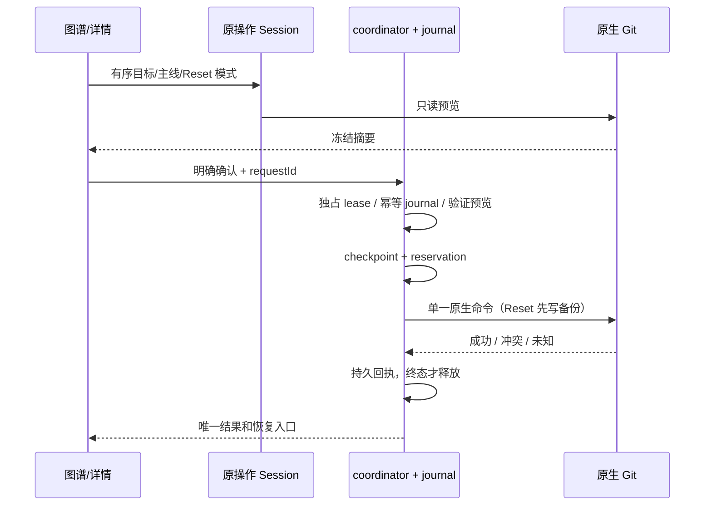

# G4 高级历史操作与恢复

状态：2026-10-21，G4 代码与本机回归完成，构建版与真机验收后置。此文扩展原 F 历史操作，不另建写入 owner。

## 多选与批量整合

- 图谱主选择仍为详情 OID；复选框维护当前页的操作集合（最多 32），随筛选/Host 变化清空。工具条显示数量、清空、批量 Cherry-pick/Revert。原生确认展示完整有序 OID；摘取按历史行逆序（旧到新），撤销按行顺序（新到旧）。不自动遍历未加载历史。
- 复用 `previewIntegration/startIntegration`，新增可选 `targets`（严格 OID，去重，最多 32，首项必须等于 targetRef）及 `mainline`（1–64）。普通批次禁止 merge；merge 单提交必须在详情中明确选主线，图中直接操作先查看详情，不隐式沿用 parent Diff 的主线。
- 预览冻结全部 OID、当前分支/HEAD、工作树、原生状态和主线。原生命令以一个 sequencer 执行全部目标，冲突后由原 owner 继续/中止；取消不写入，不用 UI 循环发多个命令。
- receipt.integration 保存 targets/mainline，恢复时校验 sequencer/head、todo 仅为原目标的有序后缀、当前原生目标、当前 HEAD 与已记录 after 一致。改写 todo/混入 exec、Host/identity 不匹配均不能继续。中止恢复原 HEAD；完成核验单亲提交链长度等于目标数。

## Reset

- 图谱菜单进入详情中的 Reset 表单，明确选择 soft/mixed/hard，无默认 hard；确认显示旧 HEAD、目标 OID、模式和范围。hard 必须额外勾选丢弃 tracked 改动；模式文案准确说明索引/工作树影响。
- 新增 `previewHistoryReset/resetHistory` 和 `previewHistoryResetRecovery`。预览严格只读，拒绝 busy、外部整合、detached/unborn、特殊 checkout、路径碰撞。使用统一 coordinator、journal、checkout reservation；不直接从 UI 执行 Git。
- 首次写入前冻结预览并保留 `refs/lcode/history-recovery/<operation-key>/head`；如有 tracked 改动，以 `stash create` 保存工作树与 index 到同前缀 `/stash`（不保存/删除 untracked/ignored）。checkpoint 记录旧 HEAD、备份 refs、目标、模式与原工作树/暂存语义指纹。备份不自动删除、不进入公开历史图。
- 成功后记录原生结果的状态摘要。恢复按钮重新预览；只有当前 HEAD/index/worktree/分支与成功结果一致时，才可回到旧 HEAD 并通过 `stash apply --index` 恢复原 tracked 内容和暂存范围。任何新改动、备份 ref 被改或原回执未知均拒绝自动恢复。
- mixed 导致原 index 中的文件成为 untracked 时，只允许原 index 树证明归属、且 Reset 后完整状态未变化的文件参与恢复；其他 untracked/ignored 碰撞继续拒绝。stash create 刷新 index stat cache 后，执行前复核 HEAD、工作树内容和暂存条目语义，不能把自身缓存更新误当成外部写入。
- 无论 Reset 或恢复，启动原生命令前 reservation 已落盘。异常/超时/孤儿进程保留 unknown 与写入边界；只查原 requestId，不自动重放。沿用原生停止确认与 completeGitOperation 释放边界；未知结果由用户核对备份 ref/native Git 后确认完成，不伪造自动回滚。

## 测试

原生临时仓库验证批次顺序/结果、第二提交冲突继续与中止、todo 篡改、merge 主线、预览 stale、三个 Reset 模式、tracked staged/unstaged 恢复、碰撞拒绝、重放幂等、未知/孤儿/失联保留 reservation。严格 schema 拒绝选项/超限/重复 targets。E2E 验证多选、批次摘要/取消、主线必选、Reset 模式/hard 勾选、恢复预览与远端 identity；完整 typecheck/lint/架构检查。构建版与真机后置。
