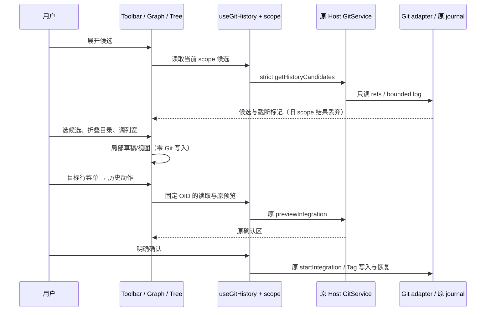

# Git 图谱候选、目录树与操作交互

状态：2026-10-21，G2 代码与本机回归完成。承接 F 与图谱布局改造；构建版验收等待用户构建。后续 G4 已追加复选批次与 Reset 菜单，Merge 操作仍需进入详情明确选择主线，见 `git-history-advanced-actions.md`。

## 产品规则

1. 高级筛选保留 Ref/OID 和作者自由输入，并增加可搜索的候选选择。候选通过原 Host 的 `getHistoryCandidates(scope)` 只读接口取得：HEAD、用户可见的本地/远端分支与 Tag（完整 Ref），以及最近可见历史的作者。界面选择只填入草稿，应用仍走原字面筛选，不 checkout、不 Fetch、不提交。
2. 候选读取不依赖已加载历史页。Ref 最多返回 500 个；作者从最近 2000 个可见提交读取、按 email（缺失时 name）去重，最多 200 个；报告截断/扫描上限，允许自由输入补足。内部 checkpoint refs 不参与。空仓库返回空候选。候选严格校验 scope 与返回结构；refs 变化拒绝混合结果。候选由 hook 持有当前 scope 投影，展开时按需读取，失败可明确重试；Host/attachment/identity 切换丢弃迟到结果，不影响原收据。
3. 历史文件区改为目录树，保留真实 path/status 和选中的真实 parent Diff。目录优先排序，默认展开，可折叠并显示后代文件数；同名的文件删除与目录新增可同时呈现。目录只切换 UI，不读文件、更不暂存/丢弃；只有叶文件选择触发原 getHistoryFile。截断提示和二进制等分类保持。
4. 宽栏日期、作者、Hash 列可拖动边界调整，也可聚焦边界后用左右键调整、Home/双击恢复该列默认值。日期/作者 64–300px、Hash 56–180px，描述列占剩余空间；窗口缩窄仅隐藏独立列，不清除当前挂载实例的宽度。不持久化、不广播列宽，复杂内容在内部滚动，不撑宽页面。
5. 提交表格采用单个 Tab 停靠点。上下/Home/End/PageUp/PageDown 在已加载行内移动并选择，沿用串行只读详情请求；pending 暂停后续选择并保持焦点，不用定时器合并请求。Enter/Space 查看当前提交；导航滚动将当前行带入可视区，表头固定；不会自动执行历史修改。目录树上下/Home/End 移动焦点，左右折叠/展开或移动到父/首子项，Enter/Space 选择文件或切换目录。
6. 行右键、Shift+F10/菜单键及手机行内更多入口提供相同菜单：查看提交、Cherry-pick、Revert、创建 Tag。打开/取消菜单零请求、零写入；动作固定到菜单所在提交，不能误用此前选中行。Merge commit 的摘取/撤销明确禁用（沿用未指定 mainline 边界）。预览期间锁定相关入口；真正写入只有原确认按钮。
7. 菜单摘取/撤销先读取目标不可变详情（需要时），再调用原 previewIntegration，最后显示原确认区；原 requestId、journal、coordinator、reservation 和未知结果恢复不变。菜单创建 Tag 进入目标提交的原表单，不自动预览或签名。切换提交/Host 清理不适用的菜单/目标 UI 请求；外部迟到读取仍由 scope 检查拒绝。
8. 中文/英文、主题、390px、短窗口与触控更多菜单均复用已有 Popover/Command、ContextMenu、DropdownMenu、Button 和主题 token。菜单/候选可键盘选择与 Escape 关闭，浮层不越出可用窗口；输入维持手机 16px 兼容 token。

## 唯一所有者与接口

- `useGitHistory` 通过现有 useGitOperationSession 解析 Host/attachment，拥有候选和读取结果；新增候选方法是 readonly，不进入写协调列表。`IGitService` 和 shared strict schema 同步扩展，原服务描述符自动沿用 Desktop/Web RPC，不增加 CLI stdio 命令。
- Toolbar 拥有筛选草稿；候选组件仅拥有浮层/本地搜索。Graph 组件拥有焦点行、列宽；菜单目标是该行的不可变 OID，Pane 只路由到 hook 或原 Tag 表单。目录树拥有折叠和焦点，传出的叶 path 由 hook 再交服务验证。
- 所有写入仍由原 Host journal 接受；UI 不增加 accepted queue，不直接访问 Repo。身份 key 保持 trimmed workspaceIdentity || workspacePath；路径仅用于操作。尺寸/折叠/焦点/菜单不广播，也不成为远端事实。
- Desktop continuous 与手机 replayable 使用各自既有链路；新增只读候选失败或断线不改变原 mutation 收据，不自动重放。

## 验收计划

- 原生候选：Unicode/重复作者、完整 Ref、内部 refs 排除、空仓库、截断边界、只读 HEAD/index/refs 不变、严格输入/输出拒绝未知字段。
- 候选选择/自由输入/搜索/重试、scope 切换丢迟到响应，候选与菜单打开零写入。
- 目录树真实路径与叶请求、折叠/键盘、同名文件与目录转换；选择文件继续显示真实 parent Diff。
- 宽列拖动/键盘/复位/界限/缩窄恢复；表格导航焦点、选择、滚动/固定表头，pending 不并发详情请求。
- 右键未选行、键盘菜单、手机更多入口、取消零写入、Merge 禁用、Tag 表单、预览后原确认及丢回执/Host 切换边界。
- 执行相关原生、strict 合同、纯树模型及浏览器回归，完成 typecheck、Lint、架构、格式和 diff 检查；记录实际结果。构建版与手机真机按用户安排后续验收。

不增加正则、多选/批量修改、Reset、交互变基、复制到剪贴板或新的写入入口。
