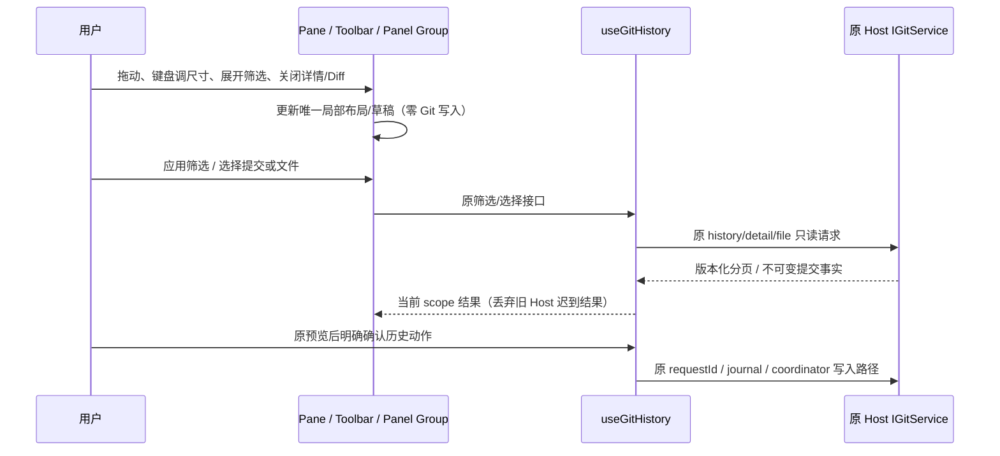

# Git 图谱工作区布局改造

状态：2026-10-21，代码与本机自动化验证完成。承接 F 高级历史，构建版验收等待用户构建。

## 产品规则

1. 右侧 Git 图谱在 390px 手机、约 512px 侧栏及宽面板始终保留同一份提交图形与提交行。窄宽只改变列与元数据排布，不切换成第二份纯文本列表。HEAD/分支/Tag 仍可识别，完整提交消息与被折叠 Ref 通过提示可读。复杂多泳道允许图谱区域内部横向滚动，不撑宽页面。
2. 历史区占满工具条以外的可用高度；没有详情时不预留空白区域。选中提交后为历史/详情显示上下分区，默认约 55/45，可拖拽或用键盘调整。切换提交保持该组尺寸，关闭详情回到完整历史区；重新打开使用默认比例。本轮不将分区比例持久化或广播。
3. 筛选默认是一行消息字面搜索、应用、展开高级筛选、刷新；完整 Ref/OID、作者和 UTC 日期放在高级区。收起不丢草稿，也不自动应用。提交按钮或 Enter 复用原只读筛选请求；刷新使用已应用条件。日期 min/max、严格 RPC 校验、refs revision 分页保持。重置显式清空草稿及已应用条件，不触发 checkout/Fetch。
4. 复用同一图谱列表，紧凑行、固定表头、弱化表格框线，颜色采用现有主题 token；同一行内 Ref 限量展示，溢出数量与完整提示保留。窄栏保留 hash、作者、时间的第二行；宽栏按空间显示日期、作者和 hash 列。选中/hover/键盘焦点可分辨。
5. 详情显示一次完整消息、作者/提交者、文件范围。文件/元数据与已选文件 Diff 再形成可调整的上下分区；没有文件 Diff 时占满详情区，关闭 Diff 恢复文件区。详情与 Diff 自身滚动，移除整个页面的长纵向堆叠。历史动作栏保持在详情底部可达。
6. Tag 表单由详情局部草稿所有者管理，展开时使用文件区域，关闭后恢复文件列表；预览仍固定目标，确认仍由原 Pane 展示。确认区限制最大占高并能滚动、获得焦点；进入整合仍走原导航，取消/关闭/拖动/筛选展开均零写入。读取或预览 pending 时暂停关闭详情/Diff；空闲时关闭详情取消未执行确认，避免预览迟到后在已关闭详情外重新出现，不重放操作。
7. 复用已有 `react-resizable-panels` 与共享 Separator。分隔条提供中文/英文名称、可见焦点、键盘调整和触控命中区。使用百分比最小尺寸适应短窗口；高级区/错误/确认自身有界滚动，不让历史、文件和动作越出父容器。手机编辑输入保留 16px 兼容 token，其余界面遵守 `text-ui-*`。

## 所有者与接口

- `GitHistoryPane` 组合布局，拥有详情显隐；Panel Group 是分区尺寸的唯一所有者。分区由当前挂载的界面拥有，不按 Git 事实持久化。
- `GitHistoryToolbar` 拥有未应用筛选草稿和高级区显隐。`useGitHistory` 仍拥有已应用筛选、读取结果、选择及未执行确认，增加的关闭文件接口仅清除 UI 投影。
- `GitHistoryDetail` 拥有 Tag 草稿，继续通过 hook 读取文件、准备操作。`GitGraphPane` 只渲染传入的提交与选择，不自行访问 Repo 或 Service。
- 原 IGitService、shared schema、journal、coordinator、reservation、Host/attachment 解析及恢复逻辑不变。无新 RPC、accepted queue、平台调用或写入入口。
- 上层 Pane 已按 workspacePath / workspaceIdentity / remoteSessionId 重建；身份切换清除旧局部草稿和确认，迟到结果仍由 hook 的 scope epoch 丢弃。Desktop continuous 与手机 replayable 仍使用各自既有链路。

## 验收场景

- 390px/512px/宽屏：始终只有一份提交列表和可见 SVG；窄栏不丢 HEAD/Ref，页面无横向溢出；图形节点与提交行对齐，滚动时表头固定。
- 高度变化：无详情时历史填满剩余高度；选择、关闭、重新打开详情按规则分配；拖动和上下键实际改变历史/详情及文件/Diff 比例，切换提交不重置历史分区。
- 紧凑筛选默认隐藏高级字段；展开/收起保留输入与焦点可达，字面参数和 UTC 日期仍走原请求。刷新、重置、分页失效与 Host 切换有实际断言。
- 文件 Diff 的真实 parent、Merge parent 选择、二进制分类、Tag 取消与丢回执查询、Cherry-pick/Revert 转整合、未知结果不重放保持回归。
- 中文/英文、Zai 亮/暗及其它主题，手机输入字体、分隔条触控/键盘、短窗口动作与确认可达；调整界面必须零 Git 写入。
- 实际执行目标浏览器场景、相关 UI/图布局与 Git 读取测试，以及 `pnpm typecheck`、`pnpm lint`、架构 changed、变更文件格式检查。最终记录实际结果，不把服务桩或浏览器验证当成构建版/手机真机验收。

该布局批次未加入候选 Ref 选择、右键菜单、目录树等交互；后续按 [图谱交互 spec](git-history-interactions.md) 补齐候选、目录树、列宽、键盘与菜单。正则、多选、Reset 和新的写入能力仍不在本批范围。

## 实施与实际验证

格式检查覆盖本轮 17 个受支持格式的文件，全部通过；`git diff --check` 退出 0，仅有既有 Windows LF/CRLF 转换提示。对应 `graph-layout-format-final.txt`、`graph-layout-diff-final.txt`。相对本轮开工源码清单，共改动 12 个源码/测试文件（其中新增 3 个），净增 392 行；已有 A–F 本地改动保留，统计不将其重复计入本轮。

`GitHistoryToolbar` 将筛选草稿留在当前挂载的 UI；高级区折叠不丢内容，重置同时依据草稿和已应用条件。`GitGraphPane` 紧凑模式始终渲染一份 SVG/行，窄栏使用第二行元数据，宽栏显示独立列；复用原布局算法，统一滚动区和 sticky 表头。尺寸使用现有 Panel Group 的局部状态，未增加 store、持久化、广播或 Git 服务。

`GitHistoryDetail` 使用固定动作栏，文件和 `GitHistoryDiff` 通过第二组 Panel 调整。关闭文件只清 hook 投影；关闭详情清未执行确认。预览 pending 时关闭按钮禁用，测试通过显式 hold/release 屏障验证迟到确认不会越过关闭边界。图谱、确认和服务 scope 的唯一所有者均沿用上述接口。

| 实际执行                                                             | 结果                                        | 证据（`artifacts/git-review-pane/`）                              |
| -------------------------------------------------------------------- | ------------------------------------------- | ----------------------------------------------------------------- |
| `LCODE_GIT_REVIEW_TEST_CASES=history` 浏览器专项                     | 15 通过，0 失败                             | `graph-layout-history-final.tap`                                  |
| `LCODE_GIT_REVIEW_TEST_CASES=pane` 手动/自动审核入口、范围与布局回归 | 22 通过，0 失败                             | `graph-layout-pane-final.tap`                                     |
| `LCODE_GIT_REVIEW_TEST_CASES=integration` 整合生命周期回归           | 8 通过，0 失败                              | `graph-layout-integration-final.tap`                              |
| 原生历史读取、parent Diff 与 shared strict 合同                      | 3 通过，0 失败                              | `graph-layout-native.tap`                                         |
| `pnpm typecheck`、`pnpm lint`                                        | 均退出 0                                    | `graph-layout-typecheck-final.txt`、`graph-layout-lint-final.txt` |
| `pnpm architecture:check --changed`                                  | 退出 0；violations/baseline/new 均 0        | `graph-layout-architecture-final.txt`                             |
| feature graph YAML、唯一 ID、关系端点/rank 与本批 seeds              | 112 节点、173 关系、9 个历史 seeds 验证通过 | `graph-layout-graph-validation.json`                              |

浏览器入口从 `packages/web` 执行 `node --import tsx --test test/git-commit-dialog.test.mjs`。布局场景拆入 `git-history-layout-cases.mjs`，共用原 F fixture 与屏障，不重复创建服务。测试数字包含父场景，不视为去重后的产品能力数量。原生入口为根目录 `node --import tsx --test packages/services/src/git/gitHistory.integration.test.ts packages/shared/src/gitHistory.test.ts`。

专项实际覆盖 390/512/1280px、短窗口、七种主题及显式主题与 OS 基色相反的情况；断言一份图谱、节点/行对齐、表头固定、尺寸随窗口改变、两组拖动/键盘调整、切提交保留比例、关闭回收空间、筛选折叠/重置、预览关闭时序以及布局交互零写入。保留 parent/二进制、Host 切换、Tag 丢回执和 Cherry-pick/Revert 等原流程断言。

首轮发现 Panel 会按 id 自动添加 testid，导致与内部测量容器重复；已分离这两个名称，没有用宽松选择器隐藏问题。Lint 曾因单个测试文件超过 400 行失败，已按职责拆文件并重跑。失败证据分别保存在 `graph-layout-browser-first.tap` 和 `graph-layout-lint.txt`，最终通过记录单独保存。

已在侧边浏览器检查生产组件加载真实仓库只读快照的界面，并实际用键盘调整两处分隔条。实拍保存为 `artifacts/git-history-layout/real-repository-sidebar.png`；fixture 的宽窄屏和短窗口截图位于 `artifacts/git-history/layout-*.png`。这些是源码组件与浏览器验证，不代替打包 Electron、macOS/Linux 客户端、手机真机触控/软键盘和既有远程恢复链路的构建版验收。
