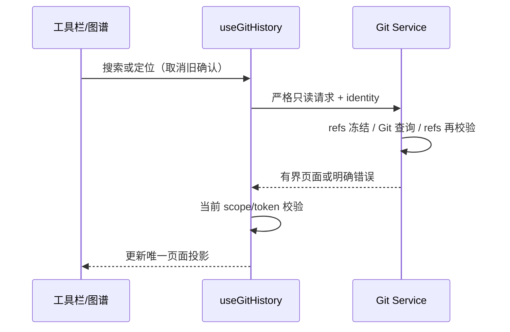

# 图谱搜索、提交定位与长历史

状态：2026-10-21，G3 代码与本机回归完成；延续 G2 的唯一状态所有者与 Host/identity 失效规则。构建版与真机验收后置。

## 产品规则与接口

- `getHistory` 新增 `searchMode=literal|regex`、`caseSensitive`。默认仍是不区分大小写的字面消息搜索；输入 4–64 位十六进制时自动按 Hash 前缀筛选，结果仍受分支、作者、日期约束。正则模式使用 Git 扩展正则，作者始终为字面条件；无效正则明确报错，不回退为全量。
- Hash 前缀由只读 `rev-parse --disambiguate` 获取，再与当前可达历史取交集；内部 checkpoint 不因搜索泄漏。消息搜索包含正文。
- `locateHistoryCommit(scope,target)` 接受 HEAD、完整 Ref、4–64 位 Hash，拒绝表达式和选项；短 Hash 歧义拒绝。只有当前 HEAD/公开分支/远端/标签可达的提交可定位。
- 定位显式清除筛选，以目标 OID 为历史起点，展示目标与祖先并打开目标详情。工具栏同步草稿，清楚显示定位后的 Ref；失败保留当前页面。响应在同一次 session read 内获取，旧 Host 结果不生效。
- 搜索按钮、Enter、大小写/正则切换和定位入口均只读；筛选变化废弃旧确认。

## 视区渲染

- 布局算法继续针对全部已加载提交计算，行和 SVG 节点只渲染可视区及两侧各 12 行；边以裁剪 SVG 显示跨屏连接，保持连续车道。
- 行高由界面字号推导，图形中心同步更新；支持仓库已有 12–20px 字号范围，避免固定行高裁剪双行窄栏信息。
- 使用唯一滚动容器、ResizeObserver 与固定行高计算窗口，不新增服务端事实缓存。滚动位置只属于组件；数据替换回顶部，分页追加保留位置。键盘跨窗口先滚动再聚焦，不能丢选中目标。
- 加载上限沿用原分页合同 10,000 skip，超出时明确停止加载；不无界请求。
- 历史 Diff 的未改动行数与展开按钮使用当前语言。通过已有 Diff 库公开的 onPostRender/expandHunk 接口适配标签与键盘，保留真实上下文展开，不通过隐藏英文提示砍掉能力；不修改代码内容或其它 Diff 场景。

## 验收

隔离原生仓库验证字面/正则/大小写、正文、Hash、作者字面、无效正则、歧义/隐藏对象拒绝、定位零写入及分页版本；浏览器验证开关、定位、滚动后端点、键盘 End、视区 DOM 有界、筛选重置、窄屏与主题。安装包/真机验收后置。
