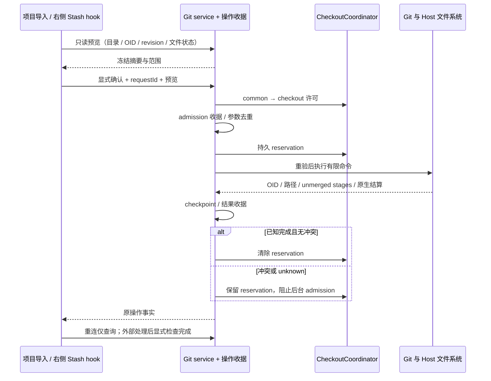

# D 阶段：仓库导入与 Stash

## 范围与产品规则

承接已实施 A/B/C，本阶段补齐 init/clone 与 Stash 保存、列表、预览、应用并保留、单项删除。右侧 Git 工作台增加「Stash」页；新建/编辑项目的源文件夹区域提供分步 Git 仓库引导，完成后追加真实目录到原项目草稿，可与其他仓库和普通目录共同管理，详见 [项目内 Git 仓库引导](git-repository-entry-wizard.md)。未初始化工作区的远端页也可初始化当前目录/克隆子目录。沿用 DESIGN.md 紧凑行、主题 token、字号、键盘、390px 与中英文。

### 导入

- 在目标 Host 校验并解析用户选择的实际目录。init 仅操作明确选中的现有普通目录，不覆盖现有 `.git`；祖先已有仓库时展示其路径，必须额外勾选允许嵌套。普通目录原有文件保留，默认初始分支 main。
- clone 仅在所选现有父目录中创建一个合法单段目录名，目标必须不存在。原子 mkdir 确认目录归属后再执行 Git，不接受既有空目录、符号链接目标、路径穿越、任意 Git 参数或隐式递归子模块。URL 只作为独立参数，复用目标 Host Git/helper/SSH。
- 预览冻结目录身份、目录条目摘要、目标是否存在、init/clone 参数及祖先仓库；确认后持许可重验。路径或选项改变使预览失效。完成结果包含实际目录路径及 HEAD；失败保留已经创建的目录，不自动重试、删除或覆盖。

### Stash

- `refs/stash` 与 reflog 属于同仓库所有 linked worktree 共享的 Git 事实。列表标明共享范围，展示 OID、时间、说明；操作绑定精确 OID 与 reflog 列表 revision，不能把旧 `stash@{n}` 当身份。
- 保存仅限当前 checkout 的全仓库改动，明确显示范围；可选包含未跟踪文件，默认关闭，ignored 永远保留。保存冻结 HEAD/index/worktree 与 stash revision，拒绝 unborn、unmerged、进行中的 Git 操作、子模块与隐藏修改；保存后记录新 OID。无可保存内容返回明确结果，不创建伪条目。
- 预览只读固定 OID，包含 staged/working tree/untracked 的有界 patch，超限明确标记。apply 采用固定 OID 的「应用并保留」，可显式选择恢复 index，要求目标 checkout 干净（ignored 除外），检查忽略文件碰撞。不会自动 pop/drop。
- 删除是独立确认动作，按当前 reflog revision/OID 精确定位单项，执行前再验证 selector。外部 Git 改动 reflog 时拒绝，不删除另一条 stash。不提供 clear。
- 为避免 native `stash drop stash@{n}` 在外部插入条目后删除另一项，files 引用后端的删除适配在 Git 原生 packed-refs/ref/reflog `.lock` 下再次比较原始 log 与 ref，再按 Git reflog rewrite 语义发布精确删除。保留原始作者/时间/消息字节；不支持的 reftable、符号链接元数据、含 packed stash 引用及超限/损坏记录在写入前拒绝。不会用无锁的 selector 命令冒充原子校验。
- apply 非零退出不等于没生效：读取实际 index unmerged stages 和文件路径，返回 conflict/partial/unknown，原 stash 保留。没有虚构的 stash abort。人工三栏解决器留在 E；本阶段引导外部 Git 解决并暂存，再显式「检查并完成」。

## 唯一所有者、写入与恢复

- Git refs/config/index/files 是仓库事实所有者；IGitService 暴露有限严格类型入口，UI 通过 hooks 与工作区服务解析目标 Host。沿用 C 的 GitNetworkJournal（扩展为通用 Git 操作收据），相同 scope/requestId 绑定同一参数摘要，已完成或 unknown/running 均不自动重执行；收据不保存 URL、Stash 消息正文、patch 或凭据。
- 继续由 coordinateGitCheckoutWrites → CheckoutCoordinator 申请许可。Stash save/apply 使用 common 独占 → checkout 独占；drop 使用 common 独占。init/clone 在开始前对现有目录取得 checkout writer，兼容普通非 Git 项目并阻止活动 Agent。只读列表/预览和操作结果查询不占 writer。
- 为覆盖 Git 根目录在创建中变化及 apply 冲突跨重启恢复，CheckoutCoordinator 增加 Host-only 持久 reservation API：路径、operationKey 和类型，不保存业务内容。Git owner 在首个可能写入前持久 reservation，原生结算及收据 checkpoint 后才清除。未结算、冲突或结果不明保留 reservation；所有 checkout admission（包括 Agent shared）均校验该 reservation。仓库级 Fetch 等不触碰该 checkout 的操作保持可用。
- Worktree Host 的 execution admission 同时读取 coordinator reservation，避免后台在取得 writer 前 spawn。同 common-dir 的其它 worktree 仍可使用各自 checkout；原 worktree binding/lease/lifecycle 判断保留。
- 「检查并完成」按原 scope/sourceRequestId 查询原收据，Host 计算 operationKey 并只允许此专用方法穿过自己的 reservation；仍需真实独占 writer。再次读取 Git idle/unmerged、文件状态与预览指纹；有冲突不清除，无冲突才记录恢复收据并解除 reservation。unknown 需额外明确确认已检查原生 Git 进程及实际文件，不自动 reset/clean/delete。另一 identity 不能通过猜 requestId 解除保留。
- Renderer 只保存本地表单、pending、确认与 last requestId；切 path/identity/attachment/Host 后忽略迟到结果。Desktop continuous 与手机 replayable 连接使用同一 Host 收据，断线或刷新不重发命令。

## 验收计划

保存确认使用独立只读 `previewStashSave`：Host 从整个 checkout 的原始 Git status 生成精确路径列表（包含空的未跟踪文件与 rename 路径），返回 repoRoot、expectedState 和 Stash revision；前后重新核验。UI 不从 Review 的可显示 Diff 列表推导保存范围。新建本地项目的导入明确使用 base Host（手机为已连接的桌面 Host），不根据输入路径误继承远端 tab；工作区内导入保留原 identity/attachment 路由。

1. 真 Git：init 保留文件/拒绝已有 Git/嵌套显式确认/目录替换失效；clone bare remote 到新目录，拒绝既有目录、穿越、符号链接和过期预览；失败保留 owned 目录及原请求结果，不泄漏 URL。
2. Stash staged/unstaged/untracked/ignored 字节与暂存语义；默认未跟踪保留、显式包含生效、ignored 始终不动；列表与分项 patch 只读；无改动、unborn、冲突及隐藏修改拒绝。
3. 精确 OID apply 保留条目，选择 --index 恢复暂存，dirty/ignored 碰撞拒绝；制造真实冲突，验证 stages、原条目、持久 reservation、重启与另一 Host/identity 的 admission，外部解决后专用完成入口解除。
4. reflog 被另一 worktree 插入/删除时，旧 save/apply/drop 预览拒绝；删除仅影响选中 OID；同 requestId、跨 Host/重启、丢回执与未知结果不重复执行。
5. common/checkout 写入协调、活动 Agent busy、失败释放或保留 reservation、独立 worktree 文件操作仍并行；目标创建中 Git 根变化不能绕过保留。
6. clone 在创建目录前中断或外部移走空目录时，恢复预览明确核对「目标不存在」，在父目录 writer 下解除原 reservation，不创建或删除目录。
7. 浏览器：项目导入回到原文件夹流程、右侧 Stash、保存选项/预览/独立确认、冲突与恢复、丢回执、同路径换 Host、390px/键盘/中英文浅暗主题。回归 A/B/C 与共享 Host。
8. 执行 pnpm typecheck、pnpm lint、architecture changed、格式与上述实际自动化测试。构建版原生客户端和手机真机验收等用户构建后进行。

## 实施与验证记录（2026-10-20）

- 入口：`ChatEmptyCreateProjectDialog → GitRepositoryImportForm`；非仓库的右侧远端页复用该表单；`GitReviewSidePane → GitStashPane → useGitStash/useGitOperationSession`。手动/自动提交审核仍进入原右侧审核页。
- 合同：`packages/shared/src/gitWorkspaceOperations.ts` 严格运行时校验；`IGitService` 增加只读预览和有限写入方法；复用通用 RPC 服务代理，不新增 Agent stdio 命令。Main/relay 不承载操作状态。
- 适配：`GitAcquisitionRepo`、`GitStashRepo`、`GitStashMutations` 与 `dropSelectedStash`；业务结果由原 `GitNetworkJournal` 持久化，资源边界由原 `CheckoutCoordinator` 的 Host-only reservation API 保留。生产 composition root 注入同一 coordinator。没有第二条已接受命令队列。
- 原生 Git 保存已生效但返回超时的故障测试证明：保留新 OID、unknown 与 reservation，同请求只返回收据，不重新保存。真实 apply 冲突测试证明：保留 Stash 与 stages，重启后的 Agent 拒绝 admission，外部解决并暂存后才能显式解除。新 Host 的 Agent 进程测试同时断言没有创建 spawn 标记。
- 精确删除与原生 `git stash drop` 的 reflog rewrite 逐字节一致；另覆盖最后条目、过期列表、原生锁、packed stash 引用拒绝。files 以外的 ref storage、本阶段拒绝的 packed stash、符号链接元数据和超限历史需要外部 Git 处理。应用冲突的人工编辑器留在 E，本阶段提供实际 stages 与外部处理后的核对入口。
- 无自动失败目录清理、不提供 Stash clear/pop、通用 Pull/Rebase、子模块管理或凭据 UI。克隆使用目标 Host 当前 Git/helper/SSH；未验证真实 SSH/HTTPS 凭据和安装包。unknown/unsettled 的原生进程需人工核实；尚存原生 writer 的当前 Host 仍保留许可，按提示核对后重启 Host。

自动化证据保存在 `artifacts/git-review-pane/`，套件存在交集，不能相加为独立用例数：

| 范围                                 | 实际结果                              | 日志                                                                                   |
| ------------------------------------ | ------------------------------------- | -------------------------------------------------------------------------------------- |
| Git/shared/worktree 扩大回归         | 245 项：244 通过、0 失败、1 平台跳过  | `d-git-regression.tap`                                                                 |
| D 与写入边界、跨重启 Agent、锁及备份 | 57/57                                 | `d-boundary-regression.tap`                                                            |
| UI owner、导航和审核状态             | 23/23；抽屉键盘 3/3                   | `d-ui-pass.txt`、`d-drawer-focus.txt`                                                  |
| D 浏览器：9 场景与根测试             | 10/10                                 | `d-browser-final-pass.tap`                                                             |
| A/B/C 完整浏览器回归                 | 71/71                                 | `d-browser-regression.tap`                                                             |
| 最后补充的状态失效、unborn 拒绝      | 2/2                                   | `d-stash-guards.txt`                                                                   |
| 类型、Lint 与架构                    | 通过；架构 baseline 0/new 0           | `d-typecheck-final-pass.txt`、`d-lint-final-pass.txt`、`d-architecture-final-pass.txt` |
| 格式、Git 空白差异检查与特性图       | 50 文件通过；空白检查通过；图校验通过 | `d-format-check.txt`、`d-diff-check.txt`、`d-feature-graph.txt`                        |

执行入口：Git 回归为 `node --import tsx --test --test-reporter=tap --test-concurrency=3` 加 `packages/services/src/git/` 全部实际 `*.test.ts`，以及 shared 的 `gitPublish.test.ts`、`gitWorkspaceOperations.test.ts` 和 worktree 的 `worktreeSafety.integration.test.ts`、`worktreeCoordinator.process.test.ts`、`worktreeReview.integration.test.ts`、`checkoutReservations.test.ts`。边界套件另覆盖 `worktreeSpawnAdmission.integration.test.ts`、`worktreeRuntimeAdmission.integration.test.ts`、`worktreeExecutionCleanup.integration.test.ts`、`missingGitCheckout.test.ts`、`atomicFileLock.shared.test.ts` 和 `git-backup/gitBackupService.test.ts`。

UI 使用 `pnpm exec tsx --tsconfig packages/ui/tsconfig.json --test` 后跟目标测试；直接从根目录使用 `node --import tsx` 首次执行时不能解析 UI 的 `@/` 路径别名，已改用目标包 tsconfig 后全部通过。首次新增保存预览测试仅因 Windows 路径斜杠形式不同失败，现按平台路径语义比较；首次项目浏览器用例的提交按钮选择器已改用仓库测试 ID。没有把这些首轮失败记为通过。

浏览器入口为 `node --test --test-reporter=tap packages/web/test/git-commit-dialog.test.mjs`；D 专项设置 `LCODE_GIT_REVIEW_TEST_CASES=workspace-operations`。使用实际生产组件与测试 Host 服务，覆盖中文浅色/英文暗色、390px、键盘、确认失效、丢回执、Host 切换、原请求结果与 unknown 检查完成。截图在 `artifacts/git-workspace/`。单项 POSIX executable Hook 跳过源于 Git for Windows 平台语义。构建版原生客户端及手机真机验收仍待用户构建后执行。

架构范围为 shared 合同、legacy Git service/UI、现有 managed worktree coordinator 与 admission，层级检查没有新违规。特性图为 109 个唯一节点、161 条有效关系，新增 D 节点的 5 个真实源码种子及 3 条 owner/边界关系已验证。D 新增源码与测试 21 文件、3458 行；跟踪文件相对 HEAD 累计 +3059/−1544，净 +1515（含用户已有 A/B/C，不能视作 D 的独立净增），统计见 `d-change-statistics.json`。原有本地改动保留。
