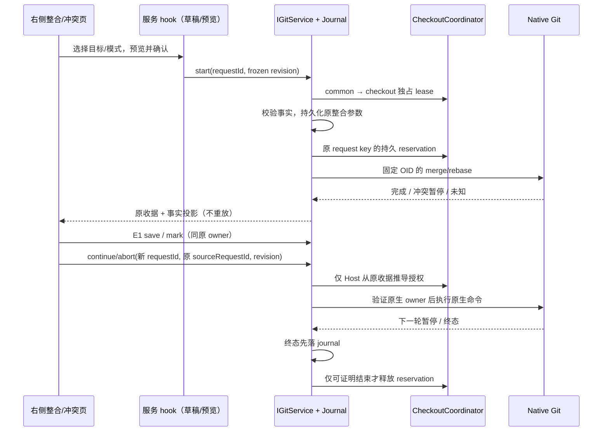

# E2：通用 Merge / Rebase 整合

状态：本批代码、专项和扩大自动化回归已完成。承接 E1 人工冲突解决；构建版、macOS/Linux 原生客户端及手机真机验收由用户构建后执行。

## 产品规则

- Git 右侧增加“整合”页；发起、继续和中止均在页内预览并确认。冲突文件使用已有“冲突”页，保存、标记解决与继续是三个独立动作；标记解决不隐式提交。
- Merge 将一个本地已有的提交合入当前分支，允许快进，否则创建 merge commit，使用 Git 默认消息。Rebase 将当前分支的线性提交重放到目标上，明确告知会改写提交。目标接受完整 heads/remotes/tags ref 或完整 OID，预览冻结为 commit OID；无隐式 Fetch、Push、autostash、交互编辑器、hook、签名或后台维护。
- 发起要求已存在的本地分支、干净 index/工作树（含未跟踪文件）、无原生整合/锁/冲突、无 checkout reservation。拒绝隐藏修改标志、稀疏/子模块/符号链接等不能完整证明安全的 checkout，以及无共同祖先。Rebase 本批次支持至多 1024 个线性提交，拒绝含 merge commit 的重放范围，避免静默丢失拓扑；不提供 skip/interactive/onto 任意参数。
- 不覆盖 ignored 文件：发起前检查目标及所有重放步骤可能触及的路径与现存 ignored 文件/目录的祖先、后代碰撞；Merge 同时传入 no-overwrite-ignore。继续/中止再次检查将触及的路径；不删除未跟踪文件，不执行 clean 或自行 reset，不自动保存/弹出 stash。
- 发起前记录原分支、原 HEAD、目标 OID、模式及根目录。原 journal 是业务 owner，checkout reservation 只保存其 key；暂停期间禁止 Agent 和其他 checkout writer。同仓库独立 linked worktree 仍可运行，执行写入同时持有 common-dir 与 checkout lease。
- Continue/Abort 仅操作本产品发起且仍由原 key 持有的整合；验证 MERGE_HEAD/ORIG_HEAD/分支，或 rebase-merge 的 orig-head/head-name/onto。外部命令发起、E1 接管的普通冲突、Stash、受管候选 worktree 的整合不能借本入口继续/中止，继续走各自 owner/外部 Git。外部已结束时可使用原收据“核对并解除保留”。
- Continue 必须无 unmerged stages，无未暂存/未跟踪文件；审核显示当前 staged/变更文件和 rebase 进度。Rebase 可能再次暂停，原 sourceRequestId 不变，每次动作有独立 requestId。空提交等需要额外决策的状态保留原生状态，提示外部处理；不自动 skip。
- Abort 明确确认会撤销整合期间的人工修改和暂存结果；仅调用 Git 原生 abort。发起前必须干净，完成后核对原分支、原 HEAD、无原生标记/冲突；不声称任意外部修改都可无损恢复。中止时已有未跟踪文件与原始树冲突则拒绝，保留现场。
- 成功结束以 Git 事实证明：Merge 当前分支包含原 HEAD 和目标；Rebase 当前分支包含目标；Abort 恢复原 HEAD/分支。先持久化终态与 resolved，再清理原 reservation；若事实不符、执行异常、超时/输出截断/丢回执，保持 reservation，不重放。原生进程未确认退出时保留 lease 并标记原 owner unsettled。
- 同 requestId 相同参数只返回原收据；不同参数拒绝。继续/中止请求必须携带原 sourceRequestId、最新完整 revision 和必要的原生进程已停止确认；RPC 不能指定 bypass/owner/lease。恢复只读，不自动再次执行。

## 状态与时序

UI draft/预览属于 hook；原生 markers/index/工作文件是实时 Git 事实；原 journal 只保存已接受命令及结算，不增加第二个业务队列。Desktop continuous 与手机 replayable 仍共用现有 Host RPC；身份按 trimmed workspaceIdentity || workspacePath 隔离，路径只用于执行；attachment 切换后的迟到响应不能覆盖新 UI。

## 接口与恢复

共享严格 schema 与 IGitService 增加 getIntegrationSnapshot、previewIntegration、startIntegration、continueIntegration、abortIntegration。原收据增加 integration 元数据和 sourceRequestId 关联，kind 增加 merge/rebase/integration-continue/integration-abort。snapshot 包含完整 revision、原收据、原生模式、权限/继续条件、冲突路径、变更文件及进度，不把 UI 选择持久化为事实。

每次预览/动作重新读取 HEAD、symbolic HEAD、index、原生标记及工作文件指纹；目标 ref 移动、工作文件/index/进度变动、另一个 identity、旧 request、原生状态替换均使确认失效。没有足够证据时留现场；恢复可以查询原收据并在确认原生进程停止且无 markers/冲突后显式解除，不能伪造成功。

## 验收计划

1. 真实仓库：Merge 快进/非快进/已包含、Rebase 线性成功；目标在预览后移动拒绝旧确认；dirty/detached/unborn/隐藏标志/无共同祖先/merge 拓扑/ignored 碰撞拒绝。
2. 真实冲突：Merge 和多提交 Rebase start→E1 save/mark→continue，再次暂停保持 owner；中止恢复原 HEAD/分支，不自动继续。人工未暂存修改拒绝 Continue；Abort 的确认和 stale revision 必须生效。
3. 写入边界：跨 Host/identity、原生锁、Agent busy、受管候选 checkout；继续/中止仅来源 key 可进入。独立 linked checkout 不阻塞。进程未退出、丢回执、重启、收据重复、目标或 marker 被外部替换都不自动重放/放行。
4. UI E2E：右侧直接切换、目标/模式/固定 OID 的确认、冲突导航、多次继续、中止警示、只读恢复、Host 切换迟到响应、390px/英文/主题/键盘；已有 A–E1 交互回归。
5. 实际执行针对性测试、pnpm typecheck、pnpm lint、architecture changed、改动格式检查；结果追加到本文。未执行构建版验收不能写成通过。

Git 行为依据：[git-merge](https://git-scm.com/docs/git-merge)（abort 不能保证恢复操作开始前已有未提交修改）、[git-rebase](https://git-scm.com/docs/git-rebase)（continue/abort、提交重放与暂停）。本方案以干净发起和原 owner 验证缩小恢复边界。

## 实现与验证记录

实现 owner 仍是 `GitNetworkJournal`，`GitIntegrationState` 仅执行原生事实校验，没有新增持久业务队列。接口通过 `gitServiceIntegration.ts` 接入既有 service 和 coordinator。原生 markers 或 Rebase todo 被外部替换后，E1 写入与 E2 Continue/Abort 一并拒绝，不只在界面禁用按钮。进程未知时原 owner 持久标记 unsettled，独占 lease 与 reservation 各自保留原边界。

`useGitIntegration` 通过现有服务解析选择 Host，迟到响应按 service/attachment/identity scope 丢弃；丢回执后的只读刷新保留未知提示。手机输入/select 使用 16px 兼容 token，其他字体遵守 DESIGN。界面截图在 `artifacts/git-integration/`，已检查中文亮色、英文暗色的 390px 布局。

已执行的命令入口：

- 专项：`node --import tsx --test --test-concurrency=3` 加 `gitIntegration.integration.test.ts`、`gitCheckoutCoordination.test.ts`、两份 E1 integration、shared `gitIntegration.test.ts`、worktree `worktreeSpawnAdmission.integration.test.ts`（均为当前源码实际路径）。
- 浏览器：从 `packages/web` 运行 `node --import tsx --test test/git-commit-dialog.test.mjs`，E2 使用 `LCODE_GIT_REVIEW_TEST_CASES=integration`；E1 使用 `conflicts`，D 使用 `workspace-operations`；A/B/C 扩大回归不设置筛选变量。
- UI 单测：`pnpm exec tsx --tsconfig packages/ui/tsconfig.json --test` 加冲突草稿 store、审核 pane/navigation store、文件选择/树、手机 footer、switchAssist 的实际测试文件。
- Git 扩大回归沿用 E1 入口并加入 shared 整合合同与锁、worktree runtime admission / execution cleanup；本次准确文件清单记录在 `artifacts/git-review-pane/e2-git-regression-files.json`。

首轮发现并已处理：跨身份拒绝在进入 journal 前抛出，测试改为验证拒绝；fixture 删除有修改的临时文件需显式 `rm -f`；丢回执后的读取不能清除提示；手机输入缺少 16px token。最初失败日志保留，没有作为最终通过证据。

图索引验证：111 个唯一节点、169 条有效边，新增整合节点的 5 个 source seeds 均有实际文件/符号。新增 13 个源码/测试/fixture 文件，约 2.1k 行；工作区起点包含 A–E1 未提交改动，Git 总 diff 是累计量，不能当作本批独立净增。

最终结果（2026-10-20，Windows / Node 24.21.0 / Git 2.56.0.windows.2）：

| 验证                                                           | 实际结果                             | 证据（`artifacts/git-review-pane/`）                                                        |
| -------------------------------------------------------------- | ------------------------------------ | ------------------------------------------------------------------------------------------- |
| E2 + E1 + Host 授权/真实 Agent admission 专项                  | 40/40 通过                           | `e2-focused.tap`                                                                            |
| Git/shared/worktree 扩大回归（不重复运行 E2 integration 文件） | 282 项，281 通过、0 失败、1 平台跳过 | `e2-git-regression.tap`、`e2-git-regression-files.json`                                     |
| UI 相关单测                                                    | 17/17 通过                           | `e2-ui-regression.tap`                                                                      |
| 新整合浏览器                                                   | 7 场景 + harness，8/8 通过           | `e2-browser-pass.tap`                                                                       |
| A/B/C 浏览器回归                                               | 71/71 通过                           | `e2-abc-browser-regression.tap`                                                             |
| D / E1 浏览器回归                                              | 分别 10/10 通过                      | `e2-d-browser-regression.tap`、`e2-e1-browser-regression.tap`                               |
| 类型 / Lint / 架构                                             | 全部 exit 0；架构 baseline 0 / new 0 | `e2-gates.json`、`e2-typecheck-final.txt`、`e2-lint-final.txt`、`e2-architecture-final.txt` |
| 格式 / diff check                                              | 39 文件格式通过，diff check exit 0   | `e2-format-final.txt`、`e2-format-gates.json`                                               |

平台跳过沿用 POSIX 可执行 hook 在 Git for Windows 上的测试限制。原生命令的 orphan/超时分支通过测试 provider 注入，真实 Git 负责其余临时仓库流程；这不等于安装包或真实孤儿进程验收。浏览器使用生产组件 + 测试 Host，不能替代构建版跨端验收。

本批保留的明确限制：只操作本产品发起的原整合，不接管候选整合/外部整合的生命周期；Rebase 仅支持至多 1024 个线性提交，不提供交互变基、skip 或保留 merge 拓扑。遇到空提交等额外决策时保留原生现场，交由外部 Git 处理后通过原操作核对解除。构建版验收仍待用户构建后进行。
