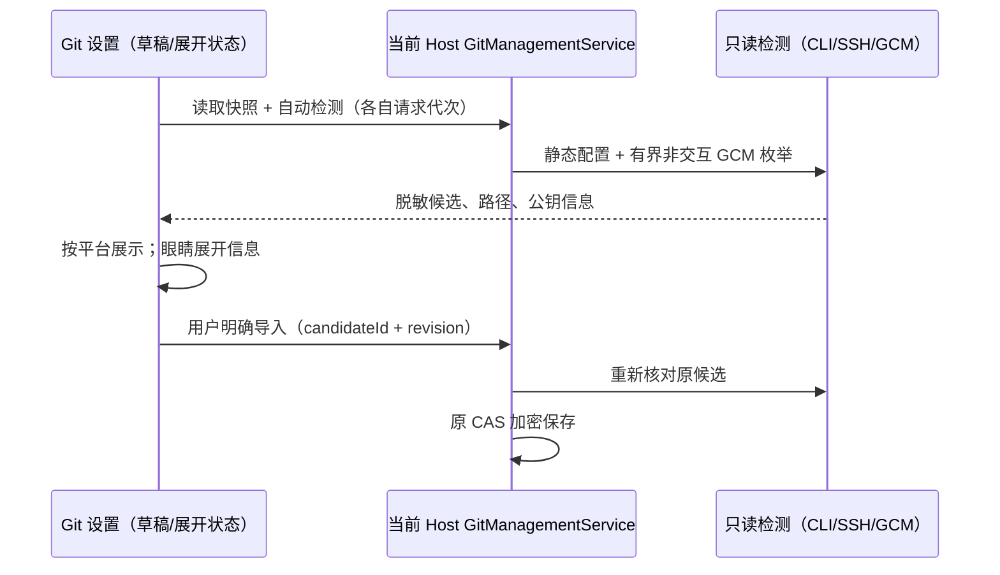
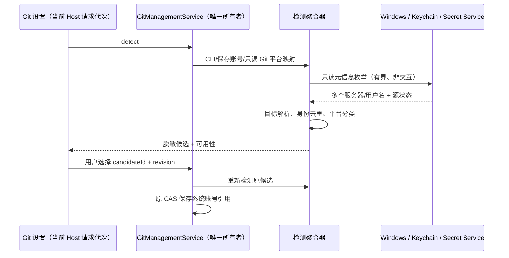
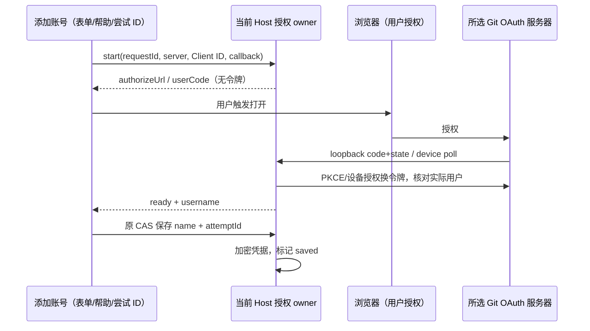
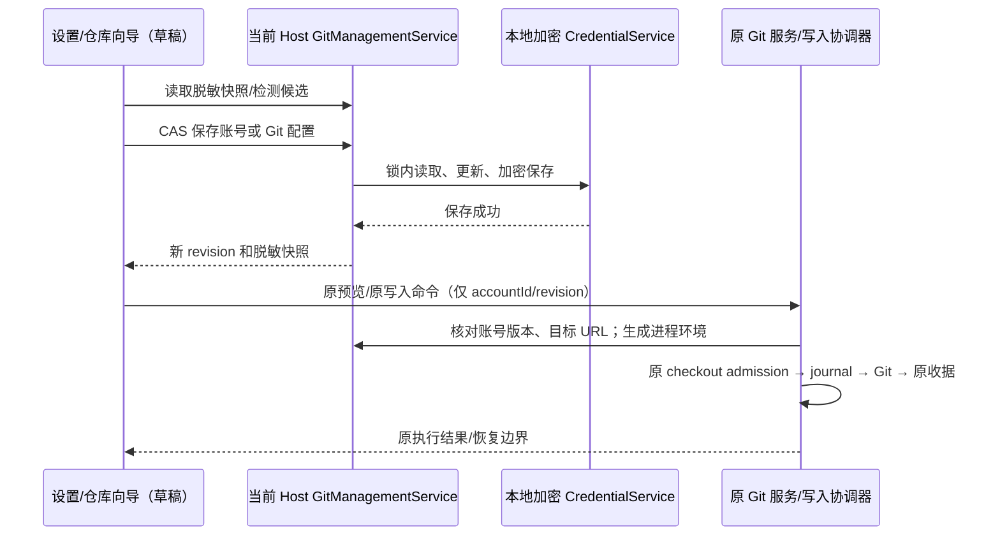

# Git 管理与仓库认证

仓库/远端绑定、检测账号直接选用和 Agent Shell 统一认证的后续规则见 [Git 账号路由](git-account-routing.md)。该规则取代下文仅支持显式导入、仓库全局 ID 和 Agent 外部命令环境的旧限制；设置页导入仍保留为可选管理动作。

## 产品规则

- 设置 → 编码新增「Git 管理」：Git 可执行文件自动检测/自定义路径、默认提交身份及初始分支；GitHub、GitLab（包含自建）、Gitea/Forgejo、其他 Git 服务器四个账号分区。
- 账号支持新增、修改、删除；地址自动判断常见平台，自建服务可手动选择类型。认证方式为 HTTPS 令牌、SSH、现有系统凭据及浏览器授权（GitHub/GitLab/Gitea/Forgejo）。浏览器授权核对实际用户身份；保存和授权均不替代仓库级 Git 访问权限验证。
- 令牌只在编辑时输入；列表、检测结果、错误和仓库地址均不返回令牌。编辑留空保留已有令牌。全部配置由 Host 加密凭据服务持有，不进入普通设置同步。
- 「检测本机账号」只读解析 gh/glab/tea 配置中的账号元信息、`.ssh/config` 的静态 Host 和 `.ssh/id_*` 路径；不执行配置的 Match exec，不读取私钥内容。用户选择导入后才将配置文件中的令牌复制到本地加密凭据库；系统钥匙串托管的凭据仍使用系统 Git helper。自定义/未能检测的账号始终可手动录入。
- 仓库向导的配置步骤读取同一 Host 的账号，选择与仓库服务器、协议和路径相符的账号；不自动任选多个匹配账号中的一个。默认「系统 Git 凭据」。初始化使用默认分支，克隆最终预览显示账号名称及服务器。
- 克隆请求仅携带账号 ID 与版本。预览前及执行前核对账号仍存在、版本与服务器匹配。删除/修改账号使旧预览失效；不重放原操作。
- 克隆将非敏感的账号 ID 记录到仓库本地 `lcode.accountId`，后续 Fetch/Push 复用该账号；删除、账号地址不匹配均明确停止认证，不悄悄改用另一账号。没有绑定的旧仓库保持原系统认证。
- 令牌不放在 argv、URL、Git 配置文件或日志；只对当次 Git 子进程设置 URL 精确限定的认证头，禁用认证跳转和交互提示。SSH 仅引用原私钥路径，保留 known_hosts 检查，私钥口令由现有 agent 负责。
- 自定义 Git 路径无效时明确失败，不回退其他 Git。切换自动检测/修改路径后下次命令立即使用新配置。
- Host 内审核、网络、工作树、检查点与 Git 备份的 Git 执行统一注入同一配置 provider；不能让检查点或备份绕过自定义路径。终端和用户自行调用的外部 Git 属于各自命令环境。

### Git 配置区布局

- 按设置卡片的可用宽度排版；空间足够时，Git 路径输入框与「检测 Git 路径」「使用自动检测」同排，输入框与按钮底边对齐。
- 进入页面即检测 Git，自动模式在输入框显示实际检测路径；空的 `configuration.binaryPath` 仍表示自动，不将检测值偷偷保存成固定路径。用户编辑/选择文件改为自定义草稿，「使用自动检测」清空自定义草稿并立即显示检测路径。检测完成不能覆盖用户的自定义输入；检测失败时允许手动填写。
- 输入框旁提供「选择 Git 可执行文件」和「打开所在位置」图标按钮，与检测及自动模式按钮同排对齐。通过 `IPlatformService.selectFile/openInFileManager` 使用当前设备能力；选择取消不改草稿，失败显示局部错误，选择/查看不自动保存、不执行所选程序。Web/手机缺少本机路径能力时禁用原生操作并说明，仍可手动填写 Host 路径。
- 提交者姓名、提交者邮箱、默认初始分支同排，输入框参考宽度分别为 12rem、18rem、10rem；邮箱获得更多输入空间，姓名与分支不随卡片拉长。保存按钮在同排容得下时靠输入框底边排列。
- 空间不足时自然换行；窄卡片与手机采用整行输入框，任何字段和操作都不能横向溢出。适配明暗主题、中英文及界面字号设置，保留标签、键盘顺序和保存反馈。
- 只调整 `GitManagementSection` 的布局；配置草稿仍由该组件持有，Host 的配置所有者、hook、CAS 保存接口及账号编辑行为不变，不新增测量状态或写入入口。

### 本机账号与 SSH 信息

- 进入 Git 管理时自动检测一次；支持手动重新检测。检测候选在对应 GitHub、GitLab、自建 GitLab、Gitea/Forgejo、其他服务器页签展示，标明来源；尚未导入的候选与已保存账号区分。检测不自动保存/切换登录账号，也不发起远端验证。
- 不把 Git 提交者姓名/邮箱当成登录账号。Git Credential Manager（GCM）保留非交互 `github list`；所有 Git 平台同时通过当前 Host 的系统凭据元信息发现多账号。不执行 credential fill/get/login，不提取系统令牌，不触发登录、解锁或网络验证。
- gh 同主机多个 `users` 逐一识别，只有当前活动用户可以使用主机级 token；其他用户不能继承该 token。GitLab/glab、自建地址、tea/Gitea/Forgejo、Git 凭据文件中的多个服务器与用户名均独立识别。系统托管来源导入为系统认证，实际 Git 命令按选定用户名限定 credential 匹配，不切换外部工具的活动账号。
- 配置目录适配 Windows、macOS、Linux 的默认路径以及 `GH_CONFIG_DIR`、`GLAB_CONFIG_DIR`、`TEA_CONFIG_DIR`、`XDG_CONFIG_HOME`；只有已存在的配置来源参与检测。GCM 缺失、命令失败/超时、单个来源损坏不阻断其他来源，公共结果只含固定错误分类。所有 IO 异步、读取及进程输出有上限。
- SSH 私钥路径以列表展示名称、类型和路径，补充“私钥用于本机认证，公钥添加到 Git 服务器”的说明。眼睛按钮展开/收起类型、完整私钥路径、SHA256 指纹和公钥；指纹只从对应 `.pub` 的有效 SSH 公钥 blob 计算，不读取私钥原文。公钥缺失/无效时显示不可用，不能从文件名猜测有效密钥或已登录账号。
- 默认命名密钥以及静态 `IdentityFile` 引用的已有文件都参与列表；保留静态 Include 深度/数量上限，不执行 Match exec 或 SSH 探测连接。候选检测结果是 Host 的只读派生数据，不持久化；展开状态仅属于 UI。旧 Host 缺少公钥详情字段时仍能显示路径并提示详情不可用。

切换 Host 或卸载后忽略旧请求结果；检测与配置保存的错误/忙碌状态分别管理，检测不能覆盖草稿或保存错误。重新检测不重放任何 Git 操作，继续沿用原写入协调和恢复边界。

### 系统凭据跨平台补齐

- 范围：GitHub、GitLab.com、自建 GitLab、Gitea/Forgejo、Bitbucket 及其他 Git 服务器。系统凭据只读发现，导入仍需用户选择；保存仅保存服务器、用户名、平台及系统认证方式，不复制密码/令牌。跨平台是 Host 的能力，手机复用当前 Host，不枚举手机或其他 Host 的凭据。
- Windows：通过 Win32 `CredEnumerateW` 读取 Generic Credential 的 TargetName/UserName，支持 `git:https://…`、带用户名或仓库路径的 GCM 目标及旧 `LegacyGeneric:target=` 格式；不解引用 CredentialBlob，不写入/删除凭据。系统脚本只输出 Git 相关元信息，使用固定脚本与数据参数，不拼接用户代码。
- macOS：使用系统 `security dump-keychain` 的属性模式（禁止 `-d/-g/-w`），识别 GCM generic service/account 及 Git 服务器 internet-password 的 server/account/protocol/port/path，逐个保留多个账号。不读取密码，不调用解锁。未知 internet-password 只有匹配已知 Git 服务器或明确 Git 属性时才作为候选，避免把普通网站账号当成 Git。
- Linux：使用用户 D-Bus 的 Secret Service `SearchItems` 与 Item `Attributes`，覆盖 GCM `service/account` 和 Git libsecret `protocol/server/user/object/port` 元信息；禁止 OpenSession/GetSecret/GetSecrets/Unlock。已锁定项只读可访问属性，无法访问时显示部分可用，不触发 prompt。按 busctl 的真实 JSON 格式解析：方法调用的 `aoao` 数据是两个路径数组；`get-property` 的 `a{ss}` 数据直接是属性对象，不能套用方法返回的外层数组。格式不符隔离为部分可用，不导入未验证的记录。
- 系统命令通过 Host 内注入的有界异步进程接口运行：无 shell、隐藏 Windows 窗口、超时终止、输出上限；缺命令、权限拒绝、锁定/损坏、输出过多分别报告固定状态，不把 stderr、原始命令输出、非 Git 账号或秘密写入日志/公共结果。单个源失败不丢弃其他源和已有编辑。
- 分类：CLI/已保存账号/只读 Git `credential.<server>.provider` 提供自建服务的明确平台映射；其次识别已知公共服务及域名特征。相同协议、服务器（含端口与路径）、用户名、SSH 密钥构成身份，同账号多来源去重，不按主机吞掉其他用户名，不给其他用户兜底活动用户 token。来源或认证方式变更导致旧导入候选失效。
- 自建域名没有任何平台证据时归入“Git 服务器账号”，保留真实服务器和用户名，不猜测为 GitLab/Gitea；用户可用现有修改账号功能设置服务类型，后续检测复用该映射。不联网探测未知服务器。
- 系统候选通过原 CAS 导入和重新检测核对；原凭据删除、用户名/目标改变后，旧候选拒绝导入。系统认证在实际 Git 命令中继续按服务器/路径和选定用户名限定，禁止跟随另一活动账号回退；不改全局 Git 配置。仓库向导、Fetch/Push 继续使用原绑定、写入协调、日志收据与恢复边界。
- 公共检测结果新增向后兼容的 `systemCredentialSources`：源、ok/partial/unavailable/unsupported 状态及候选数（不返回内部错误）。设置区展示本机系统源状态，区别“无账号”和“源不可用”；旧 Host 缺字段仍可显示原候选。

### 添加账号的浏览器授权登录

- HTTPS 信任与当前 Host 的网络配置一致：OAuth 专用网络 transport 通过现有公开网络适配器，合并 Node 默认/额外 CA、当前操作系统信任库及已配置自定义 PEM，沿用代理/noProxy；不改全局 dispatcher 或其他请求策略。Windows、macOS、Linux 均通过 Node 系统 CA API，禁止写死用户证书路径、关闭证书或主机名校验。远程 Host 不借用浏览器/桌面的本地 CA。Host 释放时同时取消授权并释放连接池，令牌交换与自动刷新使用同一 transport。
- 证书不受信、域名不匹配、证书过期、网络连接、Client ID、授权码/权限、令牌交换与用户核对分别返回固定错误类别，页面显示可执行提示；不把底层异常、响应正文、网址参数、code/state 或令牌写入结果/日志。回调页引导返回 LCode 查看具体错误，失败不自动重放授权码。
- 只有 pending 状态投影授权网址和设备码；成功、失败、取消或过期后移除旧浏览器入口，避免用户继续打开失效尝试。错误诊断不回显回调参数，重新授权必须创建新尝试。
- 自建证书问题已用只读连接复现：默认 Node 校验失败，系统已信任的根证书可正常连接。回归使用临时本地 CA/HTTPS 服务验证系统信任注入、自定义 PEM、未知 CA/域名错误仍拒绝，以及网络 owner 释放。真实平台登录等重新构建后由用户授权验收。

- 在认证方式新增「浏览器授权登录」，支持 GitHub（设备授权）、GitLab/自建 GitLab（PKCE）与 Gitea/Forgejo（PKCE）。仓库没有内置 LCode OAuth 应用，用户填写 Client ID；不借用第三方应用 ID，不要求把 Client Secret 放入客户端。未知 Git 服务器/Bitbucket 当前仍使用系统凭据、令牌或 SSH，不展示未经适配的 OAuth 流程。
- 授权区的“？”支持鼠标悬停、键盘聚焦和点击，说明各平台创建 OAuth 应用的位置、Client ID、GitHub 设备授权开关、GitLab/Gitea public client、所需 Git/身份权限、回调地址和授权后的保存步骤。手机点击同样可读，不依赖 hover。帮助内容与选中平台/服务器一致。
- PKCE 默认回调 `http://127.0.0.1:17654/git-auth/callback`，允许指定 loopback 端口；只监听 127.0.0.1 和精确路径，使用随机 state、S256 verifier，拒绝 state 缺失/不匹配/重放。客户端在平台 OAuth 应用注册该回调地址。远控浏览器无法回调 Host 时可粘贴浏览器最终回调 URL，由同一 Host 验证；不关闭 Host 隔离或转移令牌到浏览器。
- GitHub 设备授权显示一次性验证码和验证网址；Host 按服务端 interval/slow_down、expires_in 约束查询，UI 重复查询不加速轮询。拒绝、过期、取消及缺失/无效 Client ID 明确反馈，不静默改用其他认证方式。
- 授权尝试由 `GitManagementService` 内单一 owner 持有：请求 ID 幂等、服务器/平台/Client ID 固定，PKCE 监听与秘密只留 Host 内存。浏览器打开仅在用户点击授权后通过 `IPlatformService.openExternal`；授权码交换及用户信息核对仅在 Host 进行，OAuth 请求拒绝跨站跳转，令牌不返回 UI、URL、argv 或日志。
- UI 只接收尝试 ID、授权/验证网址、用户码、到期时间、状态与脱敏用户名。取到实际身份后才允许“保存账号”，保存走原 CAS，使用实际返回的用户名/服务器，不信任 UI 伪造 OAuth 账号。授权完成未保存时不创建账号；取消清除 pending grant，保存失败保留 grant 允许同一意图重试；保存成功后的重复查询返回已保存账号 ID，禁止重复保存另一个账号。
- OAuth access/refresh token 加密保存在原 Host 凭据记录；过期时在原文件锁内刷新并核对身份，不改变公开账号 revision 或重放 Git 操作。刷新失败/授权撤销明确失败，用户重新授权；手工编辑 OAuth 账号只能保留同身份改名称，变更服务器/用户必须重新授权。实际 Git 仍通过原进程级认证 adapter 和绑定；GitLab OAuth Git HTTP 使用 oauth2 用户名，公开账号保留实际登录名。
- 新增严格授权命令/状态 schema 和 Host RPC 方法；不修改 Agent stdio 任务协议或把业务状态放入 Main。旧 Host 缺方法时提示能力不可用。卸载/切换 Host 后不接收旧结果；关闭授权区取消未保存尝试，Host 十分钟 TTL 释放监听/秘密。构建前不连接真实平台授权或创建外部 OAuth 应用，以本地 OAuth 服务与浏览器桩验证链路。

## 所有者与接口

`GitManagementService` 是每个 Host 的唯一配置所有者；凭据 key `git-management:v1` 中存放严格版本化的加密完整记录。跨进程文件锁覆盖读取、CAS 修改、加密保存，避免多窗口丢失更新。公共 RPC 接口只返回脱敏快照，修改请求携带快照 revision。每个账号还有独立 revision。

UI 只能通过 hooks 使用服务，不读取本机文件。Desktop 本地与手机远控使用已连接 Host 的同一事实源；远端服务不得 fallback 到桌面本地账号。新增独立服务频道，不修改 Agent stdio 任务协议；共享 Zod schema 验证 RPC 输入和输出。Git 设置不构成 Git 仓库写入，实际克隆/Fetch/Push 继续走现有协调与恢复路径。

## 验收

1. 缺 Git 自动检测、有效/无效自定义路径、切换路径不重启；默认身份覆盖只作用 Git 子进程，不写全局配置。
2. 四类平台账号 CRUD、自建地址、空令牌保留、删除令牌、CAS 冲突及损坏记录拒绝覆盖；普通设置/快照/异常无令牌。
3. 静态 SSH Include、Host、IdentityFile 与默认密钥路径检测；缺目录、损坏 CLI 配置、通配 Host、Match exec 不执行；自动导入与手动添加均可使用。
4. 仓库向导引用账号；错服务器、旧账号版本、删除账号在目录创建之前阻断；重试登记不会重做克隆。
5. 真 Git HTTP 服务器验证认证头仅发向目标，重定向不转交凭据，绑定账号用于 Fetch/Push；SSH 引用路径且不复制私钥。
6. 设置与向导桌面/390px、明暗主题、中英文、键盘、加载失败与请求过期；保留原审核和图谱回归。
7. 宽卡片中路径及检测操作同排，姓名/邮箱/初始分支及保存按钮底边对齐，邮箱输入框宽于姓名和分支；缩窄设置卡片时按容器宽度换行，390px 中英文及较大字号下无横向溢出，键盘可依次编辑并保存。
8. GCM 同服务器两个 GitHub 账号均列出，gh/glab/tea 与凭据文件的多账号不丢失、不串 token；Windows/macOS/Linux 配置路径、来源去重、损坏/超时隔离，真实本机验证仅记录来源和数量。
9. SSH 列表眼睛按钮支持键盘展开/收起，指纹与真实 `ssh-keygen -lf` 一致；默认/自定义命名密钥、公钥缺失/损坏/过大、旧 Host 返回路径均可展示，无私钥内容进入检测结果、日志或快照。
10. Windows/macOS/Linux 系统源分别覆盖 GitLab、自建 GitLab、Gitea/Forgejo、Bitbucket 同服务器多账号、端口/仓库路径、Unicode 名称、来源重复；无平台证据的自建服务器保持 generic，明确映射优先于域名猜测。
11. 进程超时/缺工具/无权限/输出过大与 Secret Service 锁定项隔离；静态来源仍可用，UI 显示系统源状态。测试验证命令从不请求秘密、解锁或登录；公共结果/持久化中无系统凭据字节。
12. 系统候选导入前删除/修改被拒绝；多账号实际 Git HTTP 认证选择正确用户名，配置/恢复边界不变；管理页自动检测、平台页签、导入后仓库向导、手机/明暗主题及旧 Host 兼容回归。Windows 本机仅做只读元信息核对，macOS/Linux 原生验收及安装版验收等待用户构建。
13. OAuth 本地服务覆盖 GitHub device pending/slow_down/拒绝/过期、GitLab/Gitea PKCE state/路径/端口核对与重放拒绝、真实用户核对、重定向/无权限失败、并发与取消、CAS 冲突重试及加密保存/刷新；UI 不出现 access/refresh token，帮助 hover/focus/tap、平台切换和取消回归。

## 实施记录

本轮修复浏览器安全但 Host 授权失败的证书信任差异：只读连接复现默认 Node 返回 `UNABLE_TO_VERIFY_LEAF_SIGNATURE`，确认提供的根 CA 已在 Windows 系统信任库；OAuth 专用适配器合并系统信任后返回正常 302，未复用用户授权码或进行平台登录。实现对 Windows/macOS/Linux 使用同一 Node 系统 CA API，并复用 Host 自定义 PEM/代理；真实临时 HTTPS 回归确认未知 CA 和域名错误仍被拒绝。授权失败分阶段显示固定类别，结束后移除失效浏览器入口。令牌交换/刷新共享原 owner 的连接池并随其释放；写入、CAS、恢复边界保持。相关 83 项服务/网络/真实 Git 与目录测试、34 项界面回归及类型/Lint/架构检查通过，证据见 `artifacts/project-git-integration/validation.json`。macOS/Linux 原生和安装版授权仍待重新构建后验收。系统 CA 行为依据 [Node TLS CA API](https://nodejs.org/docs/latest-v24.x/api/tls.html#tlsgetcacertificatestype)。

已实现独立 Host 服务、加密完整配置及 CAS、静态检测、进程级认证 adapter、RPC/远端代理、设置分区及向导账号引用。审核、工作树、检查点和 Git 备份均注入同一配置 provider。真实 Git HTTP 服务完成克隆、Fetch、分支和 Tag 推送；凭据不进入 URL/仓库配置/列表，重定向不传递令牌。39 项服务/加密/代理及备份专项、10 项新增界面和分组登记测试通过；相关 60 项 Git 服务回归及类型、Lint、架构检查通过，明细见 `artifacts/git-build-acceptance-pass5/report.md`。

保存账号不能清空未保存的 Git 配置草稿，已有回归断言；默认分支初始化不会覆盖已编辑值。自建 GitLab 单段内网主机名由统一 URL schema 校验，可被检测。保存账号不标记为已通过远端验证。新增功能等待用户构建后的安装版验收。

本批补齐适当宽度的横排配置、自动路径直接展示、平台文件选择/打开父目录、平台页签中的自动检测候选及 SSH 公钥详情。22 项服务/认证回归与 17 项浏览器管理/向导/项目测试通过；类型、Lint、架构、23 个目标文件格式检查及 diff 空白检查通过。本机只读实测识别 2 个 GCM GitHub 账号，1 个公钥指纹与 `ssh-keygen -lf` 一致；不记录真实账号名或密钥内容。Windows/macOS/Linux 配置路径使用隔离目录覆盖；原生选择框由平台桩验证，安装版及其他系统真机验收仍待用户构建。明细见 `artifacts/git-management-layout/validation.json`，界面证据位于同目录。

2026-10-21 补齐系统凭据元信息适配、同服务器多账号和来源状态；Windows 本机只读实测检测到 2 个 GitHub 账号，未读取或复制凭据内容。Linux 属性解析先用 systemd 真实 JSON 结构复现失败，再修正为直接属性对象，回归覆盖多平台、多账号和不合法数组包装。macOS/Linux 使用命令适配桩与隔离数据验证，尚未进行原生系统验收。

浏览器授权已接入 Host owner、原 CAS 保存、加密凭据及串行刷新；支持 GitHub 设备授权和 GitLab/Gitea/Forgejo PKCE。认证区的「？」支持鼠标悬停、键盘聚焦和手机点击，按平台说明 Client ID、公共客户端、权限和回调配置，并可打开应用设置。37 项服务/认证/代理测试与 19 项界面/仓库向导/项目表单测试通过，包含真实本地 Git HTTP 的 OAuth Clone/Fetch/Push；类型、Lint、架构检查通过。没有创建外部 OAuth 应用或执行真实平台登录，安装版、真实平台及其他系统验收等待用户构建；证据见 `artifacts/git-account-discovery/validation.json`。

参考：[Git 凭据匹配](https://git-scm.com/docs/gitcredentials)、[Git 配置](https://git-scm.com/docs/git-config)、[OpenSSH 配置](https://man.openbsd.org/ssh_config)、[GCM 多账号](https://github.com/git-ecosystem/git-credential-manager/blob/main/docs/multiple-users.md)、[gh 配置路径与多账号](https://github.com/cli/go-gh/blob/trunk/pkg/config/config.go)、[glab 跨平台配置目录](https://docs.gitlab.com/cli/configuration/)。构建版验收由用户重新构建后进行。

新增适配依据：[Windows 凭据枚举](https://learn.microsoft.com/en-us/windows/win32/api/wincred/nf-wincred-credenumeratew)、[GCM macOS 存储实现](https://github.com/git-ecosystem/git-credential-manager/blob/main/src/Core/Interop/MacOS/MacOSKeychain.cs)、[Secret Service API](https://specifications.freedesktop.org/secret-service/latest-single/)、[busctl 属性输出](https://github.com/systemd/systemd/blob/main/src/busctl/busctl.c)、[systemd JSON 子树编码](https://github.com/systemd/systemd/blob/main/src/libsystemd/sd-bus/bus-dump-json.c)、[GitHub 设备授权](https://docs.github.com/en/apps/oauth-apps/building-oauth-apps/authorizing-oauth-apps)、[GitLab OAuth/PKCE](https://docs.gitlab.com/api/oauth2/)、[Gitea OAuth2](https://docs.gitea.com/development/oauth2-provider/)、[Forgejo OAuth2](https://forgejo.org/docs/latest/user/oauth2-provider/)。
