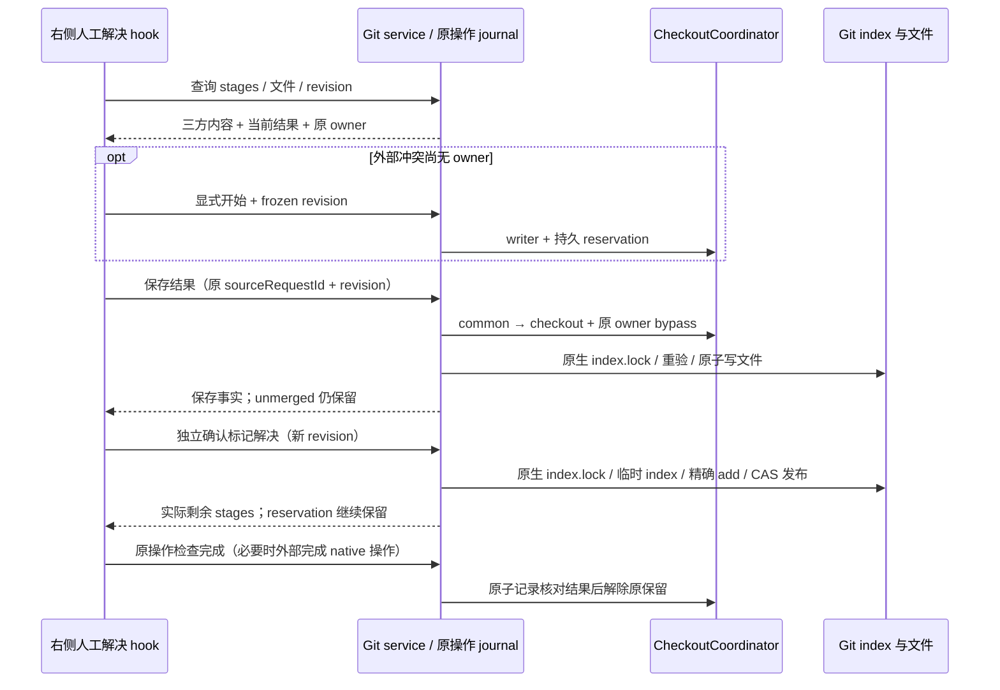

# E 阶段：三方 Diff 与人工冲突解决

后续进展：E2 通用 Merge/线性 Rebase 的发起、继续和中止已按 [整合 spec](git-integration-operations.md) 实施。以下“本批”指 E1 历史范围；E1 的保存和标记仍不会隐式继续整合。

## 本批范围与交互

承接 D 的持久操作收据与 checkout reservation，本批实现 E 的三方文本查看、人工结果编辑、精确保存/删除、独立标记解决及恢复核对。右侧 Git 工作台增加「冲突」页，Stash 恢复区可直接进入。普通外部 merge/rebase/cherry-pick/revert 的当前 index 冲突也可查看并显式开始人工处理；不自动发起整合或改写历史。计划中的通用 merge/rebase 发起、原生 continue/abort 是后续整合批次，本批不把它们当作人工保存的隐式副作用。

- 文件列表由当前 checkout 的 `ls-files --unmerged -z` 生成，读取具体文件时再取 stages 1/2/3（base/ours/theirs），不能用 HEAD/工作文件替代某一方。rebase 的 ours/theirs 保留 stage 名称并解释语义，避免误称本地/远端。
- 大屏三栏展示基准、当前(stage 2)、传入(stage 3)，两侧基于基准使用现有 DiffViewer 高亮；结果独立可编辑。窄侧栏/手机使用基准、当前、传入、结果页签，展开宽度足够时恢复三栏。紧凑工具栏、路径省略/完整 title、主题 token、代码字号及中英文遵循 DESIGN.md。
- 可将任一可读文本版本填入结果，再手工编辑。原始 UTF-8/BOM、CRLF、尾部换行由结果字节决定；UI 默认沿工作文件的 LF/CRLF 习惯保存，混合行尾需明确选择。不能把二进制、非 UTF-8、超限、symlink、submodule 或复杂单阶段/重命名冲突伪装为普通文本。
- 保存仅写结果文件，保留 unmerged stages；标记解决是独立确认，按当前结果精确暂存该文件或其已确认删除。删除结果文件也是独立明确动作；不递归删目录、不隐式移动重命名、不处理其它路径。特殊文件在外部编辑后可经明确核对对普通结果文件进行标记；链接/子模块/超限结果继续引导外部 Git。
- 打开/刷新/查看无写入。无 reservation 的外部冲突需先按当前 revision「开始人工解决」，创建本操作的持久 reservation。D 的 stash 冲突沿用原 requestId 和保留，不创建竞争 owner。另一 identity 的 reservation 只显示占用，不能接管；unknown 必须明确核对进程，活跃 writer 仍阻止修改。
- 编辑草稿仅保存在本窗口对应 Host/path/identity/attachment、文件与 revision 下；切上下文不沿用旧确认，迟到响应不得覆盖当前草稿。刷新/切文件有未保存草稿时用页内保留/放弃确认；重连只查询原请求，不重放保存或标记。
- UI 草稿的唯一所有者为窗口内 Zustand store（最多保留 20 份，不落盘），使工具切换/关闭重开可恢复。Host revision 已变化时保留文本并标为过期，禁止直接保存，需保留副本后重新加载或显式选用新版本。常见未处理的文本冲突标记阻止标记解决。
- 所有文件解决后仍保留 reservation，用户检查实际 Git 状态后使用原「检查并完成」。Stash 没有 abort。外部 merge/rebase 等须在外部 Git 完成其原生操作后再解除；现有候选 worktree 的验证/发布/生命周期流程不被自动继续或清理。

## 合同、所有者与写入

保存/标记子请求在写入前将相对 `filePath` 记录到原有操作收据，丢回执后可明确核对具体文件，正文只参与参数摘要，不写入 journal。

`GitConflictSnapshot` 给出 root、revision、operation 类型、原 sourceRequestId、blocked/nativeCheck 和真实 path/stage 列表。`GitConflictFile` 给出逐方 OID/mode/size/分类/text、当前结果、行尾和 content revision。只读请求不创建新的服务端草稿。

新增严格 `IGitService` 方法：`getConflictSnapshot`、`getConflictFile`、`beginConflictResolution`、`saveConflictResult`、`markConflictResolved`。后者三项沿用 `GitNetworkJournal` 去重和 `coordinateGitCheckoutWrites → CheckoutCoordinator`；Host 从原收据计算允许穿过的 reservation key，拒绝 RPC 注入 owner/resource/bypass。公开 worktree RPC 不增加 bypass。

原生 Git index、文件及操作标记是事实所有者；journal 只保存参数摘要、目标路径和结算，不持久原始文件内容。扩展现有 reservation 类型为 conflict-resolution，原操作的完成核对复用 D 路径，无新队列。采用 common → checkout 独占许可，保持 linked worktree 的其它 checkout 独立；Agent admission 与后台 spawn 继续读取同一保留。

每次保存/标记均重新读取 HEAD、操作标记、完整 index 字节、所选 stages 和结果文件指纹；预览 revision 不符即拒绝。写入时持有 Git 原生 `index.lock`，再校验 index。保存写同目录独占临时文件、同步后原子替换，保持现有权限，不跟随链接父路径；删除只 unlink 原已确认普通文件。标记解决使用复制的临时 index 执行 literal-path `git add -A`，校验当前文件和原 index 未变化后原子发布原生 index.lock。非零/超时/孤立进程如实结算，不自动重试、回滚或释放原冲突保留；未确认原生退出时保留 writer 和必要原生锁。

应用锁不把外部编辑器的文件写入变成原子事务；版本检查和原子发布尽量缩小窗口，检测到外部变化明确拒绝。二进制内容不经 UTF-8 路径写回；读取 blob 以对象哈希验证解码完整性，完整文本上限 256 KiB，超过上限仅展示元数据；当前文件完整指纹有 64 MiB 上限，不接受静默截断的编辑/标记。

Desktop continuous 与手机 replayable 共用目标 Host 的原 journal/reservation，通信方式与现有 RPC 不变。scope key 仍为 identity.trim() || path，路径仅用于 Host IO，不依赖 Renderer 本地文件系统。

## 验收场景

草稿集合按最近编辑顺序淘汰，使用有序 Map；对象的数字字符串键会被 JavaScript 重新排序，不能据此决定淘汰对象。浏览器总套件采用独立总预算，单步超时和同步屏障保持原值，不以延长等待掩盖业务同步错误。

原生标记进程未结算时，子请求收据与原冲突 owner 均保留 unsettled，原生 index.lock 与应用 writer 不释放；重启后仍要求核对进程。临时 index 中所选路径的 unmerged stages 必须实际消失后才发布。三方含义和 index 输入格式参考 [git-ls-files](https://git-scm.com/docs/git-ls-files)、[git-update-index](https://git-scm.com/docs/git-update-index)；本仓库使用真实 Git 回归验证。

1. 真实 stash 冲突：三方内容来自 stages，保存不会清除 stages，标记仅暂存所选路径，原 Stash 保留；所有冲突解决后经原完成入口解除。
2. 外部 merge/rebase 冲突识别、显式接管、重启 admission 保留、外部原生完成后核对解除；现有候选 worktree 回归。
3. 保存前外部文件/HEAD/index/stage/操作变化拒绝；多个窗口只允许当前 revision。原生 index.lock 占用拒绝且不删除外部锁。
4. 保存和标记丢回执、同 requestId、跨服务重启只读原事实；失败/unknown 不伪造解决，writer 未退出不放行。
5. modify/delete、add/add、空文本、Unicode/含特殊字符路径、CRLF/BOM、二进制/非 UTF-8、链接/目录/子模块/大文件分流；不越界、不递归、不跟随父链接。
6. 浏览器：真实生产组件的三方 Diff、结果编辑、保存与标记分离、删除确认、草稿保护、跨 Host 迟到响应、重连查询、390px/宽屏、中英文浅暗主题/键盘。
7. 执行 Git/shared/worktree 回归、UI/浏览器回归、pnpm typecheck、pnpm lint、architecture changed 与格式检查。构建版原生客户端及手机真机验收等用户构建后执行。

## 实施与自动化记录（2026-10-20）

实际链路为 `GitReviewSidePane → GitConflictsPane → useGitConflicts → IGitService → GitConflictRepo/GitConflictMutations`。Stash 的恢复区直接导航到同一「冲突」页。共享合同在 `packages/shared/src/gitConflicts.ts`，服务方法依旧通过已有 RPC 代理，不新增 Agent stdio 命令。窗口内草稿只由 `gitConflictDraftStore` 所有；无第二份组件文本镜像、服务端草稿或已接受命令队列。

真实仓库验证了 Stash 和外部 Merge/Rebase，包含不同 stages 的实际内容、重启后的 reservation、保存与标记分离、精确删除、未跟踪/无关文件保留、原 Stash 保留、原生继续不被隐式调用。额外覆盖 binary/非 UTF-8/大对象/真实 gitlink/目录/符号链接/复杂单阶段、Unicode 与特殊文件名、BOM/CRLF/空文本、原生 index.lock、外部文件和 index 改变、临时 index 生成期间的外部改写、孤立原生进程及请求去重。更新后的实际 Agent spawn 场景同时验证 stash-apply 和 conflict-resolution 保留，均未创建进程标记。

下表日志均在 `artifacts/git-review-pane/`，套件覆盖有交集，不能相加为独立用例数：

| 范围                                                  | 实际结果                             | 日志                                                                       |
| ----------------------------------------------------- | ------------------------------------ | -------------------------------------------------------------------------- |
| Git/shared/worktree 扩大回归                          | 260 项：259 通过、0 失败、1 平台跳过 | `e-git-regression.tap`                                                     |
| 最终 E、写入协调、Agent/Runtime、原生锁专项           | 42/42                                | `e-boundary-latest.tap`                                                    |
| 最后补充的 Rebase、Unicode/目录/gitlink、owner bypass | 3/3；临时 index 外部改写反例另 1/1   | `e-extra-native.txt`、`e-index-cas.txt`                                    |
| UI 导航、审核、键盘与唯一草稿 owner                   | 27/27                                | `e-ui-pass.txt`                                                            |
| E 浏览器 9 场景及根测试                               | 10/10                                | `e-browser-latest.tap`                                                     |
| D 导入/Stash 浏览器回归                               | 10/10                                | `e-d-browser-regression.tap`                                               |
| A/B/C 完整浏览器回归                                  | 71/71                                | `e-browser-regression-pass.tap`                                            |
| 类型、Lint、架构                                      | 通过，baseline 0/new 0               | `e-typecheck-latest.txt`、`e-lint-latest.txt`、`e-architecture-latest.txt` |

Git 扩大回归入口为 `node --import tsx --test --test-reporter=tap --test-concurrency=3` 加 Git 目录全部实际 `*.test.ts`，shared 的 `gitPublish.test.ts`/`gitWorkspaceOperations.test.ts`/`gitConflicts.test.ts`，worktree 的 safety/coordinator/review/checkoutReservations 测试。最终专项为两份 E integration 测试、`gitCheckoutCoordination.test.ts`、shared 合同与共享锁、worktree 的 SpawnAdmission/RuntimeAdmission/ExecutionCleanup 测试。UI 使用 `pnpm exec tsx --tsconfig packages/ui/tsconfig.json --test` 加实际 UI 文件。浏览器统一入口为 `packages/web/test/git-commit-dialog.test.mjs`，E 指定 `LCODE_GIT_REVIEW_TEST_CASES=conflicts`，D 指定 `workspace-operations`，完整回归不设筛选变量。

首轮记录没有计作通过：Rebase/Merge 测试夹具一度用意图构造函数遮蔽 Git provider，已保留独立字段；浏览器最初用了错误的 Diff 自定义标签、切换时未检查空节点，改为实际 `diffs-container` Shadow DOM 与明确存在条件；草稿单测发现对象键重排的淘汰问题，改用有序 Map 并复测。全量浏览器首轮 300 秒总预算用尽，66 个场景已通过，剩余场景因浏览器关闭取消/失败；提高套件总预算至 420 秒，保留所有单步时限和同步屏障，末轮 71/71 在约 250 秒内完成。一次 Windows 格式化原子 rename 被占用时保留原文件与临时输出，校验临时输出等于重新格式化结果后才发布，没有丢失源码。

截图在 `artifacts/git-conflicts/`，包含宽屏真实三方 Diff、390px 中文浅色和英文暗色，验证了无横向溢出、键盘/底栏可达及手机编辑字号至少 16px。浏览器使用生产组件和测试 Host 服务；Git/进程测试使用临时真实仓库。构建版 Windows/macOS/Linux 客户端、真实 SSH/HTTPS 凭据和手机真机验收均留待用户构建。

本批交付三方查看与人工解决。通用 merge/rebase 发起、native continue/abort 仍属于后续整合批次；已有外部操作需在外部 Git 完成原生流程后使用当前检查入口解除。不会自动中止、回滚、清理候选 worktree 或绕过验证与发布生命周期。

架构范围为 shared 合同、legacy Git services/UI 和现有 managed worktree reservation/admission；没有新增 Host 业务 owner。特性图已校验 110 个唯一节点、165 条有效关系，E 的 6 个源码 seed 和 4 条 owner/边界关系均存在，见 `e-feature-graph.txt`。本批新增源码与测试 17 文件、2494 行；跟踪文件相对 HEAD 累计 +3350/−1544，净 +1806（包含已有 A–D，不能视作 E 的独立净增），见 `e-change-statistics.json`。原有本地改动保留。

最终门禁：44 个本批相关文件格式通过，Git 空白差异检查通过，typecheck/lint/architecture 均以退出码 0 完成。证据为 `e-format-check.txt`、`e-diff-check.txt`、`e-typecheck-final-pass.txt`、`e-lint-final-pass.txt`、`e-architecture-final-pass.txt` 和 `e-final-checks.json`。
