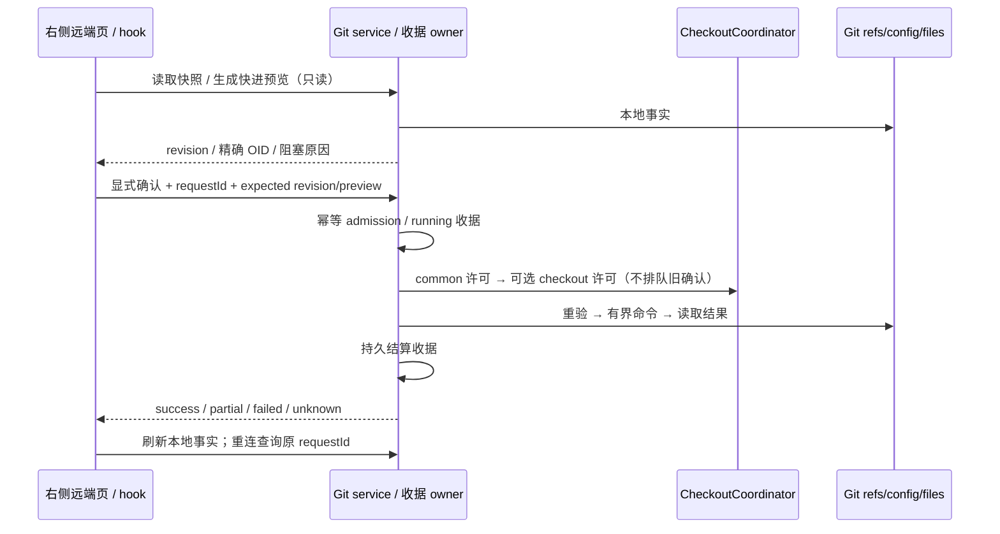

# Git C 阶段：跟踪、远端与安全更新

## 产品规则与范围

右侧 Git 工作台增加「远端」页，沿用紧凑工具栏和行布局。显示当前分支、上游、ahead/behind、本地分支跟踪关系、远端的 Fetch URL / Push URL、最近网络操作收据。支持设置/取消当前分支上游，新增、编辑、重命名、删除远端；配置修改前展示影响，删除不触碰远端服务器。多 URL 保留次序，空 Push URL 表示继承 Fetch URL。

2026-10-21 构建版验收后的布局调整：提交审核内原有“远端与 Tag 发布”及工作树目标发布统一投影到本页，选项、冻结预览、结果和失败项重试使用原发布 owner。提交审核保留文件、Diff、消息和本地确认；发布所需提交尚未审核时提示返回审核。进入本页不生成模型草稿或执行 Git 写入。完整边界和验收场景见 [构建版验收与发布归属](git-built-acceptance-and-publication-navigation.md)。

刷新、打开页面和重连只读本地事实，不触发网络。Fetch 由用户显式选择一个或多个已配置远端，只更新对应 `refs/remotes/<remote>/*`，不 prune、不拉 tags、不递归子模块、不修改 FETCH_HEAD、HEAD、index 或工作树；逐远端结算，部分失败保留成功事实，不自动重试。

多远端 Fetch 在每个远端开始前重新校验配置；执行期间外部 Git 修改配置时，后续远端不再发起网络命令，返回部分成功/失败及过期提示。

仅快进更新分为只读预览和确认执行。预览展示本地分支、当前 OID、上游及目标 OID。没有上游、上游引用缺失、detached/unborn、脏工作区、进行中的 merge/rebase/cherry-pick/revert、分叉均返回明确阻塞原因。已经领先或相等返回无需更新。确认必须携带原预览；Host 重验配置/引用 revision、HEAD/index/worktree 指纹及 idle 状态，然后只向固定 OID 执行 `merge --ff-only`，禁用 autostash、签名、hooks 和自动维护。不会隐式 Fetch、merge commit 或 rebase。

## 状态所有者、写入与协议

- Git 原生 refs/config/index/files 是仓库事实唯一所有者。`GitNetworkRepo` 读取并执行有限 Git 命令；共享协议提供严格 Zod 输入；`IGitService` 是唯一 UI 命令入口。原 publishing `listRemotes` 保持兼容。
- 发布快照新增可选 `remoteConfigFingerprint`，新快照冻结远端及 URL rewrite 配置，配置修改使旧发布确认失效；历史未带该字段的请求保持兼容。首次推送自动建立 upstream 不属于远端 URL 配置变化。
- `CheckoutCoordinator` 增加 Host-only resource 参数，真实 Host 通过 Git 和 realpath 解析 common directory。锁顺序固定为 common directory → checkout。仓库级 mutation（Fetch、配置、跟踪、标签、推送、分支、提交）持 common 独占；涉及文件时再持 checkout 独占。普通文件操作/既有 worktree writer 持 common 共享及 checkout 独占，独立 worktree 可并行。Agent shared admission 仅占 checkout，允许 Fetch；同 checkout 的快进更新仍明确 busy。
- 既有 worktree 组合源提交继续走已持 writer 的 raw Git owner，不重复申请许可。外部终端和 Agent 自行执行 Git 不属于应用锁，预览校验和 Git 原生锁负责拒绝并发变化，不能宣称跨任意外部 Git 原子性。
- 每次新 C mutation 必须有 requestId；同 scope（identity fallback path）+ requestId 只接受同一参数摘要。同一请求重复返回原收据，不重执行。Host 在写入前持久记录 running，结束后持久记录逐远端结果/效果；丢响应或重启后查询原 requestId。遗留 running 表示 outcome-unknown，不能换 ID 自动重放。收据不持久化 URL、命令输出或凭据。
- RPC 不承载第二队列。Renderer hook 只持草稿、pending、预览和收据投影。切工作区/identity/remoteSession/服务换代丢弃迟到 UI 结果。Desktop continuous 与手机 replayable 均查询同一 Host 收据，重连不重发 mutation。
- Fetch 每个远端结束即持久 checkpoint；Git 命令报告 orphaned 时收据带 `unsettled`，当前 Host 保留原 writer 许可，避免仍在运行的进程与下一操作重叠。此状态需要人工核对原生进程与仓库后重启 Host，不提供自动重试或强制解锁按钮。
- 即时 writer admission 不排队；重启后的旧许可只有在 PID 已确认退出时才允许回收。无 owner、损坏 metadata 或仍活跃的进程不能因 waitMs=0 被删除。沿用共享文件锁的唯一 owner token，不能删除后来加入的 owner。

## 验收与测试计划

1. 真 Git + bare remote：Fetch 获取新分支和强制更新，只改变所选远端跟踪 refs，脏工作区/index/HEAD 字节不变，不新增 tags，不 prune，不隐式 Fetch；单项失败及多远端部分成功有逐项收据。
2. 跟踪设置/取消、当前分支 ahead/behind；Fetch/Push URL 分开，多 URL 保留，远端 add/edit/rename/remove，陈旧 revision 和选项/refspec 注入拒绝；配置改动使快进预览失效。
3. 快进成功精确到原目标 OID；dirty、分叉、detached、缺失上游、进行中操作、旧 HEAD/引用/配置/文件状态拒绝，失败不能报告成功。
4. 同 requestId 重复/并发/跨 Host/重启不执行两次；不同参数拒绝；未知结果不自动重试；持久收据无 URL/凭据。
5. 两个 Host、linked worktree：仓库写入互斥、Agent shared 不阻塞 Fetch、阻塞同 checkout 快进；文件操作独立并行，失败释放锁，RPC 不能注入资源或 owner。
6. 浏览器使用真实 UI + 服务 fixture：远端页进入、各 mutation 确认、Fetch 与更新分开、阻塞原因、部分失败、双击、切换 Host/identity 的迟到结果、390px/键盘/中英文主题；回归 A/B 入口与文件操作。
7. 执行 typecheck、lint、architecture changed、格式与相关 Git/worktree/UI/browser 测试，记录真实结果。用户构建后的原生客户端与手机真机验收留到后续。

## 实现与验证记录

- 公开严格类型入口位于 `packages/shared/src/gitNetwork.ts` 与 `IGitService`；服务装配 `gitServiceNetwork.ts`，仓库适配分为 `GitNetworkRepo` 和 `GitFastForwardRepo`，收据 owner 为 `GitNetworkJournal`。未增加 Main、Renderer 或 relay 业务 owner。
- 上游设置适用于已有本地分支与已在本地存在的远端跟踪分支。远端名称采用单段 Git 引用名约束；Fetch 不使用任意 URL 或自定义 refspec。已有非标准命名/引用布局需要外部 Git 处理，不自动重写其配置。
- 快进明确拒绝 dirty、分叉、detached/unborn、无上游、引用缺失、进行中 Git 操作及隐藏修改的 assume-unchanged/skip-worktree。忽略文件碰撞由 `--no-overwrite-ignore` 保留本地文件并报告失败。
- 网络操作结算后复用工作台 `onRefreshGit` 读取本地事实。右侧 hook 以 workspaceIdentity fallback path、实际 path、目标服务与 attachment 约束迟到结果。sessionStorage 仅保存最后 requestId，既不缓存 Git 事实，也不作为命令队列。
- 验证仅运行临时 Git 仓库、bare remote、实际生产组件和测试 Host。没有在本项目执行提交/推送，也没有执行构建版或手机真机验收。

### 最终自动化证据（2026-10-20）

| 范围                                                    | 实际结果                                     | 证据                                                                                                     |
| ------------------------------------------------------- | -------------------------------------------- | -------------------------------------------------------------------------------------------------------- |
| Git/shared/worktree 完整扩大回归                        | 226 项：225 通过、0 失败、1 跳过             | `artifacts/git-review-pane/c-git-regression.tap`                                                         |
| C 服务、幂等、故障与协调器定向复跑                      | 34/34；另补远端新分支及强制更新 1/1          | `c-service-final-pass.txt`、`c-fetch-ref-regression.txt`                                                 |
| 即时锁恢复、跨进程 common/checkout、已有共享锁          | 13/13                                        | `c-lock-recovery.txt`                                                                                    |
| 文件操作、只读刷新、worktree safety、备份及资源清理回归 | 55/55                                        | `c-write-boundary-regression.tap`                                                                        |
| 既有 UI owner、导航与审核状态                           | 25/25                                        | `c-ui-regression.txt`                                                                                    |
| A/B/C 完整浏览器回归                                    | 70/70                                        | `c-browser-regression.tap`                                                                               |
| 最后新增 C 回执丢失、主题对比度及窄屏专项               | 8/8（7 场景和根测试）                        | `c-browser-final-pass.tap`                                                                               |
| 类型、Lint、架构、格式                                  | 通过；架构 baseline 0/new 0；38 文件格式通过 | `c-typecheck-final-pass.txt`、`c-lint-complete.txt`、`c-architecture-complete.txt`、`c-format-check.txt` |

表内缩写日志均在 `artifacts/git-review-pane/`，各套件覆盖有交集，不能相加为独立用例数。唯一跳过项是 POSIX 不可执行 Hook：Git for Windows 不依赖 POSIX executable 位。

最终浅色、英文暗色、390px 与桌面快进预览截图在 `artifacts/git-network/`，使用真实主题入口清除启动颜色种子，并验证文本对比度至少 4.5、操作可达和无横向溢出。浏览器测试使用服务 fixture；既有共享 Host 场景使用实际 Host 状态类，不代表真实 SSH/手机链路或打包 Electron 已验收。

架构范围为 shared、legacy Git services/UI、公开 worktree Host coordinator 与共享 Node 文件锁，没有新增运行时队列或业务 owner。特性图 YAML 已验证 108 个唯一节点、158 条有效关系和 C 节点的 5 个源码 seed。C 新增源码/测试 13 文件、2555 行；当前跟踪文件相对 HEAD 累计 +2558/−1526，净 +1032（含前序 A/B，不能视为 C 的独立净改动）。用户已有改动全部保留。
