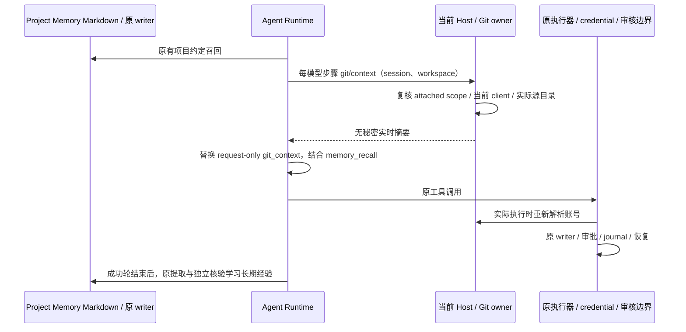

# Git 实时上下文与项目记忆联动

## 产品规则

Git 账号绑定负责当前事实，Project Memory 负责用户已采用的长期 Git 约定和有证据的排错经验。两者供同一 Agent 使用，不建立第二份账号配置或记忆 writer。

- 每次模型步骤前，通过当前 session 的私有 Host 协议只读获取实际项目源目录的 Git 摘要；账号改选、删除、远端改址、linked worktree 与多源目录均按原 Git owner 的实时结果处理。摘要不能读取令牌、刷新 OAuth 或调用系统 credential fill。
- 摘要只含仓库目录、版本、远端 URL、认证匹配状态和实际账号名称/用户名/平台；不提供候选账号全集、账号 ID、私钥路径、token、审批记录或写入能力。多账号未选、旧绑定失效与未配置明确区分。
- 私有 `git/context` 请求复用 `git/credential` 的 attached workspace、session、worktree ready、execution-set 与当前 client 检查。当前 Host 返回当前已授权源目录，不递归扫描项目外目录；最多 20 个目录、四目录并发、每仓库最多 32 个 URL，超出明确标记 partial。离线目录独立返回不可用，不读取本机同名远程路径作为回退。
- 摘要每个模型步骤重新获取并替换原 request overlay；失败或取消不保留旧结果。无此能力的 CLI/旧 Host 保留现有行为，失败不阻断普通对话、不重试 Git 写入。执行时的认证仍由原私有 credential 通道再次核验，模型看见的摘要从不成为授权。
- 可选摘要请求采用 5 秒只读预算；超时只表示本次摘要不可用，不推断账号失效、不重发请求、不重放工具。取消或迟到应答由原 RPC owner 清理，原认证与写入流程继续独立执行核验。
- 摘要为当前 request 的派生信息，与 memory recall 分开标记；不进入 canonical session、ModelRequest 持久化投影、compact 摘要、轮后记忆证据或新一轮恢复。模型可结合召回的项目 Git 习惯理解摘要，但不能用记忆复活旧账号、改变远端、推送权限或批准过期审核。
- 普通子 Agent、script/DWF 和 legacy workflow 子 runtime 继承父会话已绑定的只读 provider，仍由原 session/workspace 授权，不授予子会话额外目录，也不创建新的执行或 credential owner。
- 长期记忆可记录提交格式、分支命名、已采用的审核流程、文件排除约定及经确认的排错经验。不能把一次性文件列表、提交 hash、发布完成状态、账号绑定、token/私钥、审批/审核 ID 作为长期配置保存。
- 生成与独立核验都明确区分 Git 约定和临时配置；候选 frontmatter 中的 `gitContext`、`gitAuthentication`、`accountBindings`、`accountId`、`privateKeyPath`、`reviewId`、`approvalId` 属于受保护控制字段，沿原硬校验拒绝，不能由模型“同意”豁免。普通排错说明中提及接口或配置名称仍可按证据复核。
- 复用原完成轮提取 scheduler、来源重验、独立 AI 核验、root lock、CAS、journal 与恢复；不增加后台 Agent、模型请求阶段、旁路写入、定时任务或自动 Git 发布。更新现有相关 topic，避免为每次操作生成重复记忆。普通项目记忆开关不影响实时 Git 认证；关闭自动提取时不新写记忆。
- Windows/macOS/Linux 的 Git 路径、system credential、scope 规则保持原适配。桌面 continuous 与手机 replayable 都连接同一个 Host owner，不增加 Renderer 队列或 Main 业务状态。

## 所有者、接口与顺序

`GitManagementService` 内部 routing owner 提供 `readRepositoryContext` 无秘密投影，复用真实 common-dir/URL/profile 解析；Host 根据已有项目源目录授权汇总。`git/context` 有严格请求和结果 schema，不加入公开账号写入服务。Bootstrap 将其作为可选依赖注入 Runtime；Core 不引用 Service 实现。

## 验收矩阵

1. 两个系统账号的明确绑定、自动唯一匹配、多账号未选、旧绑定/删除/改址、清除选择和 legacy origin 的摘要与实际执行一致；读取摘要零凭据查询与 OAuth 刷新。
2. 多目录、多 remote、多 push URL、linked worktree 和远端 identity 隔离；无效目录/过量结果有明确状态，其他有效目录继续返回。
3. 私有协议拒绝伪造 scope、非 ready worktree、过期 execution set、非当前 client、迟到结果及额外敏感字段。
4. 实际 Runtime 模型请求同时包含记忆约定和最新 Git 上下文；改选后下一步骤更新，失效或失败清除旧摘要；canonical history、存储请求、compact 和学习材料中没有该摘要。
5. Git 长期约定与审核经验沿原核验/CAS 路径学习并在后续轮召回；一次性账号事实、私钥和令牌不晋升为记忆；多次复盘沿用原消费去重。
6. 回归认证/写入/恢复以及记忆提取、召回和请求投影。执行根目录 typecheck/lint、CLI/core/bootstrap 检查、架构、格式与生成输入校验。安装版和其他平台真机等用户构建后再验收。

## 验证记录

2026-10-21，Windows、Node 24.21.0。本次重新执行 **415 项测试，全部通过，无跳过**：

| 验证范围                                                                                                    | 通过数 |
| ----------------------------------------------------------------------------------------------------------- | ------ |
| 账号、只读上下文、三平台元数据、私有协议、worktree/execution-set 授权、实际隔离 HTTP Git 和 SSH helper      | 88     |
| 全部 core memory 测试及 Runtime 召回/请求投影、真实 SQLite/CAS、冷恢复、学习去重、子 Agent 和 workflow 接线 | 220    |
| 原 Git 写入协调、分支/Tag 发布并行检查、journal、checkout reservation、Agent admission、关闭及环境恢复      | 100    |
| Agent 嵌入 worker、生成顺序和发布输入一致性                                                                 | 7      |

- 根目录 `pnpm typecheck`、`pnpm lint`、`pnpm architecture:check --changed` 通过；架构基线和新增违规均为 0。
- core、bootstrap、CLI 的独立 typecheck 通过；core/bootstrap 独立 lint 通过。实际 Runtime 集成前按当前包的 `build` 脚本更新 core 库产物，避免测试使用旧的包导出；未构建或安装桌面客户端/SEA 可执行文件。
- Root 与 CLI 各自的定向 oxfmt 检查、`git diff --check` 和功能图谱路径/符号/边校验通过。共享协议变化后已同步嵌入 worker 和第三方输入清单。
- 实测包含最新账号从 Alice 改为 Bob、删除后 stale、远端改址、无秘密摘要、四目录并发上界、超量 partial、过期 client/作用域、source-review 控制字段硬拒绝、真实长期约定更新/后续召回和重复证据零二次写入。
- 本次无 UI 改动，交互验证使用真实 Runtime、SQLite、文件 adapter 及模型请求夹具。未进行真实付费模型质量评估、用户系统凭据读取、外部仓库发布、安装版或 macOS/Linux 真机验收；待用户构建后再验收客户端。

命令输出、文件哈希、净行数和结构化验证记录保存在本机忽略目录 `artifacts/git-memory-integration/`。状态所有者仍为 Host Git profile 与原 Project Memory Markdown writer；当前请求仅持有派生摘要。
