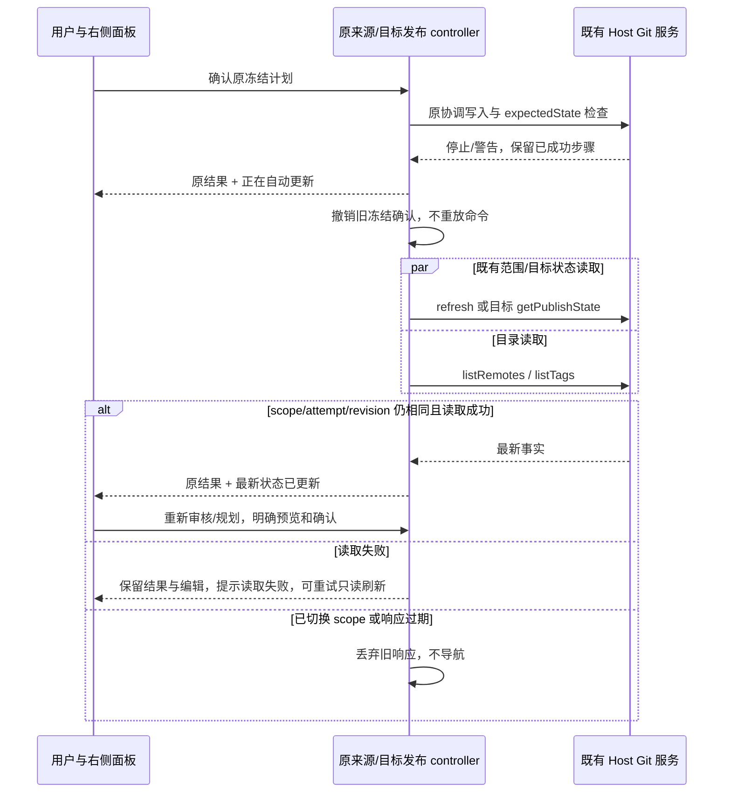

# 发布停止后的自动刷新与重新确认（2026-10-21）

## 问题与范围

第五轮 Windows 安装版已实测通过语义 index 修复：普通、冻结审核的分支和 Tag 发布期间运行外部 status 均成功；冻结提交的 index 原始字节确有变化，暂存语义、HEAD 与文件内容不变。真实内容变化仍停止后续 Tag，普通/冻结过期审批均在写入前拒绝；原生显式刷新后可以重新确认并发布。证据在 `artifacts/git-build-acceptance-pass5/report.md`。

用户进一步要求取消保护停止后必须人工刷新的步骤。当前 GitActionMenu 与 useWorktreePublication 的执行结果只提示重新读取，最新范围与目录要靠用户点击刷新。此次修改两个既有 controller 的只读恢复流程，不改变 GitPublishStateReader、统一 checkout writer/lease、expectedState、journal 或成功事实。

## 产品规则

- 执行/重试返回终态 stopReason 后，由发起命令的既有 controller 自动发起一次只读刷新；不靠 effect 轮询、超时、重复执行或字符串匹配错误文案。
- 来源发布读取最新审核范围、身份与远端/Tag 目录；显式人工范围、排除、未暂存选项及消息保留。采用 Host 当前范围，不重新套用旧任务自动草稿的文件列表。冻结审核引用与确认失效，未完成的冻结范围必须重新生成审核，不能静默降级为普通提交。
- 合并目标发布沿 useWorktreePublication 读取目标分支状态和远端/Tag；operation 的 targetBranch/candidateHead 继续是原目标事实，不自动改为移动后的分支 HEAD，也不把来源工作树状态用作目标审批。
- 刷新与发布严格分开：不会生成可执行的新计划、自动勾选冻结确认、提交、推送、创建 Tag、重放成功步骤或放宽原恢复门禁。新计划仍经原预览及明确确认。
- 原执行结果、警告、固定目标和成功提交/OID 一直保留到用户明确开始下一次审核/规划。刷新不会自动切页、重开已关闭的面板、改消息/发布选项或掩盖失败。
- UI 显示“正在自动更新 / 最新状态已更新 / 自动更新失败”。读取完成后按钮进入重新审核/规划，不再要求点击刷新；只有本次读取确实失败时提供显式重试读取，禁止无限自动重试。
- 刷新期间阻止新计划和重试；失败时不能以旧范围继续。现有可隔离网络失败没有 stopReason 时保留原单步重试行为，不制造新的发布停止。
- 同一终态仅刷新一次。scope/session/epoch、attempt、view revision、读取 ticket 继续拒绝迟到响应；刷新中的会话切换和关闭不产生新导航或命令。Desktop continuous 与手机 replayable 使用相同 Host 事实，刷新阶段仅是本机读请求状态，不同步为另一份 Git 事实。

## 所有者与事件顺序

GitActionMenu 持有来源计划/执行结果/读请求阶段；useWorktreePublication 持有合并目标的对应状态。Host 拥有共享草稿、范围、冻结审核与 Git 写入事实。GitPublishResults 仅显示结果和读请求阶段，没有服务调用。

## 先测试再实现

1. 普通过期计划自动更新范围与目录；不点刷新即可看到更新完成，消息/远端/Tag 选项和原结果保留，副作用为零。
2. 冻结计划失效后旧确认撤销，重新生成前不能提交，人工消息不被覆盖；再次生成并确认后仍沿原提交路径。
3. 分支推送成功后真实状态变化或 warning：成功结果保留，后续 Tag 未执行；只读刷新完成不自动创建计划或重推。
4. 暂时读取失败：原成功结果保留，不能用旧状态开新计划，明确重试后恢复；没有计时轮询。
5. 刷新有在途范围/目录读取时切 session/epoch，迟到结果不能覆盖新审核、发布配置或导航；关闭期间不重开。
6. 合并目标 controller 同样自动读目标 ref/目录，保持 candidateHead 校验及来源/目标边界；原独立网络失败重试保持。
7. 390px、明暗主题的阶段文案和操作无溢出；相关 E2E、原发布/入口/共享 Host 回归、类型、Lint、架构与格式检查实际执行。

安装版原行为的验收与此次源码增强分开记录。新增自动刷新需用户下次构建后再做原生验收，本轮不构建或替换安装文件。

## 实施结果

来源及目标两个 controller 已按上述事件顺序实现。发布/编辑/自动刷新浏览器回归 30/30，工作树合并和目标发布回归 2/2，原审核侧栏 34/34、共享 Host 9/9 通过。包括读取失败重试、scope/epoch 失效、成功事实与编辑保留、不重放，以及手动重开先进入审核页、切至远端仍保留结果。最终类型、Lint、架构、相关文件格式及 whitespace 检查通过；证据见 `artifacts/git-build-acceptance-pass5/report.md`。
