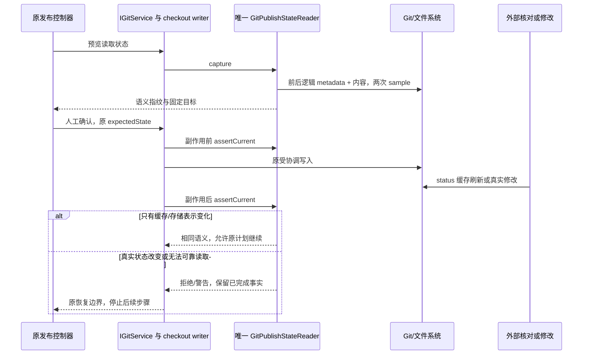

# Git 发布语义状态与并行核对（2026-10-21）

## 已确认问题与证据

第四轮 Windows 安装版记录过提交/分支推送成功后、Tag 前的保护停止。原场次没有保存前后 index 字节，不能事后证明唯一原因；本轮用真实 Git、本地 bare origin 和真实 IGitService，在 push 完成与后置验证之间设置显式屏障，稳定复现同样提示。

`artifacts/git-publish-protection-investigation/reproduction-results.json` 保存修复前八组对照，原始 index 前后文件及 HEAD、条目、内容、完整状态指纹在 evidence/。无干预、log/引用核对、GIT_OPTIONAL_LOCKS=0 的 status、应用摘要均无警告；允许缓存刷新的 status 与 update-index --refresh 仅改变原始 index 字节，逻辑条目/内容/HEAD 不变，却产生 indexFingerprint 变化和成功后的 warning；真实索引标志或内容修改仍产生 warning。

原因是 GitPublishStateReader 将整个 index 文件的 SHA256 作为审批事实，混入 stat、缓存扩展及存储布局。Git 官方说明 status 可刷新并写回 stat 缓存：[status background refresh](https://git-scm.com/docs/git-status#_background_refresh)、[index format](https://git-scm.com/docs/index-format)。

## 产品规则与唯一所有者

- 预览接受的是 HEAD、分支、完整逻辑暂存区、工作树内容和有效远端配置；相同逻辑状态的缓存刷新或 index v2/v3/v4、split 等存储表示变化，不应废除人工确认。
- 真实 OID、路径、模式、stage、assume-unchanged、skip-worktree、intent-to-add 的改变必须废除确认。不能只删除 raw index 比较而遗漏标志；空文件 intent-to-add 与普通已暂存空文件的 OID/路径可相同，仍必须区分。
- 工作树继续直接读取 tracked/untracked 内容、链接及执行位，包括被索引标志隐藏的修改；原冲突、子模块、路径越界、字节预算、读取期间变更、超时和截断拒绝边界保留。
- GitPublishStateReader（services/repo）继续是唯一快照实现；提交、推送、Tag、文件操作、历史与恢复调用方仍使用既有 getPublishState / expectedState。UI 不自行判断缓存变化，不忽略 warning，也不增加另一条写入路径或协调器。
- 统一 checkout writer/lease、workspace identity fallback、固定 OID/目标、目标 URL 校验、journal、成功事实与部分失败恢复均不变。真实变化仍在副作用前拒绝；成功推送后发现真实变化仍返回成功事实加警告，并停止后续步骤，绝不重放或强推。

## 接口与实现边界

- GitPublishState 的严格协议和 64 位十六进制不透明指纹保持不变。indexFingerprint 内部改为带算法域标识的逻辑记录摘要；不新增客户端或恢复字段。
- 由 Git 负责解码物理索引及 split/sparse 等形式；使用同一次 ls-files 的 stage、mode、OID、原始 NUL 路径和持久标志，排除 stat 与内存/缓存标志。保留前后 metadata 与两次 sample 的一致性校验，不通过等待、重试或自动重新接受状态掩盖并发修改。
- ls-files -v 的状态字符不能单独辨认 intent-to-add；适配器读取 --debug 的 flags 并仅取持久语义位。该输出官方声明可变，因此必须严格校验记录结构、OID、stage、flags 与尾部完整性；格式不认识时明确拒绝，不降级为空范围、仅路径或 raw 字节比较。Git 版本变化需由契约回归发现。[ls-files documentation](https://git-scm.com/docs/git-ls-files#Documentation/git-ls-files.txt---debug)
- 故障注入同时暴露 metadata 的 Promise.all 提前拒绝会留下其他未结束 Git 读取；并行读取必须全部 settled 后才返回错误，不改变失败结果，不增加等待重试。读取失败和进程资源释放一起验收。
- 未改变 sourceBranch 仅冻结显式本地 ref 的独立语义。工作树全量快照仍不使用 status/摘要缓存，应用已有 GIT_OPTIONAL_LOCKS=0 保留，但不能假设外部工具遵守该环境。
- 新旧算法使用不同域标识。旧冻结计划/恢复快照不批量换算或重新签认；尚未执行的新写入在既有 expectedState 检查失败后，由用户显式刷新/重新确认。已完成事实的查询和幂等返回仍沿用原路径；已成功的提交/推送和 journal 不清除、不回滚、不补发。

## 测试与验收

先补会失败的真实 Git 回归，再修改实现，最后执行相关发布、协调/恢复及 UI 回归：

1. 三处时序：接受后到副作用前、采样中、push 完成到后置检查；cache-only 刷新均不误报，实际内容或暂存修改仍失效。全部使用显式 command 屏障，不用定时等待。
2. 普通和冻结审核真实提交 → 分支推送 → 创建 Tag → 推送 Tag，注入外部 status 刷新后所有步骤成功；核对实际引用和只提交一次。
3. flags：assume-unchanged、skip-worktree、intent-to-add（含空文件相同 OID），包括隐藏的工作树字节变化，保持拒绝。
4. 表示与路径：index v2/v3/v4、split、SHA-256、unborn/missing index、带空格/Tab/换行/中文路径；逻辑状态相同则一致，不支持的内容仍失败关闭。
5. 损坏、格式未知、截断、读取失败、捕获时真实修改；旧算法 expectedState 必须拒绝，不创建 Tag 或推送。
6. 沿用既有真实 Git 发布/Tag、checkout coordination、journal、历史 Reset/恢复和 UI 部分失败重试回归；typecheck、lint、架构、格式与 whitespace 实际执行并记录。

上轮源码修复未构建或替换 `D:\LCode\LCode.exe`。用户现已重建，下节记录 Windows 安装版的并行 status 复验；其他平台真机仍未执行。源码实验与安装版实测分开记录。

## 实施与验证结果

唯一读取器已采用带域标识的语义索引，严格适配器保留持久 flags，metadata 失败先收束所有并行 IO。新增专项 32/32 通过；真实 Git 发布/文件/网络/协调/恢复/历史等回归 184 通过、1 项 POSIX executable Hook 场景按 Windows 平台跳过、0 失败；入口 UI 13/13 与发布 UI 22/22 通过。修复前八组对照、修复后同一矩阵 8/8、不修改文件时间的自然冻结提交 3/3，以及 stat 字节差异均记录在 `artifacts/git-publish-protection-investigation/report.md`。计数含根测试且场景重叠，不相加。pnpm typecheck、pnpm lint、架构 changed（violations/baseline/new 均为 0）、本轮格式及 whitespace 检查通过；该修复的 Windows 安装版复验见下节，其他平台真机仍待执行。

## 2026-10-21 安装版复验补记

`D:\LCode\LCode.exe` 3.20.0，安装前后 `app.asar` SHA256 均为 `9DBF4AF798B0B6A17FAE1576999DD13E480DE21FFB1B6A9F37B8216C1456E3F7`。隔离 profile/仓库与 bare origin，未提交或推送真实工作仓库。

普通手动审核与任务完成后的冻结审核均在分支、Tag 的 pre-push 屏障中执行外部 `git status`（每阶段 20 次）。普通发布成功；冻结发布期间观测到原始 index 字节改变、逻辑条目与 HEAD/文件内容不变，分支与 Tag 仍成功。真实内容变化则保留已成功提交/分支步骤，阻断后续 Tag；旧手动/冻结计划全部在写入前拒绝，重新读取并明确确认新计划后成功。持久 assume-unchanged 标志仍会使冻结旧计划失效，测试结束恢复该标志。

安装版没有确认到新的并行 status 误判。旧 raw-hash 审批迁移拒绝由真实 Git 源码测试覆盖，未伪造安装版历史审批。证据与边界见 `artifacts/git-build-acceptance-pass5/report.md`。新增自动刷新属于后续源码增强，需用户下次构建后另验。
