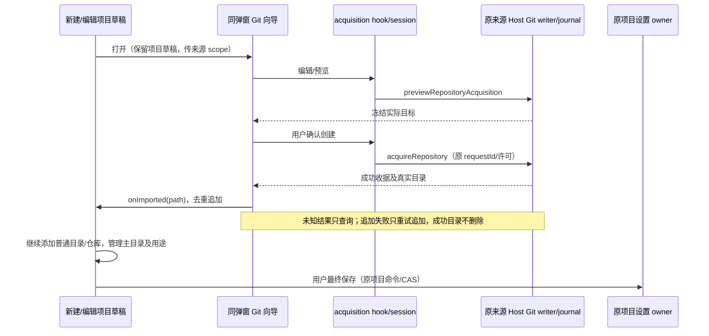

# 项目内 Git 仓库引导与多源文件夹（2026-10-21）

## 产品规则

- 按本次需求撤销项目菜单中与「新建项目」「远程连接」平级的独立「Git 仓库」入口。新建项目及编辑项目的「源文件夹」标题行，在「添加目录」后显示「Git 仓库」。
- 仓库向导属于当前项目表单，在同一个 Dialog 内切换内容，不叠加第二个项目弹框。打开、返回或取消向导保留项目名称、文件夹、用途、默认参与、排序等草稿。
- 向导四步：仓库方式 → 保存位置 → 仓库配置 → 确认并添加。仅负责克隆或初始化一个仓库目录；不创建项目、不选择项目分组、不自动打开工作区。用户可重复进入，引入多个仓库并与普通目录组成同一项目。
- 克隆选择现有父目录、目标目录名、仓库 URL 和认证账号；初始化选择既有目录、初始分支及嵌套仓库明确许可。当前 Host 的 Git 管理提供配置和账号引用，不复制令牌，不新增配置写入路径。
- 前三步只编辑或预览。最终确认使用原 Host 冻结预览和 acquireRepository；真实成功目录加入当前源文件夹列表，返回项目表单。保存项目之前，不登记项目或改变已保存项目范围。
- 新建项目第一个目录默认主要；其他目录提供「设为主文件夹」，保持一个主目录并将其排在 sourceFolderPaths 首位。编辑项目保留原有主目录及身份锚点，不允许借此更换或移除主目录；其他目录沿用排序、移除、用途和默认参与管理。
- 目录按现有路径规范去重，重复添加不能丢失用途或默认参与设置；沿用 20 个源文件夹上限。预览发现无法追加的新目标时在 Git 写入前阻断；初始化现有源目录可复用该行。完成后的移除或取消项目只解除草稿关联，不删除真实仓库目录。

## 状态所有者与接口

- 新建表单拥有名称、members 顺序及固定 projectId intent；编辑表单沿用 useProjectEditor 的项目草稿、revision/CAS 和来源连接检查。Git 向导仅拥有步骤及当前 acquisition 参数，不复制项目列表或保存项目定义。
- GitRepositoryWizard 通过 onImported(path) 将成功目录交回表单；添加失败可再次添加同一成功目录，不重放 init/clone。创建后保留提示明确说明目录已写入磁盘，项目保存仍是独立动作。
- useGitRepositoryAcquisition/useGitOperationSession 继续唯一拥有预览、Host/context、requestId 和收据关联；Git 服务继续原 writer admission、协调器、journal 与恢复边界。只查询未知结果，不以超时重新执行，不自动回滚或删除已创建目录。
- 历史成功收据不能冒充本次新向导的成功结果；只有本次已确认操作或其原收据恢复可以直接交接目录。session 在发送 mutation 前记录本次请求关联 ID，向导同时核对 context、requestId 和 kind，不能仅凭同目录和 success 交接；上一成功收据留在页面而下一请求丢回执时，也必须先查下一请求。该 ID 只是 UI 请求关联，Host 仍拥有 admission/journal 事实。未知、running、partial、conflict 禁止继续新的创建；保留查询和原检查完成入口。
- 新建本地项目固定使用 Base Host，不能被活动远端工作区污染。编辑项目使用其原 workspaceIdentity、remoteSessionId 与来源 Host；目录浏览和 Git 配置/账号均来自同一 Host，断连不 fallback 到本地。
- 平台路径浏览复用 IPlatformService/DirectoryBrowser。手机复用连接 Host；不创建额外 Host 或 Agent。新增行为不改变 stdio 协议、项目 schema 或已接受的会话范围。
- 新建/编辑最终仍通过原项目保存回调与设置 owner 登记多目录。既有 projectId/sidebarSectionId 调用兼容保留；仓库向导不再承担分组或项目导航。
- 项目已保存但后续归组/打开失败时，相同 intent/主目录的原样重试复用已保存事实；用户继续补充名称、源目录或用途后再次保存，必须按已保存 revision 执行原 CAS 更新，不能跳过保存而丢失新草稿，也不能覆盖其他 intent 或改变原主目录。

## 验收场景

1. 项目选择菜单没有独立 Git 入口；新建和编辑的源文件夹标题行按「添加目录」「Git 仓库」顺序展示，窄屏换行不溢出。
2. 普通目录 + 两个仓库加入同一新建草稿，主目录可选，项目名/用途/默认参与保留；确认 Git 之前无写入，最终只创建一个多目录项目。
3. 初始化既有源目录不重复插行；返回或 Escape 回到原项目草稿。取消项目、移除已创建源目录均不删除磁盘目录。
4. 新建最终保存失败重试保留固定 intent 和全部源目录，不重复 Git 写入。编辑时只改草稿，最终原 CAS 保存；取消编辑不改变已存项目。
5. 默认分支异步加载不能覆盖用户输入；账号按当前来源 Host 匹配 URL。真实仓库创建/认证/目录恢复继续运行既有服务集成测试。
6. 执行中防双击、禁止返回/关闭；失去响应仅查询原 requestId，成功后再追加；失败或不确定结果保留旧恢复入口。重复打开不直接附加历史成功收据中的目录。
7. 20 个上限、路径去重、添加失败后重试、嵌套保护、远端断连及迟到结果隔离。主目录在普通编辑中保持不变。
8. 390px/桌面、明暗主题、中英文、键盘操作、单 Dialog 焦点与布局回归。执行 typecheck、Lint、架构检查及相关 E2E，构建版验收等待用户重新构建。

## 实施与验证

已移除独立菜单入口，新建/编辑表单在「添加目录」后进入同弹窗向导。普通目录与多个仓库共同保留在项目草稿，新增主目录选择，编辑保留原身份锚点；Git 成功后只追加目录，不直接登记单目录项目。重复路径、20 个上限、添加失败重试、取消保留磁盘文件、嵌套保护和原收据恢复均有回归。

两处问题先用失败用例复现再修正：同一项目 intent 在部分保存后新增目录会被跳过，现按原 CAS 更新；连续创建时下一请求丢回执可能复用上一成功收据，现由原 session 记录并核对本次 mutation requestId。未新增 Git 写入路径或业务状态所有者。

83 项服务/网络/真实 Git 与目录测试、34 项浏览器测试通过；typecheck、Lint、架构及目标格式/空白检查通过。初次并行启动多个浏览器夹具出现页面加载超时，串行复验通过；不增加产品超时或同步兜底。明细见 `artifacts/project-git-integration/validation.json`。安装版及其他系统真机验收等待用户重新构建。
