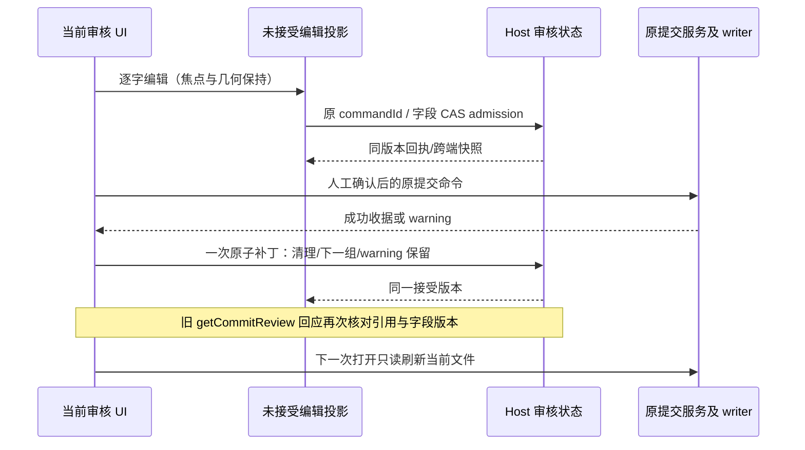

# 审核输入稳定性与提交完成状态

## 问题与产品规则

2026-10-21：输入提交信息时，Host 草稿保存状态在 saving/ready 间切换，原同步条反复进入/退出文档流，导致审核文件区、消息框和滚动位置抖动。普通手动范围修改也无条件设置 `requiresRegeneration`，错误要求用户调用模型。提交完成时草稿、审核引用及范围分多次 admission 写入，旧审核读取的迟到结果还可能把新状态标成失效。

- 普通 saving 是持续输入的正常状态，不改变内容区域几何、焦点、选区、文本框高度或滚动位置；辅助技术仍能读取保存状态。loading、断线、字段冲突保留可见状态与原恢复操作。
- 普通手动提交未持有冻结审核时，勾选、排除、恢复文件或读取最新 Git 状态直接更新当前范围，不要求重新生成模型审核。原提交路径仍按实际所选路径、index/HEAD、writer 和真实 Git 状态验证。
- 已有冻结审核或失效审核的范围变化继续清除确认、废止旧冻结引用、保留人工文本并禁止使用旧审核提交。提示只描述当前改动需要重新审核，提供现有生成入口；不自动调用模型、不替用户确认、不重放 Git 写入。
- 对没有有效冻结引用且没有提交恢复错误的旧失效状态，允许用户明确“改用普通手动提交（当前所选整个文件）”：先沿原 scope 读取最新 Git 文件状态，再保留文本/范围并解除冻结审核门禁。读取失败或 scope/attempt 变化时不解除；恢复 warning 不能通过该入口消除。此为显式模式选择，不是自动批准旧审核。
- 同轮检查文件分页/搜索、目录勾选、Diff 切换、分区 resize、远端表单和历史筛选。远端账号区只读刷新保留已有列表，禁用待核对选择；新 scope 仍从空状态开始，不借用旧 scope 结果。
- 最终提交无 warning 成功时，草稿、引用、正向范围、排除、浏览位置和 includeUnstaged 默认值用一次 Host admission 清理；剩余分组则一次性推进到下一组。下一次打开自动读取最新文件，不能再出现旧审核过期提示。
- 提交返回 warning 时保留原文本、范围、冻结引用与恢复上下文，维持重新审核门禁，不能自动把 warning 当作最终完成。
- 异步冻结审核读取在返回后重新核对本 scope 的引用和引用字段版本；提交已清理、人工替换、跨端变更或同 ID 新版本后，旧结果不能清除新审核、写入 regeneration 或覆盖新确认。
- 不通过延时隐藏同步问题，不增加草稿、审核或提交事实的第二所有者。

## 所有者、接口和事件顺序

Host `GitReviewWorkspaceState` 继续持有已接受的草稿与范围；UI `ReviewWorkspaceProjectionStore` 只持有快照和未接受编辑。冻结内容/提交收据归原 `CommitReviewService`，writer、journal、恢复预留及身份隔离不变。无需新增 RPC 或持久化字段。

桌面 continuous 与手机 replayable 继续沿原订阅、完整快照和字段版本恢复；saving 不改变写入门禁，断线和冲突不能被视觉优化掩盖。

## 验收计划

1. 用草稿保存屏障复现输入时的布局移动，逐字输入、长文本、中文输入法、选区、人工 resize、滚动和窄屏回归。
2. 普通手动选择/取消文件并编辑消息可以提交当前所选范围；不会自动调用模型或设置 regeneration。
3. 冻结范围变化仍阻止旧提交，显示有效重新审核入口；显式重新生成才产生新审核，不自动提交。
4. 最终成功与分组推进的草稿/引用/范围属于一个 admission；warning 保留文本和范围。
5. 确定性迟到读取在引用清理、更换以及同 ID 新版本后不污染新状态；跨端并发、响应丢失、重连恢复继续通过。
6. 执行相关单测、浏览器回归、typecheck、lint、架构与定向格式检查；构建版待用户重新构建后验收。

## 验证记录

已实现。首次确定性浏览器复现中，输入框 y 从 580.84375 移到 596.15625，偏移约 15.31 CSS px；普通排除文件会误置 regeneration；warning 会把人工文本清空；成功完成的首个 admission 只含草稿，缺少引用和范围。修复后的专项断言在保存前、保存中和回执后检查位置误差小于 1 CSS px，并验证选区、焦点、中文 composition 事件和分区比例。

| 已执行验证                                                         | 结果                             |
| ------------------------------------------------------------------ | -------------------------------- |
| 专项输入/范围/完成、旧状态手动恢复、迟到读取、远端账号刷新         | 13 项通过                        |
| 原审核入口、目录、分页、Diff、文件操作、手机和主题                 | 34 项通过                        |
| 发布保护停止与自动刷新                                             | 9 项通过                         |
| 实际 Host 的桌面/手机共享状态与重连                                | 9 项通过                         |
| 图谱筛选、列宽、键盘/菜单、详情/Diff 分区与高级历史操作            | 26 项通过                        |
| 工作树提交/合并阶段、失败重试与原请求边界                          | 8 项通过                         |
| 完成补丁、Host/投影并发、并行 status 与真实内容变化保护            | 37 项通过                        |
| 手机抽屉焦点、Tab 与 Escape 边界                                   | 3 项通过                         |
| `pnpm typecheck`、`pnpm lint`、`pnpm architecture:check --changed` | 通过；架构总违规/基线/新增均为 0 |
| 定向格式、diff 空白及功能图谱 seed/符号校验                        | 通过                             |

总计 139 项测试执行通过，包含 Node 套件容器及不同批次重复的网络场景，非唯一场景数。测试使用生产组件、确定性 Host 桩和隔离临时 Git 仓库；未修改用户实际仓库或执行外部发布。

本轮涉及 UI、Web 测试与对应 spec。Host、RPC、writer、journal 和恢复预留接口未变；修改文件清单、相对上轮保留改动的净行数、复现截图/日志和最终结果保存在本机忽略目录 `artifacts/git-review-editing/`。输入法 composition 为浏览器事件回归，未声称原生系统输入法或真机软键盘验收。安装版等待用户重新构建后复验。
