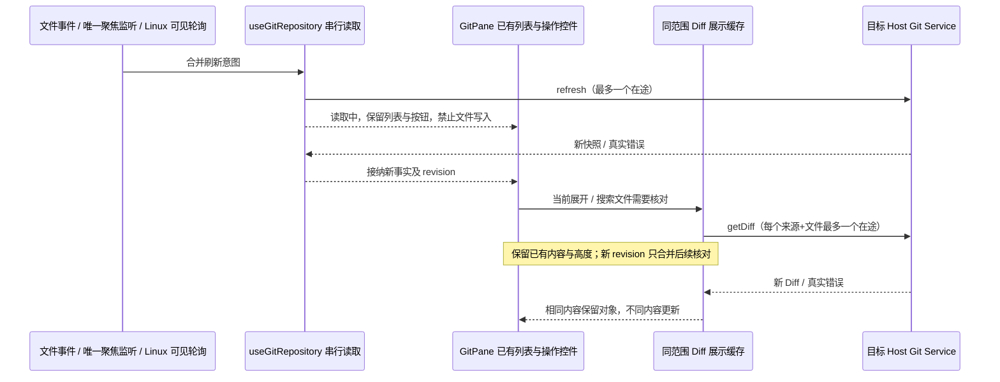
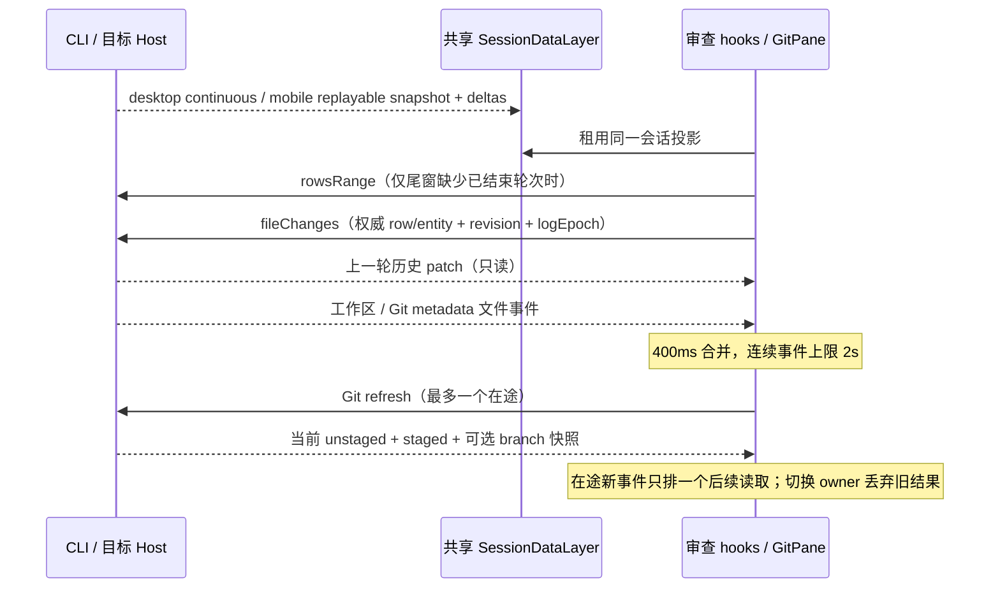
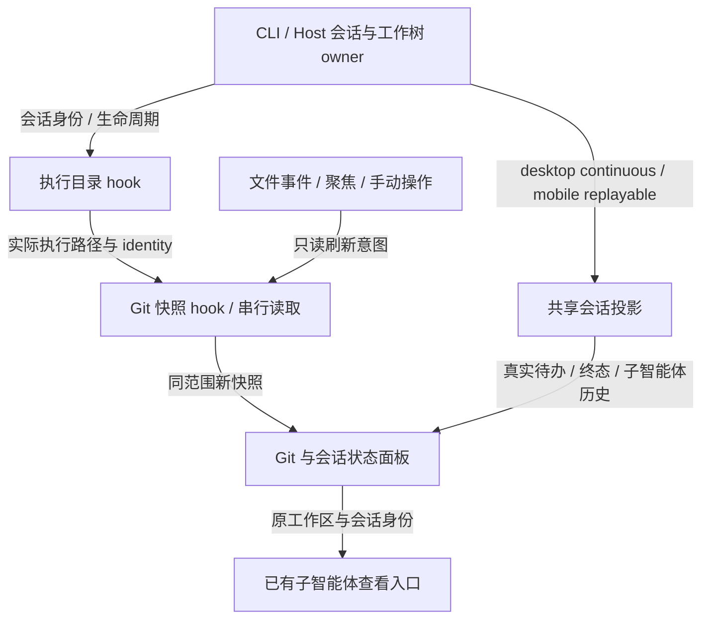

# Git 审查：上一轮历史与及时刷新

## 规则与边界

- 未暂存 = 当前工作目录相对 index 的改动（含未跟踪文件）；已暂存 = index 相对 HEAD 的改动。提交完成后暂存区为空是正常状态，未推送的提交不属于这两个来源。
- 上一轮改动 = 当前会话最近一个已结束的 agent 产品轮次的文件差异。运行中的下一轮不覆盖它；最新结束轮次无改动或已撤销时显示对应空状态，不向更旧轮次寻找非空数据。跳过不执行 agent 的 controlOnly 轮。
- 使用 V4 turnHeader 和 conversation/fileChanges，与聊天中的文件摘要使用相同权威数据。不依赖 TaskIndex.changeSummary，不恢复已移除的 per-turn Zustand map，不从当前 Git diff 重建历史。
- 只在审查面板存在时租用现有 workspace connection / SessionDataLayer。原项目路径用于会话路由，execution workspacePath 用于 Git 和文件显示，远端贯穿 identity 与 remoteSessionId。历史尾窗没有上一轮时，按既有 rowsRange 分页向前寻找，遇到最新已结束轮次即停止；不修改聊天的窗口或业务状态。
- 历史差异只读；读取失败显示诊断和刷新入口，不伪装成零文件。会话、Host、workspace 或 logEpoch 变化后丢弃旧查询结果；手动刷新可重试。提交不会清空历史差异。
- 短批文件事件采用 400ms 合并，连续事件最多等待 2s 即触发刷新，不使用原 60s 的无限延后策略。文件监听路径仍复用 Host 提供的工作区与 Git metadata 路径，工作树保留独立 gitDir / commonDir。
- Host 文件 watcher 的 150ms 合并也必须设置 500ms 上限，否则客户端根本收不到连续写入信号。它仍只广播文件事件，不承载 Git 状态。Git status / diff 只读调用禁用 optional index refresh，避免读操作写回 index 触发自己的监听形成循环；真正暂存、提交和切换分支仍执行原生写入与锁定。
- 每个 Git 读取所有者同时最多一个 refresh RPC。在途期间合并为一个后续读取，先显示已完成快照再读取最新状态，持续写文件不能让所有响应失效。切换 owner 后旧结果丢弃；React effect 重挂载不能造成永久 loading。
- 回到可见页面 / 窗口聚焦时刷新，补齐后台期间的变化。保持监听失败诊断及手动刷新。UI 不自动暂存、提交、推送或改审核文件范围。
- Linux 按既有平台边界不递归监听整棵工作区；仅审查面板可见时，每 2s 补读一次 Git 状态，后台/关闭面板停止。Windows/macOS 使用文件事件。轮询、文件事件与人工刷新共享同一串行读取所有者。
- 自动 Git 刷新不递增历史查询版本，不重复读取整轮 patch；只有轮次/撤销/纪元改变或人工刷新才重读历史。
- 空状态按来源说明原因：已暂存无改动说明提交后清空；未暂存无改动说明当前文件已与 index 一致；上一轮说明已结束轮次的历史语义。中英文、桌面和手机共享组件。
- 每轮聊天文件摘要在“撤销”前提供“审查”。按钮携带该会话、轮次 row/entity、logEpoch 与原 workspace 路由，打开同一审查面板的“所选轮次改动”；选择保持在该轮，不随下一轮开始/完成漂移。手动重新选择“上一轮改动”回到自动跟随最近已结束轮次；会话/工作区切换清除指定轮次。运行中、缺少 entity 和已撤销时按钮不可用。只读审查与撤销是独立动作。

## 后台刷新稳定性（2026-10-22）

### 已确认原因与产品规则

- 变更页把读取中的 `loading` 同时当作文件操作能力：每轮刷新卸载再挂载暂存/丢弃按钮，导致文件名、统计和展开箭头横向跳动。区分长期能力与即时可执行性：同范围有效列表的按钮保持 DOM、位置和尺寸，读取期间仍禁止发送写入，不能移除按钮或反复改变透明度。
- 每次 Git 读取完成都增加 revision；旧实现据此清空整个 Diff 缓存，使已经展开的内容反复变成 loading、收缩后再展开。revision 仅使缓存需要重新核对，不能先删除已显示内容。相同 Diff 沿用原对象；内容不同（包括增删行数不变）仍须更新。
- 同范围、同来源、同文件最多一个在途 Diff 读取。在途收到多个 revision 合并为最新一次后续读取，先接纳当前结果再核对最新版本，不能用不断丢弃响应造成饥饿。首次尚无 Diff 才显示 loading；读取失败显示真实诊断，不能无限伪装为成功旧内容。
- 源码检查另发现重复选中当前历史轮次也会先清空 dataset。同一 lease、路径、轮次权威 key 的历史重新核对保留已有列表和内嵌 patch；自动跟随切换到同一轮的显式选择使用同一有效 logEpoch。真正换轮、换 lease/路径/纪元时仍隔离旧内容，过期显式请求仍报错。扩展测试原始版本也出现历史 Diff 空白；运行时确认夹具缺少产品使用的 worker provider，先补齐相同 provider 后验证历史刷新。
- 文件内容查找仅在查询、当前命中位置或显式导航变化时定位；缓存重新核对和相同快照不能因对象引用改变把用户滚动位置拉回命中行。
- workspacePath、identity、remoteSessionId 或 Git 服务实例改变后，旧缓存立即不可见；迟到响应不得污染新范围或释放新请求。同路径跨 Host 仍隔离。缓存只为 UI 展示，不能用于审核审批或写入校验。
- 常规文件事件与 Linux 可见面板轮询静默更新已有快照，不反复旋转刷新图标；初次读取与用户主动刷新保留进度反馈，刷新按钮和文件操作的禁用样式保持尺寸与色彩稳定。真实列表变化仍按仓库事实更新。
- 文件事件、聚焦恢复和 Linux 轮询复用既有串行刷新 owner。聚焦/可见性监听只注册一套，Linux 轮询只补充定时意图；无文件事件的 Windows/macOS 不自行连续读取。不得通过延长定时器或停止监听掩盖闪烁。
- 不修改 Host writer、expectedState、丢弃确认、owner/lease、desktop continuous / mobile replayable 恢复协议，不新增持久化迁移或自动写入。

### 状态所有者与顺序

Git Repository hook 仍独占仓库快照，GitPane 的 Diff hook 独占其展示缓存和在途标记；文件操作 hook 只拥有能力、进行中操作与确认，不拥有仓库事实。

### 必需回归

1. 确定性屏障挂住 refresh：批量及行按钮保留原 DOM/坐标，写入为零、丢弃确认不可执行；解锁后恢复。1280px/390px、中英文、明暗主题覆盖。
2. 展开 Diff，连续相同快照及慢 getDiff 下内容不消失、高度和滚动不回跳；并发上限为一，相同内容不重建预览。查找已命中后手动滚动，自动刷新不能拉回原命中行。增删行统计不变而内容改变仍更新；失败有诊断，手动重试可恢复。
3. 在途多个 revision 只排最新后续读取；切来源、切相同路径的 identity / Host 后迟到结果不串范围。同轮显式重选及手动历史刷新期间保留原文件 DOM、展开 patch 和滚动位置；换轮与撤销仍显示新权威结果。
4. Windows/macOS 无事件时读取收敛；Linux 持续轮询不改变已显示 DOM/布局。单次聚焦只产生一次刷新意图，文件事件与慢刷新仍合并、有界且无响应饥饿。
5. 暂存、取消暂存、丢弃、真实改动拒绝和提交审核既有回归通过。执行 typecheck、lint、架构检查；安装版由用户重建后验收。

### 本轮验证记录

- 新增 `git-pane-refresh.test.mjs`，在修复前复现按钮被卸载、旧 Diff 被卸载及搜索后 scrollTop 从 180 回到 0；修复后 6 个浏览器场景通过。覆盖读取屏障、慢 Diff 串行/合并、相同行数内容变化、错误重试、手动反馈、空状态、跨 Host 迟到响应和查找导航。
- `git-review-live-turns.test.mjs` 的中文/英文、1280px/390px 四种组合通过，新增同轮手动核对保持文件及 patch DOM；持续文件事件仍在批次中刷新，Git RPC 最大并发为一。夹具补齐与产品相同的 Diff worker provider，未用跳过断言处理旧版本也存在的空白。
- Git 文件操作、watcher、只读刷新与串行调度的 21 个服务/单元场景通过；暂存、取消暂存、丢弃拒绝过期状态以及只读操作不回写 index 的边界保持。历史查询和调度的 6 个单元场景通过。
- 文件操作/远端入口浏览器回归 13 个场景、来源错误隔离 4 个场景、会话/工作树刷新 5 个场景通过。`pnpm typecheck`、`pnpm lint`、`pnpm architecture:check --changed` 和本轮文件格式检查通过；架构 baseline/new 均为 0。
- 本机浏览器使用 win32/darwin/linux Host 平台桩验证事件与轮询分支，不表示 macOS/Linux 原生客户端已验收；安装版继续等待用户重新构建。

## 唯一所有者与顺序

CLI 是轮次、检查点、历史差异与持久化的唯一所有者；SessionDataLayer 共享订阅，projection store 是只读投影。历史 hook 只持有当前查询结果和租约。Git Service 是当前仓库快照的唯一所有者；UI scheduler 只合并只读刷新意图。

## 验收

1. 聊天上一轮 48 个文件、下一轮正在写入：上一轮审查显示同一 48 文件与历史 patch；当前未暂存显示新一轮 Git 状态，已提交后的暂存区为空。
2. 新轮次结束后切换到新历史差异；无改动和撤销不残留旧轮次文件；冷恢复长尾窗经分页仍能找到上一轮。
3. 历史查询失败显示错误，手动刷新恢复；切换会话和相同路径不同 identity 后迟到响应不能污染当前列表。
4. 文件连续变化时 2s 内发起刷新；大批事件合并，慢 refresh 不并发也不饥饿；未暂存→暂存→提交后列表及统计更新。
5. 重新聚焦刷新，watch/unwatch 幂等且身份切换清理旧监听；打开扩展数据、effect 重挂载不会卡 loading。
6. 浏览器实际运行共享 hooks、SessionDataLayer 与 GitPane，覆盖 desktop-continuous / web-remote-replayable、桌面和手机宽度、中英文。单测验证历史选择、patch、分页与刷新调度；执行 typecheck、lint、架构检查，不构建桌面安装包。

## 提交后刷新循环与会话查看（2026-10-07）

### 已确认问题与规则

- 既有 App 把 Git 刷新版本传给执行目录 hook，刷新期间将目录投影为空；Git watcher 重新建立时立即刷新，形成无文件事件也持续运行的循环。Git 读取版本必须与工作树生命周期版本分离，不能使执行目录、Git 监听或子智能体详情反复卸载。
- `useWorkspaceGitState` 统一 App 的执行目录、当前 Git、历史审查和监听编排，浏览器回归必须使用这条组合路径，不能只测独立 Git hook。执行目录响应会话/目标 Host/工作区身份、工作树生命周期及共享会话订阅的实际恢复；普通 Git 刷新与流式增量不能使目录失效。冷恢复和重连必须等订阅投影就绪再读取目录；旧 Host/身份/生命周期/恢复代次读取迟到时必须丢弃。面板加载、错误及重试规则见 `workspace-side-pane-recovery.md`。
- 监听注册是观察操作，不自动发起 Git 刷新。首次仓库读取由 Git hook 负责；文件事件、人工刷新、焦点恢复仍复用现有串行读取路径。提交后读取新的仓库状态，已建立的同范围监听与会话查看保持挂载。
- 已结束的子智能体（含失败、取消）仍可进入目录并查看记录；只有历史子智能体、没有 Git/待办/运行工作时，状态面板也必须保留入口。
- 待办列表保留 CLI 保存的真实状态与计数，不因提交或主轮成功而自动改成全部完成。标题统一为“待办”；执行进入 `completedSuccess`、`completedInterrupted` 或 `error` 后，如仍有未完成项，明确显示“本轮执行已结束，仍有 N 项待办未标记完成”。下一轮执行中不显示该提示。子智能体供应商错误保留为失败，不能被主轮成功覆盖。

### 所有者与事件顺序

Git 快照更新不回写 Location。投影与查看复用现有 owner/lease；不改命令 admission、不新增会话缓存、无持久化迁移。

### 验收

1. 使用真实组合 hook 与状态面板，覆盖本地目录、工作树、相同路径不同远端 identity；无文件事件时 Git/会话读取收敛，人工刷新与提交后不重读执行目录、不重建监听。
2. 展开 Git/待办/子智能体，打开子智能体目录及记录，再完成提交；同一 DOM 与展开状态保持，失败记录可打开。仅有历史子智能体时也保留入口。
3. 2/4 待办、主轮完成时保留 2/4 并显示未更新提示；成功/中断/错误均不伪造完成；下一轮开始后提示消失。
4. 工作树生命周期实际变化、会话/Host 切换仍阻止旧路径操作，迟到响应不污染新范围。桌面宽度与手机 Web 宽度、中英文、continuous/replayable 共用上述语义。
5. 执行相关单测、浏览器组合回归、类型检查、Lint 和架构检查；不构建桌面安装包。

### 验证记录（2026-10-07）

- `git-session-refresh.test.mjs`：5 个子场景通过。使用 App 共用编排、真实状态面板、子智能体目录和只读 `SessionPane`；覆盖本地/工作树、1280px/390px、中英文、continuous/replayable、提交后 DOM/展开状态保留、仅有历史时 mini 入口、真实生命周期失效、跨会话/Host/service 迟到响应丢弃。
- `git-commit-dialog.test.mjs`：最终整组 46 个子场景通过；`git-review-source-errors.test.mjs` 4 个子场景通过；`git-review-live-turns.test.mjs` 4 个组合通过。
- `worktree-ui.test.mjs`：全量重跑 35 个子场景中 34 个通过，一例停在 `page.goto` 的 load 超时。通过既有 `LCODE_WORKTREE_TEST_CASES=preparation-fork` 独立重跑准备/分叉 9 个子场景全部通过（含该超时项）；不将全量单次执行记录为全部通过。
- 历史轮次/串行刷新/两种投递恢复单测 11 个通过；状态面板挂载约束 4 个通过。
- `pnpm typecheck`、`pnpm lint`、`pnpm architecture:check --changed`、`pnpm verify:pre-push` 和本次文件的 `oxfmt --check` 通过；Lint 0 警告/0 错误，架构 baseline 0/new 0。未构建桌面包，也未把已保存的真实待办或子智能体失败记录改成成功。

## 本次验证记录（2026-10-05）

- `packages/ui/src/v4/gitLastTurn.test.ts` 与 `packages/ui/src/hooks/gitRefreshScheduler.test.ts`：6 个场景通过，含最新结束空轮、分页纪元隔离、撤销投影、串行刷新和旧 owner 释放。
- `packages/services/src/fileWatcher/fileWatcherService.test.ts` 与 `packages/services/src/git/gitRefresh.integration.test.ts`：6 个场景通过。使用真实临时目录连续写入和真实 Git 仓库；Host 无限尾沿延迟在修复前可复现。
- `packages/web/test/git-review-live-turns.test.mjs`：4 个浏览器组合通过（中文/英文、1280px/390px）；覆盖 48 文件历史、指定轮次固定、旧响应丢弃、返回上一轮、无改动、失败重试、暂存/提交、持续事件及自动刷新不重复读取历史。英文手机组合注入 Linux Host 平台，验证无递归 watcher 的可见面板轮询；不声称本机 Windows 已执行 Linux 原生系统验证。
- `packages/web/test/git-review-source-errors.test.mjs`：4 个浏览器组合通过，已有来源错误隔离没有回退。
- `packages/ui/src/v4/conversationProjectionStore.workflowSync.test.ts`：5 个恢复场景通过，覆盖 desktop-continuous 与 web-remote-replayable 的 ACK/帧顺序、恢复和旧订阅防护。
- `pnpm typecheck`、`pnpm lint`、`pnpm architecture:check --changed`、`pnpm verify:pre-push` 通过；Lint 为 0 警告/0 错误，架构为 baseline 0/new 0。未构建桌面安装包。
