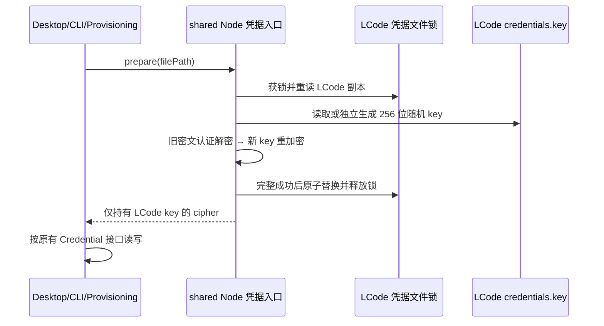

# LCode 独立随机凭据密钥与一次性迁移

## 产品规则

- LCode 的默认密钥是由操作系统 CSPRNG 生成的 32 字节随机值，不再由平台、用户名、主目录等公开信息派生。加密继续使用 AES-256-GCM，每次写入使用独立的随机 12 字节 IV 和 16 字节认证标签。
- 每个 LCode 凭据目录拥有自己的 `credentials.key`，内容为版本化 JSON，使用私有文件原子写入（POSIX mode 0600；Windows 继承用户目录 ACL）。密钥不进入日志、RPC、远端同步、导出日志或仓库。不同机器及数据目录独立生成密钥。
- `LCODE_CREDENTIAL_SECRET` 是显式覆盖入口，要求至少 32 字节，按 LCode v2 专用域标识与完整原值计算 SHA-256 后作为 AES key，使配置相同文本时也不复用 ZCode 的 AES key。长度校验不等于熵保证，默认随机密钥是推荐方式。弱配置报稳定错误，不降级到可预测密钥。`ZCODE_CREDENTIAL_SECRET` 仅供迁移读取旧密文，绝不作为 LCode 的新写入密钥。
- 新密文采用 `enc:lcode:v2:`，日常 cipher 只接受该格式及历史明文，不接受旧 `enc:v1:`。已有 v2 密文对应的 key 丢失、损坏或覆盖不匹配时必须失败，不能生成新 key 掩盖丢失。
- 同步给远端的是原有 allowlist 中的凭据内容，远端凭据服务再使用远端 LCode 自己的密钥加密。密钥文件从不跨 Environment 传输。Desktop continuous 与手机 replayable 的投递语义不变。

## 唯一所有者与接口

- `packages/shared/src/node/` 的 Node-only 凭据入口唯一负责密钥生成、格式验证和一次性迁移；通过 `@lcode/shared/node` 供 services 与 CLI adapter 使用。
- `prepareLCodeCredentialStore(filePath, { env? })` 异步获取独立 cipher，并在返回前完成该凭据文件迁移。使用与现有 Credential Store 相同的 `withFileLock(filePath)`，锁内重读，完整转换成功后原子替换。
- 密钥文件初始化再按 `withFileLock(keyFile)` 串行执行，锁序固定为凭据文件 → key 文件，防止自定义的不同凭据文件名在同一目录竞争生成并覆盖 key；保留的 `credentials.key` 不得作为凭据文件传入。
- services CredentialService、Provider Provisioning Source 和 CLI SharedLCodeCredentialStore 必须等待 prepare，然后才读取或写入。prepare 必须在其正常写事务加锁前完成，避免嵌套锁。
- cipher 是内存能力，仅执行同步加解密；密钥文件 IO 与迁移全部异步。CLI 无调用者的同步凭据读取导出随本改动移除，禁止另建同步密钥读取路径。

## 迁移与失败边界

1. 只处理调用方明确传入的 LCode 凭据文件，拒绝 `.zcode` 目录路径；不访问、不写入 ZCode 原文件或配置。
2. 锁内读取凭据副本及 LCode key。无 key 且无 v2 密文时生成随机 key；有 v2 且 key 丢失则停止。
3. 对旧 `enc:v1:` 按既有 LCode 显式 secret、LCode 机器派生规则、ZCode 显式 secret、ZCode 机器派生规则尝试认证解密。这些旧规则只存在于迁移器内。
4. 全部旧条目解密后用独立 LCode key 重加密。历史明文同样加密；旧 `zcodejwttoken` 在新键缺失时补 `lcodejwttoken`。已为 v2 的条目保持密文不变。未知非字符串字段原样保留，由既有调用方 schema/allowlist 决定是否拒绝，保持 Provisioning allowlist 行为。
5. 任一所需转换失败不替换凭据文件，不记录明文，不清空 store。进程中断若仅留下新 key，下一次仍可读取旧密文并继续迁移。
6. 幂等依据是凭据文件自身的 v2 格式，不使用额外完成标记或超时。并发 Host/CLI 共用文件锁，新 writer 必须等待迁移完成；锁内重读避免覆盖其它提交。
7. 后续更改显式 secret 不属于自动轮换；与已有 v2 不匹配时保留文件并失败。ZCode 保持原密钥及原文件独立读写。

## 验收

- 相同明文在两个 LCode 数据目录下由不同随机 key 加密，彼此不能解密；公开机器信息及旧 ZCode key 不能解密 v2。
- ZCode 副本及此前 LCode 派生密文均能一次性迁移；源文件字节不变；重入不改变已迁移密文或 key。
- 支持显式强 secret；弱 secret 拒绝；ZCode secret 不改变 LCode 新写入 key。
- 密文篡改、未知旧 key、损坏/丢失 key、错误 JSON、非法 v2 均不得覆盖原凭据。
- 并发首次准备得到同一 key，迁移与正常写入不丢条目；缺失凭据文件保持为空，不凭空导入 ZCode 数据。
- services 与 CLI 双向互读；Provider Provisioning 从旧副本成功读取 allowlist，信封不含 key 文件内容。
- 日志导出排除 `credentials.key`。运行相关 Node 测试、根 typecheck/lint、CLI typecheck/lint 及 architecture check；真实安装包的 SSH 重连需使用新构建验证。

## 本次验证（2026-10-19）

- `node --import tsx --test packages/shared/src/node/lcodeCredentialStore.test.ts scripts/lcode-credential-isolation.test.mjs scripts/lcode-brand-migration.test.mjs`：21 项通过，包含独立 Node 进程竞争同一个凭据文件、同目录不同文件名竞争 key 及目录链接隔离。
- 根 `pnpm typecheck`、`pnpm lint`、`pnpm architecture:check --changed` 通过，架构 baseline/new 均为 0。
- `pnpm --dir apps/lcode-cli typecheck` 通过；CLI lint 退出码为 0，报告 8 条已有内存模块未使用导入警告。Turbo 另有 workspace 不在 lockfile 的警告，未改动无关依赖或模块。
- 测试运行于 Windows；没有重写真实凭据、替换安装包或执行真实 SSH 重连。macOS/Linux 的原生文件权限与打包实测留待发布验证。
- 涉及 shared（唯一 key/迁移 owner）、services、lcode-cli、desktop；首次准备必须先完成迁移再进行正常读写，原有业务状态所有者不变。本次 14 个文件新增 840 行、删除 229 行，净增 611 行，主要为迁移保护、测试及规格。
