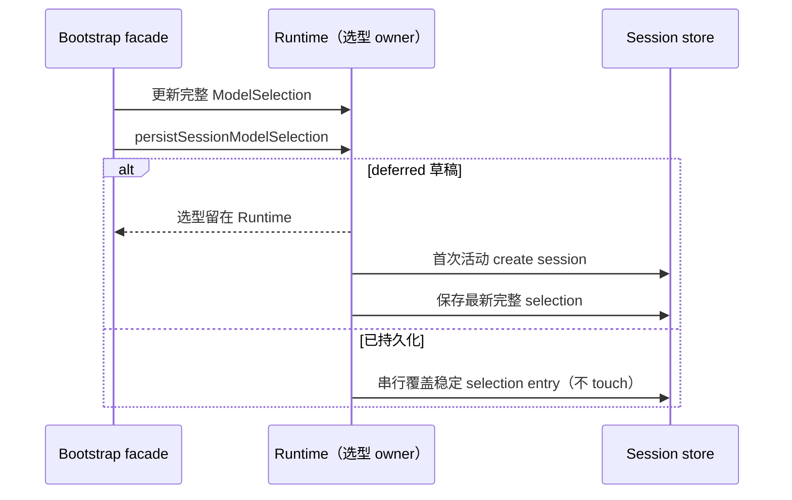
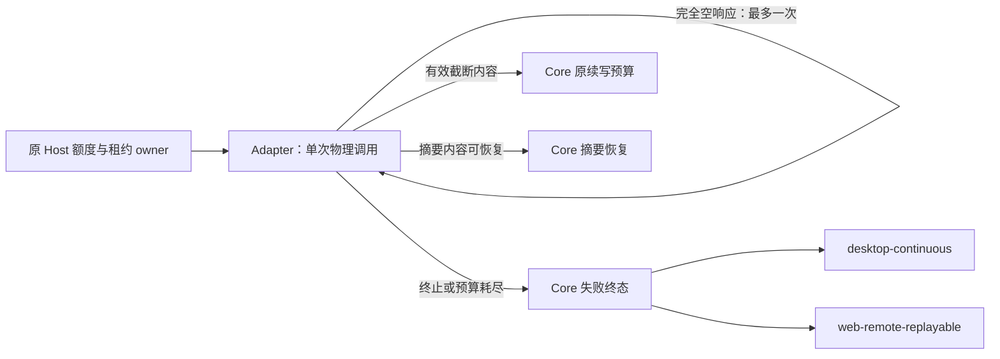

# 模型请求失败全链路排查与系统性修复方案

2026-10-22，承接日志调查及 `oauth-routing-quota-refresh.md`。状态：**排查与待实施方案，未修改行为代码**。以当前检出源码及本地 magpie `d9c6a60d` 为对照；日志对应的已打包客户端构建版本尚未确证。本文中的修复规则和接口是实施目标，不表示已经交付。

## 排查结论与证据等级

原日志 7,147 条、34 轮任务：6 完成、16 失败、12 取消。93 条 error 包含多层重复及正常取消，不能作为独立故障数。已经逐类核对全部 warn/error 事件。

| 问题                       | 现场事实                                                                                                                        | 源码与复现结论                                                                                                                                          | 尚缺证据                                                                              |
| -------------------------- | ------------------------------------------------------------------------------------------------------------------------------- | ------------------------------------------------------------------------------------------------------------------------------------------------------- | ------------------------------------------------------------------------------------- |
| GPT 空响应                 | 7 轮、56 次，均为 `max_output_tokens`，均只有 start / start-step / finish-step / finish 四类事件                                | 当前 Codex 原生驱动删除出站 `max_output_tokens`；AI SDK 会把“终态 output 有正文但缺少 delta”和“终态确实空”映射为相同空结果，两者均已本地复现            | 现场原始 SSE 终态类型、output item 结构、usage 是否存在、最终出站参数、实际客户端构建 |
| 空响应恢复放大             | 每轮约 8 次物理调用后失败                                                                                                       | adapter 允许一次空响应重试；Core 对 length 再续写三次，因此可形成 `(1+1)×(1+3)=8`                                                                       | 无；放大链源码与现场吻合                                                              |
| 自动压缩重试越界           | `reserve-unverifiable` 的不可重试错误仍进入三次 auto compact；一次长压缩约 11 分钟                                              | `isAutoCompactRetryableError` 只识别 CoreError，其它 Error 默认 true；用 `context.retryable=false` 的真实 adapter error 复现三次请求摘要                | 供应商瞬态故障的原始终态不完整；不能把 11 分钟全部归为同一错误                        |
| 额度预留阻断               | 37 次请求级 `reserve-unverifiable`、9 轮业务失败                                                                                | 当前已有请求前刷新、合并 flight、代次校验及未确认借记保护；相关回归通过。不能据旧日志断言当前刷新未生效                                                 | 失败当时读数版本、quality、age、资源 scope、held/available、probe 与发布构建          |
| 路由反馈未确认             | 65 次，有界反馈后仍未确认                                                                                                       | 当前反馈日志没有 HTTP status、失败阶段和安全错误类别，无法区分过期票据、owner-stale、schema、网络及关闭                                                 | 每条反馈的 attempt 关联、HTTP status、安全原因、物理/归一双终态                       |
| 长期额度仍重试             | 15 次 Antigravity 429，提示 Individual quota reached，重置约 168 小时                                                           | 已知 `insufficient_quota` 分类为不可重试；只有通用数值 429 的长期配额错误仍可重试，已合成复现。这是错误语义在供应商边界不完整，不能只增加 OpenAI 业务码 | 原始厂商结构化 quota/reset/scope 字段；日志只保留了归一消息                           |
| 草稿模型配置保存失败       | 33 个 deferred 草稿、66 次外键失败                                                                                              | bootstrap 直接 saveSessionEntry 时没有 session 父行；Runtime 另有同类型写入口。重复所有者和草稿生命周期边界已确认                                       | 无；不需要数据库 migration                                                            |
| 日志泄露内容且缺少关键诊断 | 16 条 SDK warning 共 3,652,032 字节，约占文件 42.7%；token 字段全部脱敏                                                         | warning 自由文本嵌有完整历史推理；redactor 对字段名 token 一刀切。还会把 undefined 的 token 字段显示为 Redacted，使缺失与真实零无法区分                 | 原始 usage 已不可从这份文件恢复                                                       |
| 上游与辅助请求失败         | 47 次“无可用模型通道”503，另有 502/503/timeout；2 次 read_session_context 400                                                   | 503/网络失败确实来自请求链；400 仅记录通用拒绝文案，不能确认是参数、上下文还是供应商约束。工具随后完成与其本地摘录降级路径一致                          | 安全业务码、字段路径、请求结构摘要与辅助调用的模型能力配置                            |
| 工具与其它警告             | 3 次 Edit 拒绝；5 次 inactive session read；5 次冷合并 checkpoint 警告；1 次 iterator.return 清理失败；156 次快速档位未确认警告 | 两次未读文件、一次 old_string 不存在属于工具约束生效；checkpoint 警告是保留未知旧事实；取消和 background failure 多层重复。其它不能据次数认定为主故障   | session read 的调用/恢复顺序；清理异常与主错误的因果关联；fast 档位的上游确认         |

日志没有崩溃或 OOM 的直接证据；内存样本峰值约 367 MiB 不构成内存泄漏结论。进程启动次数也不能单独作为崩溃次数。

## GPT：参数、协议转换与上游的判定

当前链路：`turn-model-step.ts` 按模型声明及剩余上下文选择预算 → adapter option map 生成 Responses 请求 → Host 只转发与调度 → `native/openai-request.ts` 为 Codex 删除输出上限，规范化 input/reasoning → 原生驱动透传 SSE → `@ai-sdk/openai` → Runtime。

1. **请求参数没有证实为现场根因。** 当前主请求默认使用模型声明输出上限，未知时 fallback 32K，preflight 按剩余上下文裁剪。更关键的是，合成请求送入真实 `OpenAIAuthDriver` 后，最终出站没有 `max_output_tokens` 或 `max_completion_tokens`。因此提高 Core 的数值不能保证改变 Codex OAuth 的真实出站请求。标准 OpenAI API、Codex OAuth 必须按 endpoint 能力分别验证，不能统一删参数或统一加参数。
2. **结束原因映射本身正常，正文来源存在兼容盲点。** 当前 SDK 将 `incomplete_details.reason=max_output_tokens` 映射为 length，并读取终态 usage；终态 schema 没有消费完整 output 来补发缺失的正文 delta。标准 delta 流正常；只有终态 output 的合成流，SDK 输出与现场完全一致的四类空事件。这证明存在兼容路径，但没有证明现场就是该路径。
3. **“无 usage”不等于“实际消耗零”。** `normalizeUsage` 保留 undefined，但空响应判定累加时缺失按 0 处理，日志脱敏又掩盖了字段是否存在。需要区分 missing / reported-zero / reported-positive / invalid。官方说明也明确：输出预算包含隐藏推理和其它不可见 token，可能先耗尽预算再产生可见正文；因此不能仅按正文为空推断零消耗。
4. **历史推理 warning 不足以解释首轮失败。** 跨供应商历史推理被 SDK 跳过会产生 warning，但日志还包含新会话首轮短输入失败，不能将全部空响应归咎于历史太长或历史推理转换。
5. **不对旧日志做无法证明的根因归属。** 标准流在本地正常，只有终态 output 和真实空终态均能得到相同现象；必须在最靠近真实网络的边界补安全摘要才能分辨。不能靠自动降思考档、换协议、重开会话或无限续写掩盖差异。

官方语义参考：[Reasoning models](https://developers.openai.com/api/docs/guides/reasoning)、[Counting tokens](https://developers.openai.com/api/docs/guides/token-counting)。官方 API 文档不能直接证明 Codex OAuth 私有 backend 接受相同参数。

## 规则与所有者

- 模型 adapter 唯一拥有物理请求重试。无正文、无推理、无工具、usage 为缺失或已报告零的异常终止，最多重试一次；仍为空时产生不可重试的 `InvalidModelResponse`，不能交给 Core 自动续写而重新获得预算。正常空 stop、内容过滤、context overflow 需按原协议语义区分，不能全部算作异常空流。有效推理/usage 的 output-limit 不能误判为坏流；其重试也受同一逻辑调用预算和无进展限制。compact 的原始流边界与降输入恢复保留。
- Core 的自动 compact 只补偿可恢复的摘要内容错误；adapter 已明确不可重试或已耗尽物理请求预算的错误不得被外层三次摘要重试放大。取消和未确认派发仍立即终止。
- Provider business code 的长期额度耗尽保持不可重试；普通 429、503 沿原 adapter 预算。请求前额度刷新继续归 Host 的 `ProviderAccountQuotas`，预留/借记/探测归原 Scheduler。不能根据刷新、TTL 或反馈失败直接放开未知消费。
- 会话模型与推理档位由 Runtime 的完整 `ModelSelection` 唯一持有，bootstrap 只校验与发命令。持久化通过 Runtime 的一个入口，使用同一个稳定 entry，配置更新不 touch 会话活动时间。
- deferred 草稿没有 session 父行时只更新 Runtime，不提前创建会话或写外键 entry；首次真实活动创建父行后保存最新完整选择。已持久化会话的配置立即保存，失败生产日志可追踪。并发配置保存必须按同一 owner 的调用顺序完成，避免旧选择覆盖新选择。
- SDK warning 的自由文本可能含完整历史及凭据，生产日志只保留类型、功能、数量与文本长度；列表和标识有界，不复制原始 message/details。数值 token 统计使用明确字段白名单，有限非负数字可见，其它 token/密钥字段继续脱敏。
- 路由反馈只对不可变 usage 做有界幂等重试，终态日志包含阶段、次数、HTTP 状态或安全错误分类；不记录 URL、凭据、正文，不重放模型 POST。

## 实施顺序与接口边界

### 第一批：先恢复证据与限制放大

- 在 `provider-node` 原生网络边界生成安全的出站摘要：logicalCallId / attemptId、driver 版本、SDK 版本、build revision、配置 revision、真实协议、stream、模型、reasoning 档位、请求前后输出上限与 removed 字段枚举；input 只记录 item 类型及数量、工具数量、估计长度，不记正文。
- 原始 SSE 仅在 adapter 内观察与归一化，不新建 UI/Host 业务状态。记录终态事件是否存在、类型、status、incomplete reason、output 类型/数量、usage presence、数值统计、原始与归一 delta 数量。读数有来源，不把 unknown 写成零。使用有界记录并避免缓冲完整流或完整历史。
- 统一失败契约，复用现有 ModelErrorCode / context 传播，补齐必要的 `retryDisposition`、已消耗物理 attempts、exhausted、dispatch certainty、output committed、恢复阶段与安全供应商原因。跨模块契约先更新，所有调用方只读归一事实，不识别 Error 类名或 message。
- `compact-summary-model-request.ts` 的 stream→generate fallback 与 `compact-active.ts` 的外层重试都读取同一失败契约。终止、取消、未知派发、已耗尽预算不能因更换 transport 或外层摘要重新获得预算；摘要内容验证失败可在原 operation 内修复。保留真实 context-too-long 的降输入恢复，与服务不可用分别计数。
- 先加失败回归证明“连续空 length 至多两次”和“不可重试 compact 只尝试一次”，再改实现。按 logicalCallId 汇总一条最终失败，逐 attempt 决策留 debug；正常取消不记为 error。

### 第二批：依据原始结构修协议兼容

- 如果终态包含完整有效 output、delta 缺失：在原 adapter/driver 的单一 Responses 归一化入口处理，使用 responseId + itemId + outputIndex 对账，文本只补未提交后缀，工具调用只生成一个调用事实，reasoning/encrypted metadata 保持来源；已提交冲突数据产生协议错误，不能盲目拼接或执行两次工具。
- 如果终态 output 真为空：按 invalid empty / genuine reasoning limit / upstream failed 分类，有界失败，不制造文本或工具。missing usage 仍保留未知消费，不反馈成功或零消费来释放预留。
- 如果没有合法终态：记 incomplete transport，不当作正常结束；已提交输出的流不整次重放，沿现有恢复边界处理。
- 标准 API 的请求上限与 reasoning 预算按模型能力验证；Codex 的有效字段按原生端点实测契约验证。只改经过合成样例和端点证据证明的转换，不依据模型名猜固定参数。

### 第三批：额度、反馈和辅助调用

- 复用现有 `prepareRouting`、Scheduler 与反馈索引，在 admission 拒绝时记录 scope、reading revision/age/quality、required/available/held、probe 状态和 dispatch=unsent。先核对客户端是否包含现有额度刷新提交，再判断哪个资源阻断；不清空未知借记、硬绑定或恢复许可。
- 将 Antigravity/其它供应商的配额语义保留在各自 adapter 边界：优先读取上游结构化原因、scope、resetAt 和 RetryInfo，再归一为长期耗尽/短时限流。缺失结构化字段的已知兼容格式只在对应驱动有限解析并有固定样例测试；Core 不匹配英文或中文消息。不能把所有 429 或所有长 Retry-After 一律定为长期配额。
- 反馈使用原 attempt 的不可变数据及原票据，只有确有租约/可能派发的请求才反馈。未派发 admission 拒绝不制造一次 owner-stale 反馈。双终态未确认保守保留；幂等重试不顺延冷却、不新增 accepted 队列。对 400/403/409/429/5xx/timeout/owner shutdown 分别记录安全原因。
- ReadSessionContext 的 400 先保留 provider code、字段路径、请求形状、预算和模型能力；继续返回已有本地摘录并标明 source/truncated/degraded。没有原始拒绝结构之前，不武断修改 tools、reasoning 或历史裁剪规则。
- inactive session read 区分 stored-but-cold / deferred / deleted / wrong Host/identity；调用方按照既有 resume/lease 入口处理，不在只读 handler 隐式新建 Runtime。不删除 checkpoint 等未分类旧事实。

### 第四批：会话持久化与可观测性收敛

- 删除 bootstrap 的直接 session entry 写入，增加或复用 Runtime 公开持久化命令；同 owner 串行写稳定 entry。deferred 只留 Runtime，首次真实活动创建父行时保存最新完整选型。优先复用 createSession 的 initialEntries 原子边界；若沿原创建后保存，则需覆盖保存期间配置更新的顺序及失败恢复。
- 已持久化会话切模失败要区分 applied-in-memory / persisted / failed，不能把 model.updated 伪装成已落库。保持 touchSession=false，不为切模型把空草稿显示为真实历史会话。
- warning 不记录 message/details 原文，按 type/feature 聚合，限制条数和标识长度；token 白名单仅放行合法有限非负数字及明确 presence 枚举，不能放行 accessToken、token 数组或字符串。
- fast 档位未确认属于未确认事实，不能宣称已加速，也不应每个工具轮次产生一次重复生产 warning。iterator.return 清理失败作为 secondary error 关联原主错误，不能覆盖原终态。正常取消与 background turn 的镜像事件按同一 failureId 关联。

上述四批可独立审查，但第一批契约和证据须先完成；第二批按实际协议证据决定具体分支。无需新增 UI 设置、数据库 migration、调度服务或第二份队列。

两种客户端继续消费同一 Runtime 的事件与持久化事实；连接恢复不重新获得模型重试预算、不重放 POST。owner/lease、跨 Host 路由和 stale run 防护沿用现有边界。

## 借鉴边界

检查本地 magpie `d9c6a60d`，可借鉴点与适用限制如下。

| 实现                                         | 可借鉴点                                                          | 在 zcode 的边界                                                                            |
| -------------------------------------------- | ----------------------------------------------------------------- | ------------------------------------------------------------------------------------------ |
| `internal/gateway/maxoutput.go`              | 已知模型使用真实声明预算，避免统一固定 16K 裁剪隐藏推理           | zcode 已按模型声明选预算；Codex 出站又会删除该字段，不能把 magpie 的数字策略直接当作修复   |
| `internal/gateway/gathered.go`               | 用 item/index 对账流结果与最终 output，缺少完整终态就报错         | 这是非流式请求的 SSE 聚合，不直接解决 zcode 流式仅有终态 output 的场景；借鉴对账和去重原则 |
| `internal/gateway/whole_stream.go`           | 将完整 JSON 转成对应协议的原生事件，保留 item/block/part          | 可作为兼容响应的实现参考；只有确认真实响应是 JSON 或终态独占内容后才启用相应转换           |
| `internal/gateway/routing.go`、`fallback.go` | 区分 quota、credit、短时 rate limit，以及原请求不可恢复与可换线路 | zcode 采用驱动边界的结构化分类；不照搬通用文案正则、自动换线或陈旧额度放行                 |
| `internal/gateway/gateway.go`                | 区分可见内容、usage、正常空结束和 length/filter                   | magpie 明确不把 length 直接算普通空回复；zcode 还需单独限制无进展 length 的恢复预算        |

按 zcode 的既有类型、owner 和保守记账实现，不复制 Go 代码，不引入新依赖。当前注册表已提供模型输出预算，不增加未经证实的固定 GPT 参数或自动切换协议。

## 验收

1. generate / stream 连续异常空 length 响应至多两次调用，失败不可重试，不产生第三次请求；临时空响应后正常结果可恢复；真实隐藏推理、usage 缺失/零/正数、正常空 stop、filter、context overflow 分别覆盖，取消不重试。
2. compact 对 adapter 不可重试及预算耗尽只调用一次摘要操作；可恢复摘要内容失败仍按原三次上限。长期配额业务码与普通限流分别验证。
3. 草稿切模型/推理不写数据库、不创建父行；首次活动保存最终完整选择；已存在会话立即保存且并发写不倒序，不改活动时间。
4. warning 携带大段历史和密钥时生产日志不出现原文且总量有界；token 数字诊断可见，字符串、负数、非有限值及未知 token 字段仍脱敏。
5. 反馈成功、4xx、5xx、网络失败和取消有可区分的安全诊断；最多三次反馈、一次模型 POST，未确认借记不释放。执行现有额度刷新、远端 provider、流式工具管线回归。

6. Responses 标准 delta、只有终态 output、只有 output_item.done、重复 item、冲突正文、混合 text/tool/reasoning、截断 EOF、response.failed 都有端到端合成样例；断言没有丢字、重字或重复工具副作用。
7. desktop-continuous 和 web-remote-replayable 使用相同的最终失败与选择事实；断线重连只恢复投影，不重放物理请求。交互呈现若变化，补充桌面/手机 E2E 场景。

## 本轮实际验证

- 根 `node scripts/check-workspace-freshness.mjs`：通过；Node v24.21.0，pnpm 10.34.6，符合 mise。
- `pnpm architecture:check --changed`：通过，新旧违规均 0；已读取 lcode-cli/services 受控上下文。
- 根 `pnpm typecheck`、`pnpm lint`：均通过。
- 额度刷新、长流票据、路由反馈、OpenAI refresh 四组现有测试：23 通过、0 失败。
- compact 生命周期、标题生命周期、远端 provider relay 三组现有测试：通过（dot reporter）；不是本方案实施后的回归证明。
- `node scripts/test-model-stream-tool-pipeline.mjs`：159 通过、0 失败。
- 合成验证：真实 SDK 的四种 Responses 流、真实原生驱动出站字段、长期/短期 429 分类、不可重试 adapter error 被 auto compact 调用三次。均使用虚构输入与 mock fetch，没有调用真实账号或模型服务。
- 本轮只新增本方案文档，不修改运行时代码、现有本地 UI 改动或 magpie。尚未抓取现场原始 SSE，也未对新版已打包客户端进行线上复测；根因未确证的项目在上表明确列出。

真实供应商空响应的上游原因仍需新版日志的实际出站参数、原始终态结构和 usage 证明；方案目标是让失败有界、可定位，不宣称已修复供应商服务。
